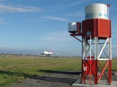
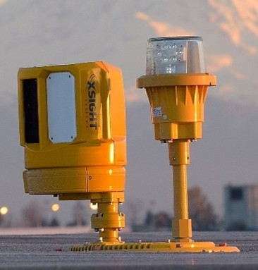
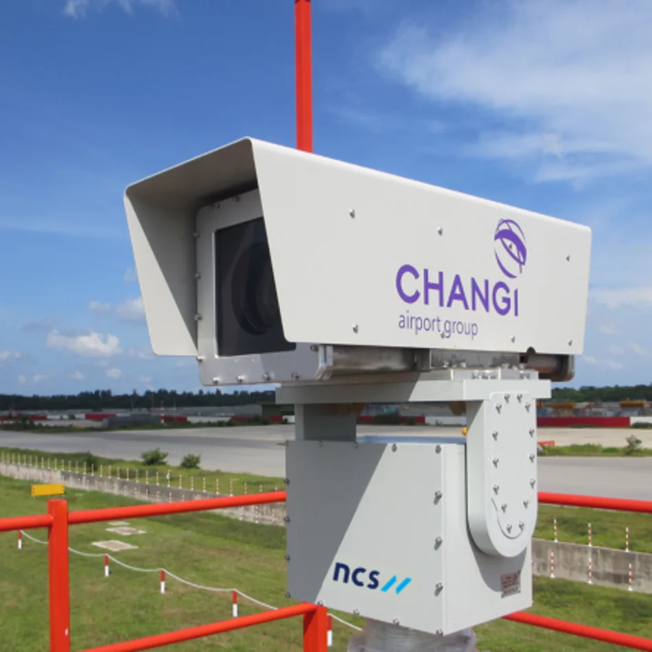
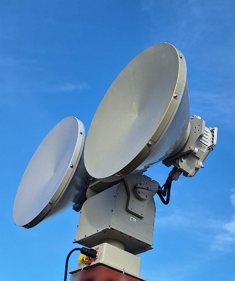
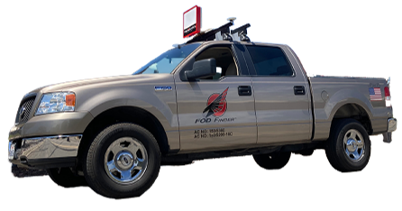

<!--
  The Report page is the complete report, assembled at build time from the canonical Markdown:
    report/introduction, report/design-overview, report/preliminary   team-wide chapter text
    report/design-overview/subsystem-division.md#<chapter>-overview    the chapter openings
    report/members/<member>/<topic>.md (its `report` region)          each section, owned by one member
    report/lead/<member>-lead.md                                      the Subsystem Lead plate under a heading
  This file only orders them: chapter (##) and section (###) headings with ids, a plate, then the source.
  Numbers come from the page styling. `prefix=` keeps each composed page's anchors unique and turns links to
  that page into links within this one (see .vitepress/compose.ts).
-->

<ReportToc />

<header class="rpt-cover">

Runway Patrol · CDE4301

<h1 class="rpt-cover__title">FOD Hunter Engineering Report</h1>
</header>

<section class="rpt-pre">

<!--@compose: ./report/preliminary/acknowledgements.md-->

</section>

<section class="rpt-pre">

<!--@compose: ./report/preliminary/executive-summary.md-->

</section>

<!-- report:start -->

<section class="rpt-chapter">

## Introduction {#introduction}

In this chapter, we discuss why runway foreign object debris (FOD) remains a problem worth solving and make the case for FOD Argus and FOD Hunter as the answer. We first revisit the loss of Air France Flight 4590, the global cost of FOD and Singapore's shrinking military manpower, before presenting interviews with the RSAF, CAAS and the project's industry partner, which showed that the current process cannot measure its own thoroughness and most often misses small rivets and screws. We then compare existing solutions and find that most detect FOD but leave removal to people, which leads to the problem statement and the decision to scope the project to military air bases. Finally, we justify a two-robot approach using Öztürk and Kuzucuoğlu's multi-robot study, walk through the user journey, and close with seven stakeholder needs that Chapter 2 turns into requirements and specifications.

<!--
ARCHIVED, previous Chapter 1 (the team's earlier sections, kept for reference and untouched on disk).
To bring a section back, move its line below out of this comment and change "ARCHIVED-COMPOSE" to "@compose".
Their old anchors (#primary-research, #secondary-research) are kept as the invisible spans below so existing links still land on this chapter.

ARCHIVED-COMPOSE: ./report/introduction/problem-statement.md#report{shift=2,prefix=pstate}      (was 1.1 Problem Statement)
ARCHIVED-COMPOSE: ./report/introduction/primary-research.md#report{shift=2,prefix=primary}      (was 1.2 Primary Research)
ARCHIVED-COMPOSE: ./report/introduction/secondary-research.md#report{shift=2,prefix=secondary}  (was 1.3 Secondary Research)
ARCHIVED-COMPOSE: ./report/introduction/problem-scope.md{shift=1}                                (was 1.4 Problem Scope)
ARCHIVED-COMPOSE: ./report/introduction/competitive-analysis.md{shift=1}                         (was 1.5 Competitive Analysis)
ARCHIVED-COMPOSE: ./report/introduction/user-journey.md{shift=1}                                 (was 1.6 User Journey)
-->

### The Problem {#problem-statement}

On 25 July 2000, Air France Flight 4590 struck a 435 mm titanium wear strip on runway 26R at Paris Charles de Gaulle. The strip had fallen from a Continental Airlines DC-10 that departed five minutes earlier. Tyre debris ruptured a fuel tank, and the resulting fire brought the Concorde down at Gonesse, killing all 109 people on board and four on the ground [\[1\]](#refs-literature-ref-1). Figure 1.1.1 shows the sequence of events and Figure 1.1.2 the strip itself.

<Figure src="./shared/assets/images/plane-on-fire.png" alt="Air France Flight 4590 on fire shortly after take-off" caption="Figure 1.1.1: Air France Flight 4590 on fire shortly after take-off." />

<Figure src="./shared/assets/images/titanium-strip.png" alt="The titanium wear strip that fell from the preceding DC-10" caption="Figure 1.1.2: The titanium wear strip that fell from the preceding DC-10 and was recovered from the runway." />

A full runway inspection scheduled for that afternoon had been postponed for a fire drill [\[3\]](#refs-literature-ref-3). Research into FOD detection and prevention increased sharply after the accident [\[4\]](#refs-literature-ref-4), and runway FOD began to be treated as a safety problem in its own right rather than a housekeeping task [\[5\]](#refs-literature-ref-5). FOD remains costly. El-Sayed places the annual cost of FOD to global aviation at US\$1.26 billion in direct damage and US\$13.9 billion once indirect costs such as delays and cancellations are included [\[6\]](#refs-literature-ref-6); an FAA study puts the upper estimate at US\$22.7 billion in 2020 dollars [\[7\]](#refs-literature-ref-7). Runway FOD is disproportionately expensive: only about 15% of FOD is found on runways, yet it accounts for up to half of FOD damage [\[4\]](#refs-literature-ref-4). Removal is still largely manual [\[5\]](#refs-literature-ref-5), and the runway must close while personnel drive out, locate and pick up each item [\[4\]](#refs-literature-ref-4).

In Singapore, the manpower behind that manual process is shrinking. The total fertility rate fell to 1.1 in 2020, and MINDEF has described low fertility as a significant structural challenge to national defence [\[8\]](#refs-literature-ref-8). In the same reply, then-Minister for Defence Dr Ng Eng Hen stated: "This relentless drive to optimise manpower must continue. Job re-design is also an important initiative to optimise our manpower resource." [\[8\]](#refs-literature-ref-8)

MINDEF has already begun trialling automated vehicles at SAF air bases and AI-enabled drones to assess runway damage [\[9\]](#refs-literature-ref-9), and the SAF projects a one-third reduction in manpower by 2030 [\[10\]](#refs-literature-ref-10). Whether this pressure translates into a real burden on the runway is a question for the people who clear FOD, so the team interviewed them.

### Who Carries the Problem {#sec-affected}

FOD affects both military and civil aviation in Singapore, through the RSAF and CAAS respectively (Figure 1.2.1), and airports worldwide face the same task with less manpower.

<Figure src="./shared/assets/images/who-rsaf.jpg" alt="RSAF personnel lined up on the airfield beside a fighter jet" caption="Figure 1.2.1a: Republic of Singapore Air Force (RSAF Facebook Page, 2024) [11]." />

<Figure src="./shared/assets/images/who-caas.jpg" alt="CAAS officers on the airside apron beside an aircraft" caption="Figure 1.2.1b: Civil Aviation Authority of Singapore (CAAS, 2026) [12]." />

Figure 1.2.2 maps the stakeholders by power and interest. The RSAF holds both, as the end user and the party that would approve deployment. CAAS has high power but less direct interest, because Changi already operates automated detection. The industry partner and insurers have high interest but limited power, and the servicemen who clear FOD carry the work but have little say over the process.

<Figure src="./shared/assets/images/stakeholder-map.svg" alt="Power–interest map placing the RSAF at high power and high interest, CAAS at high power and lower interest, the industry partner and insurance companies at high interest and lower power, and RSAF servicemen at lower power and lower interest" style="max-width: 560px; margin: 28px auto;" caption="Figure 1.2.2: Stakeholder power–interest map." />

The team interviewed four of these stakeholders in September 2026: the industry partner coordinating the project with the RSAF, an RSAF technician and an RSAF air traffic controller who had both cleared FOD during National Service, and a CAAS officer with over 20 years of experience at Changi Airport. Table 1.2.1 records what each stakeholder said in their own words. ([See interview transcripts](#appendix).)

<!-- TODO: add Table 1.2.3 (current practice and pain points per stakeholder) before Table 1.2.4. -->

*Table 1.2.1: What stakeholders said.*

<table class="data-table fit-table fit-4"><tbody>
<tr><th>Who</th><th>What they said</th><th>Sentiment</th><th>Key insight</th></tr>
<tr><td rowspan="5"><strong>RSAF technician (Appendix <a href="#appendix-b">B</a>)</strong></td><td>"Walk and broom. Walk and broom… Just a normal broom. In fact, it makes more FOD than it cleans up."</td><td>Frustration</td><td>When the sweeper contractor is off duty, crews clear about 4 km of runway on foot</td></tr>
<tr><td>"The big sweeper does not pick up the small pieces. It will always miss the small pieces."</td><td>Negative</td><td>Rivets and screws, the items that cause damage, slip past current sweepers</td></tr>
<tr><td>"The entire air base goes down to do FOD walk together… And even then it takes us one hour to clean."</td><td>Frustration</td><td>Adding people does not scale</td></tr>
<tr><td>"[A rivet] went into the prop, and then they have to replace the entire thing."</td><td>Negative</td><td>One small part can mean a costly propeller replacement (C-130 case)</td></tr>
<tr><td>"The paperwork to get it on takes so long that… once every couple months just to show for publicity, we'll fly it."</td><td>Frustration</td><td>Airspace approvals make routine drone use impractical</td></tr>
<tr><td rowspan="2"><strong>RSAF air traffic controller (Appendix <a href="#appendix-c">C</a>)</strong></td><td>"It's quite crude, but they just want to say on paper that you can do it."</td><td>Negative</td><td>Current drone checks are manual visual reviews, flown once or twice a month</td></tr>
<tr><td>"It could play a huge part into making the runway operational again."</td><td>Positive</td><td>Biggest value is faster runway recovery after a crash</td></tr>
<tr><td rowspan="2"><strong>Industry partner (Appendix <a href="#appendix-a">A</a>)</strong></td><td>"There's no fixed route around the runway. It's pretty random; they go left, right, center."</td><td>Negative</td><td>Today's inspection has no systematic coverage</td></tr>
<tr><td>"Autonomous vehicle means servicemen can be released for other critical roles, given that the armed forces is shrinking due to lower birth rate."</td><td>Positive</td><td>Autonomy frees manpower as the SAF shrinks</td></tr>
<tr><td rowspan="3"><strong>CAAS officer (Appendix <a href="#appendix-d">D</a>)</strong></td><td>"For that extra minute that I give you, I lose one traffic."</td><td>Insight</td><td>Civil runway windows are about 5 minutes; speed outweighs everything</td></tr>
<tr><td>"You want a drone, but yet you want precision. You want to be able to cover 4 km… It's not so possible."</td><td>Negative</td><td>Coverage, precision and drone payload trade off against each other</td></tr>
<tr><td>"By investing in iFerret, we effectively shaved off a lot of time… every minute is money."</td><td>Positive</td><td>Automated detection pays for itself in runway time, but alerts still need a human to validate</td></tr>
</tbody></table>

Three findings run across the interviews. First, the burden is heaviest at military air bases, where removal still depends on people walking or driving the runway (see Appendices [B](#appendix-b) and [C](#appendix-c)), whereas Changi already has automated detection and runway windows too short for a slow vehicle (see Appendix [D](#appendix-d)). Second, the FOD that matters most is small and hard (rivets, screws, nuts, stones) and is the type most often missed (see Appendices [A](#appendix-a) and [B](#appendix-b)). Third, drone flights on an active airfield require closure or special permission (see Appendices [B](#appendix-b) and [D](#appendix-d)). The next question is whether existing solutions already close this gap.

### Competitive Analysis {#competitive-analysis}

Existing solutions fall into three groups: those that only detect FOD, those that only collect it, and the few that attempt both. Detection has advanced considerably, from visual patrols to radar and camera systems, but removal has not kept pace [\[5\]](#refs-literature-ref-5).

#### Detection Only {#comp-detection .rpt-l3}

*Table 1.3.1: FOD detection systems.*

<table class="data-table fit-table fit-img"><tbody>
<tr><th></th><th>System</th><th>How it works</th><th>Shortcomings</th></tr>
<tr><td></td><td><strong>QinetiQ Tarsier</strong></td><td>Stationary radar detects; a camera pans to confirm <a href="#refs-literature-ref-13">[13]</a></td><td>Radar cannot classify FOD and is sensitive to ground clutter</td></tr>
<tr><td></td><td><strong>Xsight FODetect and RunWize</strong></td><td>Radar and optical sensors mounted along the runway edge lights, with laser illumination <a href="#refs-literature-ref-13">[13]</a></td><td>Hardware-intensive deployment along the full runway</td></tr>
<tr><td></td><td><strong>iFerret 2.0 (Changi)</strong></td><td>Fixed AI-powered cameras detect and verify FOD visually <a href="#refs-literature-ref-13">[13]</a> (see Appendix <a href="#appendix-d">D</a>)</td><td>Vision degrades in poor visibility such as haze (see Appendix <a href="#appendix-d">D</a>); costly cabling; alerts need a human to validate (see Appendix <a href="#appendix-d">D</a>)</td></tr>
<tr><td></td><td><strong>ELVA-1</strong></td><td>Stationary radar</td><td>Long scan time of about 3 minutes<!-- TODO: add citation --></td></tr>
<tr><td></td><td><strong>Trex FOD Finder XM</strong></td><td>Radar mounted on a vehicle <a href="#refs-literature-ref-13">[13]</a></td><td>Intermittent scanning; needs a driver at all times</td></tr>
</tbody></table>

Fixed systems detect FOD well. At Boston Logan, the detection system logged 86% of runway detections over 17 months, more than six times as many as vehicle and visual inspection [\[7\]](#refs-literature-ref-7). Installed costs of US\$1.7–6.4 million have been reported [\[7\]](#refs-literature-ref-7). However, all of these systems stop at detection, and a person must still enter the runway to remove the object [\[5\]](#refs-literature-ref-5) (see Appendix [D](#appendix-d)).

#### Collection Only {#comp-collection .rpt-l3}

Collection is still done by specialised vehicles towing friction drag mats, by sweeper trucks, or by hand. These methods remove FOD without first locating it, so they offer no record of what was collected or missed, and sweepers often miss the small hard items the interviewees described (see Appendix [B](#appendix-b)).

<!-- TODO: add Figure 1.3.2.1 as three images side by side in a .fig-row: friction-drag-mat-vehicle.jpg "Figure 1.3.2.1a: Specialised vehicle with friction drag mats [source].", manual-sweeping-1.jpg "Figure 1.3.2.1b: Manual sweeping [source].", manual-sweeping-changi.jpg "Figure 1.3.2.1c: Manual FOD pickup at Changi Airport [source]." (images not in the project yet) -->

#### Detection and Collection {#comp-both .rpt-l3}

Autonomous removal is only now reaching the market. Roboxi, a Norwegian multi-function airside robot, claims to detect and pick up FOD whilst also inspecting pavement and runway lights, and began a four-month trial at Berlin Brandenburg in 2026 [\[14\]](#refs-literature-ref-14), [\[15\]](#refs-literature-ref-15). Its cost has not been published, and no independent data on its detection or removal performance is yet available. Removal is therefore no longer an empty niche, and FOD Hunter cannot claim to be the first system to remove FOD. Its case has to rest on how it removes FOD and for whom.

<!-- TODO: add roboxi.jpg as Figure 1.3.3.1: "Roboxi autonomous airside robot [15]." (image not in the project yet) -->

#### Competitor Map {#comp-map .rpt-l3}

Figure 1.3.1 places each solution by detection and collection performance. Fixed systems sit high on detection but offer no collection; drag mats and manual sweeping collect but do not detect. Only Roboxi and the proposed system sit in the upper-right quadrant, and Roboxi's position there is based on its manufacturer's claims rather than published results.

<IntroductionWidget1 />

*Figure 1.3.1: Competitor map, detection performance against collection performance.*

<!-- TODO: static version competitor-map.png (not in the project yet), for a printed copy of the interactive map above. -->

### Problem Statement and Scope {#problem-scope}

Taken together, the literature and interviews define the problem as follows. RSAF air bases rely on servicemen walking or driving the runway to find and remove FOD. The process is manpower-intensive, has no measure of thoroughness, and most often misses the small hard objects that cause the most damage, while the manpower behind it is shrinking.

The project is scoped for low to medium air traffic airports with limited manpower, such as our military airports in Singapore. Civil airports such as Changi are out of scope for now, because their runway windows of about five minutes are too short for a slow autonomous vehicle (see Appendix [D](#appendix-d)) and they already operate automated detection. Within this scope, the project aims to show that a drone and a ground robot working together can detect and remove small FOD from a section of runway without a person entering it.

### Why a Multi-Robot Approach {#sec-multirobot}

A single robot forces a trade-off between coverage and capability. A drone surveys a wide area quickly but cannot pick up debris, while a ground robot can remove debris but covers ground slowly. Splitting the task lets FOD Argus survey the runway from the air and direct FOD Hunter only to confirmed targets, rather than sweeping the full runway.

Öztürk and Kuzucuoğlu provide the strongest quantitative case for coordinating multiple robots [\[4\]](#refs-literature-ref-4). In simulations at Istanbul Atatürk Airport, ten coordinated ground robots collected ten randomly distributed FOD items in 320 s, against 1,623 s for a single manual follow-me truck. Figure 1.5.1 shows their five-year cost comparison across usage frequencies: over 500 collection runs, the ten-robot system cost US\$10.0 million against US\$19.5 million for one manual truck, a saving of about US\$9.5 million.

<IntroductionWidget2 />

*Figure 1.5.1: Five-year cost sensitivity across usage frequencies, ranked row by row (green cheapest, red most expensive). Redrawn from Öztürk and Kuzucuoğlu [\[4\]](#refs-literature-ref-4).*

*Table 1.5.1: Five-year cost at 500 collection runs [\[4\]](#refs-literature-ref-4).*

| | ASP3, 10 robots | Manual, 1 truck |
| --- | --- | --- |
| Delay cost per run | US\$16,205 | US\$36,698 |
| Delay cost × 500 runs | US\$8,102,500 | US\$18,349,000 |
| Base cost | US\$1,905,000 | US\$1,125,000 |
| **Five-year total** | **US\$10,007,500** | **US\$19,474,000** |

The study also has limits that matter here. The saving rests almost entirely on runway closure time valued at US\$1,500 per minute, a civil airport assumption; Figure 1.5.1 also shows that the manual truck remained cheapest at low usage of under 50 runs; and the robots relied on fixed sensors for detection [\[4\]](#refs-literature-ref-4). The RSAF context differs: the industry partner indicated that cost is rarely the deciding factor and that the binding constraint is manpower (see Appendix [A](#appendix-a)). The case for this project therefore rests on freeing personnel and reducing runway downtime, with the cost result as supporting evidence rather than the main claim.

### User Journey and Demonstration {#user-journey}

Figure 1.6.1 shows the intended operating cycle in six steps.<!-- TODO: confirm the steps against the team's final operating concept. -->

<Figure src="./shared/assets/images/user-journey.jpg" alt="Six-panel illustration: FOD on the runway, aerial scanning by the drone, data transmission to the rover, ground navigation to the target, pickup by the sweep and vacuum system, and return to home with the drone landing on top" caption="Figure 1.6.1: FOD Hunter × FOD Argus user journey (concept illustration)." />

1. **FOD on the runway.** Bolts, nuts, screws, stones and dead birds lie on the runway, posing a risk to aircraft.
2. **Aerial scanning.** During a scheduled inspection or closure window, FOD Argus flies a pre-planned path and flags candidate FOD with its location.
3. **Data transmission.** FOD Argus sends the locations to the ground station, where the operator confirms each flag and filters false positives such as bird droppings.
4. **Ground navigation.** FOD Hunter drives to each confirmed location and verifies the target with its onboard sensors.
5. **Pickup.** FOD Hunter removes the item with the sweep box and vacuum.
6. **Return to home.** FOD Hunter returns to its base, and FOD Argus lands on top. Each item is logged with its location and time, giving the RSAF a record of thoroughness that the current process lacks.

The video below demonstrates the first stage in simulation: FOD Argus launches and patrols the runway on a pre-planned path whilst FOD Hunter waits on standby, before being dispatched to each reported target.<!-- TODO: state what the demonstration shows end to end and what remains to be shown on hardware. -->

<VideoClip src="./shared/assets/videos/fod-hunter-argus-demo.mp4" poster="./shared/assets/images/fod-hunter-argus-demo-poster.jpg" caption="Video 1.6.1: Simulated demonstration of FOD Hunter × FOD Argus in Gazebo." />

### Value Proposition {#sec-vps}

<Figure src="./shared/assets/images/vps-render.jpg" alt="Concept render of FOD Hunter on a runway at sunset with FOD Argus flying above it" style="max-width: 760px; margin: 28px auto;" caption="Figure 1.7.1: Concept render of FOD Hunter with FOD Argus (illustrative, not the built prototype)." />

Our value proposition statement is as follows. For low to moderate air traffic airports that struggle with effective use of manpower, our automated solution detects and removes FOD from the runway, while staff focus on more critical jobs. Unlike the current manual, time-consuming and laborious processes of clearing FOD, the system works autonomously, targets the small hard objects that are most often missed, and logs every item it handles.

Figure 1.7.2 sets out the value map and customer map, and Figure 1.7.3 shows the value proposition fit, in which each customer pain and gain is answered by a feature of the system. Table 1.7.1 maps each stakeholder need to the feature that addresses it. Chapter 2 carries these features through to requirements and specifications.

<Figure src="./shared/assets/diagrams/value-map.svg" alt="Value map: products and services, gain creators and pain relievers" caption="Figure 1.7.2a: Value map." />

<Figure src="./shared/assets/diagrams/customer-map.svg" alt="Customer map: jobs, gains and pains" caption="Figure 1.7.2b: Customer map." />

<Figure src="./shared/assets/diagrams/value-proposition-fit.svg" alt="Value proposition fit: the value map on the left answers the customer map on the right" style="max-width: 760px; margin: 28px auto;" caption="Figure 1.7.3: Value proposition fit. Each customer pain and gain is answered by a feature of FOD Hunter and FOD Argus." />

*Table 1.7.1: Need-to-feature mapping.*

| ID | Stakeholder need | Source | Feature |
| --- | --- | --- | --- |
| N1 | Release servicemen from routine FOD clearance | Appendices [A](#appendix-a) and [B](#appendix-b) | Autonomous detection and removal |
| N2 | Catch small hard FOD that sweepers miss | Appendices [A](#appendix-a) and [B](#appendix-b) | Close-range verification and vacuum pickup on FOD Hunter |
| N3 | Clear larger debris such as bird carcasses | Appendices [C](#appendix-c) and [D](#appendix-d) | Sweep box on FOD Hunter |
| N4 | Measurable thoroughness | Appendix [A](#appendix-a) | Logged detections and removals per run |
| N5 | Repeatable coverage | Appendix [A](#appendix-a) | Pre-planned survey path for FOD Argus |
| N6 | Faster checks and runway recovery | Appendix [C](#appendix-c) | Aerial survey cues ground removal in parallel |
| N7 | Operate within airspace restrictions | Appendices [B](#appendix-b) and [D](#appendix-d) | Drone flights limited to closure windows; ground-only fallback |

These seven needs, together with the insights from our primary research (the interviews) and secondary research (the literature and existing solutions), are the starting point for the design. In Chapter 2, they are developed into the features, requirements and specifications that FOD Hunter and FOD Argus must meet to answer each need, and each of these is traced back to the need and the evidence behind it.

</section>

<section class="rpt-chapter">

## Overview of Design {#overview-of-design}

In this chapter, we discuss how the seven stakeholder needs from Chapter 1 become the design of the system. We first describe the system concept, in which FOD Argus surveys the runway, an operator confirms each flag and FOD Hunter removes and logs each item. We then state the six features of FOD Hunter and FOD Argus working together and the ten features of FOD Hunter alone, each justified by the interviews and tied to the needs it answers. Next, we set out the requirements for FOD Hunter by subsystem, with each requirement addressing a feature and mapped to the specification that meets it, and we flag the values that still conflict between pages. Finally, we show how the work is divided between the team, so that any number in Chapters 3 to 5 can be traced back to a need, a feature and a person in charge.

<!--
ARCHIVED, previous Chapter 2 (the team's earlier lists, kept for reference and untouched on disk).
To bring one back, move its line below out of this comment and change "ARCHIVED-COMPOSE" to "@compose".
The anchor #list-of-features is kept on 2.2 so existing links still land in this chapter.

ARCHIVED-COMPOSE: ./report/design-overview/features.md{shift=1}
ARCHIVED-COMPOSE: ./report/design-overview/requirements.md{shift=1}
ARCHIVED-COMPOSE: ./report/design-overview/specifications.md{shift=1}
ARCHIVED-COMPOSE: ./report/design-overview/subsystem-division.md#division{shift=1}
-->

### System Concept {#system-concept}

FOD Argus is a drone that flies a pre-planned path over the runway during a closure window and flags candidate FOD with its location. It sends these flags to a ground station, where an operator confirms each one and filters out false positives such as bird droppings. FOD Hunter, the ground robot, then drives to each confirmed location, verifies the target at close range, removes it with the sweep box or the vacuum and logs the item with its location and time. When the run is complete, FOD Hunter returns to its base and FOD Argus lands on top of it (Figure 2.1.1).

<Figure src="./shared/assets/images/vps-render.jpg" alt="Concept render of FOD Hunter on a runway at sunset with FOD Argus flying above it" style="max-width: 760px; margin: 28px auto;" caption="Figure 2.1.1: FOD Hunter and FOD Argus working together (concept render, not the built prototype)." />

### Features {#list-of-features}

This section states the features of the system, where FOD Hunter and FOD Argus work together, and then the features of FOD Hunter alone. Each feature shows the stakeholder needs it answers (N1 to N7, Table 1.7.1) and a short justification from the interviews, cited as Appendix A (Mr Lim), Appendix B (the RSAF technician), Appendix C (the RSAF air traffic controller) and Appendix D (the CAAS officer).

#### Features of FOD Hunter × FOD Argus {#features-system .rpt-l3}

The system has six features, listed in Table 2.2.1.

*Table 2.2.1: The six features of FOD Hunter × FOD Argus.*

| ID | Feature | Needs addressed | Justification |
| --- | --- | --- | --- |
| F1 | Drone scans the runway and highlights FOD | N5, N6 | A pre-planned flight path makes inspection faster and more frequent ([Appendix A](#appendix-a)). The drone check used today is only a visual look, which the air traffic controller called "quite crude" ([Appendix C](#appendix-c)). |
| F2 | FOD Hunter rover sweeps the runway and removes FOD | N1, N2, N3 | Crews walk about 4 km and the big sweeper misses the small pieces that cause damage ([Appendix B](#appendix-b)). Dead birds also have to be cleared ([Appendix D](#appendix-d)). |
| F3 | Drone sends FOD locations to the rover | N6 | Today a crew searches the runway by eye. Sending locations lets the rover go straight to each item ([Appendix A](#appendix-a), [Appendix D](#appendix-d)). |
| F4 | Drone lands on the rover to charge | N5 | A drone is limited by its weight and power, so it cannot cover 4 km on its own ([Appendix D](#appendix-d)). Charging on the rover extends its coverage. |
| F5 | Central command centre with operators monitoring the runway | N4, N7 | An operator confirms each alert and filters out false alarms ([Appendix D](#appendix-d), [Appendix A](#appendix-a)). The RSAF needs a measure of accuracy and thoroughness ([Appendix A](#appendix-a)). |
| F6 | Drone coverage area over the airfield | N5, N6 | The airstrip is about 6 km ([Appendix A](#appendix-a)) and the runway about 4 km ([Appendix B](#appendix-b)), and today there is no fixed route ([Appendix A](#appendix-a)). |

#### Features of FOD Hunter {#features-hunter .rpt-l3}

FOD Hunter has ten features, listed in Table 2.2.2.

*Table 2.2.2: The ten features of FOD Hunter.*

| ID | Feature | Needs addressed | Justification |
| --- | --- | --- | --- |
| H1 | FOD Detection Confirmation | N2 | An operator has to confirm every alert, and false alarms are a struggle ([Appendix D](#appendix-d)). Bird droppings must be filtered out ([Appendix A](#appendix-a)). |
| H2 | FOD Remediation System | N2, N3 | The big sweeper misses small pieces such as rivets ([Appendix B](#appendix-b)). Items range from 2 cm metal pieces ([Appendix A](#appendix-a)) to dead birds ([Appendix D](#appendix-d)). |
| H3 | Autonomous Navigation | N1, N5 | There is no fixed route today. A pre-designed path is faster and releases servicemen for other roles ([Appendix A](#appendix-a)). |
| H4 | Long Range Communication | N6 | The runway is about 4 km ([Appendix B](#appendix-b)) and the airstrip about 6 km ([Appendix A](#appendix-a)), so the link must cover the whole airfield. |
| H5 | Compliant with aviation operating standards | N7 | Air base drones need special permission each flight ([Appendix B](#appendix-b)). Clearance has to be checked with CAAS ([Appendix A](#appendix-a)). |
| H6 | Operating speed of 15 km/hr | N6 | Vehicles today drive at about 40 km/h but must go slowly enough to see FOD by eye ([Appendix A](#appendix-a)). 15 km/h is a design value for camera detection. |
| H7 | Weight of 65 kg | Practical deployment | No interview evidence. Design value (Section 4.2.2). |
| H8 | Differential Drivetrain | Supports H3 | No interview evidence. Design choice (Section 4.5). |
| H9 | Robust Suspension System | Supports H1, H2 | Paya Lebar pavement is cracked and comes loose ([Appendix B](#appendix-b)). Potholes break up at Changi ([Appendix D](#appendix-d)). |
| H10 | Sized for easy transport | Practical deployment | No interview evidence. Design value. |

### Requirements and Specifications {#list-of-requirements}

This section covers FOD Hunter only. The requirements are split by subsystem. Each requirement names the feature it addresses (H1 to H10, Section 2.2.2), the specification that meets it, and a short justification. Where a specification is not yet defined, the table says so.

#### Communication and Navigation {#requirements-comm-nav .rpt-l3}

*Table 2.3.1: Requirements and specifications for communication and navigation.*

| ID | Requirement | Feature addressed | Specification | Justification |
| --- | --- | --- | --- | --- |
| R1 | Airfield-scale connectivity | H4 | Operational range of 1 to 4 km | The runway is about 4 km ([Appendix B](#appendix-b)). |
| R2 | Singapore IMDA SRD regulatory compliance | H5 | Frequency of 917 to 925 MHz | The radio must be legal to use in Singapore. |
| R3 | Non-internet link | H4 | Radio link at 917 to 925 MHz | The airfield link cannot depend on the internet. |
| R4 | Asynchronous telemetry and waypoint streaming | H4, H3 | Throughput of at least 120 kbps; latency below 10 ms | Targets and telemetry must stream without waiting. |
| R5 | Autonomous waypoint tracking | H3 | Waypoint accuracy of ±2 cm; global planner Hybrid A*; local controller Regulated Pure Pursuit with curvature speed scaling | No fixed route is used today ([Appendix A](#appendix-a)). |
| R6 | Dynamic obstacle avoidance | H3 | Not yet specified (Section 3.2) | The robot shares the airfield with people and vehicles. |
| R7 | Geodetic to local coordinate frame transformation | H3 | Dual EKF fusing IMU, wheel encoders and GPS | Drone targets arrive as GPS coordinates. |
| R8 | Sensor fusion to handle wheel slip | H3 | Dual EKF fusing IMU, wheel encoders and GPS | Wheels slip on the runway, so odometry alone drifts. |
| R9 | Operating speed of 15 km/hr (from the feature list) | H6 | Cruising speed of 10 to 15 km/h; precision approach speed of 3 to 5 km/h | Fast transit between targets, slow approach for pickup. |

#### Mechanical {#requirements-mechanical .rpt-l3}

*Table 2.3.2: Requirements and specifications for the chassis, body and steering, the suspension and FOD remediation.*

| ID | Requirement | Feature addressed | Specification | Justification |
| --- | --- | --- | --- | --- |
| R10 | House all electronics, vacuum and collection payloads | H2, H10 | Not yet specified | The chassis must carry the payloads. |
| R11 | Maintain ground clearance | H9 | Ground clearance of 180 mm | Runway surface defects must not catch the underside. |
| R12 | Zero mechanical fatigue | H7 | Not yet specified (FEA, Section 4.1) | The chassis sees repeated loading. |
| R13 | Agile heading alignment over small targets | H8 | 4-wheel drive | Skid steering turns on the spot to line up with small FOD. |
| R14 | Weight of 65 kg (from the feature list) | H7 | Gross vehicle weight of at most 60 kg | Keeps the robot light enough to handle and transport. |
| R15 | Sized for easy transport (from the feature list) | H10 | Not yet specified | The robot is carried to the airfield. |
| R16 | Natural frequency of below 10 Hz | H9 | Spring constant of 100 lbf/in | Wheel hop is near 15 Hz, so the suspension must sit well below it (Section 4.2.1). |
| R17 | Static sag of half the stroke length | H9 | Spring constant of 100 lbf/in; total mass of 65 kg | Leaves travel in both directions (Section 4.2.1). |
| R18 | Able to pick up FOD of varying size and weight, from screws up to a bird (3 cm to 18 cm, up to 300 g) | H2 | Vacuum motor of 2.2 kPa; FOD up to 5 inches in diameter | Items range from screws ([Appendix B](#appendix-b)) to dead birds ([Appendix D](#appendix-d)). |

#### FOD Detection {#requirements-detection .rpt-l3}

*Table 2.3.3: Requirements and specifications for FOD detection.*

| ID | Requirement | Feature addressed | Specification | Justification |
| --- | --- | --- | --- | --- |
| R19 | Detect FOD from 3 cm to 18 cm | H1 | Recall rate above 90%; 5 classes; 32 × 32 px | Pieces as small as 2 cm are reported ([Appendix A](#appendix-a)). |
| R20 | Latency (frames per second to be added) | H1, H6 | Frames required for 15 km/h: to be confirmed | The robot moves while it detects. |

#### Electrical and Power {#requirements-electrical .rpt-l3}

*Table 2.3.4: Requirements and specifications for the microcontroller, computer and battery management system.*

| ID | Requirement | Feature addressed | Specification | Justification |
| --- | --- | --- | --- | --- |
| R21 | Sufficient ports (microcontroller) | H3 | Clock speed of at least 34 MHz | The controller connects the motors and sensors. |
| R22 | Radio frequency has to be approved by the RSAF (computer) | H5 | Frequency of 917 to 925 MHz | Air bases control radio and airspace use ([Appendix B](#appendix-b)). |
| R23 | Computing power sufficient to run the AI models (computer) | H1 | Adequate computing power to run AI models | The detection models run on board. |
| R24 | 20 Ah (battery management system) | H3, H6 | 48 V, 100 A | Powers the drive, sensors and vacuum for a run. |

Some values still need to be settled. The vacuum specification of 2.2 kPa differs from the 19 kPa unit used in Section 4.3, the weight is 60 kg in the specification and 65 kg in the suspension and feature list, the battery is quoted as 48 V 100 A here and 48 V 20 Ah in Section 5.1, and the latency is quoted as below 10 ms and below 15 ms on different pages. R6, R10, R12, R15 and R20 have no specification yet.

### Subsystem Division and Leadership {#subsystem-division}

The work is divided into three subsystems, each with a named person in charge of every part, as shown in Table 2.4.1. Hilbert Soh also oversees the mechanical system integration, and Gabriel Tan also oversees the electrical architecture.

*Table 2.4.1: Subsystem division and the person in charge.*

| Subsystem | Sub-subsystem | Person in charge | Report section |
| --- | --- | --- | --- |
| Programming | Software and development environment | Hilbert Soh | 3.1 |
| Programming | Autonomous navigation | Hilbert Soh | 3.2 |
| Programming | UAV–UGV communications | Hilbert Soh | 3.3 |
| Programming | Simulation and validation | Hilbert Soh | 3.4 |
| Programming | Computer vision: sensor fusion, vision field-of-view calculations, vision research and YOLO model benchmarking | Gabriel Tan | 3.5 |
| Mechanical | Chassis: structural design, FEA simulation and material selection | Zacarias Ng | 4.1 |
| Mechanical | Suspension | Takeuchi Asuka | 4.2 |
| Mechanical | FOD remediation (vacuum pickup and sweep box) | Takeuchi Asuka | 4.3 |
| Mechanical | Motor and drivetrain sizing | Hilbert Soh | 4.4 |
| Mechanical | Steering kinematics | Hilbert Soh | 4.5 |
| Electrical | Electrical System Design: battery selection, load budget, power distribution and wiring | Bryan Ng | 5.1 |
| Electrical | Microcontrollers: STM32 hardware and firmware | Gabriel Tan | 5.2 |

</section>

<section class="rpt-chapter">

## Programming {#programming}

### Software & Development Environment {#software-environment}

<!--@compose: ./report/lead/hilbert-lead.md-->

<!--@compose: ./report/members/hilbert/software-environment.md#report-->

### Navigation {#navigation}

<!--@compose: ./report/lead/hilbert-lead.md-->

<!--@compose: ./report/members/hilbert/navigation.md#report{shift=2,prefix=nav}-->

### Communication {#communications}

<!--@compose: ./report/lead/hilbert-lead.md-->

<!--@compose: ./report/members/hilbert/communications.md#report{shift=2,prefix=comms}-->

### Simulation {#simulation}

<!--@compose: ./report/lead/hilbert-lead.md-->

<!--@compose: ./report/members/hilbert/simulation.md#report{shift=2,prefix=sim}-->

### Computer Vision {#computer-vision}

#### Vision Research {#vision-research .rpt-l3}

<!--@compose: ./report/lead/gabriel-lead.md-->

<!--@compose: ./report/members/gabriel/vision-research.md#report{shift=3,prefix=cv-research}-->

#### Vision Calculations {#vision-calculations .rpt-l3}

<!--@compose: ./report/lead/gabriel-lead.md-->

<!--@compose: ./report/members/gabriel/vision-calculations.md#report{shift=3,prefix=cv-calc}-->

#### YOLO Comparison {#cv-yolo-comparison .rpt-l3}

<!--@compose: ./report/lead/gabriel-lead.md-->

<!--@compose: ./report/members/gabriel/yolo-comparison.md#report{shift=3,prefix=cv-yolo}-->

#### Sensor Fusion {#cv-sensor-fusion .rpt-l3}

<!--@compose: ./report/lead/gabriel-lead.md-->

<!--@compose: ./report/members/gabriel/sensor-fusion.md#report{shift=3,prefix=cv-fusion}-->

</section>

<section class="rpt-chapter">

## Mechanical {#mechanical}

### Chassis {#chassis}

#### Chassis Design {#chassis-structural-design .rpt-l3}

<!--@compose: ./report/lead/zacarias-lead.md-->

<!--@compose: ./report/members/zacarias/chassis-design.md#report{shift=3,prefix=chassis-design}-->

#### FEA Simulation {#fea-simulation .rpt-l3}

<!--@compose: ./report/lead/zacarias-lead.md-->

<!--@compose: ./report/members/zacarias/fea-simulation.md#report{shift=3,prefix=fea}-->

#### Material Selection {#material-selection .rpt-l3}

<!--@compose: ./report/lead/zacarias-lead.md-->

<!--@compose: ./report/members/zacarias/material-selection.md#report{shift=3,prefix=materials}-->

### Suspension {#suspension}

<!--@compose: ./report/lead/asuka-lead.md-->

<!--@compose: ./report/members/asuka/suspension.md#summary{shift=2,prefix=susp}-->

#### Introduction and System Requirements {#susp-intro .rpt-l3}

<!--@compose: ./report/members/asuka/suspension.md#s1{shift=1,prefix=susp1}-->

#### First Principles Modelling {#susp-modelling .rpt-l3}

<!--@compose: ./report/members/asuka/suspension.md#s2{shift=1,prefix=susp2}-->

#### Suspension Design Evaluation {#susp-evaluation .rpt-l3}

<!--@compose: ./report/members/asuka/suspension.md#s3{shift=1,prefix=susp3}-->

#### Prototype and Realisation {#susp-prototype .rpt-l3}

<!--@compose: ./report/members/asuka/suspension.md#s4{shift=1,prefix=susp4}-->

#### Testing and Analysis {#susp-testing .rpt-l3}

<!--@compose: ./report/members/asuka/suspension.md#s5{shift=1,prefix=susp5}-->

#### Future Work {#susp-future-work .rpt-l3}

<!--@compose: ./report/members/asuka/suspension.md#s6{shift=1,prefix=susp6}-->

### FOD Remediation {#fod-remediation}

<!--@compose: ./report/lead/asuka-lead.md-->

<!--@compose: ./report/members/asuka/vacuum-module.md#summary{shift=2,prefix=vac}-->

#### Introduction and System Requirements {#vac-intro .rpt-l3}

<!--@compose: ./report/members/asuka/vacuum-module.md#s1{shift=1,prefix=vac1}-->

#### Selection of Remediation Method {#vac-selection .rpt-l3}

<!--@compose: ./report/members/asuka/vacuum-module.md#s2{shift=1,prefix=vac2}-->

#### Airflow Analysis and Design Iteration {#vac-airflow .rpt-l3}

<!--@compose: ./report/members/asuka/vacuum-module.md#s3{shift=1,prefix=vac3}-->

#### Prototyping, Testing, Analysis and Realisation {#vac-prototype .rpt-l3}

<!--@compose: ./report/members/asuka/vacuum-module.md#s4{shift=1,prefix=vac4}-->

#### Future Work {#vac-future-work .rpt-l3}

<!--@compose: ./report/members/asuka/vacuum-module.md#s6{shift=1,prefix=vac6}-->

### Motor Drivetrain Calculations {#motor-selection}

<!--@compose: ./report/lead/hilbert-lead.md-->

<!--@compose: ./report/members/hilbert/motor-drivetrain-calculation.md#report{shift=2,prefix=motor}-->

### Steering Kinematics {#steering}

<!--@compose: ./report/lead/hilbert-lead.md-->

<!--@compose: ./report/members/hilbert/steering-kinematics.md#report{shift=2,prefix=steer}-->

</section>

<section class="rpt-chapter">

## Electrical {#electrical}

<!--@compose: ./report/design-overview/subsystem-division.md#electrical-overview{shift=1}-->

### Electrical System Design {#electrical-system-design}

<!--@compose: ./report/lead/bryan-lead.md-->

<!--@compose: ./report/members/bryan/system-requirements.md{shift=1,prefix=system-req-}-->

#### Power Calculations & Battery Selection {#power-calculations .rpt-l3}

<!--@compose: ./report/members/bryan/power-calculations.md#report{shift=3,prefix=power-calc}-->

#### Power Distribution & Electrical Protection {#power-distribution .rpt-l3}

<!--@compose: ./report/lead/bryan-lead.md-->

<!--@compose: ./report/members/bryan/power-distribution.md#report{shift=3,prefix=power-distri} -->

*Section under development by Bryan Ng.*

#### Components List {#components-list .rpt-l3}

<!--@compose: ./report/lead/bryan-lead.md-->

<!--@compose: ./report/members/bryan/components-list.md#report{shift=3,prefix=bom}-->

### Microcontrollers {#microcontrollers}

#### STM32 Hardware {#stm32-hardware .rpt-l3}

<!--@compose: ./report/lead/gabriel-lead.md-->

<!--@compose: ./report/members/gabriel/stm32-hardware.md#report{shift=3,prefix=stm32-hw}-->

#### STM32 Firmware {#stm32-firmware .rpt-l3}

<!--@compose: ./report/lead/gabriel-lead.md-->

<!--@compose: ./report/members/gabriel/stm32-firmware.md#report{shift=3,prefix=stm32-fw}-->

</section>

<section class="rpt-chapter">

<!--@compose: ./report/conclusion.md-->

</section>

<section class="rpt-chapter">

## References and Appendices {#references}

<!--@compose: ./report/references.md{shift=1}-->

### Team Member Reference Lists {#member-references}

<!-- Each list is a dropdown (closed by default) to keep the page short; a citation link into a list opens it. -->

Literature review (Introduction)

<!--@compose: ./report/introduction/references.md{shift=3,prefix=refs-literature}-->

Hilbert Soh

<!--@compose: ./report/members/hilbert/references.md{shift=3,prefix=refs-hilbert}-->

Takeuchi Asuka

<!--@compose: ./report/members/asuka/references.md{shift=3,prefix=refs-asuka}-->

Zacarias Ng

<!--@compose: ./report/members/zacarias/references.md{shift=3,prefix=refs-zacarias}-->

Gabriel Tan

<!--@compose: ./report/members/gabriel/references.md{shift=3,prefix=refs-gabriel}-->

Bryan Ng

<!--@compose: ./report/members/bryan/references.md{shift=3,prefix=refs-bryan}-->

### Appendix {#appendix}

#### Appendix A: Interview with Mr Harry Lim, Industry Partner {#appendix-a .rpt-l3}

<!--@compose: ./report/appendix/interviews.md#a-->

#### Appendix B: Interview with 3SG(NS) Prady, Paya Lebar Air Base {#appendix-b .rpt-l3}

<!--@compose: ./report/appendix/interviews.md#b-->

#### Appendix C: Interview with LTA(NS) Elnathan, Tengah Air Base {#appendix-c .rpt-l3}

<!--@compose: ./report/appendix/interviews.md#c-->

#### Appendix D: Conversation with Ms Cindy Koh, CAAS {#appendix-d .rpt-l3}

<!--@compose: ./report/appendix/interviews.md#d-->

</section>

