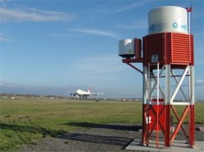
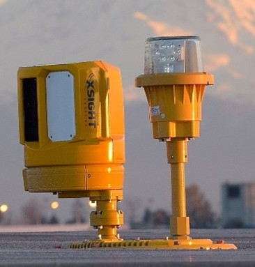
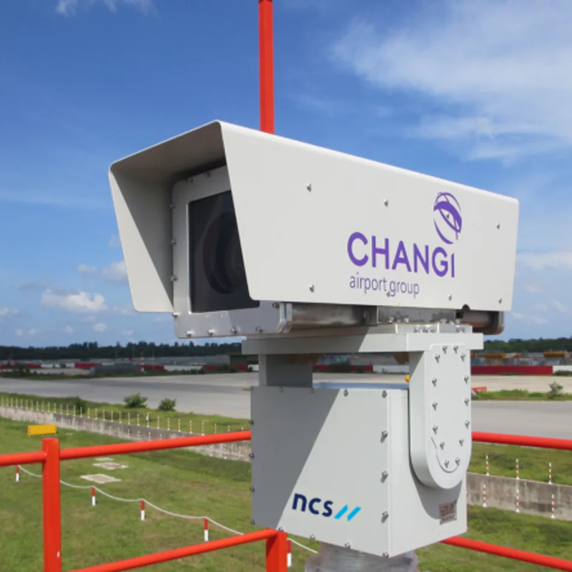
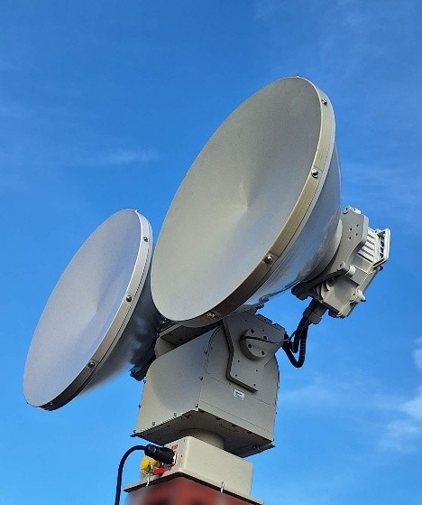
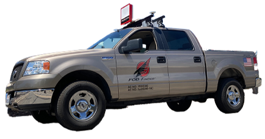

# Appendix: Background Research

Appendices E to H hold the detailed background to Section 1.1: the users who carry the problem, the competitive analysis, the problem statement and scope, and the rationale for a multi-robot approach.

<!-- #region e -->

FOD affects both military and civil aviation in Singapore, through the RSAF and CAAS respectively (Figure E.1), and airports worldwide face the same task with less manpower.

<Figure src="../../shared/assets/images/who-rsaf.jpg" alt="RSAF personnel lined up on the airfield beside a fighter jet" caption="Figure E.1a: Republic of Singapore Air Force (RSAF Facebook Page, 2024) [11]." />

<Figure src="../../shared/assets/images/who-caas.jpg" alt="CAAS officers on the airside apron beside an aircraft" caption="Figure E.1b: Civil Aviation Authority of Singapore (CAAS, 2026) [12]." />

Figure E.2 maps the stakeholders by power and interest. The RSAF holds both, as the end user and the party that would approve deployment. CAAS has high power but less direct interest, because Changi already operates automated detection. The industry partner and insurers have high interest but limited power, and the servicemen who clear FOD carry the work but have little say over the process.

<Figure src="../../shared/assets/images/stakeholder-map.svg" alt="Power–interest map placing the RSAF at high power and high interest, CAAS at high power and lower interest, the industry partner and insurance companies at high interest and lower power, and RSAF servicemen at lower power and lower interest" style="max-width: 560px; margin: 28px auto;" caption="Figure E.2: Stakeholder power–interest map." />

The team interviewed four of these stakeholders in September 2026: the industry partner coordinating the project with the RSAF, an RSAF technician and an RSAF air traffic controller who had both cleared FOD during National Service, and a CAAS officer with over 20 years of experience at Changi Airport. Table E.1 records what each stakeholder said in their own words. ([See interview transcripts](#appendix).)

<!-- TODO: add Table E.3 (current practice and pain points per stakeholder) before Table E.4. -->

*Table E.1: What stakeholders said.*

<table class="data-table fit-table fit-4"><tbody>
<tr><th>Who</th><th>What they said</th><th>Sentiment</th><th>Key insight</th></tr>
<tr><td rowspan="5"><strong>RSAF technician (Appendix <a href="#appendix-b">B</a>)</strong></td><td>"Walk and broom. Walk and broom… Just a normal broom. In fact, it makes more FOD than it cleans up."</td><td>Frustration</td><td>When the sweeper contractor is off duty, crews clear about 4 km of runway on foot</td></tr>
<tr><td>"The big sweeper does not pick up the small pieces. It will always miss the small pieces."</td><td>Negative</td><td>Rivets and screws, the items that cause damage, slip past current sweepers</td></tr>
<tr><td>"The entire air base goes down to do FOD walk together… And even then it takes us one hour to clean."</td><td>Frustration</td><td>Adding people does not scale</td></tr>
<tr><td>"[A rivet] went into the prop, and then they have to replace the entire thing."</td><td>Negative</td><td>One small part can mean a costly propeller replacement (C-130 case)</td></tr>
<tr><td>"The paperwork to get it on takes so long that… once every couple months just to show for publicity, we'll fly it."</td><td>Frustration</td><td>Airspace approvals make routine drone use impractical</td></tr>
<tr><td rowspan="2"><strong>RSAF air traffic controller (Appendix <a href="#appendix-c">C</a>)</strong></td><td>"It's quite crude, but they just want to say on paper that you can do it."</td><td>Negative</td><td>Current drone checks are manual visual reviews, flown once or twice a month</td></tr>
<tr><td>"It could play a huge part into making the runway operational again."</td><td>Positive</td><td>Biggest value is faster runway recovery after a crash</td></tr>
<tr><td rowspan="2"><strong>Industry partner (Appendix <a href="#appendix-a">A</a>)</strong></td><td>"There's no fixed route around the runway. It's pretty random; they go left, right, center."</td><td>Negative</td><td>Today's inspection has no systematic coverage</td></tr>
<tr><td>"Autonomous vehicle means servicemen can be released for other critical roles, given that the armed forces is shrinking due to lower birth rate."</td><td>Positive</td><td>Autonomy frees manpower as the SAF shrinks</td></tr>
<tr><td rowspan="3"><strong>CAAS officer (Appendix <a href="#appendix-d">D</a>)</strong></td><td>"For that extra minute that I give you, I lose one traffic."</td><td>Insight</td><td>Civil runway windows are about 5 minutes; speed outweighs everything</td></tr>
<tr><td>"You want a drone, but yet you want precision. You want to be able to cover 4 km… It's not so possible."</td><td>Negative</td><td>Coverage, precision and drone payload trade off against each other</td></tr>
<tr><td>"By investing in iFerret, we effectively shaved off a lot of time… every minute is money."</td><td>Positive</td><td>Automated detection pays for itself in runway time, but alerts still need a human to validate</td></tr>
</tbody></table>

Three findings run across the interviews. First, the burden is heaviest at military air bases, where removal still depends on people walking or driving the runway (see Appendices [B](#appendix-b) and [C](#appendix-c)), whereas Changi already has automated detection and runway windows too short for a slow vehicle (see Appendix [D](#appendix-d)). Second, the FOD that matters most is small and hard (rivets, screws, nuts, stones) and is the type most often missed (see Appendices [A](#appendix-a) and [B](#appendix-b)). Third, drone flights on an active airfield require closure or special permission (see Appendices [B](#appendix-b) and [D](#appendix-d)). The next question is whether existing solutions already close this gap.
<!-- #endregion e -->

<!-- #region f -->

Existing solutions fall into three groups: those that only detect FOD, those that only collect it, and the few that attempt both. Detection has advanced considerably, from visual patrols to radar and camera systems, but removal has not kept pace [\[5\]](#refs-literature-ref-5).

##### Detection Only {#comp-detection}

*Table 1.3.1: FOD detection systems.*

<table class="data-table fit-table fit-img"><tbody>
<tr><th></th><th>System</th><th>How it works</th><th>Shortcomings</th></tr>
<tr><td></td><td><strong>QinetiQ Tarsier</strong></td><td>Stationary radar detects; a camera pans to confirm <a href="#refs-literature-ref-13">[13]</a></td><td>Radar cannot classify FOD and is sensitive to ground clutter</td></tr>
<tr><td></td><td><strong>Xsight FODetect and RunWize</strong></td><td>Radar and optical sensors mounted along the runway edge lights, with laser illumination <a href="#refs-literature-ref-13">[13]</a></td><td>Hardware-intensive deployment along the full runway</td></tr>
<tr><td></td><td><strong>iFerret 2.0 (Changi)</strong></td><td>Fixed AI-powered cameras detect and verify FOD visually <a href="#refs-literature-ref-13">[13]</a> (see Appendix <a href="#appendix-d">D</a>)</td><td>Vision degrades in poor visibility such as haze (see Appendix <a href="#appendix-d">D</a>); costly cabling; alerts need a human to validate (see Appendix <a href="#appendix-d">D</a>)</td></tr>
<tr><td></td><td><strong>ELVA-1</strong></td><td>Stationary radar</td><td>Long scan time of about 3 minutes<!-- TODO: add citation --></td></tr>
<tr><td></td><td><strong>Trex FOD Finder XM</strong></td><td>Radar mounted on a vehicle <a href="#refs-literature-ref-13">[13]</a></td><td>Intermittent scanning; needs a driver at all times</td></tr>
</tbody></table>

Fixed systems detect FOD well. At Boston Logan, the detection system logged 86% of runway detections over 17 months, more than six times as many as vehicle and visual inspection [\[7\]](#refs-literature-ref-7). Installed costs of US\$1.7–6.4 million have been reported [\[7\]](#refs-literature-ref-7). However, all of these systems stop at detection, and a person must still enter the runway to remove the object [\[5\]](#refs-literature-ref-5) (see Appendix [D](#appendix-d)).

##### Collection Only {#comp-collection}

Collection is still done by specialised vehicles towing friction drag mats, by sweeper trucks, or by hand. These methods remove FOD without first locating it, so they offer no record of what was collected or missed, and sweepers often miss the small hard items the interviewees described (see Appendix [B](#appendix-b)).

<!-- TODO: add Figure F.2 as three images side by side in a .fig-row: friction-drag-mat-vehicle.jpg "Figure F.2a: Specialised vehicle with friction drag mats [source].", manual-sweeping-1.jpg "Figure F.2b: Manual sweeping [source].", manual-sweeping-changi.jpg "Figure F.2c: Manual FOD pickup at Changi Airport [source]." (images not in the project yet) -->

##### Detection and Collection {#comp-both}

Autonomous removal is only now reaching the market. Roboxi, a Norwegian multi-function airside robot, claims to detect and pick up FOD whilst also inspecting pavement and runway lights, and began a four-month trial at Berlin Brandenburg in 2026 [\[14\]](#refs-literature-ref-14), [\[15\]](#refs-literature-ref-15). Its cost has not been published, and no independent data on its detection or removal performance is yet available. Removal is therefore no longer an empty niche, and FOD Hunter cannot claim to be the first system to remove FOD. Its case has to rest on how it removes FOD and for whom.

<!-- TODO: add roboxi.jpg as Figure F.3: "Roboxi autonomous airside robot [15]." (image not in the project yet) -->

##### Competitor Map {#comp-map}

Figure 1.3.1 places each solution by detection and collection performance. Fixed systems sit high on detection but offer no collection; drag mats and manual sweeping collect but do not detect. Only Roboxi and the proposed system sit in the upper-right quadrant, and Roboxi's position there is based on its manufacturer's claims rather than published results.

<IntroductionWidget1 />

*Figure 1.3.1: Competitor map, detection performance against collection performance.*

<!-- TODO: static version competitor-map.png (not in the project yet), for a printed copy of the interactive map above. -->
<!-- #endregion f -->

<!-- #region g -->

Taken together, the literature and interviews define the problem as follows. Low to moderate air traffic airports rely on staff walking or driving the runway to find and remove FOD. The process is manpower-intensive, has no measure of thoroughness, and most often misses the small hard objects that cause the most damage.

The project is scoped for low to medium air traffic airports with limited manpower, such as our military airports in Singapore. Civil airports such as Changi are out of scope for now, because their runway windows of about five minutes are too short for a slow autonomous vehicle (see [Appendix D](#appendix-d)) and they already operate automated detection. Within this scope, the project aims to show that a drone and a ground robot working together can detect and remove small FOD from a section of runway without a person entering it.
<!-- #endregion g -->

<!-- #region h -->

A single robot forces a trade-off between coverage and capability. A drone surveys a wide area quickly but cannot pick up debris, while a ground robot can remove debris but covers ground slowly. Splitting the task lets FOD Argus survey the runway from the air and direct FOD Hunter only to confirmed targets, rather than sweeping the full runway.

Öztürk and Kuzucuoğlu provide the strongest quantitative case for coordinating multiple robots [\[4\]](#refs-literature-ref-4). In simulations at Istanbul Atatürk Airport, ten coordinated ground robots collected ten randomly distributed FOD items in 320 s, against 1,623 s for a single manual follow-me truck. Figure H.1 shows their five-year cost comparison across usage frequencies: over 500 collection runs, the ten-robot system cost US\$10.0 million against US\$19.5 million for one manual truck, a saving of about US\$9.5 million.

<IntroductionWidget2 />

*Figure H.1: Five-year cost sensitivity across usage frequencies, ranked row by row (green cheapest, red most expensive). Redrawn from Öztürk and Kuzucuoğlu [\[4\]](#refs-literature-ref-4).*

*Table H.1: Five-year cost at 500 collection runs [\[4\]](#refs-literature-ref-4).*

| | ASP3, 10 robots | Manual, 1 truck |
| --- | --- | --- |
| Delay cost per run | US\$16,205 | US\$36,698 |
| Delay cost × 500 runs | US\$8,102,500 | US\$18,349,000 |
| Base cost | US\$1,905,000 | US\$1,125,000 |
| **Five-year total** | **US\$10,007,500** | **US\$19,474,000** |

The study also has limits that matter here. The saving rests almost entirely on runway closure time valued at US\$1,500 per minute, a civil airport assumption; Figure H.1 also shows that the manual truck remained cheapest at low usage of under 50 runs; and the robots relied on fixed sensors for detection [\[4\]](#refs-literature-ref-4). The RSAF context differs: the industry partner indicated that cost is rarely the deciding factor and that the binding constraint is manpower (see Appendix [A](#appendix-a)). The case for this project therefore rests on freeing personnel and reducing runway downtime, with the cost result as supporting evidence rather than the main claim.
<!-- #endregion h -->
