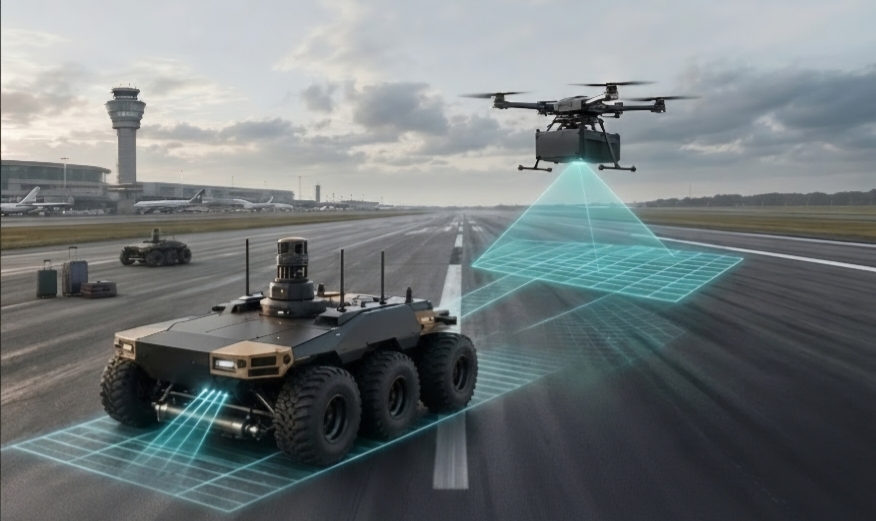

<!-- Canonical report source. Edit here. -->

<!-- Chapter 2 opening (system concept, user needs). -->

<Badge type="info" text="System Concept" />

#### Heterogeneous Multi-Agent Closed-Loop Collaboration

FOD Argus (UAV) surveys the runway and flags suspected debris. FOD Hunter (UGV) travels to each location confirmed by the operator, checks the item at close range and removes it.

### User Needs & Operational Drivers

Derived from three interviews (an industry partner, an RSAF technician and an RSAF air traffic controller) and one conversation with a CAAS officer.

[View primary field research →](/report#primary-research)

The cards below summarise the operational drivers behind the design; the full list of user needs is given in the Report.

<CardGrid :cols="3">

<Card title="1. Operational Efficiency &amp; Reduced ROT" accent="purple">

A runway closed for FOD checks cannot be used by aircraft. Instead of sweeping the full runway length, the system uses aerial scanning to send the ground robot directly to flagged locations. The aim is a shorter closure; no reduction has been measured yet.

</Card>

<Card title="2. Full Autonomous Operation" accent="blue">

Reduces the need for manual driving and airside escorts. Nav2 path planning, waypoint navigation and dispatch from the C2 station are demonstrated in Gazebo simulation with a proxy vehicle. Autonomous navigation and suction on the physical FOD Hunter are not yet tested.

</Card>

<Card title="3. Ground Transit Speed (10–15 km/h)" accent="emerald">

A runway is about 4 km long, so the specification is a cruising speed of 10–15 km/h, slowing to 3–5 km/h on approach. The hub motors are sized by calculation for 15 km/h; Semester 1 ground tests ran at 0.34 m/s on a bench power supply.

</Card>

<Card title="4. Novel Purpose for Multi-Agent Task" accent="amber">

Each robot does the part it is suited to. A drone covers the runway quickly but cannot carry a vacuum; a ground robot can carry the collection equipment but is slow to search the whole runway. Pairing them separates search from removal.

</Card>

<Card title="5. Close-Range Verification" accent="rose">

Before collection, FOD Hunter re-checks each item at close range to avoid acting on false alarms. Camera–LiDAR fusion is designed for this; current computer-vision prototyping runs on a laptop with a USB camera.

</Card>

<Card title="6. Readiness &amp; Charging" accent="blue">

FOD Hunter runs on a 48 V-class LiFePO4 battery (20 Ah; 51.2 V nominal assuming a 16S pack). A contact-charging dock, on which the drone also lands, is proposed for Semester 2 to recharge between runs.

</Card>

</CardGrid>

## List of Features {#list-of-features}

### Key Technical Innovations for Our UGV Platform

<!-- #region key-innovation -->

How FOD Hunter differs from fixed detection systems and inspection-only rovers

<Badge type="info" text="Core Innovations" />

<CardGrid :cols="4">

<Card title="1. Closed-Loop &quot;Find-and-Fix&quot; Remediation" tag="Innovation 1">

Fixed systems (_iFerret, Tarsier_) and inspection rovers (_Airtrek, Guimu_) report debris locations but do not remove debris. FOD Hunter is designed to verify and collect debris in the same trip, using a vacuum intake or a sweep box. The remediation module is at the bench-prototype stage.

</Card>

<Card title="2. Single Suction Mechanism" tag="Innovation 2">

Suction was selected because one mechanism handles metallic, non-metallic and animal debris; a magnetic bar was rejected because it cannot collect stones or animal remains. In an on-vehicle trial, the top-down intake collected M3–M4 screws under 10 g. A gripper arm is kept in reserve for larger items.

</Card>

<Card title="3. Two-Stage False-Alarm Check" tag="Innovation 3">

An operator confirms each aerial detection before dispatch, and FOD Hunter re-checks the item with its own camera at close range. Camera–LiDAR fusion is planned to help reject flat look-alikes such as pavement markings, skid marks and shadows.

</Card>

<Card title="4. Aerial-Guided C2 Handshake" tag="Innovation 4">

Instead of sweeping the whole runway, FOD Hunter receives target coordinates from the C2 station and drives directly to them. Dispatch from the C2 station to Nav2 is demonstrated in simulation; the time saving on a real runway has not been measured.

</Card>

</CardGrid>
<!-- #endregion key-innovation -->
