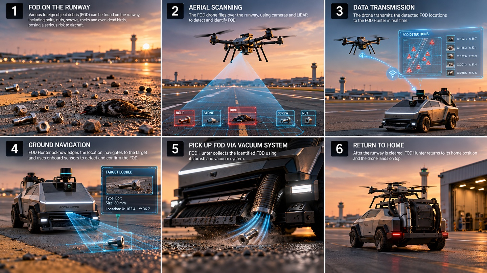

<!-- Canonical report source. Edit here. -->

## User Journey {#user-journey}

### User journey {#sec-journey}

Image to be added

1. **FOD on the runway**Various foreign object debris can be found on the runway, including bolts, nuts, screws, rocks and even dead birds, posing a serious risk to aircraft.
2. **Aerial scanning**The FOD drone flies over the runway, using cameras and LiDAR to detect and identify FOD.
3. **Data transmission**The drone transmits the detected FOD locations to FOD Hunter in real time.
4. **Ground navigation**FOD Hunter acknowledges the location, navigates to the target and uses its onboard sensors to detect and confirm the FOD.
5. **Pick up FOD via vacuum system**FOD Hunter collects the identified FOD using its brush and vacuum system.
6. **Return to home**After the runway is cleared, FOD Hunter returns to its home position and the drone lands on top.

<Figure src="../../shared/assets/images/uav-and-ugv-collab.png" alt="Collaborative UAV and UGV Multi-Agent Architecture" caption="**Figure 1.1:** Heterogeneous Multi-Agent Operations — Aerial Scout UAV provides macro runway sweep and cued coordinate transfer to the Ground Extraction UGV." />

### Demonstration: FOD Hunter × FOD Argus {#sec-demo}

Simulation of the full workflow: FOD Argus (UAV) patrols the runway on a pre-planned path and reports detected FOD, and FOD Hunter (UGV) is dispatched to clear it.

<VideoClip src="../../shared/assets/videos/fod-hunter-argus-demo.mp4" poster="../../shared/assets/images/fod-hunter-argus-demo-poster.jpg" />

### Our solution and value proposition statement {#sec-vps}

For

low to moderate air traffic airports that struggle with effective use of manpower,

Our

automated solution provides guaranteed clearance of FOD on the runway, while staff focus on more critical jobs,

Unlike

the current manual, time-consuming and laborious processes of clearing FOD.

### Value proposition map {#sec-vpmap}

<Figure src="../../shared/assets/diagrams/1-introduction-value-map-with-products-and-services-gai.svg" alt="Value map with products and services, gain creators and pain relievers" caption="Value map" />

<Figure src="../../shared/assets/diagrams/1-introduction-customer-map-with-jobs-gains-and-pains.svg" alt="Customer map with jobs, gains and pains" caption="Customer map" />

#### Value proposition fit

Each customer pain and gain is answered by a FOD Hunter feature.

<table class="data-table"><tbody>
<tr><th>Value map</th><th></th><th>Customer map</th></tr>
<tr><td colspan="3">Products and services → Jobs</td></tr>
<tr><td>Automated swarm of FOD detection and collection</td><td>→</td><td>Runway, ground operations and FOD remediation teams</td></tr>
<tr><td colspan="3">Pain relievers → Pains</td></tr>
<tr><td>Less laborious FOD process</td><td>→</td><td>Extremely laborious FOD process</td></tr>
<tr><td>Less manpower required for FOD</td><td>→</td><td>Manpower-intensive FOD process</td></tr>
<tr><td>Automated solution decreases mundane tasks</td><td>→</td><td>Repetitive and mundane tasks</td></tr>
<tr><td>Costs less overall in 5 years</td><td>→</td><td>Expensive cost of FOD</td></tr>
<tr><td colspan="3">Gain creators → Gains</td></tr>
<tr><td>Staff can be released for more critical roles</td><td>→</td><td>Meaningful deployment of manpower</td></tr>
<tr><td>Higher accuracy of FOD detection</td><td>→</td><td>Safer runways</td></tr>
<tr><td>Higher frequency of inspection and intervention</td><td>→</td><td>Increased productivity</td></tr>
</tbody></table>

### Progress to date {#sec-progress}

[Project timeline →](../../timeline.md)

<!-- #region semester-1 -->

<MilestoneTracker />

<!-- #endregion semester-1 -->
