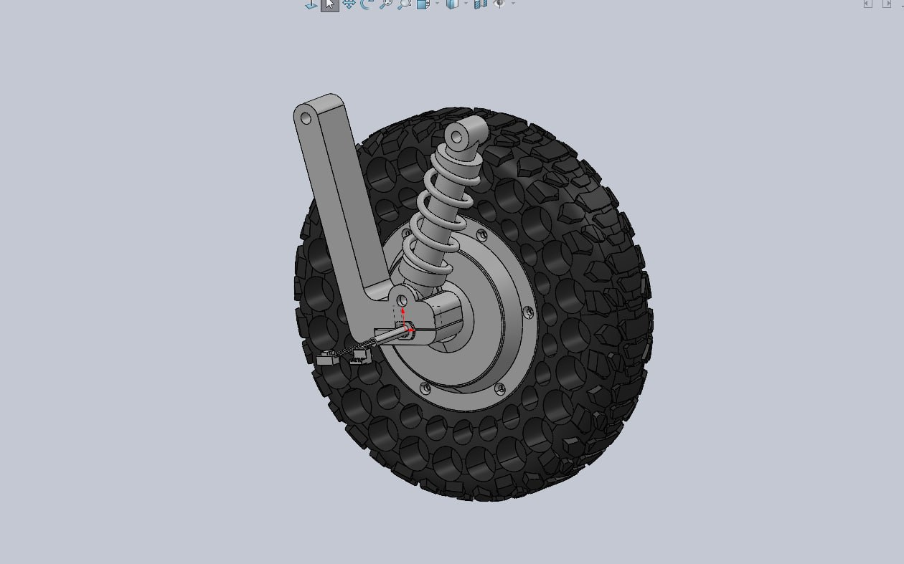
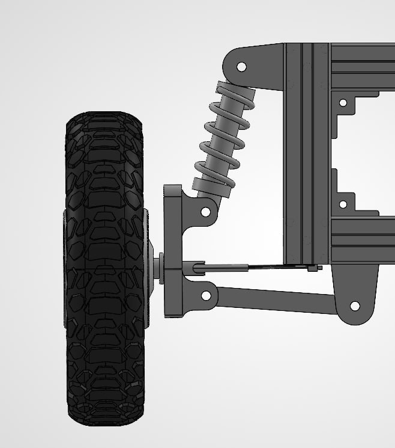
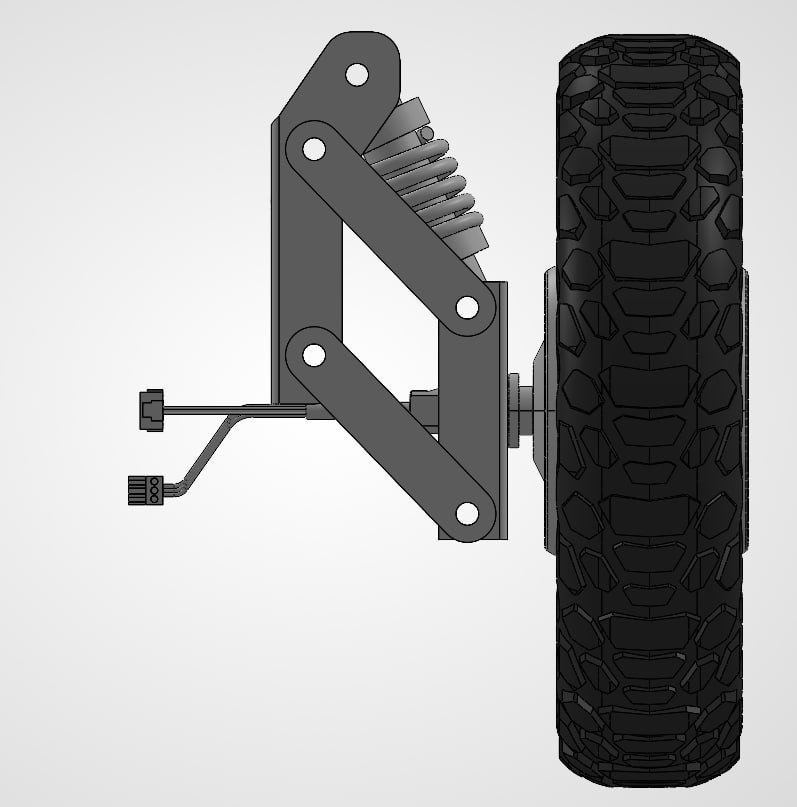

# Suspension Design and Calculations

In this chapter, I discuss the design of the suspension subsystem, which keeps the FOD Hunter’s wheels in contact with the ground and limits the vibration reaching the camera and onboard electronics. I first model a single corner of the robot as a spring–damper system, assuming the load is evenly distributed across all four wheels. From this model, I derive the transfer function and analyse the step response to select a spring rate of 100 lbf/in, the only option that meets both the static sag and natural frequency criteria. I then compare three suspension types and select the double wishbone, keeping the trailing arm as a back-up in case the chassis width becomes a constraint. Finally, video analysis of the assembled suspension shows all four wheels stayed in contact with the ground over undulating terrain (simulated by obstacles).

<!-- #region report -->

<!-- Report summary (the Report's section text). The detailed write-up follows. -->

## Suspension Subsystem Architecture {#sec-4-1-6}

<Badge type="danger" text="Asuka" /> <Badge type="danger" text="Terrain Compliance &amp; Dynamics" />

The suspension subsystem filters out jitter so computer vision works reliably, minimises vibration to protect other hardware, and keeps the 65 kg FOD Hunter in even contact with the ground. It has two requirements: static sag of ½ the 20 mm stroke length (40–60% acceptable), and a natural frequency below 10 Hz. Each 16.25 kg corner is modelled as a mass-spring-damper system, from which the transfer function $\frac{bs+k}{ms^2+bs+k}$ and its unit step response are derived. With a 25° installation angle (motion ratio 0.821) and an assumed dampener value of 400 Ns/m, the **100 lbf/in spring** is selected, giving **11.087 mm static sag** and a **4.734 Hz natural frequency**. The double-wishbone architecture is selected over the MacPherson strut (rejected) and the trailing arm (kept as a back-up plan if width becomes an issue). Both requirements are met, pending real-life testing.

<Figure src="./assets/images/double-wishbone-on-chassis.jpg" alt="Double wishbone suspension mounted on the FOD Hunter chassis" caption="Double wishbone suspension mounted on the chassis." />

## Purpose and Requirements

<Badge type="danger" text="Asuka" />

::: info Purpose
1. Filter out jitter to ensure computer vision works.
2. Minimise vibration to protect other hardware parts.
3. Give the FOD Hunter even contact with the ground.
:::

::: tip Requirements
1. Static sag = ½ of stroke length (40–60% of stroke length is acceptable).
2. Natural frequency &lt; 10 Hz.
:::

## Suspension Design Model

Each corner is modelled as a corner mass supported by a spring and a dampener in parallel, sitting on a wheel assumed to be 100% rigid. To describe the physical relationship between the input (road profile) and the output (position of the chassis), we find the transfer function.

::: warning Assumptions
- The wheel and tyre are 100% rigid, so all compliance comes from the spring and dampener.
- The 65 kg system mass is shared evenly across the four corners (16.25 kg per corner).
- Dampener value $b = 400\ \text{Ns/m}$.
- The shock absorber is installed at 25°, giving a motion ratio factor of 0.821.
:::

<Figure src="./assets/diagrams/suspension-corner-mass-on-spring-and-dampener-above.svg" alt="Corner mass on spring and dampener above a rigid wheel" caption="Single-corner model." />

<Figure src="./assets/diagrams/suspension-free-body-diagram-with-road-profile-inpu.svg" alt="Free body diagram with road profile input x(t) and chassis displacement output y(t)" caption="Forces acting on the corner mass." />

## Static Sag and Transfer Function

### Static sag

Initial conditions: velocity = 0 and system acceleration = 0. Considering the vertical direction only:

$$
\sum F_y = m a_y
$$

$$
F_{weight}+F_{spring}+F_{dampener}=F_{acceleration}
$$

This reduces to the following, also known as the static sag:

$$
F_{weight}=-F_{spring}
$$

### Transfer function

Input road profile = $x(t)$, output chassis displacement = $y(t)$. Using $F = ma$, at equilibrium $\sum F = 0$ after static sag:

$$
-m\ddot{y}-k\big(y(t)-x(t)\big)-b\big(\dot{y}(t)-\dot{x}(t)\big)=0
$$

$$
m\ddot{y}(t)=-k\big(y(t)-x(t)\big)-b\big(\dot{y}(t)-\dot{x}(t)\big)
$$

Taking the Laplace transform of all terms:

$$
ms^2Y(s)=-k\big(Y(s)-X(s)\big)-b\big(sY(s)-sX(s)\big)
$$

Expanding all terms:

$$
ms^2Y(s)=-kY(s)+kX(s)-bsY(s)+bsX(s)
$$

Regrouping into $X(s)$ and $Y(s)$:

$$
ms^2Y(s)+kY(s)+bsY(s)=kX(s)+bsX(s)
$$

$$
Y(s)\big(ms^2+k+bs\big)=X(s)\big(k+bs\big)
$$

Obtaining the transfer function:

$$
\frac{Y(s)}{X(s)}=\frac{bs+k}{ms^2+bs+k}
$$

::: info second-order system
This is a .
:::

## Unit Step Response

For a unit step response, $X(s)=\frac{1}{s}$:

$$
Y(s)=\frac{bs+k}{s\big(ms^2+bs+k\big)}=\frac{\frac{b}{m}s+\frac{k}{m}}{s\left(s^2+\frac{b}{m}s+\frac{k}{m}\right)}
$$

Let $\omega_n^2=\frac{k}{m}$ and $2a=\frac{b}{m}$, for completing the square in later steps:

$$
Y(s)=\frac{2as+\omega_n^2}{s\big(s^2+2as+\omega_n^2\big)}
$$

Using partial fractions to simplify:

$$
\frac{2as+\omega_n^2}{s\big(s^2+2as+\omega_n^2\big)}=\frac{A}{s}+\frac{Bs+C}{s^2+2as+\omega_n^2}
$$

$$
2as+\omega_n^2=A\big(s^2+2as+\omega_n^2\big)+s\big(Bs+C\big)
$$

$$
2as+\omega_n^2=As^2+2Aas+A\omega_n^2+Bs^2+Cs
$$

Comparing coefficients, $A+B=0$, $A=1$, $C=0$:

$$
\frac{2as+\omega_n^2}{s\big(s^2+2as+\omega_n^2\big)}=\frac{1}{s}-\frac{s}{s^2+2as+\omega_n^2}
$$

Completing the square:

$$
\frac{1}{s}-\frac{s}{s^2+2as+\omega_n^2}=\frac{1}{s}-\frac{s}{(s+a)^2+\omega_n^2-a^2}
$$

Let $\omega_n^2-a^2=p^2$:

$$
Y(s)=\frac{1}{s}-\frac{s}{(s+a)^2+p^2}
$$

$$
Y(s)=\frac{1}{s}-\frac{s+a}{(s+a)^2+p^2}+\frac{a}{(s+a)^2+p^2}
$$

$$
Y(s)=\frac{1}{s}-\frac{s+a}{(s+a)^2+p^2}+\frac{\frac{a}{p}\,p}{(s+a)^2+p^2}
$$

Taking the inverse Laplace transform of both sides:

$$
y(t)=1-e^{-at}\cos pt+\frac{a}{p}e^{-at}\sin pt
$$

Given a unit step input, the response $y(t)$ is characterised by this equation, where:

$$
\omega_n^2=\frac{k}{m},\qquad a=\frac{b}{2m},\qquad p=\sqrt{\omega_n^2-a^2}
$$

From the second-order equation, $2\xi\omega_n=2a$, so the damping ratio is:

$$
\xi=\frac{a}{\omega_n}=\frac{b}{2\sqrt{km}}
$$

## Spring Rate Selection

<Badge type="tip" text="Selected: 100 lbf/in" />

Dampener value $b = 400\ \text{Ns/m}$ (assumption). $y(t)$ is plotted with a time step of 0.01 s (originally plotted in Excel).

**Interactive:** drag the sliders to change the corner mass $m$, the spring rate $k$ and the dampener value $b$. The wheel rate uses $K_w = K_s \times 0.821$, and the static sag uses $F_{corner} = mg$.

<SuspensionWidget1 />

::: warning The spring must meet BOTH criteria
: static sag of 40–60% of the stroke, and a natural frequency below 10 Hz.
:::

### Spring rate comparison

System mass = 65 kg, corner mass = 16.25 kg, $F_{corner}$ = 159.4125 N. Angle of installation = 25°, stroke length = 20 mm.

| Spring rate (lbf/in) | Ks (N/m) | Wheel rate Kw (N/m) = Ks × motion ratio \[0.821\] | Kw (N/mm) | x steady state (mm) | Natural freq. (rad/s) | Natural freq. (Hz) | Result |
| --- | --- | --- | --- | --- | --- | --- | --- |
| 30 | 5253.803 | 4313.372 | 4.313 | 36.958 | 16.292 | 2.593 | ❌ Does not meet static sag criteria |
| 50 | 8756.338 | 7188.954 | 7.189 | 22.175 | 21.033 | 3.348 | ❌ Does not meet static sag criteria |
| **100** | 17512.677 | 14377.908 | 14.378 | **11.087** | 29.745 | **4.734** | ✅ Meets both criteria |
| 150 | 26269.015 | 21566.862 | 21.567 | 7.392 | 36.431 | 5.798 | ❌ Does not meet static sag criteria |
| 200 | 35025.354 | 28755.816 | 28.756 | 5.544 | 42.066 | 6.695 | ❌ Does not meet static sag criteria |
| 300 | 52538.031 | 43133.723 | 43.134 | 3.696 | 51.521 | 8.200 | ❌ Does not meet static sag criteria |
| 400 | 70050.708 | 57511.631 | 57.512 | 2.772 | 59.491 | 9.468 | ❌ Does not meet static sag criteria |
| 500 | 87563.385 | 71889.539 | 71.890 | 2.217 | 66.513 | 10.586 | ❌ Does not meet natural frequency criteria |
| 550 | 96319.723 | 79078.493 | 79.078 | 2.016 | 69.759 | 11.103 | ❌ Does not meet natural frequency criteria |
| 600 | 105076.062 | 86267.447 | 86.267 | 1.848 | 72.861 | 11.596 | ❌ Does not meet natural frequency criteria |
| 650 | 113832.400 | 93456.401 | 93.456 | 1.706 | 75.836 | 12.070 | ❌ Does not meet natural frequency criteria |
| 700 | 122588.739 | 100645.355 | 100.645 | 1.584 | 78.699 | 12.525 | ❌ Does not meet natural frequency criteria |
| 750 | 131345.077 | 107834.309 | 107.834 | 1.478 | 81.461 | 12.965 | ❌ Does not meet natural frequency criteria |

Green cells meet a criterion: static sag of 8–12 mm (40–60% of the 20 mm stroke) or natural frequency &lt; 10 Hz. Red rows fail at least one criterion.

::: tip Component selected: 100 lbf/in spring
Static sag of 11.087 mm is 55% of the 20 mm stroke (within 40–60%), and the natural frequency of 4.734 Hz is below 10 Hz.
:::

## Cost Trade-off: Off-the-Shelf vs Adjustable Shock Absorbers

Shock absorbers in this size range cost from about \$\[2\] to \$\[800\] each. The main difference between them is precision and adjustability. The spring rate is largely fixed once a spring is chosen, but the damping can vary significantly. In a hydraulic damper, the damping force comes from oil forced through small orifices as the shock compresses and extends. A smaller orifice resists the flow more, giving a higher damping coefficient and a slower, more controlled response. A larger orifice gives lower damping and a softer response. Higher-end shock absorbers allow these settings to be adjusted and tuned.

For the FOD Hunter, the main innovations are the coordination between the FOD Argus and the FOD Hunter and the FOD pickup mechanism. To put more budget and time into these systems, I chose a low-cost, non-adjustable shock absorber (\[part name\], \$\[X\] each, \$\[4X\] for four corners) instead of an adjustable unit. The trade-off is that its damping coefficient is not published or adjustable, which is why my model assumes $b = 400\ \text{Ns/m}$ (Section 2). Despite this, the selected 100 lbf/in spring still meets the static sag and natural frequency requirements, as confirmed by testing (Section \[X\]). Measuring the actual damping coefficient, for example from the decay rate in a bounce test, is listed as future work.

## Suspension Selection

<table class="data-table"><tbody>
<tr><th></th><th>Suspension type</th><th>Advantages</th><th>Disadvantages</th><th>Remarks</th><th>Final decision</th></tr>
<tr><td></td><td><strong>Trailing arm</strong></td><td>Constant track width, zero camber angle change.  Maximum space efficiency, keeping robot width to the minimum.  Low vertical profile.</td><td>Transverse bending moments are concentrated on the main pivot shaft during spot turns.</td><td>Used as rear suspension on vehicles, but can also be used on the FOD Hunter with strict width constraints.</td><td>Keep as back-up plan in case width is an issue</td></tr>
<tr><td></td><td><strong>MacPherson strut</strong></td><td>Leaves space for other parts at the upper arm assembly.  Lower part count.</td><td>Higher wear on shock absorbers, as skid steering exerts large stress on them.</td><td>Usually used on Ackermann-steering vehicles (which we are not using).</td><td>Reject</td></tr>
<tr><td></td><td><strong>Double wishbone</strong></td><td>The dual-arm set-up easily absorbs lateral bending moments during skid-steering turns.  Maintains a stable tyre contact patch across the full stroke.</td><td>Mechanically complex.</td><td>Typically used in performance vehicles; a wide chassis width is available.</td><td><strong>Selected</strong></td></tr>
</tbody></table>

## Final Design and Status

<Figure src="./assets/images/double-wishbone-on-chassis.jpg" alt="Double wishbone suspension mounted on the FOD Hunter chassis" caption="Double wishbone suspension on the chassis (CAD)." />

::: tip Requirements
1. Static sag ½ of stroke length (40–60%) ✅
2. Natural frequency &lt; 10 Hz ✅

*Pending real-life test.*
:::

<!-- #endregion report -->
