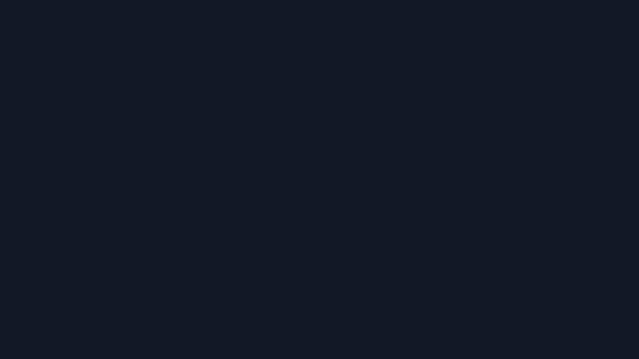
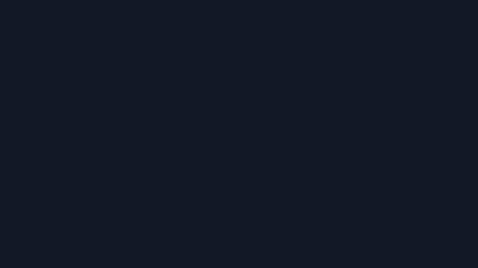

# STM32 Firmware Architecture & Control

<Badge type="info" text="EMBEDDED FIRMWARE SUBSYSTEM • GABRIEL" />

<!-- #region report -->

## Built Bottom-Up, Verified at Every Layer {#section-1-method}

Every layer of the firmware was verified on the bench before the next was built on top of it — from proving the physical wire carries a signal, to driving the full robot with a wireless gamepad.

Step 1

Prove the Wire

CAN bring-up & physical diagnostics

Step 2

Precise Timing

Stepper actuator microsecond control

Step 3

Move Four Wheels

Multi-node CAN, CiA 402 profile velocity

Step 4

Make It Safe

5-state machine, GUI & fault recovery

Step 5

Drive It

Gamepad teleop, kinematics & ramping

Click any step above to jump directly to its verification phase below.

## How the Final Firmware Fits Together {#section-2-architecture}

The firmware executes a bare-metal, deterministic main loop on the Cortex-M4F core, decoupling high-level operator kinematics from physical closed-loop Field-Oriented Control (FOC) running inside the motor drivers.

<Card>

<Figure src="./assets/diagrams/stm32-firmware-firmware-architecture-block-diagram.svg" alt="Firmware Architecture Block Diagram" />

</Card>

::: tip
**Architecture Overview:** Bare-metal, deterministic main loop on the STM32F446RE. The ZLAC8015D drivers run the closed-loop FOC current/velocity control; the STM32 commands velocity setpoints and supervises driver state.
:::

<Badge type="info" text="PHASE 1" />

## Prove the Wire {#phase-1}

`can_debugging_check.c`

**Problem Statement:** “Before commanding any motor, prove the CAN link itself works — and when it doesn't, know exactly why.”

## 1 DC Loopback Test

Bit-bangs the transceiver as plain GPIO before the CAN controller starts, separating wiring faults from protocol faults.

::: details Details

PB9 is temporarily driven as GPIO output and PB8 read as input. Recessive test: PB9 HIGH → PB8 must read HIGH. Dominant test: PB9 LOW → PB8 must read LOW. Pins are then restored to AF9 (CAN1).

:::

## 2 Live Baud-Rate Sweep

Pressing the blue user button (PC13) cycles 500k → 250k → 1M → 125k and re-pings the driver, discovering its baud rate without reflashing.

## 3 Mailbox Deadlock Prevention

Auto-retransmission is disabled and stalled TX mailboxes are aborted before each ping, so a missing ACK can never lock up the controller.

## 4 Hardware Bus Diagnostics

Decodes the CAN Error Status Register (TEC, REC, LEC) into plain-English faults and auto-recovers from Bus-Off.

::: details Details

LEC=1 (stuff error) → baud mismatch. LEC=3 (ACK error) → disconnected wires, swapped CAN\_H/CAN\_L, or unpowered driver. BOFF → controller restarted automatically.

:::

<MissingAsset name="phase1-can.mp4" alt="video" />

Phase 1 Video Demo `/assets/images/Gabriel/phase1-can.mp4` Place recording here to enable live loop preview

**Code (C)**

```
uint32_t esr = hcan1.Instance->ESR;
uint8_t tec = (esr & CAN_ESR_TEC) >> CAN_ESR_TEC_Pos;
uint8_t lec = (esr & CAN_ESR_LEC) >> CAN_ESR_LEC_Pos;

if (lec == 1) printf("[DIAGNOSTIC] Stuff Error (LEC=1, TEC=%d). Baud rate mismatch?\r\n", tec);
if (lec == 3) printf("[DIAGNOSTIC] No Acknowledgment (LEC=3, TEC=%d).\r\n", tec);

if (esr & CAN_ESR_BOFF) {
  printf("[BUS ERROR] Bus-Off! Restarting CAN controller...\r\n");
  HAL_CAN_Stop(&hcan1);
  HAL_CAN_Start(&hcan1);
}
```

**Console Output**

```
--> [RESULT] Transceiver Physical Loopback: 100% PASS!
[BUTTON] >>> Switching CAN Baud Rate to: 500 kbps (Default) <<<
-> [DIAGNOSTIC] No Acknowledgment (ACK Error, LEC=3, TEC=8).
```

<Badge type="info" text="PHASE 2" />

## Precise Timing {#phase-2}

`steppermotor_w_user_input.c`

**Problem Statement:** “Drive a TB6600 microstep driver with clean, sub-millisecond pulses from 3.3 V logic.”

## 1 5 V Common-Anode Sinking

PUL+/DIR+ tied to 5 V; the STM32 sinks PUL−/DIR− (PC2/PC3, open-drain), giving the driver's optocouplers full drive current without a level shifter.

::: details Details

Sourcing from 3.3 V leaves only ~1.7 V across the opto's internal resistor after the LED drop — not enough current. Sinking puts the full 5 V across it while the GPIO just switches to ground.

:::

## 2 Microsecond Timing via DWT

The Cortex-M4 cycle counter replaces HAL\_Delay(), whose 1 ms tick is too coarse for 200–800 µs step pulses.

## 3 Direction Setup Guard

A 20 µs guard after every DIR change (TB6600 needs ≥5 µs) prevents lost steps on reversal.

## 4 Interactive Tuning

UART console: W/S jog ±400 steps, +/− adjusts step delay (200–5000 µs) live to find resonance and top speed.

<MissingAsset name="phase2-stepper.mp4" alt="video" />

Phase 2 Video Demo `/assets/images/Gabriel/phase2-stepper.mp4` Place recording here to preview live playback

**Code (C)**

```
/* Enable Cortex-M4 DWT cycle counter */
CoreDebug->DEMCR |= CoreDebug_DEMCR_TRCENA_Msk;
DWT->CTRL |= DWT_CTRL_CYCCNTENA_Msk;
DWT->CYCCNT = 0;

void Stepper_DelayUs(uint32_t us) {
  uint32_t start = DWT->CYCCNT;
  uint32_t wait  = us * (SystemCoreClock / 1000000);
  while ((DWT->CYCCNT - start) < wait);
}
```

**Console Output**

```
>>> [SPEED] Faster! Delay = 400 us
>>> [SPEED] Faster! Delay = 300 us
```

<Badge type="tip" text="PHASE 3" />

## Move Four Wheels {#phase-3}

`2_motor_w_user_input.c`

**Problem Statement:** “Run two ZLAC8015D drivers (four hub motors) on one shared 2-wire CAN bus, smoothly and safely.”

## 1 Multi-Node Addressing

CANopen SDO IDs route each command to the right driver: Node 1 listens on 0x601 (replies 0x581), Node 2 on 0x602 (replies 0x582). No extra pins needed.

## 2 CiA 402 Power-Up Handshake

Each driver is set to Profile Velocity Mode with 100 ms accel/decel ramps, then armed via Shutdown (0x06) → Switch On (0x07) → Enable Operation (0x0F), with targets initialised at 0 RPM.

## 3 Synchronised Drive & Two-Tier Braking

All four wheels commanded together. \[Q\] = gentle ramped stop; \[E\] = CiA 402 Quick-Stop (Controlword 0x0002) that locks the wheels immediately.

<MissingAsset name="phase3-four-wheels.mp4" alt="video" />

Phase 3 Video Demo `/assets/images/Gabriel/phase3-four-wheels.mp4` Place recording here to preview live playback

**Code (C)**

```
/* CiA 402 power-enable handshake, per driver node */
ZLAC8015D_Write16_Node(nodeId, ZLAC_OBJ_CONTROLWORD, ZLAC_SUB_ALL, 0x0006); /* Shutdown         */
ZLAC8015D_Write16_Node(nodeId, ZLAC_OBJ_CONTROLWORD, ZLAC_SUB_ALL, 0x0007); /* Switch On        */
ZLAC8015D_Write16_Node(nodeId, ZLAC_OBJ_CONTROLWORD, ZLAC_SUB_ALL, 0x000F); /* Enable Operation */
```

**Console Output**

```
[INIT] Initializing ZLAC8015D Driver 1 (Node ID 1)...
[INIT] Initializing ZLAC8015D Driver 2 (Node ID 2)...
>>> [ALERT] EMERGENCY STOP TRIGGERED ON ALL MOTORS!
```

<Badge type="warning" text="PHASE 4" />

## Make It Safe to Command {#phase-4}

`state_machine_check.c + GUI.py`

**Problem Statement:** “Stop guessing what the driver is doing — track its real state and reject unsafe commands before they reach the bus.”



Five-state motor state machine: Disengage, Lock, Movement, Jerk, Error



Python desktop GUI with speed slider streaming commands to the STM32

## 1 Five Explicit States

DISENGAGE (freewheel), LOCK (holding 0 RPM), MOVEMENT (−350 to +350 RPM), JERK (Quick-Stop), ERR (driver fault).

## 2 Enforced Transitions + GUI

You can't jump from DISENGAGE straight to MOVEMENT; the motor must be locked at 0 RPM first. Invalid inputs are rejected before any CAN frame is sent. A Python GUI streams target speeds from a slider.

## 3 Statusword Polling & Fault Recovery

The driver's Statusword (0x6041) is polled every 150 ms; a set fault bit (bit 3) forces STATE\_ERR and zero speed automatically. \[C\] clears the fault with the CiA 402 rising edge on Controlword bit 7 — no reboot needed.

<MissingAsset name="phase4-fsm-gui.mp4" alt="video" />

Phase 4 Video Demo `/assets/images/Gabriel/phase4-fsm-gui.mp4` Place recording here to preview live playback

**Code (C)**

```
case STATE_LOCK:
  if (ch == 'w' || ch == 'W') {
    currentSpeedRpm = SPEED_STEP_RPM;
    Driver_Set_Speed_Right_Only(currentSpeedRpm);
    currentState = STATE_MOVEMENT;
  }
  else if (ch == 'd' || ch == 'D') {
    Driver_Disengage();
    currentState = STATE_DISENGAGE;
  }
  break;
```

**Console Output**

```
>>> [ACTION] RUN: Enabling driver & locking shaft at 0 RPM...
>>> [!] HARDWARE ALARM DETECTED: Entering STATE_ERR!
```

<Badge type="info" text="PHASE 5" />

## Drive It {#phase-5}

`controller.c`

**Problem Statement:** “Bring everything together: a wireless gamepad plugged straight into the STM32 drives the full robot — no laptop in the loop.”

## 1 Boot-Time Node Probe

Each driver is pinged at startup; if one doesn't reply within 60 ms, the console prints exactly what to check (DIP switch, power, CAN wiring).

## 2 Mirrored-Motor Correction

The right-side hub motors are mounted facing the opposite way, so their direction is inverted in software. Higher layers think only in “vehicle forward”.

## 3 USB Host Gamepad

XInput packets parsed directly on the STM32. RT = forward, LT = reverse; pulling both at once forces 0 RPM.

## 4 Differential Steering & Ramping

Track width 381.2 mm, wheel radius 100 mm, turn rate 0.80 rad/s → ≈14.6 RPM left/right difference. A 25 ms ramp loop accelerates at 35 RPM/s (0→30 RPM in ~0.85 s) and coasts down at 15 RPM/s. Gamepad \[B\] triggers a software CiA 402 Quick-Stop on all four wheels; \[A\] re-arms.

<MissingAsset name="phase5-drive.mp4" alt="video" />

Phase 5 Full Teleoperation Demo `/assets/images/Gabriel/phase5-drive.mp4` Featured live verification capture (largest video in firmware scope)

**Code (C)**

```
static int32_t Calculate_Base_RPM(uint8_t lt_pct, uint8_t rt_pct) {
  /* Safety: both triggers pulled -> force stop */
  if (lt_pct > TRIGGER_DEADZONE_PCT && rt_pct > TRIGGER_DEADZONE_PCT)
    return 0;
  if (rt_pct > TRIGGER_DEADZONE_PCT)               /* RT: forward */
    return  (int32_t)((rt_pct * MOTOR_MAX_RPM) / 100);
  if (lt_pct > TRIGGER_DEADZONE_PCT)               /* LT: reverse */
    return -(int32_t)((lt_pct * MOTOR_MAX_RPM) / 100);
  return 0;
}
```

**Console Output**

```
>>> [INIT] Probing CAN Node 1 & Node 2...
  >>> [CAN OK] Driver Node 1 DETECTED!
  >>> [CAN OK] Driver Node 2 DETECTED!
```

## Safety Is Layered, Not Bolted On {#section-8-safety}

A multi-layer safety matrix enforces determinism at the driver protocol, software state machine, and hardware interlock levels.

| Hazard | Mitigation | Layer | Phase |
| --- | --- | --- | --- |
| **No ACK locks the CAN TX mailboxes** | Auto-retransmit off; stalled mailboxes aborted | <Badge type="info" text="Firmware" /> | [Phase 1](#phase-1) |
| **Driver not powered / miswired at boot** | Node probe with actionable diagnostics | <Badge type="info" text="Firmware" /> | [Phase 5](#phase-5) |
| **Command sent while coils disengaged** | State machine rejects invalid transitions | <Badge type="info" text="Firmware" /> | [Phase 4](#phase-4) |
| **Driver fault (stall, overvoltage)** | Statusword polled every 150 ms → STATE\_ERR, speed zeroed | <Badge type="info" text="Firmware" /> | [Phase 4](#phase-4) |
| **Both triggers pulled at once** | Forced 0 RPM | <Badge type="info" text="Firmware" /> | [Phase 5](#phase-5) |
| **Sudden speed jumps (tipping, gear shock)** | Driver ramps + 25 ms software ramp | <Badge type="info" text="Firmware" /> | [Phase 3](#phase-3), [5](#phase-5) |
| **Operator emergency** | Gamepad \[B\] → CiA 402 Quick-Stop | <Badge type="info" text="Firmware" /> | [Phase 3](#phase-3), [5](#phase-5) |
| **Firmware or comms failure** | Wireless NC kill switch acts directly on drivers; contactor cuts motor power | <Badge type="warning" text="Hardware" /> | [Hardware → Power & Safety](./stm32-hardware.md#interface-wiring) |

## Problems We Hit {#section-9-problems}

Key benchtop troubleshooting lessons learned during actuator and motor driver integration.

#### “Stepper driver ignored our pulses”

Symptom Driver didn't respond reliably.

Cause 3.3 V GPIO couldn't push enough current through the driver's optocoupler LEDs (~1.7 V left after the LED drop).

Fix Rewired common-anode to 5 V and sinked the negative inputs with open-drain GPIO.

#### “The wheels fought each other”

Symptom +30 RPM to all motors locked the chassis.

Cause Right-side hub motors are mounted mirrored.

Fix Per-channel direction inversion inside Motor\_Set\_Velocity().

#### “Step timing was too coarse”

Symptom Motor couldn't reach usable speed smoothly.

Cause HAL\_Delay() has 1 ms resolution; pulses needed 200–800 µs.

Fix DWT cycle-counter microsecond delay.

## Semester 2 Firmware Roadmap {#section-10-roadmap}

Target enhancements scheduled for integration upon delivery of the runway chassis and companion autonomy computer.

IMU Sensor Fusion <Badge type="info" text="Planned" />

Complementary/EKF filter on the STM32 for attitude and tilt estimation on uneven runway surfaces.

Jetson & ROS 2 Integration <Badge type="info" text="Planned" />

micro-ROS link: publish odometry and status, subscribe to cmd\_vel; add a comms-timeout watchdog so the STM32 Quick-Stops if the Jetson goes silent.

BMS Telemetry <Badge type="info" text="Planned" />

Cell voltages, SoC and temperature over USART1, with automatic power throttling and cutoffs.

Closed-Loop Slip Compensation <Badge type="info" text="Planned" />

Use driver encoder feedback to correct heading drift and wheel slip in turns.

<!-- #endregion report -->

←

[Previous Architecture](./stm32-hardware.md)

STM32 Hardware Subsystem
