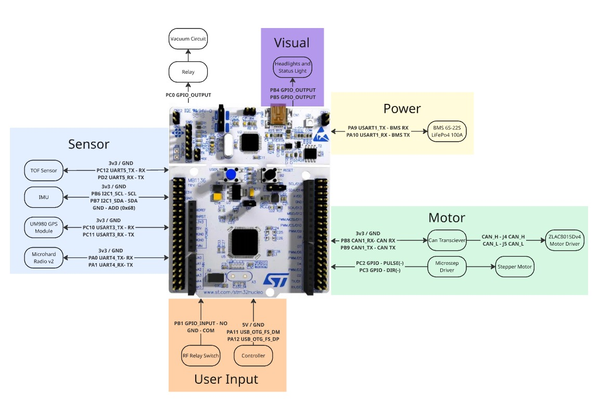

# STM32 Low-Level Control Unit

<Badge type="info" text="ELECTRICAL & EMBEDDED SUBSYSTEM • GABRIEL" />

<!-- #region microcontrollers -->

<!-- #region report -->

## Why a Dedicated ECU {#why-dedicated-ecu}

The UGV splits computing into two tiers: a high-level computer for computing and a microcontroller for autonomy.

<Figure src="./assets/diagrams/stm32-hardware-two-tier-computing-split-architecture-di.svg" alt="Two-Tier Computing Split Architecture Diagram" />

::: tip Failsafe isolation
If the Jetson's OS crashes, reboots or drops frames, the STM32 detects the communication timeout and independently triggers a CiA 402 Quick-Stop on all four wheels.
:::

::: info Deterministic timing
No OS preemption. Control loops and step pulses run with microsecond-level, predictable timing, and hardware peripherals (CAN, timers, UART) handle I/O without loading the CPU.
:::

::: info Proven industry pattern
The same high-level / low-level split is used by Pixhawk flight controllers (STM32 + companion computer) and ROBOTIS TurtleBot3's OpenCR board (STM32).
:::

<!-- #endregion microcontrollers -->

## Requirements & Selection {#requirements-selection}

<Badge type="tip" text="STEP A" />

### Hard Requirements Specification

| Requirement | Target Specification | Peripheral Allocation | Engineering Justification |
| --- | --- | --- | --- |
| **Hardware Serial Ports** | **≥ 4 UART / USART** | BMS (USART1), RTK GNSS (USART3), Microhard Radio (UART4), ToF (UART5) | Enables concurrent, non-blocking DMA serial streaming without software serial emulation or bus multiplexing. |
| **CAN Bus Controller** | **≥ 1 bxCAN (500 kbps)** | CAN1 (PB8/PB9) → Dual ZLAC8015D dual-channel hub motor drivers | Native differential industrial bus with hardware message ID filtering for real-time CiA 402 motion commands. |
| **USB Host Interface** | **USB 2.0 OTG FS** | PA11 (DM), PA12 (DP) → Direct USB gamepad joystick input | Permits direct manual emergency jog control and diagnostics without relying on host PC or ROS 2 network stack. |
| **Compute Clock Budget** | **≥ 35 MHz (FPU core)** | STM32F446RE Cortex-M4F operating at 180 MHz | Comfortably absorbs peak peripheral interrupt loads (17.16 MHz raw + 2× margin = 34.32 MHz) with &gt;80% headroom. |

<Badge type="info" text="STEP B" />

### Worst-Case Compute Budget

Cortex-M4F 180 MHz Frequency Budget Allocation

Peak throughput under concurrent CAN saturation, 4× UART DMA streaming, 10 kHz stepper interrupts, and IMU polling.

<Badge type="tip" text="> 80% Headroom Available" />

9.5%

+9.5%

&gt; 80% headroom for sensor fusion, telemetry and RTOS overhead (145.68 MHz)

**17.16 MHz (9.5%)** Base Worst-Case Load

**34.32 MHz (19.1%)** Peak Load (2× Safety Margin)

**&gt; 80% Headroom** for sensor fusion, telemetry and RTOS overhead

::: details Show breakdown: task assumptions & cycle budget

| Task | Assumption | Load |
| --- | --- | --- |
| **4× UART (BMS, GPS, radio, ToF)** | 4 ch × 11,520 B/s (115,200 baud ÷ 10 bits) = 46,080 B/s | × 150 cycles/byte = **6.91 MHz** |
| **CAN to ZLAC8015D** | 9,000 frames/s (1 Mbps bus saturation) | × 350 cycles/frame = **3.15 MHz** |
| **GPS parsing** | 10 Hz × 5 sentences × 80 B = 4,000 B/s | × 100 cycles/byte = **0.40 MHz** |
| **Stepper pulses** | 20,000 interrupts/s (10 kHz, 2 per pulse) | × 75 cycles = **1.50 MHz** |
| **IMU over I2C** | 100 reads/s | × 2,000 cycles = **0.20 MHz** |
| **USB host + main loop** | — | **5.00 MHz** |
| **Total** | Worst-case unscaled sum across active peripherals | **17.16 MHz** |
| **With 2× safety margin** | Conservative industrial doubling for RTOS jitter & telemetry spikes | **34.32 MHz** |

:::

<Badge type="info" text="STEP C" />

### Candidate Evaluation

<table class="data-table"><tbody>
<tr><th>Board</th><th>UART</th><th>CAN</th><th>Logic / Clock</th><th>Verdict</th></tr>
<tr><td><strong>Arduino Uno/Nano</strong></td><td>1</td><td>0</td><td>5 V, 16 MHz</td><td><Badge type="danger" text="✗ Too few ports, too slow" /></td></tr>
<tr><td><strong>Arduino Mega 2560</strong></td><td>4</td><td>0</td><td>5 V, 16 MHz</td><td><Badge type="danger" text="✗ No CAN, too slow" /></td></tr>
<tr><td><strong>ESP32</strong></td><td>3</td><td>1</td><td>3.3 V, 240 MHz</td><td><Badge type="danger" text="✗ Too few UARTs" /></td></tr>
<tr><td><strong>Raspberry Pi Pico</strong></td><td>2</td><td>0</td><td>3.3 V, 133 MHz</td><td><Badge type="danger" text="✗ Too few UARTs, no CAN" /></td></tr>
<tr><td><strong>Teensy 4.1</strong></td><td>8</td><td>3</td><td>3.3 V, 600 MHz</td><td><Badge type="warning" text="Backup" /></td></tr>
<tr><td><strong>NUCLEO-F446RE</strong> <Badge type="tip" text="SELECTED" /></td><td>6</td><td>2</td><td><strong>3.3 V (5 V-tolerant I/O), 180 MHz</strong></td><td><Badge type="tip" text="✓ Selected" /></td></tr>
</tbody></table>

::: tip
<Badge type="tip" text="SELECTION VERDICT" />

**Microcontroller Selection Rationale**

Teensy 4.1 out-specs the F446RE on paper, but the STM32 was chosen for its toolchain and industry adoption: STM32CubeMX pin/clock configuration, HAL libraries, an on-board ST-Link debugger, and direct relevance to industrial embedded work. It meets every requirement with &gt;80% headroom.
:::

## Interface & Wiring {#interface-wiring}

Complete hardware mapping for all 11 external devices connected to the STM32 NUCLEO-F446RE, detailing communication protocol, pin assignments, and electrical characteristics.

Click to Enlarge

NUCLEO-F446RE wiring diagram grouped by Sensor, Power, Motor, Visual and User Input subsystems (Click image to open full-size lightbox preview)

<Stm32HardwareWidget1 />

<Stm32HardwareWidget2 />

<Badge type="warning" text="WIP · Semester 2" />

## Carrier PCB (Work in Progress) {#carrier-pcb}

A custom carrier board is being designed in KiCad so the Nucleo, CAN transceiver and sensor harnesses plug into locking JST connectors instead of loose jumper wires — improving reliability under runway vibration.

Click to Enlarge

KiCad carrier board schematic placeholder (lockable JST-XH/PA connectors, isolated CAN transceiver, and low-noise LDO rails)

::: info
<Badge type="info" text="SOFTWARE ARCHITECTURE" /> <Badge type="tip" text="PHASES 1–5 COMPLETED" />

**STM32 Firmware Architecture & Control**

Explore the progressive bottom-up verification (DC loopback, DWT microsecond timing, CiA 402 multi-node CAN, 5-state machine, and wireless gamepad teleoperation).

[Open STM32 Firmware →](./stm32-firmware.md)
:::

<!-- #endregion report -->

<CardGrid :cols="2">

<Card>

←

[Previous Documentation](./vision-research.md)

Computer Vision Research

</Card>

<Card>

[Next Architecture](./stm32-firmware.md)

STM32 Firmware Architecture →

</Card>

</CardGrid>
