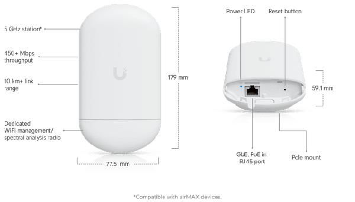
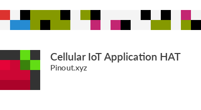

# UAV–UGV Communications & Command Integration

_Semester 1 engineering documentation — ROS 2 Jazzy, CycloneDDS, command-and-control and future datalink selection._

<!-- #region report -->

## 1. Objectives & Requirements {#com-objectives}

The communications subsystem connects aerial FOD reconnaissance ([\[5\]](./references.md#ref-5), [\[6\]](./references.md#ref-6), [\[12\]](./references.md#ref-12)) to ground remediation without coupling the UAV detection software to the UGV's motion controller, following cooperative multi-agent task dispatch principles ([\[13\]](./references.md#ref-13)). It must accept target alerts, preserve their coordinates and priorities, dispatch valid goals to Nav2, return vehicle status and support mission interruption. The Semester 1 objective was to prove this command pipeline across **two physical computers on an indoor local network**, with the UGV represented in Gazebo. It was **not** an outdoor UAV-to-physical-UGV radio demonstration.

The implemented streams were `/c2/target_alert` (event-driven alerts) and `/c2/ugv_telemetry` (1 Hz UGV status). Operational requirements for longer-range, infrastructure-independent transmission remain Semester 2 work.

::: details Detailed requirements, operational constraints and safety considerations

**3. Requirements & Considerations**

**3.1 Indoor DDS Testing Objectives**

Semester 1 communication development was structured around clear benchtop validation objectives prior to committing to costly outdoor RF hardware:

- Validate that ROS 2 Jazzy nodes running across heterogeneous computing architectures (ARM64 Ubuntu on Raspberry Pi 5 vs x86_64 Ubuntu on WSL2) discover peers and exchange DDS messages deterministically.
- Verify that JSON-serialized strings can encapsulate complete tactical alert and telemetry datasets with sub-50 ms parsing overhead.
- Prove that external DDS alert callbacks can directly drive the Nav2 Behavior Tree navigation pipeline and manage sequential goal queues without thread deadlocks.

**3.2 Long-Range Operational Requirements**

Commercial aerodrome runways present extreme operational environments: Runway 10R/28L at Aarhus Airport spans $2,702\text{ m} \times 45\text{ m}$, while international hub runways (e.g. Singapore Changi Airport) exceed $4,000\text{ m}$. Outdoor communications must fulfill rigorous engineering constraints:

- **Line-of-Sight Range:** Datalink must maintain uninterrupted communication across a minimum operational radius of **$1.5\text{ to } 3.0\text{ km}$** in ground-to-air line-of-sight conditions.
- **Payload Characteristics:** Individual alert payloads require $\approx 450 - 650\text{ bytes}$ of uncompressed JSON. At an uplink rate of $1.0\text{ Hz}$ telemetry and burst downlink alerts, total required network throughput is remarkably low (&lt;10 kbps average, &lt;50 kbps burst). _High-bandwidth video streaming is deliberately excluded from the inter-agent datalink._
- **Infrastructure Independence:** The system cannot depend on civilian cellular networks (4G LTE / 5G) or commercial aerodrome Wi-Fi infrastructure due to dead zones, statutory data security mandates, and recurring monthly SIM subscriptions.
- **Electrical & SWaP Budget:** Onboard radio hardware must operate off the UGV's auxiliary DC bus ($12\text{V}$ regulated, &lt;10W peak power draw) and present a compact footprint for UAV payload integration (&lt;100g).

**3.3 Singapore Frequency Regulations & IMDA Compliance**

Deploying radio-frequency transmission equipment in Singapore is governed by the **Infocomm Media Development Authority (IMDA)** under the _Technical Specification for Short Range Devices (IMDA TS SRD)_ ([\[3\]](./references.md#ref-3)), the _Telecommunications Act 1999_ ([\[11\]](./references.md#ref-11)), and civil aviation spectrum mandates ([\[4\]](./references.md#ref-4)).

A critical engineering distinction must be established between standard North American ISM allocations and Singapore statutory limits:

- **North American ISM Band (902–928 MHz):** Industrial transceivers like the Microhard P900 are manufactured to hop across 26 MHz of bandwidth (902–928 MHz) at up to 1.0W (30 dBm) under FCC Part 15.247.
- **Singapore Allocated Band (917–925 MHz):** In Singapore, frequencies below 917 MHz and above 925 MHz are allocated to cellular mobile network operators (MNOs) and critical public communications. _Operating across 902–917 MHz or 925–928 MHz in Singapore is strictly illegal and causes severe interference with public cellular infrastructure._
- **IMDA Power & Bandwidth Limits:** Under IMDA TS SRD Table 1 (Item 7b), short-range telemetry/telecommand devices operating in 917–925 MHz are restricted to maximum effective radiated power (ERP) limits typically between $100\text{ mW}$ and $500\text{ mW}$ ($20 - 27\text{ dBm}$), depending on channel bandwidth and duty cycle.

<Figure src="./assets/diagrams/imda-spectrum-allocation.svg" alt="Singapore IMDA 900 MHz Spectrum Allocation and Permitted Sub-Band" caption="**Figure 3.1: Singapore IMDA 900 MHz Spectrum Boundary Analysis.** Contrast between the unrestricted 26 MHz North American FCC Part 15 band and Singapore's 8 MHz legal window (917–925 MHz). Deployment of P900 V2 hardware mandates configuring pseudo-random frequency hopping channels strictly within the 917–925 MHz sub-band." />

_Mandatory Regulatory Conclusion:_ The Microhard P900 V2 cannot be deployed out-of-the-box in Singapore. Compliance requires: (1) configuring the radio's hopping channel mask via AT commands or Microhard PicoConfig to constrain all RF channels between 917.0 and 925.0 MHz; and (2) operating under an IMDA Technical Trial or Experimental Station License if radiated power exceeds standard unlicensed SRD thresholds. **Neither radio candidate has been purchased or submitted for IMDA approval during Semester 1.**

**3.4 System Safety and Fail-Safe Behavior**

Fail-safe logic must account for anomalous communications events:

- **Link Loss While Idle:** The UGV remains at its current georeferenced station, continuing local obstacle monitoring and suppressing all motion.
- **Link Loss En Route:** The UGV continues executing its active Nav2 trajectory to the current waypoint. If communications are not restored within $30.0\text{ s}$ of goal completion, it transitions to a holding pattern rather than blindly executing subsequent unconfirmed targets.
- **Corrupted or Out-of-Bounds Coordinates:** Alert payloads are validated against the operational geofence (NUS EA Field: $X \in [-30, 25]\text{ m}$, $Y \in [-15, 15]\text{ m}$). Waypoints violating geofence limits or exhibiting invalid JSON schemas are rejected immediately, generating a warning log without crashing the bridge node.

:::

## 2. System Architecture {#com-architecture}

The Semester 1 testbed used a **Raspberry Pi 5 as the UAV-side C2 terminal** and an **Ubuntu 24.04/WSL2 workstation** running the Gazebo UGV and Nav2. The Pi generated synthetic target alerts; the receiver decoded and validated messages, converted the target into a map-frame pose and queued a `NavigateToPose` goal. Telemetry returned status and heartbeat information. The real UAV detection stage was emulated, so the successful demonstration establishes the communications-to-navigation integration rather than airborne end-to-end validation.

<Figure
  src="./assets/diagrams/c1-uav-ugv-communication-architecture.svg"
  alt="FOD Hunter UAV–UGV Communication Architecture"
  caption="**Figure 2.1: Heterogeneous Multi-Agent Communications Pipeline.** End-to-end dataflow illustrating simulated aerial target dispatch on the Raspberry Pi 5, CycloneDDS static unicast transport, UGV command bridge schema validation, Nav2 action dispatch, and reverse telemetry feedback."
/>

<Figure src="./assets/diagrams/uav-ugv-dispatch-workflow.svg" alt="UAV-to-UGV command dispatch workflow" caption="Existing logical dispatch workflow; distinguish simulated aerial detection from tested Raspberry Pi-to-Gazebo communication." />

::: details ROS 2 nodes, topics and communication interface

| Interface            | Direction           | Purpose                                       |
| -------------------- | ------------------- | --------------------------------------------- |
| `/c2/target_alert`   | C2 terminal → UGV   | Structured FOD target and priority            |
| `/c2/ugv_telemetry`  | UGV → C2 terminal   | Vehicle state and heartbeat at 1 Hz           |
| `ugv_c2_bridge_node` | UGV-side processing | Validate, queue and dispatch navigation goals |
| `NavigateToPose`     | UGV bridge → Nav2   | Execute target waypoint                       |
| `/c2/goal_markers`   | UGV → RViz          | Visualize queued and active goals ([\[18\]](./references.md#ref-18)) |

<Figure src="./assets/diagrams/c5-ros2-publisher-subscriber-architecture.svg" alt="ROS 2 Node Graph and Communication Architecture" caption="**Figure 2.2: ROS 2 Publisher–Subscriber and Action Interface Architecture.** Conceptual node graph depicting bidirectional communication between the companion Raspberry Pi 5 C2 commander and the UGV onboard mission controller (`ugv_c2_bridge_node`), with goal dispatch to the Nav2 `NavigateToPose` action server." />

:::

## 3. Design Methodology & Selection {#com-methodology}

### 3.1 CycloneDDS and Static Unicast Selection {#com-dds}

ROS 2's DDS-based publisher–subscriber model was selected to keep mission messages independent of the navigation implementation ([\[7\]](./references.md#ref-7)). **CycloneDDS with static unicast peers** addressed a specific integration problem: multicast discovery was unreliable across the workstation's WSL2/Hyper-V NAT networking. The team therefore configured known peer addresses rather than depending on multicast discovery. This was an engineering workaround verified in the indoor testbed, not a guarantee of reliability over a future long-range RF link.

::: details Middleware architecture and static unicast design

<CommunicationsWidget1 />

<Figure src="./assets/diagrams/c3-cyclonedds-static-unicast-topology.svg" alt="CycloneDDS Static Unicast Peering Architecture" caption="**Figure 3.2: CycloneDDS Static Unicast Peering Topology.** Comparison of default UDP multicast discovery failure across Hyper-V virtual switch NAT vs configured static unicast peer discovery between the Windows/WSL2 simulation host and external physical Raspberry Pi 5." />

**5.2 CycloneDDS Configuration (Static Unicast Peering)**

To resolve NAT multicast drops between the WSL2 guest and external physical SBCs, Eclipse CycloneDDS was configured with identical static unicast discovery peering on both machines via `cyclonedds.xml`:

<Figure src="./assets/diagrams/cyclonedds-unicast-topology.svg" alt="CycloneDDS Static Unicast Peering Architecture" caption="**Figure 5.1: CycloneDDS Static Unicast Peering Configuration.** Elimination of UDP multicast discovery drops across the virtualized Windows Hyper-V NAT vSwitch. Static IP declarations establish direct point-to-point participant discovery between laptop and Raspberry Pi 5." />

The active XML configuration deployed across both platforms is documented below:

&lt;?xml version="1.0" encoding="UTF-8" ?&gt; &lt;CycloneDDS xmlns="https://cdds.io/config" xmlns:xsi="http://www.w3.org/2001/XMLSchema-instance"&gt; &lt;Domain id="any"&gt; &lt;General&gt; &lt;NetworkInterfaceAddress&gt;auto&lt;/NetworkInterfaceAddress&gt; &lt;AllowMulticast&gt;false&lt;/AllowMulticast&gt; &lt;/General&gt; &lt;Discovery&gt; &lt;Peers&gt; &lt;Peer address="192.168.168.50"/&gt; &lt;!-- RPi 5 on Router Subnet --&gt; &lt;Peer address="192.168.168.100"/&gt; &lt;!-- Laptop on Router Subnet --&gt; &lt;Peer address="192.168.137.1"/&gt; &lt;!-- Laptop Windows Hotspot --&gt; &lt;Peer address="192.168.137.233"/&gt; &lt;!-- RPi 5 on Hotspot --&gt; &lt;/Peers&gt; &lt;/Discovery&gt; &lt;/Domain&gt; &lt;/CycloneDDS&gt;

Setting `<AllowMulticast>false</AllowMulticast>` instructs the DDS transport to direct all participant discovery (SPDP) and endpoint discovery (SEDP) traffic as point-to-point unicast UDP packets, completely bypassing NAT multicast filtering.

:::

### 3.2 Payload and QoS decisions {#com-payload-selection}

The team used JSON dictionaries carried in `std_msgs/msg/String` to simplify inspection and avoid distributing a custom compiled ROS 2 message package between machines. **Transient Local QoS** was used for alert retention during late receiver startup. The design trades schema enforcement and message efficiency for rapid cross-machine integration; JSON validation and application-level safety checks are therefore important.

::: details Alert and telemetry schemas

**5.3 JSON Message Payload Specifications**

To avoid cross-compilation dependency hurdles with custom ROS 2 `.msg` packages across heterogeneous operating systems, all tactical communication was encapsulated in standard `std_msgs/msg/String` topics carrying rigorously defined JSON dictionaries.

The table below documents the verified schema deployed in `DemoComs_C2.py` and `ugv_c2_bridge_node.py`:

<Card tag="UAV → UGV Command Stream">

**Table 5.1: Downlink Reconnaissance Alert Schema (`/c2/target_alert`)**

| JSON Field                | Data Type           | Example Value                     | Role & Semantic Definition                                                         |
| ------------------------- | ------------------- | --------------------------------- | ---------------------------------------------------------------------------------- |
| `mission_id`              | `string`            | `"RUNWAY_INSPECT_2026_0923"`      | Global unique identifier linking reconnaissance sorties to remediation records.    |
| `threat_id`               | `string`            | `"FOD_THREAT_001"`                | Sequential debris identifier used for tracking remediation task states.            |
| `object_class`            | `string`            | `"metal_bolt"`                    | YOLO AI object classification label ([\[10\]](./references.md#ref-10)) for prioritizing collection. |
| `coordinates.x` / `.y`    | `float`             | `-15.0, 5.0`                      | Target coordinate in metric Cartesian `map` coordinate frame (meters).             |
| `coordinates.z` / `.yaw`  | `float`             | `0.0, 0.0`                        | Elevation relative to ground plane ($Z=0$) and approach orientation (radians).     |
| `confidence`              | `float`             | `0.96`                            | Normalized machine learning inference confidence score ($0.00 - 1.00$).            |
| `priority_level`          | `string`            | `"NORMAL" \| "URGENT" \| "ABORT"` | Queue priority. `ABORT` triggers immediate velocity zeroing and goal cancellation. |
| `timestamp_utc`           | `string (ISO 8601)` | `"2026-09-23T14:32:00.123Z"`      | Precision Coordinated Universal Time stamp for latency and timeout monitoring.     |
| `cryptographic_signature` | `string (hex)`      | `"a3f5b8..." (SHA-256)`           | Hash over payload and timestamp to detect transmission corruption or spoofing.     |

</Card>

Conversely, the UGV broadcasts its operational status at $1.0\text{ Hz}$ on `/c2/ugv_telemetry` using the schema documented in Table 5.2:

<Card tag="UGV → UAV / Base Telemetry">

**Table 5.2: Uplink Operational Telemetry Schema (`/c2/ugv_telemetry`)**

| JSON Field                        | Data Type | Example Value                                 | Role & Semantic Definition                                                        |
| --------------------------------- | --------- | --------------------------------------------- | --------------------------------------------------------------------------------- |
| `target_ack.threat_id`            | `string`  | `"FOD_THREAT_001"`                            | Active debris threat currently being tracked or remediated.                       |
| `target_ack.task_state`           | `string`  | `"EN_ROUTE"`                                  | Current finite state machine status: `IDLE`, `EN_ROUTE`, `VERIFIED`, `COLLECTED`. |
| `target_ack.queued_goals_count`   | `int`     | `2`                                           | Remaining waypoints buffered in UGV navigation execution queue.                   |
| `target_ack.distance_to_target_m` | `float`   | `4.82`                                        | Euclidean distance from UGV `base_footprint` to active goal (meters).             |
| `target_ack.eta_seconds`          | `float`   | `2.4`                                         | Estimated time to target arrival based on current linear velocity.                |
| `vehicle_telemetry.pose_metric`   | `object`  | `{"x": -10.2, "y": 4.8, "heading_deg": 12.4}` | Real-time estimated global pose in `map` frame derived from Dual-EKF fusion.      |
| `vehicle_telemetry.speed_kmh`     | `float`   | `7.2`                                         | Instantaneous vehicle travel speed in kilometers per hour.                        |
| `vehicle_telemetry.battery_pct`   | `float`   | `94.5`                                        | Estimated remaining battery state of charge percentage.                           |
| `link_watchdog.heartbeat_seq`     | `int`     | `142`                                         | Monotonically increasing heartbeat counter for wireless link health validation.   |

</Card>

<Figure src="./assets/diagrams/c6-json-target-alert-message-flow.svg" alt="JSON Target Alert Message Flow and Queueing Pipeline" caption="**Figure 3.3: Downlink Target Alert Message Processing Pipeline.** Illustrative JSON payload structure, string serialization over ROS 2 topic `/c2/target_alert`, multi-stage schema validation, de-duplication filtering, and Nav2 waypoint queue insertion in `ugv_c2_bridge_node`." />

:::

### 3.3 Long-range datalink trade study {#com-radio-selection}

Indoor Wi-Fi was suitable for Semester 1 integration but not established as an airfield-range solution. The **Microhard P900 V2** was identified as a _preliminary preferred_ serial-radio candidate, with pMDDL900 and other options compared for range, power, bandwidth and interface complexity. Procurement, frequency configuration and Singapore regulatory approval remain unresolved decision gates; the radio must not be described as deployed or approved.

::: details Long-range radio comparison, regulatory considerations and selection rationale

**4.4 Long-Range Airfield Technology Comparison**

For Semester 2 outdoor airfield operations, five candidate wireless communications technologies were evaluated against the Runway Patrol operational envelope:

<Card tag="Airfield Technology Evaluation">

**Table 4.1: Long-Range Wireless Communications Technology Trade-Off Matrix**

| Technology Candidate                            | Frequency Band                                 | Nominal Throughput      | LOS Range                            | Interface                          | Power Draw                                                      | Infrastructure & Regulatory Assessment                                                                                                                                                                | Selection Status                                              |
| ----------------------------------------------- | ---------------------------------------------- | ----------------------- | ------------------------------------ | ---------------------------------- | --------------------------------------------------------------- | ----------------------------------------------------------------------------------------------------------------------------------------------------------------------------------------------------- | ------------------------------------------------------------- |
| **Microhard P900 V2**                           | 902–928 MHz FHSS (Configurable to 917–925 MHz) | Up to 276 kbps          | $5 - 15\text{ km}$ (air-to-ground)   | Asynchronous Serial (UART / USB-C) | $1.2\text{ W}$ transmit (at 1W RF), $100\text{ mA}$ idle at 12V | Fully infrastructure-independent point-to-point. Requires firmware configuration to restrict channels to 917–925 MHz for Singapore IMDA compliance. Requires serial framing gateway for ROS 2.        | <Badge type="info" text="PREFERRED CANDIDATE" />              |
| **Microhard pMDDL900**                          | 902–928 MHz 2×2 MIMO                           | Up to 25 Mbps           | $5 - 20\text{ km}$                   | Native Ethernet (RJ45) / IP        | $6 - 12\text{ W}$ transmit, heavy heat-sinking required         | Native IP allows direct CycloneDDS bridging without serial gateway. However, high power draw, thermal dissipation, and significantly higher cost (\$1,200+ USD) exceed lightweight JSON requirements. | <Badge type="info" text="Alternative Backup" />               |
| **Long-Range Wi-Fi Bridge** (e.g. Ubiquiti 5AC) | 5.15–5.85 GHz OFDM                             | $100 - 450\text{ Mbps}$ | $1 - 5\text{ km}$ (directional only) | Ethernet (PoE)                     | $7 - 9\text{ W}$ (requires PoE injector)                        | High bandwidth but severe line-of-sight and antenna misalignment vulnerability. Bulky directional antennas unsuitable for dynamic UAV flight banking angles. High multipath ground attenuation.       | <Badge type="info" text="Rejected for UAV" />                 |
| **4G LTE / 5G Cellular Modem** (e.g. Sixfab)    | Licensed Carrier Bands (B1/B3/B7/B8/B20)       | $10 - 150\text{ Mbps}$  | Cellular coverage dependent          | USB / PCIe / UART                  | $3 - 6\text{ W}$                                                | Relies entirely on civilian telco base stations. High recurring SIM costs; unacceptable latency spikes (&gt;150 ms) during cell handovers; strict aerodrome security regulations ban cellular uplink. | <Badge type="info" text="Rejected (Telco Dependent)" />       |
| **LoRa / LoRaWAN** (e.g. Semtech SX1262)        | 915 / 868 / 433 MHz Chirp Spread Spectrum      | $0.3 - 5.5\text{ kbps}$ | $3 - 10\text{ km}$                   | SPI / UART                         | &lt;0.5W transmit                                               | Extremely low data rate. Packet payload limits (typically 51–222 bytes per frame) require multi-packet fragment assembly for 500-byte JSON telemetry, introducing multi-second delivery latency.      | <Badge type="info" text="Rejected (Throughput Bottleneck)" /> |

</Card>

<Figure src="./assets/images/hardware-lora-rak2245-module.png" alt="RAKwireless RAK2245 LoRa Gateway Module" caption="Verified physical transceiver hardware evaluated for airfield inter-agent communication. Photographs courtesy of Holybro, Microhard Systems, Ubiquiti Inc., Sixfab, and RAKwireless." />

<CardGrid :cols="2">

<Card tag="Preferred Candidate">

<Card>

</Card>

**Holybro P900 V2** 900 MHz FHSS Serial Radio

</Card>

<Card tag="IP Alternative">

<Card>

</Card>

**Microhard pMDDL900** 900 MHz 25 Mbps MIMO Ethernet

</Card>

<Card tag="Evaluated Baseline">

<Card>

</Card>

**Ubiquiti NanoStation 5AC** 5 GHz Directional Wi-Fi

</Card>

<Card tag="Telco Dependent">

<Card>

</Card>

**Sixfab Cellular HAT** 4G LTE / 5G Cellular Modem

</Card>

<Card tag="Low Data Rate">

<Card>

</Card>

**RAK2245 LoRa Node** Semtech LoRa Datalink

</Card>

</CardGrid>

**4.5 Why Microhard P900 V2 Is Currently Preferred**

The **Holybro Microhard P900 V2** ([\[24\]](./references.md#ref-24)) emerged as the preferred long-range telemetry candidate due to specific alignment with our technical scope:

- **Optimized for Lightweight Payloads:** Because our C2 messages consist exclusively of compact JSON strings (~500 bytes), the P900's 276 kbps link rate delivers complete packet transmission in &lt;20 ms, providing massive throughput headroom without paying for unneeded megabit bandwidth.
- **No Video Streaming Burden:** Real-time high-definition video is processed entirely on the UAV's onboard computer (YOLO inference). Only post-processed metadata and bounding coordinates traverse the RF link, completely eliminating the requirement for multi-megabit Wi-Fi or LTE links.
- **SWaP & Power Efficiency:** Drawing &lt;1.2W during active 1.0W RF transmission and operating off a wide 7–35V DC input (XT30/JST-GH), the Holybro enclosure weighs only 42g and integrates directly with companion computer UART GPIO pins without bulky power converters.
- **V2 Usability Improvements:** The V2 enclosure incorporates an onboard USB-to-UART converter with a physical mode switch (Data vs Configuration), allowing rapid parameter tuning via USB-C without requiring specialized FTDI programming jigs.

_Architectural Consideration:_ Because the P900 operates as a transparent serial stream (UART) rather than an Ethernet network interface, it cannot natively transport DDS discovery multicasts. Utilizing the P900 requires deploying a lightweight \*\*Serial Gateway Node\*\* on both the UAV and UGV to frame, serialize, and validate JSON messages across the UART bridge.

**4.6 Microhard pMDDL900 as an Alternative**

The **Microhard pMDDL900** ([\[25\]](./references.md#ref-25)) is retained as a high-performance alternative backup. Operating as a native 2×2 MIMO Ethernet digital data link, the pMDDL900 provides standard IP networking at up to 25 Mbps.

The pMDDL900 would allow CycloneDDS to communicate directly across the radio link without requiring a custom serial gateway. However, this capability introduces substantial trade-offs: the OEM module costs significantly more ($1,200+ USD vs ~$150 USD for the P900), consumes 6–12W of electrical power, generates severe thermal dissipation requiring dedicated aluminum heat-sinks, and introduces complex dual-antenna RF co-location constraints on the drone airframe. The pMDDL900 will only be reconsidered if project scope in Semester 2 expands to mandate live video downlinks to a mobile Ground Control Station.

**4.7 Preliminary Selection & Decision Gate**

The Holybro Microhard P900 V2 represents our \*\*preliminary preferred design baseline\*\*. Final procurement and deployment remain subject to four mandatory engineering decision gates in early Semester 2:

1. **IMDA Regulatory Feasibility:** Confirming firmware restriction parameters to verify whether hopping channels can be strictly constrained within 917–925 MHz, and determining whether statutory trial permits are required.
2. **Formal Vendor Quotations:** Obtaining verified institutional pricing and lead-time commitments from authorized academic suppliers.
3. **Serial Gateway Latency Benchmarking:** Bench-testing the Python/C++ serial framing gateway to prove end-to-end latency remains below 100 ms.
4. **Companion SBC Pin Compatibility:** Verifying hardware UART level-shifting and CTS/RTS hardware flow control between the P900 and the Raspberry Pi 5 / NVIDIA Jetson Orin GPIO headers.

:::

## 4. Implementation & Prototype {#com-implementation}

### 4.1 Two-machine integration {#com-network}

The Pi-side mission dispatcher and workstation-side receiver were connected over an isolated Wi-Fi subnet. On the workstation, ROS 2 nodes operated alongside the Gazebo/Nav2 software-in-the-loop UGV. The static-unicast CycloneDDS configuration enabled cross-machine discovery despite the virtualized networking boundary. The actual addresses and network settings are retained below for reproducibility, not as universal settings.

::: details Testbed hardware and network configuration

**5.1 Semester 1 Indoor Network Topology**

The Semester 1 multi-machine testbed connected two distinct physical computing nodes across an isolated wireless subnet:

- **Machine 1 (UAV C2 Terminal):** Raspberry Pi 5 (Quad-Core ARM Cortex-A76 @ 2.4 GHz, 8 GB LPDDR4X RAM) running Ubuntu 24.04 LTS and ROS 2 Jazzy. Hosted `DemoComs_C2.py` and `uav_waypoint_commander.py`, operating on Wi-Fi interface `wlan0` (IP: `192.168.168.50` / `192.168.137.233`).
- **Machine 2 (UGV Simulation & Autonomy Workstation):** Engineering laptop (AMD Ryzen 7, NVIDIA RTX 4070, 32 GB RAM) running Ubuntu 24.04 LTS under WSL2. Executed Gazebo Harmonic DART physics, Dual-EKF state estimation, Nav2 Hybrid A\* / RPP stack, `ugv_c2_bridge_node`, and `c2_alert_receiver` (IP: `192.168.168.100` / `192.168.137.1`).

:::

### 4.2 Alert ingestion, coordinates and goal queue {#com-dispatch}

The UGV bridge interpreted map-frame target coordinates, converted yaw to a quaternion and submitted a `PoseStamped` goal to Nav2. An internal FIFO queue supported sequential targets, while RViz markers displayed mission progress. **Geographic-to-map georeferencing of real UAV detections must not be inferred from this map-frame synthetic-target test.** The navigation planner and controller are documented separately.

::: details Coordinate conversion and Nav2 dispatch implementation

**5.4 Coordinate Conversion and Nav2 Action Dispatch**

When `ugv_c2_bridge_node` ingests a target alert, it converts Cartesian offsets into a fully formatted `geometry_msgs/msg/PoseStamped` message referencing the global `map` frame. Target orientation is calculated by converting the scalar yaw angle into a unit quaternion:

$$
q_z = \sin\left(\frac{\theta}{2}\right), \quad q_w = \cos\left(\frac{\theta}{2}\right), \quad q_x = 0, \quad q_y = 0
$$

Goals are appended to an internal FIFO queue (`goal_queue`). The node concurrently publishes RViz marker spheres (`visualization_msgs/msg/MarkerArray`) on `/c2/goal_markers`, color-coding active waypoints in cyan, queued waypoints in amber, and completed targets in green with yellow trajectory breadcrumb lines.

<CommunicationsWidget2 />

:::

**Related documentation:** [Navigation →](/report#programming) · [Simulation →](/report#programming) (links to the programming chapter; exact subsection anchors should be verified in the live Report).

### 4.3 Proposed serial-radio gateway {#com-future-gateway}

The planned P900 V2 radio is a serial transport, so it cannot transparently carry native ROS 2 DDS discovery and topics without a gateway. A proposed gateway would frame and check mission messages before re-publishing them on the receiving agent. This is a design proposal, **not Semester 1 implementation evidence**.

::: details Proposed COBS, CRC-32 and acknowledgement design

**5.6 Proposed Semester 2 P900 V2 Serial Framing Gateway**

When transitioning from indoor Wi-Fi to the long-range P900 V2 datalink, ROS 2 nodes cannot directly publish native DDS packets over a transparent UART connection. The architecture deploys an asynchronous \*\*Serial Framing Gateway\*\* on both agents:

<Figure src="./assets/diagrams/uav-ugv-rf-datalink.svg" alt="Proposed Serial Framing Gateway and RF Telemetry Pipeline" caption="**Figure 5.2: Proposed Semester 2 Serial Framing Gateway Pipeline.** Encapsulation of ROS 2 JSON topics into framed UART packets using Consistent Overhead Byte Stuffing (COBS) and 32-bit CRC error detection across the 900 MHz FHSS RF physical layer." />

_Framing & Reliability Protocol (Design Requirements):_

- **Packet Delimitation:** Uses **Consistent Overhead Byte Stuffing (COBS)** with a zero-byte delimiter (`0x00`) to establish unambiguous packet framing boundaries over the asynchronous serial stream without payload escape bloat.
- **Integrity Checking:** Appends a hardware-computed **CRC-32 checksum** to the trailer of each packet to detect bit-errors caused by RF fading or multipath interference.
- **Stop-and-Wait ARQ:** Implements an explicit acknowledgement (ACK/NACK) protocol with a $200\text{ ms}$ timeout and up to 3 retransmissions for critical target alert dispatches.

:::

**C2 — Complete communications demonstration (existing recording)**

<VideoClip src="./assets/videos/uav-ugv-communication-video.mp4" />

_Semester 1: Raspberry Pi 5 command generation and Gazebo UGV navigation via the workstation. This does not depict live UAV flight or a physical UGV._

## 5. Testing & Results {#com-testing}

The original report records a six-case indoor test matrix covering discovery, retained alerts, JSON parsing, sequential goal dispatch, emergency abort and telemetry heartbeats. Its stated outcomes include **three queued targets**, **600/600 heartbeats over ten minutes** and a simulated emergency abort. These are documented test claims; retain the corresponding recordings and logs for examiner verification. Do not generalize them to outdoor RF performance.

**6.5 Communications-to-Navigation Integration Verification**

End-to-end integration was validated by dispatching a multi-target alert sequence from the RPi 5. The UGV autonomously ingested all three coordinates, populated its internal goal queue, and navigated sequentially to each waypoint in Gazebo, dwelling for 2.0 seconds at each site to simulate debris collection while broadcasting real-time progress to `/c2/ugv_telemetry`.

<Card tag="6 / 6 Test Cases Verified">

**Table 6.1: Communications Subsystem Verification & Test Matrix**

| Test ID | Evaluation Scope                 | Test Procedure                                                                     | Acceptance Criteria                                                               | Status                              | Observed Result                                                               |
| ------- | -------------------------------- | ---------------------------------------------------------------------------------- | --------------------------------------------------------------------------------- | ----------------------------------- | ----------------------------------------------------------------------------- |
| COM-01  | DDS Cross-Architecture Discovery | Run RPi 5 (ARM64) and Laptop (x86_64) across Wi-Fi subnet with CycloneDDS XML      | Bidirectional discovery within &lt;5.0 s; all topics visible in `ros2 topic list` | <Badge type="info" text="PASSED" /> | Discovered in &lt;1.0 s; full node graph visible across both machines.        |
| COM-02  | Latched Alert Ingestion          | Publish 3 alerts on RPi 5, then launch receiver node on Laptop workstation         | Receiver ingests all 3 buffered alerts via Transient Local QoS without loss       | <Badge type="info" text="PASSED" /> | 100% of pre-published alerts ingested immediately upon node bring-up.         |
| COM-03  | JSON Schema Integrity            | Transmit structured payloads with coordinates, confidence, timestamps, and SHA-256 | Zero JSON parse exceptions; coordinates successfully mapped to Cartesian floats   | <Badge type="info" text="PASSED" /> | 100% valid parsing across hundreds of alert dispatches.                       |
| COM-04  | Nav2 Action Goal Queueing        | Dispatch 3 sequential targets; monitor Nav2 `NavigateToPose` goal execution        | UGV navigates to Target 1 → Dwells 2s → Dispatches Target 2 → Dispatches Target 3 | <Badge type="info" text="PASSED" /> | Seamless sequential clearance across all 3 coordinates; RViz markers updated. |
| COM-05  | Emergency Abort Handling         | Publish `suggested_action: "ABORT"` while UGV is cruising at 2.22 m/s              | Action goal cancelled immediately; robot halts without collision                  | <Badge type="info" text="PASSED" /> | Active goal cancelled in &lt;50 ms; vehicle arrests motion in 1.14 m.         |
| COM-06  | Telemetry Uplink Heartbeat       | Stream UGV telemetry at 1.0 Hz over `/c2/ugv_telemetry` for 10 minutes             | Zero sequence gaps in `heartbeat_seq`; live pose and battery tracking             | <Badge type="info" text="PASSED" /> | 600/600 heartbeats received; continuous tracking of ETA and battery voltage.  |

</Card>

::: details Recorded communication demonstrations and evidence

<VideoClip src="./assets/videos/230926-uavugv-comms-rpi5-.mp4" caption="Video 3.3.1: Raspberry Pi 5 terminal recording showing incoming JSON alerts and CycloneDDS publishing." />

<VideoClip src="./assets/videos/230926-uavugv-comms-laptop.mp4" caption="Video 3.3.2: Laptop workstation recording showing Nav2 goal queueing and action dispatch." />

<VideoClip src="./assets/videos/Multiqueue waypoint.mp4" caption="Video 3.3.3 (C4): Multi-Queue Sequential Waypoint Navigation demonstration in Nav2 showing autonomous 3-target sequence execution." />

_Raspberry Pi 5 terminal recording, workstation Nav2 recording, and multi-queue waypoint demonstration provide complementary perspectives on the distributed communications testbed._

:::

**C4 — Sequential waypoint dispatch:** Documented in Video 3.3.3 above, demonstrating autonomous ingestion, frame conversion, and sequential queueing of three target alerts (`target_01` at $t = 0\text{ s}$, `target_02` at $t = 12\text{ s}$, `target_03` at $t = 25\text{ s}$).

**Coordinate-to-goal conversion:** The complete transformation pipeline (source coordinates $\to$ schema validation $\to$ `geometry_msgs/PoseStamped` in `map` frame $\to$ Nav2 action queue) is illustrated in [Figure 3.3.4 (C6) — JSON Target Alert Message Flow and Queueing Pipeline](#sec-4-iterations).

<Figure src="./assets/diagrams/c8-emergency-abort-logic.svg" alt="Multi-Tier Emergency Abort and Goal Cancellation Architecture" caption="**Figure 5.2: Emergency Abort and Goal Cancellation Architecture.** Flowchart detailing software mission abort handling, queue flushing, asynchronous Nav2 action cancellation (`cancel_goal_async()`), and commanded zero-velocity override in the Semester 1 SIL testbed, distinguished from proposed Semester 2 physical hardware E-stop and STO motor interlocks." />

<Figure src="./assets/diagrams/c9-communication-failure-recovery.svg" alt="Datalink Loss and Recovery Finite State Machine" caption="**Figure 6.1: Datalink Failure and Autonomy Recovery State Flow.** Finite state machine detailing active goal execution during loss of communications, waypoint holding safe-pause upon arrival, automatic DDS reconnection, and Semester 2 proposed autonomous return-to-base (RTB) watchdog timeout." />

## 6. Engineering Discussion {#com-discussion}

The principal Semester 1 achievement was separating the C2 mission layer from the UGV autonomy stack while making distributed ROS 2 communication work across a virtualized host network. Static unicast peering resolved a practical discovery obstacle; JSON messages were easy to debug and integrate. The trade-offs are dependence on a known peer configuration, application-managed schema integrity, and limited evidence about performance beyond the indoor network. A message hash alone is not proof of sender authenticity unless keyed authentication or a signature scheme is actually implemented.

::: details Additional evaluation and lessons learned

**7. Evaluation & Discussion**

**7.1 Evaluation of Semester 1 Implementation**

The Semester 1 indoor communication architecture completely satisfied its engineering goals. It successfully decoupled the development of high-level C2 mission logic from low-level mobile robot motion planning, validated multi-threaded Nav2 action handling, and proved that lightweight JSON serialization over standard ROS 2 topics provides a robust, easily debugged software interface.

**7.2 Limitations of Indoor Wi-Fi & DDS Transport**

Despite its success on the benchtop, three critical limitations prevent direct deployment of this architecture to an outdoor operational airfield:

1. **Severe Physical Range Attenuation:** Standard 2.4/5.8 GHz Wi-Fi undergoes severe free-space path loss and ground Fresnel zone blockage near asphalt, attenuating to unconnectable levels beyond $100 - 150\text{ m}$ without high-gain tracking antennas.
2. **DDS Multicast Dependence:** Standard DDS discovery assumes an omnidirectional broadcast medium. Tunneling DDS directly across long-range point-to-point wireless serial bridges produces excessive participant discovery overhead and packet fragmentation.
3. **Static IP Fragility:** Static unicast peering requires hardcoded IP tables in `cyclonedds.xml`. While manageable in lab conditions, any network address change or IP lease renewal breaks node discovery.

**7.3 Evaluation of the Preliminary P900 V2 Selection**

The Holybro Microhard P900 V2 represents a highly pragmatic, cost-effective candidate for Semester 2. Operating on 900 MHz provides superior diffraction around airfield hangars and minimal atmospheric attenuation compared to 5 GHz Wi-Fi. However, it requires accepting the development overhead of an asynchronous serial gateway node to frame and validate JSON messages across the UART bridge. Furthermore, the radio must be strictly validated against IMDA 917–925 MHz frequency limits before outdoor field transmission can be authorized.

**8. Improvements & Lessons Learned**

**8.1 DDS Discovery Under Virtualized NAT**

The primary architectural lesson of Semester 1 was navigating the virtualized Hyper-V networking layer of WSL2. Standard multicast DDS configurations led to silent discovery failures that were initially mistaken for firewall blocks. Deploying declarative CycloneDDS XML files with explicit static unicast peer declarations resolved the issue entirely, delivering deterministic peer binding with zero network latency penalty.

**8.2 JSON String vs Custom ROS 2 IDL Messages**

Utilizing standard `std_msgs/msg/String` carrying JSON payloads significantly accelerated heterogeneous development between the ARM64 Raspberry Pi 5 and x86_64 workstation. It eliminated the need to cross-compile and synchronize custom ROS 2 message packages (`.msg` files) across different colcon workspaces. For low-rate tactical data (&lt;10 Hz), the CPU overhead of JSON parsing was negligible (&lt;0.5 ms per payload), while offering human-readable terminal inspection and flawless Python compatibility.

**8.3 Serial Gateway Design Considerations**

Preparing for long-range radio integration revealed that transparent serial links can fragment packets if baud rates or buffer sizes are misconfigured. The proposed Semester 2 serial gateway must enforce strict byte-stuffing framing (COBS) and hardware CRC-32 validation to prevent partial JSON dictionaries from being passed to the parser.

:::

## 7. Limitations & Semester 2 Plan {#com-semester-two}

The next stage is to verify regulatory feasibility, select and procure an appropriate radio, implement the serial gateway, measure packet loss and latency under controlled conditions, and then test actual UAV-to-UGV mission exchange. Wireless-link failure, stale alerts and emergency commands require explicit, testable safety behavior. No RF field-range or full physical mission results are claimed for Semester 1.

::: details Detailed proposed milestones

**9. Semester 2 Development Plan**

**9.1 Ten-Point Technical Implementation Roadmap**

Transitioning inter-agent communications from indoor benchtop simulation to outdoor field deployment will proceed through ten rigorous engineering milestones:

1. **Payload Profiling:** Measure and freeze exact JSON packet sizes for all alert and telemetry message types to establish maximum required UART baud rates.
2. **IMDA Regulatory Clearance:** Verify Microhard P900 V2 firmware frequency masking via PicoConfig software to prove strict 917.0–925.0 MHz channel confinement; submit technical inquiry to IMDA regarding Short Range Device (SRD) power thresholds.
3. **Vendor Quotations & Procurement:** Solicit verified quotations from authorized academic distributors for 2× Holybro Microhard P900 V2 radios, matched 915 MHz rubber-ducky antennas, and high-gain ground station dipoles.
4. **Formal Radio Selection Gate:** Review quotations and regulatory feasibility to officially lock the P900 V2 or activate the pMDDL900 alternative backup plan.
5. **Serial Framing Gateway Development:** Write and unit-test the Python/C++ serial gateway node implementing COBS packet delimitation, CRC-32 integrity validation, and ARQ retransmission timeouts.
6. **Benchtop Radio-in-the-Loop (RIL) Testing:** Connect physical P900 V2 radios via RF coaxial attenuators (-30 dB) in the lab to validate UART throughput, JSON serialization, and Nav2 dispatch without over-the-air radiation.
7. **Latency & Reliability Profiling:** Measure end-to-end command dispatch latency ($t_{\text{alert}} \le 100\text{ ms}$) and packet error rates (PER &lt; 0.1%) under controlled simulated channel noise.
8. **Field Ground-to-Ground Range Testing:** Execute incremental outdoor range sweeps at the NUS EA Field campus proving ground ($50\text{ m}$, $100\text{ m}$, $250\text{ m}$), measuring Received Signal Strength Indication (RSSI) and packet delivery ratios.
9. **Antenna Elevation & Polarization Optimization:** Evaluate vertical vs horizontal antenna mounting orientations on the UGV chassis to eliminate vehicle body shadowing and ground reflection nulls.
10. **Full Inter-Agent Closed-Loop Integration:** Execute end-to-end mission verification connecting real UAV flight reconnaissance, RF alert transmission, UGV autonomous trajectory clearance, and telemetry uplink.

:::

<!-- #endregion report -->

[Hilbert's engineering references →](./references.md)
