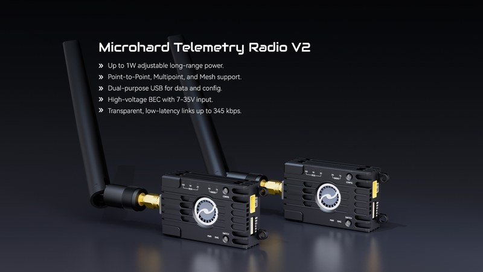
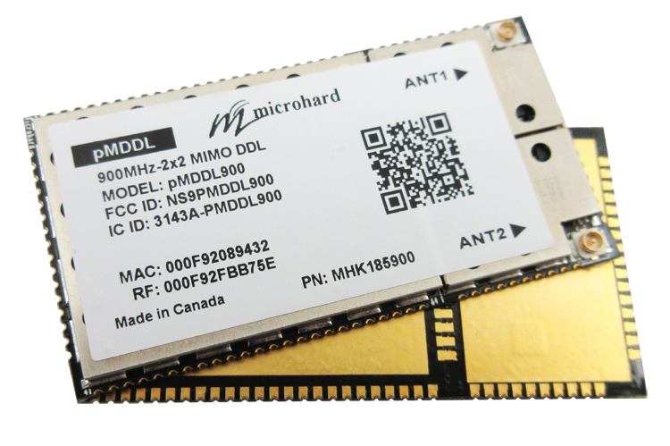

# UAV–UGV Communications & Command Integration

_Semester 1 engineering documentation — ROS 2 Jazzy, CycloneDDS, command-and-control and future datalink selection._

<!-- #region report -->

## 1. Objectives & Requirements {#com-objectives}

The communication system allows the UAV companion computer to send FOD target coordinates to the UGV through ROS 2 without directly controlling its motors ([\[5\]](./references.md#ref-5), [\[6\]](./references.md#ref-6), [\[11\]](./references.md#ref-11), [\[12\]](./references.md#ref-12)). The UGV validates incoming target coordinates against an operational geofence, queues waypoints, and passes navigation goals to Nav2 while returning telemetry to the C2 terminal.

In Semester 1, we tested this workflow between **two physical computers over an indoor local network**, with UGV path planning and kinematics simulated in Gazebo Harmonic. Testing an over-the-air radio link between an airborne UAV and a physical UGV is planned for Semester 2.

The active communication topics are `/c2/target_alert` (event-driven FOD targets) and `/c2/ugv_telemetry` (configured 2 Hz UGV pose and link heartbeat).

::: details Detailed requirements, operational constraints and safety considerations

**Functional & Operational Requirements**

- **REQ-COM-01 (Peer Discovery):** Heterogeneous computing nodes (ARM64 Ubuntu 24.04 on Raspberry Pi 5 vs x86_64 Ubuntu 24.04 on WSL2) must discover peers and exchange ROS 2 topics over the local network.
- **REQ-COM-02 (Payload Formatting & Parsing):** Target alerts and telemetry must encapsulate coordinates, classification labels, and timing metadata within lightweight JSON structures with sub-50 ms parsing overhead.
- **REQ-COM-03 (Asynchronous Goal Dispatch):** Ingested alerts must drive the Nav2 Behavior Tree asynchronously and manage sequential waypoint queues without blocking DDS event threads.
- **REQ-COM-04 (Airfield Operating Range):** Datalink architecture must support a line-of-sight range of $1.5\text{ to } 3.0\text{ km}$ across runway tarmac (e.g., Aarhus Airport Runway 10R/28L at $2,702\text{ m} \times 45\text{ m}$, or Singapore Changi Airport exceeding $4,000\text{ m}$).
- **REQ-COM-05 (Infrastructure Independence):** The inter-agent datalink cannot depend on civilian cellular networks (4G/5G) or commercial Wi-Fi due to coverage gaps, aerodrome security rules, and recurring SIM costs.
- **REQ-COM-06 (Power & Payload Budget):** Onboard transceiver hardware must run on a regulated 12V DC auxiliary bus (&lt;10 W peak draw) with a mass under 100 g for drone mounting.

**Singapore Frequency Regulations & IMDA Compliance**

Radio transmissions in Singapore are governed by the **Infocomm Media Development Authority (IMDA)** under the _Technical Specification for Short Range Devices (IMDA TS SRD)_ ([\[3\]](./references.md#ref-3)), the _Telecommunications Act 1999_ ([\[10\]](./references.md#ref-10)), and civil aviation spectrum rules ([\[4\]](./references.md#ref-4)):

- **North American ISM Band (902–928 MHz):** Standard transceivers like the Microhard P900 hop across 26 MHz of bandwidth (902–928 MHz) at up to 1.0 W (30 dBm) under FCC Part 15.247.
- **Singapore Permitted Sub-Band (917–925 MHz):** Frequencies below 917 MHz and above 925 MHz are allocated to cellular mobile network operators and public services. Transceiver firmware must be constrained to the 8 MHz window between 917.0 and 925.0 MHz.
- **IMDA Radiated Power Limits:** Under IMDA TS SRD Table 1 (Item 7b), telemetry devices in 917–925 MHz are restricted to effective radiated power (ERP) limits between $100\text{ mW}$ and $500\text{ mW}$ ($20 - 27\text{ dBm}$), depending on channel bandwidth and duty cycle.

<Figure src="./assets/diagrams/imda-spectrum-allocation.svg" alt="Singapore IMDA 900 MHz Spectrum Allocation and Permitted Sub-Band" caption="**Figure 1.1: Singapore IMDA 900 MHz Spectrum Boundary Analysis.** Contrast between the unrestricted 26 MHz North American FCC Part 15 band and Singapore's 8 MHz legal window (917–925 MHz). Deploying P900 V2 hardware requires configuring frequency hopping channels strictly within 917–925 MHz." />

_Regulatory status:_ The proposed Microhard P900 V2 has not yet been procured or submitted for IMDA equipment registration. Frequency configuration, channel spacing, and radiated power must be verified before field transmission.

**Fail-Safe Logic**

- **Link Loss While Idle:** UGV holds its current position, continues local 3D LiDAR obstacle monitoring, and inhibits autonomous driving.
- **Link Loss En Route:** UGV continues driving to the active waypoint. If communications are not restored within $30.0\text{ s}$ of goal arrival, the vehicle halts rather than executing subsequent unconfirmed waypoints.
- **Geofence Boundary Check:** Coordinates outside the airfield boundary (NUS EA Field: $X \in [-30, 25]\text{ m}$, $Y \in [-15, 15]\text{ m}$) are discarded with an error log, preventing out-of-bounds driving.

:::

## 2. System Architecture {#com-architecture}

The communications pipeline connects an external companion computer (Raspberry Pi 5) representing the aerial UAV C2 terminal to the UGV simulation and autonomy workstation (Ubuntu 24.04 on WSL2). The companion computer formats classified targets into JSON alerts and publishes them on `/c2/target_alert`. The UGV mission controller (`ugv_c2_bridge_node`) validates payload structure, transforms target coordinates into the global `map` frame, and dispatches goals asynchronously to the Nav2 `NavigateToPose` action server. Real-time vehicle pose and telemetry stream back over `/c2/ugv_telemetry`.

<Figure
  src="./assets/diagrams/c1-uav-ugv-communication-architecture.svg"
  alt="FOD Hunter UAV–UGV Communication Architecture"
  caption="**Figure 2.1: Heterogeneous Multi-Agent Communications Pipeline.** End-to-end dataflow illustrating simulated aerial target dispatch on the Raspberry Pi 5, CycloneDDS static unicast transport, UGV command bridge schema validation, Nav2 action dispatch, and reverse telemetry feedback."
/>

<CommunicationsWidget1 />

::: details ROS 2 nodes, topics and communication interface

| Interface | Direction | Protocol / Type | Purpose |
| :--- | :--- | :--- | :--- |
| `/c2/target_alert` | C2 Terminal → UGV | `std_msgs/msg/String` (JSON) | Structured target debris alerts with priority and coordinates |
| `/c2/ugv_telemetry` | UGV → C2 Terminal | `std_msgs/msg/String` (JSON) | Periodic vehicle pose, task state, and heartbeat at configured 2 Hz |
| `ugv_c2_bridge_node` | Internal Processing | ROS 2 C++ / Python Node | Payload schema validation, FIFO queueing, and action dispatch |
| `NavigateToPose` | Bridge → Nav2 | `nav2_msgs/action/NavigateToPose` | Asynchronous navigation action invocation |
| `/c2/goal_markers` | Bridge → RViz2 | `visualization_msgs/msg/MarkerArray` | Interactive visual markers showing queued and active waypoints |

<Figure src="./assets/diagrams/c5-ros2-publisher-subscriber-architecture.svg" alt="ROS 2 Node Graph and Communication Architecture" caption="**Figure 2.2: ROS 2 Publisher–Subscriber and Action Interface Architecture.** Conceptual node graph depicting bidirectional communication between the companion Raspberry Pi 5 C2 commander and the UGV onboard mission controller (`ugv_c2_bridge_node`), with goal dispatch to the Nav2 `NavigateToPose` action server." />

:::

## 3. Design Methodology & Selection {#com-methodology}

### 3.1 CycloneDDS and Static Unicast Selection {#com-dds}

ROS 2's Data Distribution Service (DDS) publisher–subscriber middleware was selected to decouple mission management from low-level motion control ([\[7\]](./references.md#ref-7)). FastDDS is the default ROS 2 middleware, but cross-machine discovery failed because multicast packets were dropped across the Hyper-V virtual network adapter on the Windows/WSL2 host.

**Eclipse CycloneDDS with static unicast peering** resolved this issue. By disabling multicast and defining participant IP addresses in `cyclonedds.xml`, peer discovery packets (SPDP/SEDP) travel directly via point-to-point UDP unicast:

```xml
<?xml version="1.0" encoding="UTF-8" ?>
<CycloneDDS xmlns="https://cdds.io/config">
  <Domain id="any">
    <General>
      <NetworkInterfaceAddress>auto</NetworkInterfaceAddress>
      <AllowMulticast>false</AllowMulticast>
    </General>
    <Discovery>
      <Peers>
        <Peer address="192.168.168.50"/>  <!-- RPi 5 on Router Subnet -->
        <Peer address="192.168.168.100"/> <!-- Workstation on Router Subnet -->
        <Peer address="192.168.137.1"/>   <!-- Workstation Windows Hotspot -->
        <Peer address="192.168.137.233"/> <!-- RPi 5 on Hotspot -->
      </Peers>
    </Discovery>
  </Domain>
</CycloneDDS>
```

::: details Middleware architecture and static unicast design

<Figure src="./assets/diagrams/c3-cyclonedds-static-unicast-topology.svg" alt="CycloneDDS Static Unicast Peering Architecture" caption="**Figure 3.1: CycloneDDS Static Unicast Peering Topology.** Comparison of default UDP multicast discovery failure across Hyper-V virtual switch NAT vs configured static unicast peer discovery between the Windows/WSL2 simulation host and external physical Raspberry Pi 5." />

Setting `<AllowMulticast>false</AllowMulticast>` instructs CycloneDDS to send participant discovery (SPDP) and endpoint discovery (SEDP) traffic directly as point-to-point unicast UDP packets, bypassing virtual switch multicast issues.

:::

### 3.2 Payload and QoS Decisions {#com-payload-selection}

We selected JSON dictionaries inside `std_msgs/msg/String` topics so the ARM64 Raspberry Pi and x86_64 workstation could communicate without compiling and synchronizing custom ROS 2 message packages (`.msg`). Serialization overhead measured under 1 ms for 500-byte alert dictionaries.

Target alerts use **`TRANSIENT_LOCAL` durability** and **`RELIABLE` reliability** QoS:
- **`RELIABLE`:** Requires positive acknowledgement of target alerts, resending packets dropped by transient interference.
- **`TRANSIENT_LOCAL`:** Retains the most recent target alert sample in publisher memory, allowing late-joining subscribers to receive active goals upon startup.

::: details Alert and telemetry schemas

<Card tag="UAV → UGV Command Stream">

**Table 3.1: Downlink Reconnaissance Alert Schema (`/c2/target_alert`)**

| JSON Field | Data Type | Example Value | Role & Semantic Definition |
| :--- | :--- | :--- | :--- |
| `mission_id` | `string` | `"RUNWAY_INSPECT_2026_0923"` | Unique sortie identifier linking reconnaissance missions to remediation tasks. |
| `threat_id` | `string` | `"FOD_THREAT_001"` | Debris identifier used for task lifecycle tracking. |
| `object_class` | `string` | `"screw"` | Object classification label from YOLOv8 edge inference. |
| `coordinates.x` / `.y` | `float` | `3.20, 1.70` | Metric coordinates in global Cartesian `map` frame (meters). |
| `coordinates.z` / `.yaw` | `float` | `0.0, 0.0` | Elevation relative to ground plane ($Z=0$) and approach orientation (radians). |
| `confidence` | `float` | `0.96` | Normalized edge vision inference confidence ($0.00 - 1.00$). |
| `timestamp_utc` | `string` | `"2026-09-23T14:32:00.123Z"` | ISO 8601 timestamp for message freshness and timeout monitoring. |

</Card>

<Card tag="UGV → UAV / Base Telemetry">

**Table 3.2: Uplink Operational Telemetry Schema (`/c2/ugv_telemetry`)**

| JSON Field | Data Type | Example Value | Role & Semantic Definition |
| :--- | :--- | :--- | :--- |
| `target_ack.threat_id` | `string` | `"FOD_THREAT_001"` | Active debris threat currently being remediated. |
| `target_ack.task_state` | `string` | `"EN_ROUTE"` | State machine status (`IDLE`, `EN_ROUTE`, `COLLECTING`, `COMPLETED`). |
| `target_ack.queued_goals_count` | `int` | `2` | Remaining waypoints buffered in UGV FIFO navigation queue. |
| `vehicle_telemetry.pose_metric` | `object` | `{"x": 1.2, "y": 0.8, "yaw": 0.05}` | Real-time global pose estimate derived from Dual-EKF sensor fusion. |
| `vehicle_telemetry.battery_pct` | `float` | `94.5` | Remaining battery state of charge from power distribution monitor. |
| `link_watchdog.heartbeat_seq` | `int` | `142` | Monotonically increasing counter for link integrity validation. |

</Card>

<Figure src="./assets/diagrams/c6-json-target-alert-message-flow.svg" alt="JSON Target Alert Message Flow and Queueing Pipeline" caption="**Figure 3.2: Downlink Target Alert Message Processing Pipeline.** Illustrative JSON payload structure, string serialization over ROS 2 topic `/c2/target_alert`, multi-stage schema validation, de-duplication filtering, and Nav2 waypoint queue insertion in `ugv_c2_bridge_node`." />

:::

### 3.3 Long-Range Datalink Trade Study {#com-radio-selection}

While indoor Wi-Fi supported Semester 1 multi-machine testing, airfield operations require infrastructure-independent long-range datalinks. We evaluated five wireless technologies across range, power consumption, data rate, and regulatory compliance:

<Card tag="Airfield Technology Evaluation">

**Table 3.3: Wireless Communications Technology Trade-Off Matrix**

| Technology Candidate | Operating Band | Nominal Throughput | LOS Range | Interface | Power Draw | Operational Assessment | Selection Status |
| :--- | :--- | :--- | :--- | :--- | :--- | :--- | :--- |
| **Microhard P900 V2** | 902–928 MHz FHSS (Configurable 917–925 MHz) | Up to 276 kbps | $5 - 15\text{ km}$ | Asynchronous UART / USB-C | 1.2 W RF (100 mA idle @ 12V) | Infrastructure-independent point-to-point. Conforms to Singapore 917–925 MHz via channel masking. Requires serial framing gateway for ROS 2. | <Badge type="info" text="PREFERRED CANDIDATE" /> |
| **Microhard pMDDL900** | 902–928 MHz 2×2 MIMO | Up to 25 Mbps | $5 - 20\text{ km}$ | Native Ethernet / IP | 6–12 W transmit | Native IP supports direct CycloneDDS bridging without gateway. High cost (\$1,200+ USD) and thermal dissipation exceed requirements. | <Badge type="info" text="ALTERNATIVE BACKUP" /> |
| **Ubiquiti 5AC Wi-Fi** | 5.15–5.85 GHz OFDM | $100 - 450\text{ Mbps}$ | $1 - 5\text{ km}$ (directional) | Ethernet (PoE) | 7–9 W | High bandwidth, but directional dish alignment fails during dynamic UAV banking maneuvers. Severe ground attenuation. | <Badge type="info" text="REJECTED (UAV LINK)" /> |
| **4G LTE / 5G Modem** | Telco Carrier Bands | $10 - 150\text{ Mbps}$ | Cell dependent | USB / PCIe | 3–6 W | Relies on civilian telecom towers; subject to recurring SIM fees and aerodrome security restrictions. | <Badge type="info" text="REJECTED (TELCO RELIANT)" /> |
| **LoRa (SX1262)** | 915 / 868 MHz CSS | $0.3 - 5.5\text{ kbps}$ | $3 - 10\text{ km}$ | SPI / UART | &lt;0.5 W | Low bandwidth and 222-byte payload limits cause multi-packet fragmentation and multi-second latency for JSON messages. | <Badge type="info" text="REJECTED (BANDWIDTH)" /> |

</Card>

::: details Long-range radio comparison, regulatory considerations and selection rationale

<div style="display: grid; grid-template-columns: repeat(auto-fit, minmax(280px, 1fr)); gap: 16px; margin: 16px 0;">
  <div>
    
    <p style="font-size: 12px; color: var(--apple-text-tertiary); text-align: center; margin-top: 6px;">Preferred Candidate: Holybro Microhard P900 V2 (900 MHz FHSS Serial)</p>
  </div>
  <div>
    
    <p style="font-size: 12px; color: var(--apple-text-tertiary); text-align: center; margin-top: 6px;">Alternative Candidate: Microhard pMDDL900 (900 MHz 2×2 MIMO IP)</p>
  </div>
</div>

**Why Microhard P900 V2 Is Preferred**

The **Holybro Microhard P900 V2** ([\[20\]](./references.md#ref-20)) is our preliminary preferred choice for the UGV datalink:
1. **Sufficient Bandwidth for Metadata:** C2 alerts and telemetry use compact JSON strings (~500 bytes). At 276 kbps nominal throughput, packet transmission takes under 20 ms.
2. **No Video Streaming on UGV Datalink:** YOLOv8 vision inference runs entirely on the UAV companion computer. Only numerical target coordinates cross the RF link, eliminating high-bandwidth video transmission needs.
3. **Low SWaP Footprint:** Enclosed in a 42 g aluminum case operating on 7–35V DC, the transceiver connects directly to companion computer UART GPIO pins without external PoE injectors.

**Alternative Candidate: Microhard pMDDL900 vs pMDDL2450**

The **Microhard pMDDL900** ([\[21\]](./references.md#ref-21)) provides native Ethernet IP routing at up to 25 Mbps, allowing CycloneDDS to operate natively across the RF link without a serial gateway. However, it costs significantly more ($1,200+ USD vs ~$150 USD for P900), consumes 6–12 W, and requires dedicated heatsinks. It remains a backup candidate should project requirements expand to include live sensor streaming.

*Broadband Distinction:* The ARGUS drone team evaluates the **Microhard pMDDL2450** (2.4 GHz broadband IP) for aerial video streaming to a ground station, whereas the UGV datalink carries only lightweight C2 commands and telemetry.

**Radio Security and Vulnerability Analysis**

Evaluating candidate datalink security postures highlights distinct architectural trade-offs:
- **Serial RF (Microhard P900 V2):** Operates an air-gapped point-to-point asynchronous serial connection. The lack of an IP stack eliminates port scanning, SSH brute-force attempts, and network routing vulnerabilities. The transceiver firmware supports AES-256 link-layer encryption and unique Network ID pairing. However, 900 MHz FHSS remains vulnerable to RF jamming, which requires link-loss watchdog timeouts.
- **Broadband IP (pMDDL2450 / pMDDL900):** Native TCP/IP networking exposes a broader attack surface, requiring firewall protection, SSH connection throttling (`fail2ban`), MAC address filtering, and disabled SSID broadcasts.

**Preliminary Selection & Decision Gates**

Purchasing P900 V2 hardware depends on four decision gates in Semester 2:
1. **IMDA Channel Masking:** Confirming firmware frequency masking via PicoConfig software to confine hopping strictly within 917.0–925.0 MHz.
2. **Supplier Procurement:** Securing formal institutional quotes from academic distributors.
3. **Serial Gateway Benchmarking:** Bench-testing the serial framing gateway to verify latency stays below 100 ms.
4. **Hardware Flow Control:** Validating UART CTS/RTS hardware handshaking between the transceiver and Raspberry Pi 5 / NVIDIA Jetson GPIO headers.

:::

## 4. Implementation & Prototype {#com-implementation}

### 4.1 Two-Machine Integration {#com-network}

The Semester 1 hardware-in-the-loop testbed connected two physical computers over an isolated Wi-Fi subnet:
1. **Machine 1 (UAV C2 Terminal):** Raspberry Pi 5 (Quad-Core ARM Cortex-A76 @ 2.4 GHz, 8 GB RAM) running Ubuntu 24.04 LTS and ROS 2 Jazzy, hosting `DemoComs_C2.py` (IP: `192.168.168.50`).
2. **Machine 2 (UGV Autonomy Workstation):** Workstation laptop running Ubuntu 24.04 LTS under WSL2, running Gazebo Harmonic DART physics, Dual-EKF state estimation, Nav2 path planning, `ugv_c2_bridge_node`, and `c2_alert_receiver` (IP: `192.168.168.100`).

The joint UAV–UGV communications workflow operates across four sequential stages:
- **Stage 1:** Establish communication between the ARGUS and HUNTER simulation computers.
- **Stage 2:** Obtain drone coordinates and update the detected FOD location.
- **Stage 3:** Send the C2 target alert to HUNTER.
- **Stage 4:** Convert the received target into a HUNTER navigation goal.

Stages 1 and 2 cover aerial inspection and coordinate extraction, and are documented in the [ARGUS Communication System](https://cde4301-drone-ground-robots.github.io/CDE4301_runway_drone/report/#report-communication-system). Stages 3 and 4 document HUNTER's alert ingestion and autonomous navigation dispatch.

<VideoClip
  src="./assets/videos/uav-ugv-communication-video.mp4"
  poster="./assets/images/posters/uav-ugv-communication-video-poster.jpg"
  caption="Video 4.1: Heterogeneous UAV–UGV Communication Pipeline. Physical benchtop demonstration of CycloneDDS static unicast topic exchange between the Raspberry Pi 5 companion computer and the engineering workstation running ROS 2 Jazzy over local Wi-Fi."
/>

### 4.2 Stage 3 — Sending C2 Alert to HUNTER {#com-stage-3}
<span id="com-dispatch"></span>

In Stage 3, the ARGUS-side communication node (`DemoComs_C2.py`) publishes the target alert over ROS 2 topic `/c2/target_alert` using JSON formatting within `std_msgs/msg/String`. Eclipse CycloneDDS transmits the message across the indoor router using static unicast.

On the HUNTER side, the communication monitor (`c2_alert_receiver`) and mission controller (`ugv_c2_bridge_node`) listen on `/c2/target_alert` with compatible `TRANSIENT_LOCAL` + `RELIABLE` Quality of Service (QoS). In the recorded multi-machine bench demonstration (presentation slide 175), the following target alert parameters were transmitted and ingested:

| Parameter Field | Demonstration Value | Interpretation & Context |
| :--- | :--- | :--- |
| **Threat ID** | `FOD_THREAT_001` | Unique sequential identifier assigned to candidate debris |
| **Object Class** | `Screw` (`FOD / screw`) | Debris classification passed from edge detection model |
| **Confidence** | `0.96` (96.0%) | Target classification confidence score |
| **Target X** | `3.20 m` | Local metric coordinate in `map` Cartesian frame |
| **Target Y** | `1.70 m` | Local metric coordinate in `map` Cartesian frame |
| **Target Yaw** | `0.00 rad` ($0.0^\circ$) | Desired terminal vehicle orientation upon arrival |

*Note: These coordinates and classifications represent recorded demonstration test values, not live physical UAV flight measurements.*

<C2TerminalDemo />

### 4.3 Stage 4 — C2 Alert Receiver to HUNTER Navigation {#com-stage-4}

Once HUNTER receives the target alert, the autonomous navigation dispatch pipeline executes sequentially:

1. **Alert Ingestion:** `c2_alert_receiver` parses the JSON payload from `/c2/target_alert` and extracts target coordinates, classification metadata and threat level.
2. **Schema & Geofence Validation:** `ugv_c2_bridge_node` verifies that target coordinates lie within the airfield operating boundary before accepting the goal into memory.
3. **Coordinate Transformation:** Metric offsets are mapped into a standardized `geometry_msgs/msg/PoseStamped` message referenced to the global `map` coordinate frame.
4. **Orientation Synthesis:** The scalar target yaw angle ($\theta = 0.00\text{ rad}$) is converted into an orientation quaternion:
   $$
   q_z = \sin\left(\frac{\theta}{2}\right) = 0.0, \quad q_w = \cos\left(\frac{\theta}{2}\right) = 1.0, \quad q_x = 0.0, \quad q_y = 0.0
   $$
5. **Nav2 Action Goal Dispatch:** The bridge packages the target pose and calls the Nav2 `NavigateToPose` action client asynchronously.
6. **Costmap Planning & RViz Visualization:** Nav2's SmacPlanner2D (Hybrid A*) computes an obstacle-free trajectory across the global costmap, visualized concurrently in RViz2 alongside `/c2/goal_markers`.
7. **Trajectory Execution:** Regulated Pure Pursuit (RPP) guides the simulated UGV (AgileX Scout 2.0 simulation proxy in Gazebo Harmonic) to the target coordinates.

<VideoClip
  src="./assets/videos/131026_UAV_sim_Charan_demo.mov"
  poster="./assets/images/posters/131026-uav-sim-charan-demo-poster.jpg"
  caption="Stage 4 — C2 Alert to HUNTER Navigation. Recorded demonstration of the HUNTER communication receiver passing a target to Nav2 for path planning and simulated UGV movement in Gazebo Harmonic and RViz2."
/>

::: details Coordinate conversion and Nav2 action dispatch implementation

When `ugv_c2_bridge_node` ingests a target alert, it converts Cartesian offsets into a fully formatted `geometry_msgs/msg/PoseStamped` message referencing the global `map` frame. Target orientation is calculated by converting the scalar yaw angle into a unit quaternion:

$$
q_z = \sin\left(\frac{\theta}{2}\right), \quad q_w = \cos\left(\frac{\theta}{2}\right), \quad q_x = 0, \quad q_y = 0
$$

Goals are appended to an internal FIFO queue (`goal_queue`). The node concurrently publishes RViz marker spheres (`visualization_msgs/msg/MarkerArray`) on `/c2/goal_markers`, color-coding active waypoints in cyan, queued waypoints in amber, and completed targets in green with yellow trajectory breadcrumb lines.

:::

**Related documentation:** [Navigation →](/report#programming) · [Simulation →](/report#programming) (links to the programming chapter).

### 4.4 Proposed Serial-Radio Gateway {#com-future-gateway}

The proposed P900 V2 uses an asynchronous serial interface (UART), so ROS 2 messages cannot be transmitted as native DDS traffic across the wireless link. Moving to this hardware requires implementing a dedicated serial gateway node on each machine to frame, serialize and validate JSON messages across the UART bridge.

**Engineering Status:**
- The Microhard P900 V2 remains a **proposed candidate**; no units have been procured or deployed.
- The software serial gateway has **not been implemented or bench-tested**.
- **No outdoor RF range or throughput tests** have been conducted.
- Singapore IMDA licensing, frequency mask restrictions (917–925 MHz) and power thresholds must be formally verified before transmitting over the air.

::: details Proposed COBS, CRC-32 and acknowledgement design

When transitioning from indoor Wi-Fi to the long-range P900 V2 datalink, ROS 2 nodes cannot directly publish native DDS packets over a transparent UART connection. The proposed architecture uses a serial framing gateway on each computer:

<Figure src="./assets/diagrams/uav-ugv-rf-datalink.svg" alt="Proposed Serial Framing Gateway and RF Telemetry Pipeline" caption="**Figure 4.1: Proposed Semester 2 Serial Framing Gateway Pipeline.** Encapsulation of ROS 2 JSON topics into framed UART packets using Consistent Overhead Byte Stuffing (COBS) and 32-bit CRC error detection across the 900 MHz FHSS RF physical layer." />

_Framing & Reliability Protocol (Design Requirements):_
- **Packet Delimitation:** Uses **Consistent Overhead Byte Stuffing (COBS)** with a zero-byte delimiter (`0x00`) to establish unambiguous packet framing boundaries over the asynchronous serial stream without payload escape bloat.
- **Integrity Checking:** Appends a hardware-computed **CRC-32 checksum** to the trailer of each packet to detect bit-errors caused by RF fading or multipath interference.
- **Stop-and-Wait ARQ:** Implements an explicit acknowledgement (ACK/NACK) protocol with a $200\text{ ms}$ timeout and up to 3 retransmissions for critical target alert dispatches.

:::

## 5. Testing & Results {#com-testing}

The indoor verification matrix validates cross-architecture DDS discovery, alert ingestion, JSON parsing, and autonomous Nav2 goal dispatch. The tests demonstrate the communication-to-navigation workflow between the physical Raspberry Pi 5 and the simulation workstation.

<Card tag="Communications Subsystem Verification Matrix">

**Table 5.1: Communications Subsystem Verification & Test Matrix**

<div class="table-scroll-wrapper" style="overflow-x: auto; -webkit-overflow-scrolling: touch; width: 100%; margin: 8px 0;">

| Test ID | Test Objective | Supporting Evidence | Verification Status |
| :--- | :--- | :--- | :--- |
| **COM-01** | Cross-machine CycloneDDS communication across ARM64 and x86_64 nodes | Video 4.1 (`uav-ugv-communication-video.mp4`), RPi 5 terminal recording (`230926-uavugv-comms-rpi5-.mp4`), workstation recording (`230926-uavugv-comms-laptop.mp4`) | <Badge type="tip" text="PASSED" /> |
| **COM-02** | C2 target alert transmission and reception over `/c2/target_alert` | `DemoComs_C2.py` publisher, `c2_alert_receiver.py` subscriber logs, verified `TRANSIENT_LOCAL` + `RELIABLE` QoS latching | <Badge type="tip" text="PASSED" /> |
| **COM-03** | JSON target-coordinate schema parsing and validation | Recorded demonstration logs extracting `threat_id: FOD_THREAT_001`, `screw`, Cartesian $(X=3.20\text{ m}, Y=1.70\text{ m})$, yaw $0.00\text{ rad}$ with 0 parse exceptions | <Badge type="tip" text="PASSED" /> |
| **COM-04** | C2 alert conversion to `map` frame and Nav2 `NavigateToPose` goal dispatch | Video Stage 4 (`131026_UAV_sim_Charan_demo.mov`), Gazebo Harmonic & RViz2 Hybrid A* trajectory execution using AgileX Scout 2.0 simulation proxy | <Badge type="tip" text="PASSED" /> |
| **COM-05** | Sequential multi-waypoint queue navigation | Video `Multiqueue waypoint.mp4` demonstrating autonomous sequential 3-target execution in Nav2 | <Badge type="tip" text="PASSED" /> |

</div>

> **Test scope:** These results cover the Semester 1 indoor communication testbed and ROS 2 simulation. Physical UAV–UGV RF communication, outdoor range and real-world navigation remain unverified.

_Testing Note:_ COM-01 through COM-05 validate the software communications and simulated navigation pipeline. Periodic telemetry publication at 2 Hz (`/c2/ugv_telemetry`) and emergency abort logic (`cancel_goal_async()`) are implemented in source code and tested in SIL; quantitative RF packet-error rate, outdoor range sweeps, and physical chassis dynamic stopping distances remain scheduled for Semester 2 physical integration.

</Card>

::: details Recorded communication demonstrations and evidence

<VideoClip src="./assets/videos/230926-uavugv-comms-rpi5-.mp4" poster="./assets/images/posters/230926-uavugv-comms-rpi5-poster.jpg" caption="Video 5.1: Raspberry Pi 5 terminal recording showing incoming JSON alerts and CycloneDDS publishing." />

<VideoClip src="./assets/videos/230926-uavugv-comms-laptop.mp4" poster="./assets/images/posters/230926-uavugv-comms-laptop-poster.jpg" caption="Video 5.2: Laptop workstation recording showing Nav2 goal queueing and action dispatch." />

<VideoClip src="./assets/videos/Multiqueue waypoint.mp4" poster="./assets/images/posters/multiqueue-waypoint-poster.jpg" caption="Video 5.3: Multi-Queue Sequential Waypoint Navigation demonstration in Nav2 showing autonomous 3-target sequence execution." />

:::

<Figure src="./assets/diagrams/c8-emergency-abort-logic.svg" alt="Multi-Tier Emergency Abort and Goal Cancellation Architecture" caption="**Figure 5.1: Emergency Abort and Goal Cancellation Architecture.** Flowchart detailing software mission abort handling, queue flushing, asynchronous Nav2 action cancellation (`cancel_goal_async()`), and commanded zero-velocity override in the Semester 1 SIL testbed, distinguished from proposed Semester 2 physical hardware E-stop and STO motor interlocks." />

<Figure src="./assets/diagrams/c9-communication-failure-recovery.svg" alt="Datalink Loss and Recovery Finite State Machine" caption="**Figure 5.2: Datalink Failure and Autonomy Recovery State Flow.** Finite state machine detailing active goal execution during loss of communications, waypoint holding safe-pause upon arrival, automatic DDS reconnection, and Semester 2 proposed autonomous return-to-base (RTB) watchdog timeout." />

## 6. Engineering Discussion {#com-discussion}

In Semester 1, we separated aerial target detection from UGV navigation and linked ROS 2 across two machines. CycloneDDS static unicast peers solved the WSL2 virtual network discovery issue. Using JSON strings in `std_msgs/msg/String` avoided cross-compiling custom ROS 2 message packages between ARM64 and x86_64 workspaces.

However, several architectural limitations must be addressed during Semester 2:
1. **Static IP Fragility:** Hardcoded IP tables in `cyclonedds.xml` break whenever DHCP leases renew or network interfaces change. While sufficient for a static benchtop setup, an operational system requires dynamic discovery or zero-configuration addressing.
2. **Serial Gateway Requirement:** Transparent RF transceivers such as the Microhard P900 V2 operate via asynchronous UART serial rather than native IP, precluding native DDS multicasting. Moving to long-range RF necessitates developing a dedicated serial framing gateway enforcing COBS byte stuffing and CRC-32 integrity checks.
3. **Security Posture:** While air-gapped serial datalinks eliminate IP-based network penetration vectors, unauthenticated JSON strings remain vulnerable to message injection. Semester 2 implementation will incorporate keyed HMAC signatures to verify alert authenticity before goals are passed to the navigation controller.

## 7. Limitations & Semester 2 Plan {#com-semester-two}

Key engineering milestones for Semester 2 transition the communication subsystem from simulated indoor Wi-Fi to a ruggedized, long-range airfield datalink:

::: details Detailed proposed milestones

1. **Payload Profiling:** Measure and freeze exact JSON packet sizes for all alert and telemetry message types to establish maximum required UART baud rates.
2. **IMDA Regulatory Clearance:** Verify Microhard P900 V2 firmware frequency masking via PicoConfig software to prove strict 917.0–925.0 MHz channel confinement; submit technical inquiry to IMDA regarding Short Range Device (SRD) power thresholds.
3. **Vendor Quotations & Procurement:** Solicit verified quotations from authorized academic distributors for 2× Holybro Microhard P900 V2 radios, matched 915 MHz rubber-ducky antennas, and high-gain ground station dipoles.
4. **Formal Radio Selection Gate:** Review quotations and regulatory feasibility to officially lock the P900 V2 or activate the pMDDL900 alternative backup plan.
5. **Serial Framing Gateway Development:** Write and unit-test the Python/C++ serial gateway node implementing COBS packet delimitation, CRC-32 integrity validation, and ARQ retransmission timeouts.
6. **Benchtop Radio-in-the-Loop (RIL) Testing:** Connect physical P900 V2 radios via RF coaxial attenuators (-30 dB) in the lab to validate UART throughput, JSON serialization, and Nav2 dispatch without over-the-air radiation.
7. **Latency & Reliability Profiling:** Measure end-to-end command dispatch latency ($t_{\text{alert}} \le 100\text{ ms}$) and packet error rates (PER &lt; 0.1%) under controlled simulated channel noise.
8. **Field Ground-to-Ground Range Testing:** Execute incremental outdoor range sweeps at the NUS EA Field campus proving ground ($50\text{ m}$, $100\text{ m}$, $250\text{ m}$), measuring Received Signal Strength Indication (RSSI) and packet delivery ratios.
9. **Antenna Elevation & Polarization Optimization:** Evaluate vertical vs horizontal antenna mounting orientations on the UGV chassis to eliminate vehicle body shadowing and ground reflection nulls.
10. **Full Inter-Agent Closed-Loop Integration:** Execute end-to-end mission verification connecting real UAV flight reconnaissance, RF alert transmission, UGV autonomous trajectory clearance, and telemetry uplink.

:::

### Related Documentation — ARGUS Communication System {#com-argus-reference}

This document covers Stage 3 (C2 alert transmission) and Stage 4 (HUNTER navigation goal dispatch). For Stage 1 (communication setup) and Stage 2 (FOD coordinate generation), see the [ARGUS Communication System](https://cde4301-drone-ground-robots.github.io/CDE4301_runway_drone/report/#report-communication-system).

<!-- #endregion report -->

[Hilbert's engineering references →](./references.md)
