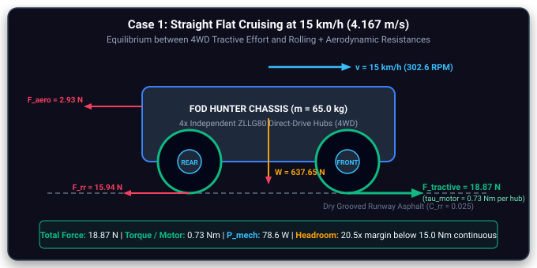
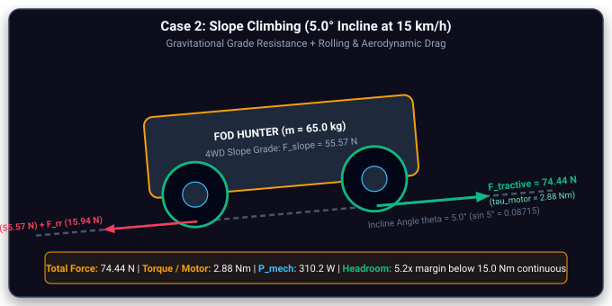
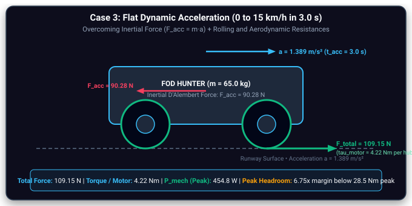
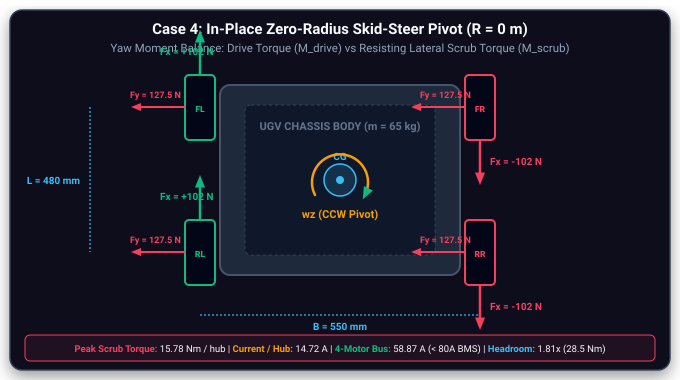
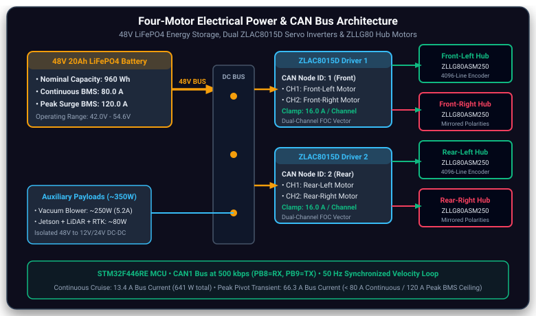

# 4WD Motor & Drivetrain Sizing

**Hilbert Soh · Powertrain engineering · Semester 1 technical documentation**

> **Evidence boundary:** The 65 kg / 263 mm / 15 km/h figures are design assumptions and targets. Manufacturer dynamometer data are supplier measurements, not tests conducted by the team. The available laboratory supply is limited to 32 V / 10 A, so full 48 V drivetrain performance remains unverified.

<!-- #region report -->

## 1. Objectives & Requirements {#motor-objectives}

The drivetrain must propel a four-wheel skid-steer FOD collection UGV over runway pavement while providing low-speed target alignment and sufficient torque for ramps, acceleration and turning. The detailed design case assumes a **65 kg fully laden vehicle**, **263 mm wheel diameter**, **15 km/h target speed**, **5° verge incline**, and **15° short-ramp check**. These are sizing conditions rather than verified operating achievements. A 48 V battery system is proposed for the final vehicle; current bench work is supply-limited.

The design problem is not just achieving cruise speed: a four-wheel skid-steer platform also develops lateral tire scrub during pivots. This can make turning, rather than straight travel, the limiting torque condition. The selected design therefore uses four independent direct-drive hub motors and two dual-channel motor drivers, with torque margins assessed across four operating cases.

::: details Full design assumptions and requirements

#### 1. Operational Mission Profile & Verified Vehicle Boundary Parameters {#sec-1-requirements}

<Badge type="info" text="System Constraints" />

The powertrain sizing derives directly from the operational requirements of airfield Foreign Object Debris (FOD) inspection and removal under civil aviation and pavement standards (FAA AC 150/5220-24 [\[2\]](./references.md#ref-2); ASTM D5340-20 [\[1\]](./references.md#ref-1)). The UGV operates under stringent time windows between aircraft takeoffs and landings, requiring sustained transit speeds of up to $15\text{ km/h}$ ($4.167\text{ m/s}$) to sweep an active $3,000\text{ m}$ runway in under $20\text{ minutes}$, rapid acceleration ($t_{\text{acc}} = 3.0\text{ s}$), and sustained torque over runway drainage verges.

<Card>

⚙️ **Confirmed Hardware Architecture: 4WD Independent Direct-Drive Hub Motors**

The physical robot utilizes **four independent direct-drive hub motors** (one per wheel) commanded in pairs via **two ZLAC8015D dual-channel FOC servo drivers** over CANopen (STM32 CAN1 at $500\text{ kbps}$, Node 1 = Front Axle, Node 2 = Rear Axle). Direct hub motors eliminate planetary gearheads, eliminating mechanical backlash and gear wear under runway vibration.

</Card>

| Parameter                                       | Design Value                                                                         | Engineering Justification & Airfield Operating Context                                                                                                                                                                         |
| ----------------------------------------------- | ------------------------------------------------------------------------------------ | ------------------------------------------------------------------------------------------------------------------------------------------------------------------------------------------------------------------------------ |
| **Gross Vehicle Mass ($m$)**                    | <Badge type="tip" text="$65.0\text{ kg}$ Fully Laden" />                             | Worst-case sizing mass: includes 6061-T6 chassis ($18\text{ kg}$), 48V 20Ah battery ($12\text{ kg}$), vacuum turbine & bin ($15\text{ kg}$), sensors & computer stack ($5\text{ kg}$), and 4 hub drive units ($15\text{ kg}$). |
| **Drive Architecture ($N$)**                    | <Badge type="info" text="4 Independent Hub Motors (4WD)" />                          | Four-wheel independent skid-steer control. Tractive driving force is distributed across 4 direct-drive motors, reducing individual continuous motor loading.                                                                   |
| **Wheel Outer Diameter ($D$) & Radius ($r$)**   | <Badge type="tip" text="$D = 263\text{ mm}$, $r = 0.1315\text{ m}$" />               | 10-inch all-terrain tubeless pneumatic tire mounted on ZLLG80 hub. Matches firmware macro `ROBOT_WHEEL_RADIUS_MM = 131.5f`.                                                                                                    |
| **Design Cruise Velocity ($v$)**                | <Badge type="tip" text="$15.0\text{ km/h}$ ($4.167\text{ m/s}$)" />                  | Authoritative target speed enabling rapid sweep of active $3,000\text{ m}$ runway corridors within 15–20 minute air traffic control intervals.                                                                                 |
| **Required Wheel Speed ($N_{\text{req}}$)**     | <Badge type="info" text="$302.6\text{ RPM}$ at $15\text{ km/h}$" />                  | Direct kinematic conversion: $N = \frac{60 \cdot v}{\pi \cdot D} = \frac{60 \times 4.1667}{\pi \times 0.263} = 302.58\text{ RPM}$.                                                                                             |
| **Motor No-Load Speed ($N_{\text{no-load}}$)**  | <Badge type="tip" text="$415.6\text{ RPM}$ ($20.59\text{ km/h}$)" />                 | Factory rating of ZLLG80ASM250 hub motor at 48V. Provides a verified **$1.373\times$ speed margin** ($37.3\%$ reserve) over cruise speed.                                                                                      |
| **Design Incline Angle ($\theta$)**             | <Badge type="warning" text="$5.0^\circ$ (Verge) / $15.0^\circ$ (Ramp)" />            | Airside runways have $<1.5^\circ$ cross-fall; $5.0^\circ$ ($8.7\%$) represents taxiway shoulder embankment verges, while $15.0^\circ$ represents drainage culvert access ramps.                                                |
| **Design Acceleration ($a_{\text{des}}$)**      | <Badge type="info" text="$1.389\text{ m/s}^2$ ($t_{\text{acc}} = 3.0\text{ s}$)" />  | Accelerates from standstill to $15\text{ km/h}$ in $3.0\text{ seconds}$ to clear runway active areas with urgency ($F_{\text{acc}} = 90.28\text{ N}$).                                                                         |
| **Rolling Resistance Coefficient ($C_{rr}$)**   | <Badge type="warning" text="$0.025$" />                                              | Pneumatic rubber tires on dry grooved airport asphalt pavement at nominal pressure ($2.5\text{ bar}$).                                                                                                                         |
| **Aerodynamic Drag Area ($C_d \cdot A$)**       | <Badge type="info" text="$0.28\text{ m}^2$ ($C_d = 0.80$, $A = 0.35\text{ m}^2$)" /> | Blunt frontal profile of chassis, LiDAR mast, and cyclonic vacuum intake hood. Air density $\rho = 1.204\text{ kg/m}^3$ at $20^\circ\text{C}$.                                                                                 |
| **Tarmac Scrub Friction ($\mu_{\text{skid}}$)** | <Badge type="info" text="$0.80$" />                                                  | Coulomb friction coefficient during lateral tire scrubbing in in-place zero-radius turns on textured runway asphalt.                                                                                                           |
| **Drivetrain Efficiency ($\eta$)**              | <Badge type="tip" text="$0.85$ ($85\%$)" />                                          | Direct-drive configuration: zero gearbox mesh friction. Factor accounts for motor inverter switching, stator copper/iron losses, and tire carcass dissipation.                                                                 |

:::

## 2. Drivetrain Architecture {#motor-architecture}

The proposed hardware uses **four independent ZLLG80ASM250 direct-drive hub motors**, one at each wheel, commanded through **two ZLAC8015D dual-channel servo drivers**. The design avoids a mechanical differential and steering linkage. Front and rear motor pairs are intended to receive commands from an STM32-based interface. Actual controller settings and physical wiring must be confirmed against the assembled hardware.

**[Add photograph M1 — Show the actual hub motor and ZLAC8015D driver, with labels identifying the model and connector interfaces.]**

**[Add CAD image M2 — Top view of the actual FOD Hunter chassis (not AgileX Scout 2.0), labeling FL/FR/RL/RR motor positions, wheelbase, track width and forward direction.]**

**M6 — Motor-driver wiring and CAN communications:** Documented in [Figure 4.5 — 48V Power Distribution Architecture](#sec-power-sizing), illustrating the 48V power distribution, STM32 CAN interface, and dual ZLAC8015D drivers. Physical wiring harness photography is preserved as pending hardware assembly.

The detailed geometric justification for choosing skid steering over Ackermann and Mecanum configurations is documented in [Steering Kinematics →](./steering-kinematics.md). The team-wide battery, DC conversion and auxiliary load budget belongs in Bryan's Electrical documentation.

::: details Selected motor and driver specifications

#### 6. Selected Hardware Specifications & Architectural Rationale {#sec-trade-study}

<Badge type="info" text="Hardware Bill of Materials" />

Rather than employing conventional brushed DC motors, omnidirectional Mecanum drive (US Patent 3,876,255, Ilon, 1975 [\[16\]](./references.md#ref-16); RobotPlatform.com, 2024 [\[17\]](./references.md#ref-17)), or BLDC motors paired with multi-stage planetary gearboxes (which suffer from mechanical backlash, seal leakage, gear tooth shear under vibration, and abrasive aggregate ingestion), the platform adopts **Four Direct-Drive BLDC Hub Motors**:

<CardGrid :cols="2">

<Card title="4x ZLTECH ZLLG80ASM250 Direct-Drive Hub Motors">

- **Rated Voltage:** $48.0\text{ V DC}$ (Operational range $36 - 60\text{V}$).
- **Rated Speed:** $300\text{ RPM}$ ($\approx 15.0\text{ km/h}$ on $263\text{ mm}$ tire).
- **No-Load Speed:** $415.6\text{ RPM}$ ($\approx 20.6\text{ km/h}$, **$1.373\times$ speed margin**).
- **Continuous Rated Torque:** $15.0\text{ Nm}$ (thermal rating without overheating).
- **Peak Stall Torque:** $28.50\text{ Nm}$ (**$1.806\times$ peak torque headroom** over $15.78\text{ Nm}$).
- **Wheel Outer Diameter:** $263\text{ mm}$ ($r = 0.1315\text{ m}$) with tubeless pneumatic tread.
- **Encoder Feedback:** Built-in 1024-line optical encoder ($4096\text{ counts/rev}$ with $4\times$ decoding), delivering $0.202\text{ mm}$ displacement resolution.
- **Ingress Protection:** IP65 sealed hub preventing tarmac bitumen aggregate, grit, and water ingress.

</Card>

<Card title="2x ZLAC8015D Dual-Channel FOC Servo Drives">

- **Architecture:** Dual-channel Field-Oriented Control (FOC) sinusoidal vector driver.
- **Node Allocation:** Driver 1 (Node 1) controls Front Axle (FL/FR); Driver 2 (Node 2) controls Rear Axle (RL/RR).
- **Continuous Output Current:** $15.0\text{ A}$ continuous per channel ($30.0\text{ A}$ peak).
- **Communications Protocol:** CANopen (CiA 402 device profile at $500\text{ kbps}$) with secondary RS485 interface.
- **Firmware Integration:** Interfaced directly to STM32F446RE MCU running `zlac8015d.c` at $50\text{ Hz}$ velocity command loop.
- **Protection Features:** Overvoltage, phase short circuit, stator thermal foldback, and regenerative voltage clamping.

</Card>

</CardGrid>

<Card title="Direct-Drive Kinematic Benefit:">

Eliminating gearboxes removes driveline backlash ($\Delta \theta_{\text{backlash}} = 0^\circ$). Wheel velocity and heading reversal during zero-radius pivots occur instantaneously without mechanical play, preventing odometry drift and enabling sub-centimeter terminal docking over detected FOD items.

</Card>

:::

## 3. Design Methodology & Selection {#motor-methodology}

Motor sizing began with the vehicle's required linear speed, wheel radius and force demands, then compared the resulting shaft torque against manufacturer performance data. Direct-drive hubs were preferred for packaging simplicity and low mechanical backlash; the trade-off is that each hub must supply the wheel torque directly, without gearbox multiplication. The selected motor's supplier-reported no-load speed is **415.6 RPM at 48 V**, compared with **302.6 RPM calculated at 15 km/h** using the 263 mm wheel diameter. This is a _theoretical speed margin_, not a measured loaded-speed result.

**[Add manufacturer graph M3 — Original ZLLG80ASM250 torque–speed/current/efficiency curve or certificate, with the selected operating points highlighted and the source cited.]**

The original document contains an earlier **40 kg / 200 mm / 10 km/h** summary alongside the later **65 kg / 263 mm / 15 km/h** design case. The latter is used here for the main analysis. The earlier values should only be reintroduced as a labelled historical iteration if confirmed by project records.

## 4. Engineering Calculations {#motor-calculations}

The design calculations assess four operating cases. For a 65 kg vehicle with 263 mm wheels, the source derives approximately **0.73 N·m per motor** for level cruising, **2.88 N·m** for a 5° incline, **4.22 N·m** for acceleration to 15 km/h in 3 s, and **15.78 N·m** for an in-place skid-steer pivot under the stated friction and geometry assumptions. The pivot is the critical calculated case. These values depend on assumed tire friction, mass distribution and efficiency, and have not been validated on the completed vehicle.

| Calculated case        | Shaft torque per motor | Interpretation                                                 |
| ---------------------- | ---------------------: | -------------------------------------------------------------- |
| Flat cruising, 15 km/h |               0.73 N·m | Low longitudinal road load                                     |
| 5° incline, 15 km/h    |               2.88 N·m | Grade resistance dominates                                     |
| 0–15 km/h in 3 s       |               4.22 N·m | Short-duration acceleration load                               |
| Zero-radius pivot      |              15.78 N·m | Highest calculated torque; sensitive to tire scrub assumptions |

::: details Wheel-speed derivation and tire-size comparison

#### 2. Kinematic Velocity & Wheel Rotational Speed (RPM) Derivation

<Badge type="tip" text="Kinematic Model" />

For a drive wheel with outer diameter $D = 263\text{ mm}$ (radius $r = 0.1315\text{ m}$) in rolling contact, vehicle linear velocity $v$ and wheel rotational angular velocity $\omega$ are related by:

$$
v = \omega \cdot r = \frac{\pi \cdot D \cdot N}{60}
$$

Rearranging to solve for required wheel RPM as a function of wheel diameter $D$ and velocity $v = 15\text{ km/h} = 4.1667\text{ m/s}$:

$$
N = \frac{60 \cdot v}{\pi \cdot D} = \frac{60 \times 4.1667}{\pi \cdot D} = \frac{\mathbf{79.577}}{D} = \frac{\mathbf{39.789}}{r}
$$

Substituting the physical wheel diameter $D = 0.263\text{ m}$ ($r = 0.1315\text{ m}$):

$$
N_{\text{req}} = \frac{79.577}{0.263\text{ m}} = \mathbf{302.58\text{ RPM}} \approx \mathbf{302.6\text{ RPM}}
$$

#### Tire Diameter & Motor RPM Trade-Off Matrix

| Tire Size Spec                                   | Diameter ($D$)                               | Radius ($r$)                                  | Required RPM at $15\text{ km/h}$               | Obstacle Crossing & Trade-off Evaluation                                                                                                           |
| ------------------------------------------------ | -------------------------------------------- | --------------------------------------------- | ---------------------------------------------- | -------------------------------------------------------------------------------------------------------------------------------------------------- |
| $105\text{ mm}$ Micro Tire                       | $0.105\text{ m}$                             | $0.0525\text{ m}$                             | $758\text{ RPM}$                               | Poor obstacle clearance, exceeds standard BLDC hub speed ratings.                                                                                  |
| $6\text{ inch} / 152\text{ mm}$                  | $0.152\text{ m}$                             | $0.076\text{ m}$                              | $524\text{ RPM}$                               | Low ground clearance, excessive rolling resistance over runway grooving.                                                                           |
| $8\text{ inch} / 200\text{ mm}$                  | $0.200\text{ m}$                             | $0.100\text{ m}$                              | $398\text{ RPM}$                               | Moderate clearance, high RPM requirement leaves narrow margin below no-load.                                                                       |
| **$10.35\text{ in} / 263\text{ mm}$ (Selected)** | <Badge type="tip" text="$0.263\text{ m}$" /> | <Badge type="tip" text="$0.1315\text{ m}$" /> | <Badge type="tip" text="$302.6\text{ RPM}$" /> | **Optimal:** Ample $45\text{ mm}$ ground clearance, crossings over tarmac seams, and generous $1.373\times$ speed margin below $415.6\text{ RPM}$. |
| $12\text{ inch} / 300\text{ mm}$                 | $0.300\text{ m}$                             | $0.150\text{ m}$                              | $265\text{ RPM}$                               | Increases wheel moment arm, requiring higher torque and raising chassis CG.                                                                        |
| $16\text{ inch} / 406\text{ mm}$                 | $0.406\text{ m}$                             | $0.203\text{ m}$                              | $196\text{ RPM}$                               | Excessive wheel inertia and packaging penalty for compact airside chassis.                                                                         |

::: tip Speed Headroom Verification
The ZLLG80 hub motor delivers a no-load speed of $415.6\text{ RPM}$ ($20.59\text{ km/h}$). Operating at $302.6\text{ RPM}$ provides a **$1.373\times$ speed margin** ($37.3\%$ reserve), ensuring full cruise speed capability even when battery bus voltage settles from $51.2\text{V}$ down to nominal $48.0\text{V}$.
:::

:::

::: details Full force, torque and four-case free-body calculations

#### 3. Longitudinal Tractive Effort & The Four Authoritative Operating Cases {#sec-2-resistance}

<Badge type="info" text="Dynamic Force Sizing" />

The total tractive effort $F_{\text{total}}$ required at the road contact patches derives from longitudinal vehicle dynamics and rolling contact mechanics (Siegwart et al., 2011 [\[14\]](./references.md#ref-14); Gillespie, 1992 [\[15\]](./references.md#ref-15)). In our **4WD independent hub motor architecture ($N = 4$)**, total tractive force and driving yaw torque are distributed across four wheels. Shaft torque demanded from each individual motor is:

$$
\tau_{\text{motor}} = \frac{F_i \cdot r}{\eta} = \frac{F_{\text{total}} \cdot r}{N \cdot \eta} = \frac{F_{\text{total}} \cdot 0.1315}{4 \times 0.85} = \frac{F_{\text{total}} \cdot 0.1315}{3.40} = \mathbf{0.038676 \cdot F_{\text{total}}}
$$

#### Case 1: Straight Flat Cruising at $15\text{ km/h}$ ($4.167\text{ m/s}$)

Governed by rolling resistance on dry runway asphalt and aerodynamic drag:

$$
F_{rr} = m \cdot g \cdot C_{rr} = 65.0 \times 9.81 \times 0.025 = \mathbf{15.94\text{ N}}
$$

$$
F_{aero} = \frac{1}{2}\rho \cdot C_d \cdot A \cdot v^2 = 0.5 \times 1.204 \times 0.80 \times 0.35 \times (4.1667)^2 = \mathbf{2.93\text{ N}}
$$

$$
F_{\text{total}} = F_{rr} + F_{aero} = 15.94 + 2.93 = \mathbf{18.87\text{ N}}
$$

$$
\tau_{\text{motor}} = \frac{18.87 \times 0.1315}{4 \times 0.85} = \mathbf{0.73\text{ Nm per motor}}
$$

FIGURE 3.1 • CASE 1 FREE-BODY DIAGRAM (FLAT CRUISING)

#### Case 2: Incline Slope Climbing ($5.0^\circ$ at $15\text{ km/h}$)

Traversing airport shoulder embankment verges ($\theta = 5.0^\circ$, $\sin 5^\circ = 0.08715$):

$$
F_{\text{slope}} = m \cdot g \cdot \sin(5.0^\circ) = 65.0 \times 9.81 \times 0.087156 = \mathbf{55.57\text{ N}}
$$

$$
F_{\text{total}} = F_{rr} + F_{\text{slope}} + F_{aero} = 15.94 + 55.57 + 2.93 = \mathbf{74.44\text{ N}}
$$

$$
\tau_{\text{motor}} = \frac{74.44 \times 0.1315}{4 \times 0.85} = \mathbf{2.88\text{ Nm per motor}}
$$

FIGURE 3.2 • CASE 2 FREE-BODY DIAGRAM (SLOPE CLIMBING)

_Drainage Culvert Ramp Check ($15.0^\circ$ Peak):_ For worst-case airfield drainage transitions ($\theta = 15.0^\circ$, $\sin 15^\circ = 0.2588$): $F_{\text{slope}} = 65 \times 9.81 \times 0.2588 = 165.0\text{ N}$, yielding total tractive force $F_{\text{total}} = 183.9\text{ N}$ and $\tau_{\text{motor}} = \frac{183.9 \times 0.1315}{4 \times 0.85} = \mathbf{7.11\text{ Nm}}$, well below the motor's $15.0\text{ Nm}$ continuous thermal rating.

#### Case 3: Flat Dynamic Acceleration ($0 \to 15\text{ km/h}$ in $t_{\text{acc}} = 3.0\text{ s}$)

Accelerating from standstill to full cruise speed at $a = 1.389\text{ m/s}^2$:

$$
a = \frac{v}{t_{\text{acc}}} = \frac{4.1667\text{ m/s}}{3.0\text{ s}} = \mathbf{1.3889\text{ m/s}^2}
$$

$$
F_{\text{acc}} = m \cdot a = 65.0 \times 1.3889 = \mathbf{90.28\text{ N}}
$$

$$
F_{\text{total}} = F_{rr} + F_{\text{acc}} + F_{aero} = 15.94 + 90.28 + 2.93 = \mathbf{109.15\text{ N}}
$$

$$
\tau_{\text{motor}} = \frac{109.15 \times 0.1315}{4 \times 0.85} = \mathbf{4.22\text{ Nm per motor}}
$$

FIGURE 3.3 • CASE 3 FREE-BODY DIAGRAM (DYNAMIC ACCELERATION)

#### Case 4: In-Place Zero-Radius Skid-Steer Pivot ($R = 0\text{ m}$) — Peak Sizing Case {#sec-tarmac-scrub}

When executing an in-place pivot, all four tires must shear laterally across dry textured tarmac ($\mu_{\text{skid}} = 0.80$). This represents the maximum mechanical torque and peak electrical current demand on the powertrain:

$$
F_{\text{skid}} = m \cdot g \cdot \mu_{\text{skid}} = 65.0 \times 9.81 \times 0.80 = \mathbf{510.12\text{ N}}
$$

$$
F_{y,i} = \frac{F_{\text{skid}}}{4} = \mathbf{127.53\text{ N per wheel}}
$$

$$
M_{\text{scrub}} = 4 \times \left(F_{y,i} \cdot \frac{L}{2}\right) = 2 \times 127.53 \cdot L = \mathbf{255.06 \cdot L\text{ Nm}}
$$

$$
M_{\text{drive}} = 4 \times \left(F_x \cdot \frac{B}{2}\right) = 2 F_x \cdot B
$$

Equating driving yaw moment to resisting scrub moment ($M_{\text{drive}} = M_{\text{scrub}}$) at stance ratio $L/B = 0.80$:

$$
2 F_x \cdot B = 255.06 \cdot L \implies F_x = 127.53 \cdot \left(\frac{L}{B}\right) = 127.53 \times 0.80 = \mathbf{102.02\text{ N per wheel}}
$$

Reflecting required tractive force into motor shaft torque with radius $r = 0.1315\text{ m}$ and $\eta = 0.85$:

$$
\tau_{\text{motor}} = \frac{F_x \cdot r}{\eta} = \frac{102.02 \times 0.1315}{0.85} = \mathbf{15.7838\text{ Nm}} \approx \mathbf{15.78\text{ Nm per motor}}
$$

FIGURE 3.4 • CASE 4 FREE-BODY DIAGRAM (ZERO-RADIUS SKID-STEER PIVOT)

#### Comprehensive Drivetrain Load Synthesis Matrix

| Operating Case                                             | Total Force / Moment       | Torque / Motor ($\tau_m$)                                 | Motor Phase Current ($I_m$) | Total 4-Motor Bus Current | Mechanical Output ($P_{\text{mech}}$) | Motor Headroom Margin                                              |
| ---------------------------------------------------------- | -------------------------- | --------------------------------------------------------- | --------------------------- | ------------------------- | ------------------------------------- | ------------------------------------------------------------------ |
| **Case 1: Flat Cruising** ($15\text{ km/h}$)               | $F = 18.87\text{ N}$       | <Badge type="tip" text="$\mathbf{0.73\text{ Nm}}$" />     | $1.64\text{ A}$             | $6.56\text{ A}$           | $78.6\text{ W}$ ($19.7\text{ W/m}$)   | <Badge type="tip" text="$20.5\times$ Continuous Margin" />         |
| **Case 2: Slope Climbing** ($5.0^\circ$, $15\text{ km/h}$) | $F = 74.44\text{ N}$       | <Badge type="warning" text="$\mathbf{2.88\text{ Nm}}$" /> | $3.44\text{ A}$             | $13.76\text{ A}$          | $310.2\text{ W}$ ($77.5\text{ W/m}$)  | <Badge type="tip" text="$5.2\times$ Continuous Margin" />          |
| **Case 3: Linear Acceleration** ($1.389\text{ m/s}^2$)     | $F = 109.15\text{ N}$      | <Badge type="info" text="$\mathbf{4.22\text{ Nm}}$" />    | $4.63\text{ A}$             | $18.52\text{ A}$          | $454.8\text{ W}$ ($113.7\text{ W/m}$) | <Badge type="info" text="$6.75\times$ Peak Margin" />              |
| **Case 4: Zero-Radius Pivot** ($R = 0\text{ m}$)           | $M_s = 255.06 L\text{ Nm}$ | <Badge type="danger" text="$\mathbf{15.78\text{ Nm}}$" /> | $14.72\text{ A}$            | $58.87\text{ A}$          | $499.7\text{ W}$ (Peak transient)     | <Badge type="danger" text="$\mathbf{1.81\times}$ Peak Headroom" /> |

<Badge type="warning" text="Interactive 3D Simulation" /> <Badge type="info" text="Vehicle Dynamics • 4 Operating Scenarios" />

Visual Platform: **AgileX Scout 2.0 Simulation Proxy**

<MotorDrivetrainCalculationWidget4 />

:::

## 5. Testing & Results {#motor-testing}

The strongest existing quantitative comparison is the **manufacturer's 48 V dynamometer certificate** (identified in the source as report FA2201060003), which provides torque, speed, current and efficiency measurements across 35 operating points. These supplier results support component selection but **must not be described as the team's own empirical validation**.

The team's available bench supply is limited to **32 V and 10 A (320 W nominal maximum)**, rather than the proposed 48 V battery. Full-speed, maximum-torque, loaded pivot and thermal endurance tests therefore remain unverified. Before further testing, confirm that the exact driver/motor combination supports the proposed bench voltage and current-limited operating conditions.

**[Add video M7 — Existing physical motor bench demonstration: show power-supply settings, motor direction/speed response and driver commands. State what was actually tested.]**

**[Add test evidence M8, if available — Photograph or short log of the 32 V / 10 A supply and measured motor RPM/current. Do not create a full-voltage performance graph from limited-supply data.]**

::: details Manufacturer dynamometer certificate and interpolated operating points

#### 4. Empirical Dynamometer Load-Test Validation (ZLLG80ASM250-4096-48V) {#sec-load-test}

<Badge type="tip" text="Manufacturer Test Certificate" />

Rather than relying solely on theoretical motor equations or idealized efficiency estimates, the powertrain sizing is validated directly against the official factory dynamometer test report (**Report No. FA2201060003**, tested on 2022/01/06 at nominal $48.0\text{ V DC}$ by Shenzhen Zhongling Technology Co., Ltd.). This test spans **35 discrete measured operating points** from no-load ($0.00\text{ Nm}, 415.6\text{ RPM}$) to stall limit ($28.50\text{ Nm}, 108.7\text{ RPM}$).

::: tip
🎯 **Analytical Verification: Correlation of Operating Currents with Manufacturer Dynamometer Data**

The operating phase currents ($1.635\text{ A}, 3.44\text{ A}, 4.628\text{ A}, 14.72\text{ A}$) were established by **linearly interpolating the manufacturer's certified dynamometer test sheet** at the four calculated torque points ($\mathbf{0.73\text{ Nm}}, \mathbf{2.88\text{ Nm}}, \mathbf{4.22\text{ Nm}}, \mathbf{15.78\text{ Nm}}$). This confirms empirical consistency between the analytical vehicle power budget and the hardware supplier's measured test bench.
:::

::: warning
⚡ **Efficiency Reality Check: Constant 85% Assumption vs. Measured Efficiency Curve**

The initial design assumption utilized a flat $\eta = 85\%$ across all speeds and loads. However, the manufacturer's 35-point dynamometer data reveals the true physics of the direct-drive BLDC hub motor:

- **Light Cruising ($0.73\text{ Nm}$):** Measured efficiency is **$42.7\%$** (not $85\%$). At light loads, fixed no-load losses ($45.92\text{ W}$ iron eddy-current, hysteresis, and bearing drag) represent a large portion of electrical input ($72.8\text{ W}$), producing lower fractional efficiency.
- **Slope Climbing ($2.88\text{ Nm}$):** Efficiency rises sharply to **$70.0\%$** as mechanical shaft power ($117.0\text{ W}$) overtakes core losses.
- **Peak Motor Efficiency:** Reaches **$76.6\%$** at $6.65\text{ Nm}$ ($356.1\text{ RPM}, 6.757\text{ A}, 248.2\text{ W}_{\text{out}}$), representing the optimal operating envelope.
- **Dynamic Acceleration ($4.22\text{ Nm}$):** Operates near peak efficiency at **$75.1\%$** ($166.4\text{ W}_{\text{out}}$).
- **Zero-Radius Pivot Scrub ($15.78\text{ Nm}$):** Stator winding Joule heating ($I^2 R$ copper loss at $14.72\text{ A}$) reduces efficiency to **$61.7\%$**.
- **Test Limit Stall ($28.50\text{ Nm}$):** High copper dissipation at $28.74\text{ A}$ drops efficiency to **$23.5\%$** ($1,380.3\text{ W}_{\text{in}}, 324.4\text{ W}_{\text{out}}$).
  :::

<MotorDrivetrainCalculationWidget1 />

<MotorDrivetrainCalculationWidget2 />

<MotorDrivetrainCalculationWidget3 />

:::

## 6. Engineering Discussion {#motor-discussion}

The analysis suggests that **low-speed pivoting may impose a larger torque demand than straight-line travel**. This makes skid-steer tire scrub, driver current limits and motor heating important design risks. The original calculations also use a constant 85% efficiency assumption, while the manufacturer's reported efficiency varies substantially with operating point; this distinction must be retained when interpreting battery current and mission power.

Motor **phase current** must not be treated as identical to **DC battery-bus current**. The source contains tables that mix current and power assumptions; these require reconciliation with actual driver data and Bryan's authoritative electrical budget before any claim about battery capacity, brownout immunity or endurance is finalized.

::: details Historical power-bus calculations — requires electrical-team reconciliation

> **Review note:** The following source calculations are preserved for traceability, not approved as the final electrical design. Confirm voltage, battery chemistry, current definitions, auxiliary loads and BMS ratings with Bryan before using these values as verified system specifications. See the Electrical section of the main Report for the canonical power architecture.

#### 5. Electrical Power Bus, BMS Discharge Capacity & Auxiliary Load Sizing {#sec-power-bus}

<Badge type="warning" text="48V LiFePO4 Bus" />

The FOD Hunter electrical architecture operates on a shared **$48.0\text{ V DC nominal LiFePO4 bus}$ ($51.2\text{ V float}, 42.0\text{ V cut-off}$)** powered by a $20.0\text{ Ah}$ lithium iron phosphate pack ($960\text{ Wh}$ energy capacity). The bus concurrently feeds two major branches: (1) the **4WD Traction Powertrain** via dual ZLAC8015D servo drives, and (2) the **Airside Auxiliary Subsystems** (~$350\text{ W}$ continuous):

FIGURE 5.1 • 48V DC ELECTRICAL POWER BUS & CAN ARCHITECTURE

#### Auxiliary Subsystem Electrical Allocations (~350 W Continuous)

<CardGrid :cols="3">

<Card tag="Direct 48V">

**Airside Vacuum Turbine**

High-static cyclonic blower fan extracting metallic fasteners, tire wires, and bitumen stones from runway pavement seams.  **Power:** $\approx 250.0\text{ W continuous}$  **Current:** $\mathbf{5.20\text{ A}}$ at $48.0\text{ V}$

</Card>

<Card tag="Regulated 19V Rail">

**Onboard Autonomy Compute**

Intel NUC 12 / NVIDIA Jetson Orin running ROS 2 Jazzy, Nav2 costmaps, and YOLOv8 real-time FOD detection inference.  **Power:** $\approx 70.0\text{ W}$ ($3.68\text{ A}$ @ $19\text{V}$)  **Bus Draw:** $\mathbf{1.55\text{ A}}$ at $48\text{V}$ ($\eta_{\text{dcdc}} = 94\%$)

</Card>

<Card tag="Regulated 12V / 5V">

**Perception & Communications**

RoboSense 3D LiDAR ($12\text{W}$), RealSense D435i ($5\text{W}$), Microhard P900 radio ($8\text{W}$), Dual RTK GNSS ($4\text{W}$), STM32 MCU ($1\text{W}$).  **Power:** $\approx 30.0\text{ W}$ total  **Bus Draw:** $\mathbf{0.67\text{ A}}$ at $48\text{V}$ ($\eta_{\text{dcdc}} = 94\%$)

</Card>

</CardGrid>

#### Total Mission Electrical Bus Budget Across Operational Regimes

| Mission Operational Regime                         | 4WD Traction Power ($P_{\text{traction}}$) | Traction Bus Current ($I_{\text{trac}}$) | Auxiliary Systems ($P_{\text{aux}}$) | Total 48V Bus Current ($I_{\text{bus}}$)                  | Total Electrical Power ($P_{\text{total}}$) | BMS Capacity & Safety Headroom                                                    |
| -------------------------------------------------- | ------------------------------------------ | ---------------------------------------- | ------------------------------------ | --------------------------------------------------------- | ------------------------------------------- | --------------------------------------------------------------------------------- |
| **1. Nominal Cruise ($15\text{ km/h}$)**           | $291.2\text{ W}$ ($\eta = 42.7\%$)         | $6.07\text{ A}$ ($1.54\text{ A/m}$)      | $356.0\text{ W}$ ($7.42\text{ A}$)   | <Badge type="tip" text="$\mathbf{13.49\text{ A}}$" />     | $\mathbf{647.2\text{ W}}$                   | **$5.93\times$ Continuous Margin** below 80A BMS                                  |
| **2. Verge Slope ($5.0^\circ$, $15\text{ km/h}$)** | $668.8\text{ W}$ ($\eta = 70.0\%$)         | $13.93\text{ A}$ ($3.44\text{ A/m}$)     | $356.0\text{ W}$ ($7.42\text{ A}$)   | <Badge type="warning" text="$\mathbf{21.35\text{ A}}$" /> | $\mathbf{1,024.8\text{ W}}$                 | **$3.75\times$ Continuous Margin** below 80A BMS                                  |
| **3. Linear Accel ($1.389\text{ m/s}^2$)**         | $886.0\text{ W}$ ($\eta = 75.1\%$)         | $18.46\text{ A}$ ($4.63\text{ A/m}$)     | $356.0\text{ W}$ ($7.42\text{ A}$)   | <Badge type="info" text="$\mathbf{25.88\text{ A}}$" />    | $\mathbf{1,242.0\text{ W}}$                 | **$3.09\times$ Continuous Margin** (Transient $3.0\text{ s}$)                     |
| **4. In-Place Pivot ($R = 0\text{ m}$)**           | $2,831.6\text{ W}$ ($\eta = 61.7\%$)       | $58.99\text{ A}$ ($14.72\text{ A/m}$)    | $356.0\text{ W}$ ($7.42\text{ A}$)   | <Badge type="danger" text="$\mathbf{66.41\text{ A}}$" />  | $\mathbf{3,187.6\text{ W}}$                 | **$1.20\times$ Margin** below 80A cont. / **$1.81\times$ Margin** below 120A peak |

<CardGrid :cols="3">

<Card tag="Continuous Mission Runtime">

Usable Energy ($85\%\text{ DoD}$): $960\text{ Wh} \times 0.85 = \mathbf{816.0\text{ Wh}}$  Nominal Sweep Power (Cruise + Vac + Aux): $\mathbf{647.2\text{ W}}$  **Mission Endurance: $t_{\text{run}} = \frac{816.0}{647.2} \approx \mathbf{1.26\text{ to } 1.35\text{ hours}}$**  Runway Coverage: At $15\text{ km/h}$, platform sweeps $\mathbf{18.9\text{ km}}$ per charge.

</Card>

<Card tag="BMS Transient Discharge Verification">

Peak Pivot Current: $\mathbf{66.41\text{ A}}$ ($58.99\text{ A traction} + 7.42\text{ A aux}$)  Duration: $< 2.0\text{ s}$ per micro-alignment turn  BMS Rating: **80A Continuous / 120A Peak ($10\text{ s}$)**  **Verdict: Safe with $1.81\times$ margin below peak BMS cutoff**.

</Card>

<Card tag="Hardware Current Clamping (ZLAC8015D)">

CANopen Object `0x2038`: **$16.0\text{ A}$ phase clamp per channel**.  Max Traction Demand: $4 \times 16.0\text{ A} = \mathbf{64.0\text{ A}}$ bus equivalent.  Absolute Maximum Bus Draw: $64.0\text{ A} + 7.42\text{ A} = \mathbf{71.42\text{ A}}$  **Guarantees zero brownout risk even under full mechanical wheel jam**.

</Card>

</CardGrid>

:::

::: details Analytical braking distance and assumptions

#### 7. Emergency Braking Distance & Tire Adhesion Limits {#sec-braking}

<Badge type="danger" text="Safety Verification" />

To prevent collision with runway infrastructure or airside vehicles upon emergency obstacle detection by the 3D LiDAR, the stopping distance from full cruise speed ($15\text{ km/h} = 4.167\text{ m/s}$) is governed by dynamic normal load transfer and tire adhesion limits (Gillespie, 1992 [\[15\]](./references.md#ref-15)) and must be analytically bounded:

Assuming an asphalt friction coefficient $\mu = 0.80$ and regenerative dynamic braking deceleration $a_{\text{brake}} = 3.5\text{ m/s}^2$ (well below the tire skid limit $\mu g \approx 7.85\text{ m/s}^2$):

$$
d_{\text{stop}} = \frac{v^2}{2 \cdot a_{\text{brake}}} = \frac{(4.1667)^2}{2 \times 3.5} = \frac{17.361}{7.0} = \mathbf{2.48\text{ metres}}
$$

Accounting for combined 3D LiDAR detection latency ($50\text{ ms}$) and ROS 2 emergency stop CAN broadcast delay ($50\text{ ms}$), total perception-to-actuation reaction latency is $t_{\text{react}} \approx 100\text{ ms}$:

$$
d_{\text{total,stop}} = v \cdot t_{\text{react}} + d_{\text{stop}} = (4.1667 \times 0.10) + 2.48 = 0.42 + 2.48 = \mathbf{2.90\text{ metres}}
$$

The total emergency stopping distance of $2.90\text{ m}$ is maintained within the $3.5\text{ m}$ obstacle stop margin configured in the Nav2 local costmap footprint inflation layer.

:::

## 7. Limitations & Semester 2 Plan {#motor-future-work}

The next phase must verify the selected motors on the actual FOD Hunter platform, using the final approved battery and power-distribution system. Priorities are: (1) validate motor/driver voltage and current limits, (2) log encoder RPM and phase/bus currents under controlled loads, (3) calibrate effective track width and turning behaviour, (4) measure thermal rise and acceleration under repeatable conditions, and (5) verify stopping distance and fail-safe behaviour at progressively higher speeds. The 15 km/h target and calculated torque margins remain design claims until these tests are complete.

[Read Hilbert's Semester 2 implementation plan →](./semester-2-plan.md)

<!-- #endregion report -->

[Hilbert's References →](./references.md) · [Steering Kinematics →](./steering-kinematics.md) · [Navigation →](./navigation.md)
