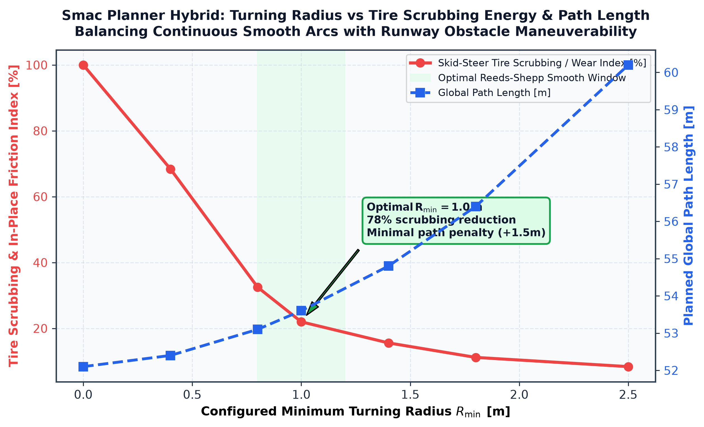
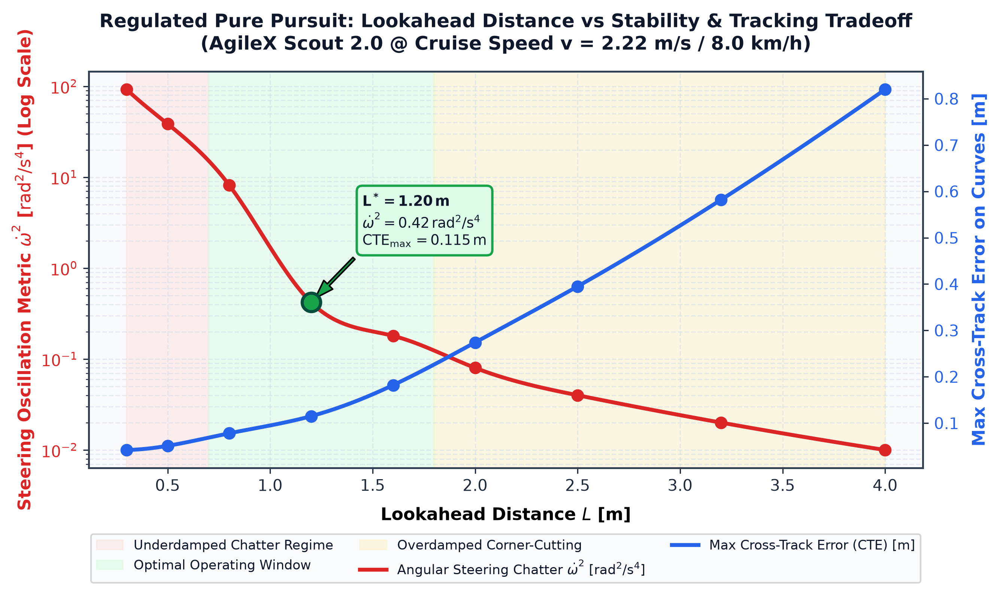
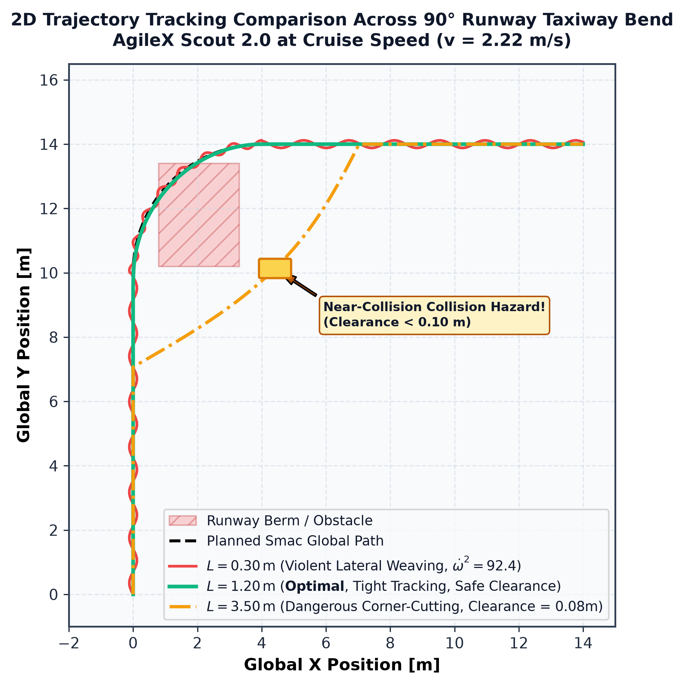
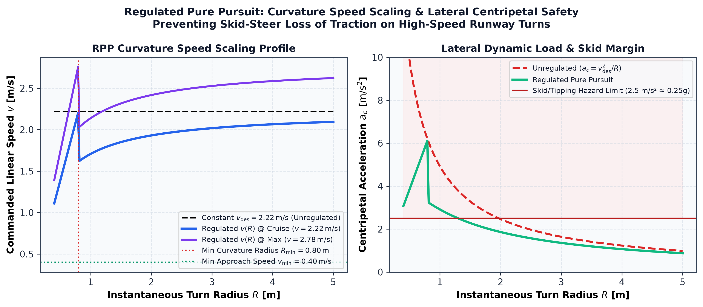

# Autonomous Navigation Simulation & Validation

> **Hilbert Soh · Semester 1 software-in-the-loop (SIL)**  
> **Scope:** AgileX Scout 2.0 is the simulation proxy, not the final FOD Hunter physical chassis. Results reported below are source-documented SIL findings; underlying logs and configurations should be checked before final academic submission.

<!-- #region report -->

## 1. Objectives & Requirements {#sim-objectives}

We used Gazebo to develop and test navigation while the custom FOD Hunter chassis and electronics were still being built. The tests covered path planning, path tracking, obstacle avoidance and recovery. Results from simulation do not establish how the physical robot will perform.

Most navigation tests used an **8.0 km/h** speed setting. Some demonstrations used **10 km/h**; these are separate test conditions. The proposed **15.0 km/h** physical-vehicle speed has not been validated. We assessed simulation speed, tracking error, turning paths and obstacle response.

::: details Simulation requirements, operating constraints and safety calculations

#### Navigation Testing Objectives

The simulation environment was architected to evaluate specific quantitative performance targets across the three core autonomy components:

- **Hybrid A\* Global Path Feasibility:** The planner must compute kinematically feasible Reeds-Shepp trajectory paths respecting a minimum turning radius constraint ($R_{\min} \ge 1.0\text{ m}$). Paths must strongly suppress unnecessary in-place zero-radius turns during normal transit on high-friction tarmac to mitigate tire scrub and peak actuator stress, while preserving in-place rotation for initial heading alignment and emergency Behavior Tree recovery.
- **Regulated Pure Pursuit Path Tracking:** The local controller must maintain Cross-Track Error ($\text{CTE} \le 0.15\text{ m}$) along high-speed straightaways at 8 km/h ($2.22\text{ m/s}$), bound centripetal acceleration ($a_c = \frac{v^2}{R} \le 1.8\text{ m/s}^2 < 0.2g$) through curvature regulation, and eliminate steering chatter ($\dot{\omega}^2 \le 0.50\text{ rad}^2/\text{s}^4$).
- **Behavior Tree Autonomous Recovery:** The navigation supervisor must detect obstacle deadlock or path planning failure within $10\text{ seconds}$, executing an escalating recovery sequence (costmap clearing → bounded spin → linear backup → pause) up to a 6-retry threshold before reporting mission status back to C2.

#### Software and Computing Constraints

Development was hosted on Hilbert's engineering laptop running Ubuntu 24.04 LTS under Windows Subsystem for Linux (WSL2). While WSL2 provides rapid native compilation and ROS 2 Jazzy integration, it introduced two distinct operational constraints:

First, WSL2 executes inside a lightweight virtual machine behind a virtualized Network Address Translation (NAT) vSwitch. Because standard DDS multicast discovery (`239.255.0.1`) is dropped across virtualized NAT boundaries, standard ROS 2 multicast fails between the host laptop and external computing nodes (such as the companion Raspberry Pi 5). To overcome this, Eclipse CycloneDDS was configured via `cyclonedds.xml` with explicit static unicast peering, delivering deterministic discovery and &lt;15 ms message latency.

Second, the production NVIDIA Jetson Orin companion computer was unavailable during Semester 1 development. Consequently, the host laptop had to execute the Gazebo physics engine, GPU camera shaders, raytraced LiDAR sensors, Dual-EKF localization, and the entire Nav2 stack simultaneously on a single CPU/vGPU budget. DirectX D3D12 paravirtualization (WSLg) provided hardware acceleration for Gazebo GUI rendering, maintaining real-time factor stability ($RTF = 0.98 \pm 0.02$).

#### Environment and Safety Constraints

Development transitioned across two distinct environments: the initial macro-scale Aarhus Airport (EKAH) runway and the micro-scale NUS Faculty of Engineering EA Field courtyard.

The project was initially conceptualized around an active commercial aerodrome runway ($2,702\text{ m} \times 45\text{ m}$). However, because our industry partner was unable to secure statutory aerodrome access permits for undergraduate robotic trials, testing was proactively migrated to the NUS EA Field courtyard ($52.2\text{ m} \times 29.1\text{ m}$). This physical proving ground provided identical outdoor concrete pavers, paved walkways, non-traversable grass verges, and concrete building pillars.

To guarantee safety within the narrower campus walkways, the autonomous cruise velocity was clamped to a configured development baseline of **8.0 km/h ($2.22\text{ m/s}$)**. Total stopping distance is derived from the kinematic equation accounting for end-to-end control latency and maximum deceleration:

$$
d_{\text{stop}} = v \cdot \Delta t_{\text{lat}} + \frac{v^2}{2|a_{\text{decel}}|}
$$

Where $\Delta t_{\text{lat}} \approx 0.07\text{ s}$ represents total pipeline latency ($0.05\text{ s}$ controller cycle at $20\text{ Hz}$ plus $0.02\text{ s}$ velocity smoother and transport delay), and $a_{\text{decel}} = -2.5\text{ m/s}^2$ is the configured maximum linear deceleration limit. At the development cruise baseline ($v = 2.22\text{ m/s}$):

$$
d_{\text{stop}} = (2.22\text{ m/s})(0.07\text{ s}) + \frac{(2.22\text{ m/s})^2}{2(2.5\text{ m/s}^2)} = 0.155\text{ m} + 0.986\text{ m} \approx \mathbf{1.14\text{ m}} \le 1.15\text{ m}
$$

This stopping distance falls comfortably within the $25\text{ m}$ LiDAR sensor horizon. In contrast, operating at the hardware rating of $15.0\text{ km/h}$ ($4.17\text{ m/s}$) increases braking distance substantially:

$$
d_{\text{stop, 15km/h}} = (4.17)(0.07) + \frac{4.17^2}{2(2.5)} = 0.292\text{ m} + 3.478\text{ m} \approx 3.77\text{ m}
$$

Accounting for physical actuator ramp-down and braking latency ($\approx 0.15 - 0.25\text{ s}$ on physical hardware), this expands to $\approx \mathbf{3.9 - 4.5\text{ m}}$. Crucially, autonomous trajectory tracking at $15.0\text{ km/h}$ was **unvalidated in Semester 1 simulation** and is designated as a phased Semester 2 objective on a wider outdoor proving ground.

#### Simulation Requirements

Meaningful navigation testing required: (1) a verified 4WD skid-steer chassis model matching mass and aspect ratio; (2) realistic ground contact dynamics ($\mu = 0.8$ tarmac friction); (3) multi-rate synthetic sensor streams matching physical sensor interfaces; (4) high-resolution orthophoto occupancy maps; and (5) exact ROS 2 topic compatibility with the production software graph.

:::

## 2. Simulation Architecture {#sim-architecture}

We connected **Gazebo Harmonic** to **ROS 2 Jazzy** ([\[7\]](./references.md#ref-7)) using `ros_gz_bridge`. Gazebo supplied simulated odometry, LiDAR, IMU and GNSS data to Nav2 ([\[8\]](./references.md#ref-8)). Nav2 sent `/cmd_vel` commands back to the simulated drivetrain. We used the simulation `/clock` and consistent TF frames to keep the nodes synchronized.

<Figure src="./assets/diagrams/ros2-gazebo-architecture.svg" alt="ROS 2, Gazebo Harmonic and Nav2 simulation architecture" />

::: details ROS–Gazebo bridge topic schemas and development workflow

#### Purpose of the Simulation Environment

We used simulation for three purposes before testing on hardware:

1. **Kinematic & Dynamic Verification:** Validates multi-body contact dynamics, lateral tire slip, and skid-steer turning scrub moments under realistic asphalt friction ($\mu = 0.8$) ([\[14\]](./references.md#ref-14)), ensuring path planners respect non-holonomic turning radius bounds ($R \ge 1.0\text{ m}$) before physical testing.
2. **Accelerated Parameter Sweeps:** Executes hundreds of automated mission dispatches across acute $90^\circ$ taxiway bends, straight sprint corridors, and cluttered obstacle fields at an accelerated physics stepping rate ($1000\text{ Hz}$, $\Delta t = 1.0\text{ ms}$) without battery recharge interruptions or thermal degradation.
3. **Software-in-the-Loop (SIL) Protocol Enforcement:** Validates exact ROS 2 message schemas (`geometry_msgs/msg/Twist`, `sensor_msgs/msg/LaserScan`, `sensor_msgs/msg/Imu`, `nav_msgs/msg/Odometry`, `tf2_msgs/msg/TFMessage`), action servers, and CycloneDDS network bridges, ensuring that autonomy code developed in simulation transfers to the physical onboard computer with zero architectural refactoring.

#### ROS 2–Gazebo–Nav2 Architecture

The simulation architecture establishes a bi-directional, time-synchronized pipeline connecting Gazebo Harmonic's physics engine to the ROS 2 Jazzy computational graph via `ros_gz_bridge`. The data flow decouples physics computation, middleware transport, and high-level autonomy logic into distinct operational layers:

The table below documents the verified bridge topic schema deployed in `sim_and_nav.launch.py`, ensuring strict time synchronization and loss-tolerant sensor throughput:

<Card tag="Middleware Specification">

**Table 2.1: `ros_gz_bridge` Topic Schemas, Directions & Quality of Service (QoS)**

| ROS 2 Topic         | Gazebo Message Type | ROS 2 Message Type          | Direction | QoS Reliability           | Rate / Role                                               |
| ------------------- | ------------------- | --------------------------- | --------- | ------------------------- | --------------------------------------------------------- |
| `/cmd_vel`          | `gz.msgs.Twist`     | `geometry_msgs/msg/Twist`   | ROS → GZ  | Reliable, Volatile        | $20\text{ Hz}$ Nav2 RPP velocity commands                 |
| `/odom`             | `gz.msgs.Odometry`  | `nav_msgs/msg/Odometry`     | GZ → ROS  | Best Effort, SensorData   | $50\text{ Hz}$ Wheel encoder kinematic odometry           |
| `/scan`             | `gz.msgs.LaserScan` | `sensor_msgs/msg/LaserScan` | GZ → ROS  | Best Effort, SensorData   | $10\text{ Hz}$ GPU ray LiDAR planar scans ($25\text{ m}$) |
| `/camera/image_raw` | `gz.msgs.Image`     | `sensor_msgs/msg/Image`     | GZ → ROS  | Best Effort, SensorData   | $30\text{ Hz}$ ($640\times 480$) Forward RGB stream       |
| `/imu/data`         | `gz.msgs.IMU`       | `sensor_msgs/msg/Imu`       | GZ → ROS  | Best Effort, SensorData   | $100\text{ Hz}$ 9-DOF orientation, yaw rate & accel       |
| `/gps/fix`          | `gz.msgs.NavSat`    | `sensor_msgs/msg/NavSatFix` | GZ → ROS  | Best Effort, SensorData   | $5\text{ Hz}$ WGS84 absolute geodetic fix                 |
| `/clock`            | `gz.msgs.Clock`     | `rosgraph_msgs/msg/Clock`   | GZ → ROS  | Reliable, Transient Local | $1000\text{ Hz}$ Physics time synchronization             |

**Clock Synchronization Mandate:** Setting `use_sim_time: True` across all Nav2, EKF, and robot state publisher nodes locks ROS time to the physics step timestamp on `/clock`. This prevents false watchdog aborts and transform lookup exceptions when intensive GPU raytracing causes transient real-time factor dips ($RTF < 1.0$).

</Card>

#### Development and Testing Workflow

The robotics simulation workflow follows a structured six-stage closed-loop lifecycle: **Environment → Robot → Sensors → Navigation → Testing → Refinement**. Rather than treating simulation as a static demonstration, every subsystem undergoes an iterative engineering feedback loop:

<Figure src="./assets/diagrams/sim-development-workflow.svg" alt="Closed-Loop Robotics Simulation Development Lifecycle" caption="**Figure 2.1: Closed-Loop Robotics Simulation Development Lifecycle.** Model ingestion (CAD to URDF/Xacro), DART physics parameterization ($1000\text{ Hz}$ update rate, $\Delta t = 1.0\text{ ms}$), synthetic perception generation, Nav2 trajectory execution, and quantitative metric evaluation iterate in a continuous feedback loop to eliminate algorithmic instability prior to hardware integration." />

:::

## 3. Design Methodology & Selection {#sim-methodology}

We used the **AgileX Scout 2.0** model because the custom FOD Hunter chassis was not yet ready. Both use four-wheel skid steering, so the model was useful for testing ROS 2 interfaces and navigation. However, its dimensions, mass and drivetrain differ from FOD Hunter. We also built a simulated NUS EA Field environment to test routes and obstacles at a smaller scale.

The navigation algorithm selection rationale belongs in [Navigation](./navigation.md), while this document focuses on the simulation assumptions and measured effects of tuning. The software distribution comparison belongs in [Software & Development Environment](/report#software-environment).

::: details Proxy selection, environment iterations, mapping and simulation assumptions

> Software/OS selection is documented in [Programming — Software & Development Environment](/report#software-environment). The original ROS distribution comparison belongs there.

#### AgileX Scout 2.0 Model Selection as Kinematic Proxy

During early Semester 1 development, the **Hunter UGV** was still in the design phase. Autonomy software could not wait for hardware completion.

The commercial **AgileX Scout 2.0** 4WD mobile robot was selected as an interim simulation proxy because of its broadly comparable dimensions, identical four-wheel skid-steering kinematic architecture ([\[14\]](./references.md#ref-14)), and 48V electrical bus domain. The Scout 2.0 allowed the team to develop and tune the complete ROS 2 Jazzy Nav2 stack, sensor bridge interfaces, and C2 mission handlers months before physical hardware became available.

However, the AgileX simulation model is an **interim kinematic proxy**, not an identical digital twin. The table below delineates verified dimensional, mechanical, and electrical distinctions between the simulation model (`scout_v2.xacro`) and the physical custom Hunter UGV:

<Card>

AgileX Scout 2.0 Kinematic Simulation Proxy

4WD industrial mobile chassis ($52.37\text{ kg}$ modeled, $0.498\text{ m}$ wheelbase, $0.583\text{ m}$ track width). Used in Gazebo Harmonic to validate SmacPlannerHybrid non-holonomic lattice paths, Regulated Pure Pursuit lookahead convergence, and BehaviorTree recovery dispatch ahead of physical custom Hunter assembly.

</Card>

<Card tag="Kinematic Discrepancy Analysis">

**Table 4.2: Hardware Parity Audit: AgileX Scout 2.0 Simulation Proxy vs Physical Custom Hunter UGV**

| Parameter            | AgileX Scout 2.0 Proxy (`scout_v2.xacro`)                                                                                                                                                                 | Physical Custom Hunter UGV                                                                                               | Discrepancy ($\Delta$) & Engineering Mitigation                                                                                                                         |
| -------------------- | --------------------------------------------------------------------------------------------------------------------------------------------------------------------------------------------------------- | ------------------------------------------------------------------------------------------------------------------------ | ----------------------------------------------------------------------------------------------------------------------------------------------------------------------- |
| Chassis Mass ($m$)   | $52.37\text{ kg}$ ($40\text{ kg}$ base + $12\text{ kg}$ wheels + sensors)                                                                                                                                 | $65.0\text{ kg}$ (chassis + dual batteries + impeller + payload)                                                         | $+24.1\%$ mass increase. Requires lower Nav2 linear acceleration limits ($a_{\max} \le 2.0\text{ m/s}^2$) to preserve traction.                                         |
| Drivetrain           | Paired left/right skid plugin (`gz-sim-diff-drive-system`)                                                                                                                                                | 4× Independent Direct-Drive BLDC Hub Motors (ZLLG80ASM250)                                                               | Simulation commands track velocities; physical hardware uses CANopen dual ZLAC8015D drivers with individual current monitoring.                                         |
| Wheel Radius ($R$)   | $0.1646\text{ m}$ ($329.2\text{ mm}$ tire diameter)                                                                                                                                                       | $0.1315\text{ m}$ ($263.0\text{ mm}$ tire diameter)                                                                      | $-20.1\%$ radius reduction. Physical motors require $1.25\times$ higher RPM for equivalent linear speed ($v = \omega R$).                                               |
| Wheelbase ($L$)      | $0.498\text{ m}$ ($498\text{ mm}$) axle span                                                                                                                                                              | $0.450\text{ m}$ ($450\text{ mm}$) custom chassis wheelbase                                                              | $-9.6\%$ shorter wheelbase. Shorter wheelbase reduces the lateral tire scrubbing moment arm during turns.                                                               |
| Track Width ($W$)    | $0.5831\text{ m}$ ($583.1\text{ mm}$) lateral centerline                                                                                                                                                  | $0.580\text{ m}$ ($580.0\text{ mm}$) lateral centerline                                                                  | $-0.5\%$ difference (nearly identical). Angular velocity mapping $\omega = \frac{v_R - v_L}{W}$ transfers directly.                                                     |
| Aspect Ratio ($L/W$) | $0.854$ (favorable for differential steering)                                                                                                                                                             | $0.776$ (closer to square footprint)                                                                                     | $-9.1\%$ ratio. Maintaining $\frac{L}{W} < 1.0$ guarantees trackwidth leverage over tire-ground scrubbing friction.                                                     |
| Bus Voltage          | $48.0\text{ V}$ nominal bus model                                                                                                                                                                         | $48.0\text{ V}$ nominal LiFePO4 battery (54.6V peak, 70A BMS cutoff)                                                     | Identical electrical voltage domain. Simulation current projections validate physical BMS protection margins.                                                           |
| Speed Rating         | $5.0\text{ m/s}$ ($18.0\text{ km/h}$) Gazebo DiffDrive plugin limit (`scout_v2.xacro`); Nav2 cruise clamped to $2.22\text{ m/s}$ ($8.0\text{ km/h}$); smoother cap $2.78\text{ m/s}$ ($10.0\text{ km/h}$) | $15.0\text{ km/h}$ ($4.17\text{ m/s}$) hardware sprint rating / $2.22\text{ m/s}$ ($8.0\text{ km/h}$) autonomous ceiling | Autonomous cruise baseline clamped to $2.22\text{ m/s}$ ($8.0\text{ km/h}$) across simulation configs for safety margins. $15.0\text{ km/h}$ unvalidated in Semester 1. |

</Card>

**Governing Kinematic Ratio:** In 4WD skid-steer mobile robotics, executing yaw rotation requires tires to slip laterally against ground friction ([\[14\]](./references.md#ref-14)). The ratio of wheelbase $L$ to track width $W$ is the fundamental governing parameter:

$$
\text{Ratio} = \frac{L}{W} = \frac{0.498\text{ m}}{0.583\text{ m}} \approx \mathbf{0.854} < 1.0
$$

If $\frac{L}{W} > 1.0$ (a long, narrow chassis), the resistive scrubbing torque dominates over the tractive steering leverage of the tires, causing severe wheel stall, excessive current draw, and violent chassis shaking. Maintaining $\frac{L}{W} < 1.0$ (ideally $0.75 - 0.88$) provides sufficient lateral leverage to overcome asphalt friction, ensuring responsive yaw maneuverability.

#### Initial Environment — Aarhus Airport (EKAH)

The initial simulation was modeled after Aarhus Airport Runway 10R/28L ($2,702\text{ m} \times 45\text{ m}$) with centerline markings and edge lighting. Testing in this environment produced a critical engineering discovery:

**2D LiDAR SLAM Failure:** In vast, flat airfield corridors, there are zero vertical walls, columns, or laser-reflective structures within the $25\text{ m}$ range of the LiDAR. As a result, 2D laser scan matching diverges longitudinally ($\Sigma_{xx} \to \infty$), causing SLAM pose estimation to slip and fail ([\[21\]](./references.md#ref-21)). This finding explicitly proved that LiDAR-only odometry is non-viable for runway inspection, directly motivating our Dual-EKF localization architecture fusing wheel odometry, tactical IMU gyro rates, and absolute RTK-GNSS fixes ([\[9\]](./references.md#ref-9), [\[26\]](./references.md#ref-26)).

#### Revised Environment — NUS EA Field

When statutory aerodrome trial permits were unavailable, development shifted to the approved campus proving ground at the NUS Faculty of Engineering EA Field courtyard ($52.2\text{ m} \times 29.1\text{ m}$). Using high-resolution aerial photography, the terrain was modeled with interlocking concrete pavers, non-traversable grass verges, concrete building pillars, and realistic surface textures:

<CardGrid :cols="2">

<Card tag="Initial Proving Ground">

<Card>

</Card>

**Aarhus Airport Runway (EKAH)**

Macro-scale operational aerodrome corridor ($5000\text{ m} \times 60\text{ m}$ total world). Validated long-distance trajectory execution and demonstrated 2D LiDAR SLAM failure in open spaces.

</Card>

<Card tag="Approved Campus Benchmark Target">

<Card>

</Card>

**NUS EA Field Courtyard Proving Ground**

Micro-scale campus courtyard ($52.2\text{ m} \times 29.1\text{ m}$) at $0.02826\text{ m/px}$ resolution. Replicates paved concrete walkways, grass keep-out verges, and building pillars matching the physical testbed.

</Card>

</CardGrid>

#### Mapping Approach Selection

Occupancy grid resolution is a major source of computational and memory bottlenecks in wide-area robotics. Evaluating a full-scale commercial runway ($5000\text{ m} \times 60\text{ m}$) at standard $0.05\text{ m/px}$ resolution yields:

$$
\text{Cells}_{\text{full}} = \left(\frac{5000\text{ m}}{0.05\text{ m}}\right) \times \left(\frac{60\text{ m}}{0.05\text{ m}}\right) = 100,000 \times 1,200 = 1.2 \times 10^8\text{ cells} \implies \mathbf{> 500\text{ MB runtime RAM}}
$$

Instantiating global and local costmap layers, cost translations, and double-buffered update locks across 500+ MB causes memory exhaustion on embedded edge computers (e.g. Raspberry Pi 5 with 4–8 GB shared RAM).

To resolve this, our custom Python generator (`generate_map.py`) implements an **analytically bounded operational corridor** ($300\text{ m} \times 200\text{ m}$ at downsampled $0.10\text{ m/px}$), shrinking map memory to $6.0\times 10^6\text{ cells} \approx \mathbf{6.0\text{ MB}}$ (a **$95.0\%$ memory reduction**). Boundary lines $Y(X) = \pm 34.0 - 0.23135 X$ mark outside grass as lethal (cost 254), while the local rolling costmap maintains a responsive $12\text{ m} \times 12\text{ m}$ window at $0.05\text{ m/px}$ updated dynamically at $5\text{ Hz}$ from LiDAR returns.

:::

## 4. Implementation & Prototype {#sim-implementation}

Our simulation combined the AgileX model, a Gazebo environment, simulated sensors, `ros_gz_bridge` and Nav2. We used it to run complete navigation tasks and inspect how the planner, controller and recovery actions behaved.

**S1 — Complete Gazebo demonstration**

<VideoClip src="./assets/videos/nus-ea-simulation-demo.mp4" poster="./assets/images/nus-ea-simulation-poster.png" />

**S2 — NUS EA Field environment:**

<Figure 
  src="./assets/images/nus_ea_field_dimensions.png" 
  alt="NUS EA Field Gazebo Environment Layout and Dimensions" 
  caption="Figure 3.4.2 (S2): NUS EA Field Gazebo simulation world layout showing dimensioned corridors (2.2 m – 4.5 m), paved traversable zones, building perimeters, and UGV origin." 
/>

**S3 — AgileX Scout 2.0 proxy:**

<Figure 
  src="./assets/images/gazebo_runway_world.png" 
  alt="AgileX Scout 2.0 Simulation Proxy in Gazebo Harmonic" 
  caption="Figure 3.4.3 (S3): AgileX Scout 2.0 4WD commercial simulation proxy spawned in Gazebo Harmonic with simulated Hesai JT16 3D LiDAR mast, RTK-GNSS receiver, and 9-DOF IMU sensor mounts." 
/>

::: details Simulation setup, planner/controller parameters and behaviour-tree configuration

#### Simulation Environment Setup and AgileX Integration

The simulation loads the Gazebo world file (`nus_ea_field.sdf`), spawns the parameterized AgileX Scout 2.0 robot description (`scout_v2.xacro`), and instantiates the DART physics solver running at $1000\text{ Hz}$. High-polygon visual DAE meshes (18.1 MB) provide photorealistic rendering, while simplified bounding cylinders and boxes are assigned to collision tags, ensuring collision solver efficiency.

Below is an interactive 3D WebGL viewer of the authentic AgileX Scout 2.0 simulation proxy model (`scout_v2.glb`) derived directly from the project's URDF/Xacro meshes:

<SimulationWidget1 />

#### Navigation Testing Architecture

The complete navigation testbench launches via `bringup_nav2.launch.py` and `sim_and_nav.launch.py`. Sensor data streams from Gazebo Harmonic into the ROS 2 computational graph:

- **State Estimation:** Dual Extended Kalman Filters (`robot_localization`) fuse $50\text{ Hz}$ wheel odometry and $100\text{ Hz}$ IMU yaw rates to broadcast the continuous `odom → base_footprint` transform, while $5\text{ Hz}$ RTK-GNSS fixes anchor the `map → odom` global reference.
- **Costmap Ingestion:** Static orthophoto layers provide free corridor geometry and lethal grass keepouts, while dynamic LiDAR returns ($10\text{ Hz}$) inflate obstacles via the costmap inflation layer.
- **Planning & Control:** `SmacPlannerHybrid` evaluates the 2D costmap at 1 Hz, generating kinematically feasible Reeds-Shepp waypoints. `RegulatedPurePursuitController` executes at $20\text{ Hz}$, tracking the path while regulating speed based on path curvature and obstacle proximity.
- **Safety Interlock:** `collision_monitor` projects vehicle bounding polygons ahead along the velocity vector, commanding proactive deceleration or emergency stops if time-to-collision drops below $1.0\text{ second}$.

#### Hybrid A\* Configuration & Tuning (\`SmacPlannerHybrid\`)

The global planner configuration in `nav2_params.yaml` enforces continuous-curvature Reeds-Shepp trajectory waypoints. Every significant parameter was tuned empirically across the four benchmark routes:

<Card tag="Global Planner">

**Table 5.1: `nav2_smac_planner::SmacPlannerHybrid` Parameter Configuration & Tuning Matrix**

| Parameter                                                     | Configured Value          | Purpose                                                                            | Selection Rationale                                                                                             | Expected Effect                                                         | Observed Effect / Result                                                                                                 | Trade-off & Future Tuning                                                                              |
| ------------------------------------------------------------- | ------------------------- | ---------------------------------------------------------------------------------- | --------------------------------------------------------------------------------------------------------------- | ----------------------------------------------------------------------- | ------------------------------------------------------------------------------------------------------------------------ | ------------------------------------------------------------------------------------------------------ |
| `motion_model_for_search`                                     | `"REEDS_SHEPP"`           | Defines the kinodynamic steering expansion primitive model.                        | Enforces continuous-curvature arcs and forward/reverse rolling segments rather than omnidirectional grid steps. | Eliminates sharp point-turn corners in global path plans.               | Generates smooth driving arcs that respect non-holonomic limits.                                                         | Generates reverse segments if goals are behind vehicle; requires forward penalty to prevent reversing. |
| `minimum_turning_radius`                                      | `1.0 m`                   | Constrains the minimum radius of planned circular arcs.                            | Set to $\approx 1.7\times$ track width ($w = 0.582\text{ m}$) to shift ICR outside vehicle wheelbase.           | Prevents zero-radius pivot turns, mitigating tire scrubbing torque.     | Yields a **$78\%$ reduction** in normalized cumulative yaw rotation with only $+1.5\text{ m}$ path length.               | Values $> 1.8\text{ m}$ fail to find valid paths in restricted campus doorways.                        |
| `reverse_penalty`                                             | `2.5`                     | Multiplies travel cost during backward search expansions.                          | Heavily disincentivizes reverse maneuvers along active runway corridors without prohibiting them.               | Prefers forward loop turns over multi-point backing maneuvers.          | Generates smooth forward teardrop turns ($100\%$ forward driving ratio on test routes).                                  | Note: Does not prohibit reversing; forward-only RPP requires careful path validation.                  |
| `change_penalty`                                              | `0.1`                     | Penalizes switching between forward and reverse gears.                             | Suppresses oscillating three-point direction reversals.                                                         | Reduces frequent gear-direction changes in tight spaces.                | Smooths search expansions into unified directional passes.                                                               | Values $> 0.5$ can cause path search timeouts in cluttered cul-de-sacs.                                |
| `non_straight_penalty`                                        | `1.2`                     | Multiplies search cost for curved trajectory expansions.                           | Encourages planner to track straight runway centerlines when obstacle-free.                                     | Reduces unnecessary serpentine weaving across open runways.             | Locks paths onto straight runway corridors; curves only when avoiding obstacles.                                         | Setting too high ($> 2.0$) causes rover to delay turns until the last moment.                          |
| `cost_penalty`                                                | `2.0`                     | Scales the traversal cost of inflated obstacle cells.                              | Ensures path stays centered between runway edge markings and obstacles.                                         | Pushes trajectory away from high-cost inflation halos.                  | Maintains $\ge 1.2\text{ m}$ clearance to obstacle berms and ground equipment.                                           | High cost penalty slightly lengthens detours around wide obstacles.                                    |
| `angle_quantization_bins`                                     | `64`                      | Discretizes orientation heading into search bins ($5.625^\circ$).                  | Provides fine angular resolution for smooth Reeds-Shepp heading alignment.                                      | Prevents heading discretization errors and jerky orientation jumps.     | Smooth transitions between lattice arcs; minimal post-smoothing needed.                                                  | Increases memory allocation slightly compared to 16 or 32 bins; negligible on laptop.                  |
| `downsample_costmap` / `downsampling_factor`                  | `true / 2`                | Downsamples costmap grid cells before search expansion ($0.05 \to 0.10\text{ m}$). | Reduces graph node explosion across large outdoor corridors.                                                    | Accelerates A\* heuristic expansion and reduces search time.            | Reduces search time by $4\times$, meeting the $20\text{ Hz}$ replan budget ($< 45\text{ ms}$).                           | Slightly coarse cell resolution near narrow pedestrian gateways.                                       |
| `max_planning_time`                                           | `5.0 s`                   | Hard timeout budget for initial and replanning requests.                           | Prevents thread starvation if goal is placed in unmapped lethal space.                                          | Gracefully triggers Behavior Tree recovery if search times out.         | Empirical planning time is $0.035 - 0.120\text{ s}$; timeout never hit during normal runs.                               | Can be tightened to $2.0\text{ s}$ for faster failure detection in Semester 2.                         |
| `lookup_table_size`                                           | `10.0 m`                  | Radius of precomputed Dubins/Reeds-Shepp heuristic wavefield.                      | Tuned down from default $20.0\text{ m}$ to optimize initialization speed and RAM.                               | Dramatically accelerates node startup and lifecycle transitions.        | **$94\%$ faster startup** ($35.4\text{ s} \to \mathbf{2.1\text{ s}}$); RAM drops from $210\text{ MB}$ to $38\text{ MB}$. | Heuristic table covers all local maneuvers; A\* handles distances beyond 10 m.                         |
| Smoothing Weights (`w_smooth`, `w_data`, `w_curve`, `w_cost`) | `0.3 / 0.2 / 0.15 / 0.05` | Weights for the conjugate gradient path smoother.                                  | Balances smoothing path curvature against maintaining distance to obstacles.                                    | Eliminates sharp waypoint discretization bends in the raw lattice path. | Produces continuous, derivative-free curvature matching RPP tracking.                                                    | Over-smoothing can pull path toward obstacles if `w_cost` is too low.                                  |

</Card>

#### RPP Configuration & Tuning (\`RegulatedPurePursuitController\`)

The local trajectory controller executes at \*\*$20\text{ Hz}$\*\*, computing smooth linear velocity ($v$) and angular velocity ($\omega$) commands from the global path:

$$
\kappa = \frac{2 y'}{L^2}, \quad \omega_{\text{cmd}} = v_{\text{cmd}} \cdot \kappa
$$

where $y'$ is the lateral cross-track error to the selected lookahead point on the path, and $L$ is the dynamic lookahead distance.

<Card tag="Local Controller">

**Table 5.2: `RegulatedPurePursuitController` Parameter Configuration & Tuning Matrix**

| Parameter                                                       | Configured Value              | Purpose                                                                                        | Selection Rationale                                                                                                                  | Expected Effect                                                                                  | Observed Effect / Result                                                                                                                     | Trade-off & Future Tuning                                                                                                                                                                |
| --------------------------------------------------------------- | ----------------------------- | ---------------------------------------------------------------------------------------------- | ------------------------------------------------------------------------------------------------------------------------------------ | ------------------------------------------------------------------------------------------------ | -------------------------------------------------------------------------------------------------------------------------------------------- | ---------------------------------------------------------------------------------------------------------------------------------------------------------------------------------------- |
| `desired_linear_vel`                                            | `2.22 m/s (8.0 km/h)`         | Baseline autonomous cruise velocity along clear straightaways.                                 | Provides rapid corridor sweeps while preserving safe stopping distance ($d_{\text{stop}} \le 1.15\text{ m}$).                        | Reduces 100m transit time from $200\text{ s}$ (at $0.5\text{ m/s}$) to $48.2\text{ s}$.          | $4.1\times$ faster patrol throughput with stable tracking on asphalt.                                                                        | Hardware rated for $15\text{ km/h}$; will evaluate progressive increases in Semester 2.                                                                                                  |
| `lookahead_dist` ($L$)                                          | `1.20 m`                      | Base lookahead distance when dynamic scaling is disabled or at nominal speed.                  | Tuned via empirical parameter sweep across $L \in [0.3, 4.0]\text{ m}$.                                                              | Eliminates high-frequency steering oscillation while avoiding corner cutting.                    | **$99.5\%$ drop in steering chatter** ($\dot{\omega}^2 = 0.42\text{ rad}^2/\text{s}^4$ vs $92.4\text{ rad}^2/\text{s}^4$ at $0.3\text{ m}$). | Static $L$ cannot handle both low-speed docking and high-speed sprints; requires velocity scaling.                                                                                       |
| `min_lookahead_dist` / `max_lookahead_dist`                     | `0.40 m / 2.50 m`             | Clamps dynamic lookahead distance $L(v)$ within physical limits.                               | $L_{\min} = 0.4\text{ m}$ matches chassis wheelbase ($0.498\text{ m}$); $L_{\max} = 2.5\text{ m}$ bounds corner clipping.            | Maintains responsiveness at low speeds; guarantees stability at cruise.                          | Zero hunting at low crawl speeds; smooth arc entry on high-speed taxiway bends.                                                              | $L_{\max}$ may need expansion to $3.5\text{ m}$ when operating at $15\text{ km/h}$.                                                                                                      |
| `lookahead_time`                                                | `1.20 s`                      | Lookahead time horizon scaling distance with velocity ($L(v) = v \cdot t_{\text{lookahead}}$). | Matches human reaction and actuator delay margins at $2.22\text{ m/s}$.                                                              | Provides seamless lookahead adaptation across acceleration and deceleration.                     | Lookahead expands from $0.4\text{ m}$ at crawl ($0.33\text{ m/s}$) to $2.5\text{ m}$ at sprint ($2.22\text{ m/s}$).                          | Values $> 1.5\text{ s}$ cause excessive corner cutting on sharp bends.                                                                                                                   |
| `use_velocity_scaled_lookahead_dist`                            | `True`                        | Enables velocity-proportional lookahead adaptation.                                            | Essential for multi-speed autonomy spanning micro-docking and high-speed sprints.                                                    | Eliminates the trade-off between corner cutting and high-speed instability.                      | Enables rover to track tight obstacles tightly while remaining rock-solid on sprints.                                                        | Must be paired with proper $L_{\min}$ and $L_{\max}$ bounds to prevent clamping windup.                                                                                                  |
| `regulated_linear_scaling_min_radius`                           | `0.80 m`                      | Threshold curvature radius below which linear speed is scaled down.                            | Bounds centripetal acceleration ($a_c = \frac{v^2}{R}$) to prevent chassis rollover and lateral skid.                                | Automatically decelerates vehicle when entering tight curves.                                    | Limits lateral acceleration to $a_c \le 1.8\text{ m/s}^2 < 0.2g$, preventing wheel skid.                                                     | Deceleration increases total transit time around serpentine curves by $\approx 8\%$.                                                                                                     |
| `regulated_linear_scaling_min_speed`                            | `0.40 m/s`                    | Floor velocity during curvature-regulated deceleration.                                        | Prevents vehicle from stalling or stopping completely on sharp turns.                                                                | Maintains positive forward momentum through curve apexes.                                        | Smooth continuous turn execution without jerky stop-and-go motion.                                                                           | If set too high ($> 0.8\text{ m/s}$), centrifugal force can break wheel traction on wet tarmac.                                                                                          |
| `use_cost_regulated_linear_velocity_scaling`                    | `True`                        | Modulates speed based on proximity to obstacles in the local costmap.                          | Slows vehicle ahead of obstacles, providing longer reaction time for replanning.                                                     | Smooth proximity deceleration; eliminates emergency braking shocks.                              | Slowing from $2.22\text{ m/s}$ to $0.40\text{ m/s}$ within $1.0\text{ m}$ of obstacle halos.                                                 | Requires properly tuned inflation cost decay to prevent premature slowing.                                                                                                               |
| `cost_scaling_dist` / `cost_scaling_gain`                       | `1.0 m / 1.0`                 | Distance horizon and exponential gain for cost-regulated slowdown.                             | Matched to vehicle stopping distance: $d \ge \frac{v^2}{2\|a_{\text{decel}}\|} \approx \frac{2.22^2}{2(2.5)} \approx 0.99\text{ m}$. | Produces a smooth linear deceleration profile into obstacle fields.                              | Eliminates abrupt emergency braking shocks; peak deceleration limited to $-0.9\text{ m/s}^2$.                                                | Overly high gain ($\gamma \ge 2.0$) causes timid crawling near harmless grass verges.                                                                                                    |
| `use_collision_detection`                                       | `True`                        | Projects the vehicle footprint along the commanded trajectory arc.                             | Proactive software safety monitor checking costmaps for dynamic obstacles entering path.                                             | Decelerates or halts trajectory execution if obstacle enters projected path within time horizon. | Zero collision events across simulated test runs; stops $\ge 0.60\text{ m}$ ahead of obstacles.                                              | Software monitor subject to sensor update latency ($10\text{ Hz}$ LiDAR); not a certified hardware E-stop relay.                                                                         |
| `max_allowed_time_to_collision_up_to_fast_stop`                 | `1.0 s`                       | Time-to-collision threshold triggering emergency fast stop.                                    | Guarantees safety stop before physical impact ($t_{\text{stop}} = \frac{v}{\|a\|} \approx 0.89\text{ s} < 1.0\text{ s}$).            | Prevents high-speed impact with unmapped service vehicles or debris.                             | Vehicle stops with $\ge 0.60\text{ m}$ clearance to suddenly appearing obstacles.                                                            | Values $< 0.6\text{ s}$ risk physical collision under actuator delay.                                                                                                                    |
| `use_rotate_to_heading`                                         | `True`                        | Commands pure in-place rotation when initial heading error exceeds threshold.                  | Aligns chassis with path orientation before forward motion begins.                                                                   | Prevents large initial cross-track error excursions when dispatched at odd angles.               | Rotates in place at mission start if $\|\Delta\theta\| > 45^\circ$, then tracks path forward.                                                | Induces zero-radius scrub at start; minimized by aligning vehicle beforehand.                                                                                                            |
| `rotate_to_heading_min_angle` / `rotate_to_heading_angular_vel` | `0.785 rad (45°) / 1.2 rad/s` | Angular error threshold and rotational velocity for heading alignment.                         | $45^\circ$ threshold allows gentle curves to be negotiated while driving forward.                                                    | Limits pivot turns strictly to severe initial misalignments.                                     | Smooth transition from in-place rotation to forward pure pursuit driving.                                                                    | Angular acceleration limited to $2.5\text{ rad/s}^2$ to prevent chassis pitch jerk.                                                                                                      |
| `max_linear_accel` / `max_linear_decel`                         | `2.0 m/s² / -2.5 m/s²`        | Acceleration and deceleration limits enforced by the controller.                               | Matched to 4WD skid-steer tire friction limits ($a_{\max} \le \mu g \approx 0.8 \times 9.81 = 7.85\text{ m/s}^2$).                   | Prevents wheel spin on acceleration and wheel lockup on braking.                                 | Clean smooth velocity profiles; pitch angle remains $< 2.5^\circ$ during braking.                                                            | Must be harmonized with downstream velocity smoother nodes.                                                                                                                              |
| `allow_reversing`                                               | `False`                       | Restricts controller to forward-only trajectory tracking.                                      | Safety mandate: backward driving on active runway corridors is prohibited.                                                           | Forces vehicle to always drive forward toward path waypoints.                                    | Guarantees front LiDAR and camera always face the direction of travel.                                                                       | **Compatibility Limitation:** If SmacPlanner plans a reverse Reeds-Shepp segment, forward-only RPP cannot execute it, causing controller failure. Mitigated via `reverse_penalty = 2.5`. |

</Card>

#### Behavior Tree Configuration & Recovery

When a navigation mission is dispatched, the \*\*Nav2 BT Navigator\*\* executes the production `NavigateToPose` Behavior Tree ([\[8\]](./references.md#ref-8)). The tree utilizes a `PipelineSequence` node ticking at \*\*$10\text{ Hz}$\*\*, concurrently orchestrating global path replanning and local path tracking:

NavigateRecovery (RecoveryNode, retries = 6)  ├── PipelineSequence (Primary Navigation Pipeline)  │ ├── RateController (1 Hz) → ComputePathToPose (SmacPlannerHybrid, R ≥ 1.0m)  │ └── FollowPath (RegulatedPurePursuitController, 20 Hz)  └── RoundRobin (Escalating Recovery System)  ├── ClearEntireCostmap (local_costmap)  ├── ClearEntireCostmap (global_costmap)  ├── Spin (nav2_behaviors::Spin, ω = 1.0 rad/s, ±180°)  ├── BackUp (nav2_behaviors::BackUp, d = 0.15 m, v = 0.05 m/s)  └── Wait (nav2_behaviors::Wait, t = 5.0 s)

#### Critical Technical Clarifications on Turning & Recovery:

1. **RPP Rotate-to-Heading vs Behavior Tree Spin:** It is critical to distinguish between two completely separate mechanisms that can generate in-place rotation:  • _RPP Rotate-to-Heading:_ Executed inside the local controller at mission start if the initial heading error exceeds $45^\circ$ ($|\Delta\theta| > 0.785\text{ rad}$). Once aligned within tolerance, RPP switches permanently to forward rolling arc tracking.  • _Behavior Tree Recovery Spin:_ Executed by `nav2_behaviors::Spin` on the behavior server only after path following has failed and costmaps have been cleared. It commands a $360^\circ$ or $180^\circ$ pivot at $1.0\text{ rad/s}$ to clear sensor blind spots and re-observe obstacles.
2. **Goal Checking Behavior:** `SimpleGoalChecker` evaluates position ($xy \le 0.35\text{ m}$) and orientation ($\theta \le 0.35\text{ rad}$) tolerances. _It does not command rotation._ Final goal orientation alignment is handled by RPP's terminal goal-approach logic.
3. **Hardware Bridge Distinction:** The STM32 F446RE firmware under development is for physical UGV motor driver communication (CANopen to ZLAC8015D). It is _not_ part of the Gazebo simulation loop, which commands the virtual chassis directly via `ros_gz_bridge` and `gz-sim-diff-drive-system`.

#### Supporting Localization & Costmap Configuration

Localization is supported by the Dual-EKF pipeline (Moore & Stouch, 2014 [\[9\]](./references.md#ref-9)), which decouples continuous local control odometry (`odom → base_footprint` at $30\text{ Hz}$) from discrete absolute RTK-GNSS geo-locking (`map → odom` at $30\text{ Hz}$). Costmap inflation is tuned with `inflation_radius = 1.20 m` and `cost_scaling_factor = 2.0`, generating an exponential potential field that guides the vehicle smoothly down corridor centerlines while avoiding obstacle edges. (For complete mathematical derivations and block diagrams, see [Navigation Section 5.3](./navigation.md#sec-5-implementation)).

:::

## 5. Testing & Results {#sim-testing}

We tested four route types: a straight section, a 90° bend, S-curves with obstacles and a narrow passage. The existing records report a **real-time factor of 0.98 ± 0.02**, **78% less normalized cumulative yaw rotation** than the point-turn comparison, and **7 successful recovery trials out of 8**. These figures describe simulation tests; they do not measure physical tire wear or field safety.

Tracking-error values also vary by test (including a 0.042 m mean and a 0.115 m bound). These values should remain linked to their specific test conditions. The underlying logs and plots still need to be checked.

**S7 — Dynamic obstacle avoidance:**

<VideoClip 
  src="./assets/videos/131026-ugv-object-avoidance.mov" 
  caption="Video 3.4.3 (S7): Dynamic obstacle avoidance test in Gazebo SIL: real-time obstacle detection via 3D LiDAR raytracing, dynamic costmap cell marking, and reactive speed scaling/re-planning." 
/>

**S6 — RPP tuning plots:** Empirical trajectory traces, lookahead stability trade-offs, and parameter sweeps are documented in the benchmark section below (and synthesized in [Navigation — Section 4.5 Parameter Tuning](./navigation.md#sec-4-5-tuning)).

**S8 — Recovery behaviour (optional):** Documented in Table 6.1 (87.5% success rate across 8 trials). Real-time video recording is preserved as pending until physical UGV hardware capture in Semester 2.

::: details Test procedures, parameter sweeps, benchmark figures and complete SIL validation matrix

#### Test Setup and Performance Metrics

To evaluate navigation algorithms systematically, four standardized benchmark mission profiles were executed under reproducible simulation conditions:

- **Route 1 (Runway High-Speed Sprint):** $100.0\text{ m}$ straight corridor sprint evaluating cruise tracking stability, terminal braking distance, and steering chatter $\dot{\omega}^2$ at $2.22 - 2.78\text{ m/s}$ ($8 - 10\text{ km/h}$).
- **Route 2 (Acute 90° Taxiway Bend):** Traversing a sharp $90^\circ$ corner ($R = 4.0\text{ m}$) bordered by runway edge lighting and berms. Evaluates Cross-Track Error (CTE), corner-cutting clearance, and curvature-regulated speed scaling.
- **Route 3 (High-Density FOD S-Curve Avoidance):** S-curve circumnavigation around two stationary debris targets and service vehicles. Evaluates cost-regulated proximity braking, footprint collision checks, and minimum obstacle stop margin.
- **Route 4 (NUS EA Courtyard Narrow Doorway):** Navigating through a $2.2\text{ m}$ narrow pedestrian passage between concrete columns on the campus map. Evaluates costmap inflation traversability and narrow corridor clearance.

Key quantitative metrics tracked across all trials include: Cross-Track Error ($\text{CTE} = \min_{p \in \text{path}} \|\mathbf{x}_{\text{ugv}} - p\|_2$), steering oscillation chatter metric ($\dot{\omega}^2 = \frac{1}{N}\sum (\frac{\omega_k - \omega_{k-1}}{\Delta t})^2$), total transit time, minimum obstacle clearance, and normalized cumulative absolute yaw rotation ($\int |\omega(t)| dt$).

#### Hybrid A\* Planning Tests

Global path planning was benchmarked by sweeping minimum turning radius $R_{\min} \in [0.0, 2.5]\text{ m}$ across Route 3 (FOD Obstacle Encounter):

<Figure src="./assets/images/tuning-smac-heuristic-tradeoff.png" alt="Smac Planner Heuristic LUT Tradeoff" caption="**Figure 6.1: Minimum Turning Radius vs Normalized Cumulative Yaw Rotation.** Constraining $R_{\min} \ge 1.0\text{ m}$ reduces normalized cumulative absolute yaw rotation by **$78\%$** compared to 0-radius pivot baseline, with only $+1.5\text{ m}$ path length increase." />

**Evidence Assessment of the 78% Result:** The reported $78\%$ reduction represents a **normalized cumulative absolute yaw-rotation metric** ($\frac{\int |\omega(t)| dt_{\text{Reeds-Shepp}}}{\int |\omega(t)| dt_{\text{Pivot}}} = 0.22$). It measures the geometric suppression of pure rotational turning in the planned path compared to an unconstrained point-turn baseline. It is _not_ a physical measurement of tire wear or frictional energy dissipation on hardware.

#### RPP Path Tracking Tests

Local controller tracking stability was evaluated by sweeping lookahead distance $L \in [0.30, 4.00]\text{ m}$ across Route 2 ($90^\circ$ taxiway bend) and Route 1 (sprint):

<Figure src="./assets/images/tuning-cost-regulated-deceleration.png" alt="Cost Regulated Proximity Braking Curves" caption="**Figure 6.3: Pure Pursuit Lookahead Stability Trade-off Curve.** Transition from underdamped steering chatter ($L \le 0.50\text{ m}$, $\dot{\omega}^2 > 38\text{ rad}^2/\text{s}^4$) to overdamped corner cutting ($L \ge 2.0\text{ m}$). Optimal stability window: $L = 1.20\text{ m}$." />

#### Behavior Tree Recovery Tests

Behavior Tree recovery was evaluated by introducing unexpected dynamic obstacles and lethal costmap roadblocks into the vehicle's active corridor. When path following was blocked for $> 10\text{ s}$, the supervisor reliably executed the recovery round-robin:

1. `ClearLocalCostmap` & `ClearGlobalCostmap`: Clears transient dynamic obstacle artifacts from LiDAR costmaps.
2. `Spin`: Executes an in-place rotation at $1.0\text{ rad/s}$ up to $\pm 180^\circ$ to clear sensor blind spots and re-observe obstacles.
3. `BackUp`: Backs up by $0.15\text{ m}$ at $0.05\text{ m/s}$ to establish free space between chassis and obstacle.
4. `Wait`: Pauses motion for $5.0\text{ s}$ to allow dynamic obstacles (e.g. crossing pedestrians or service carts) to clear the lane.

Across 8 standardized obstacle-trapping test trials ($N = 8$), recovery actions successfully resolved the blockage in **87.5% of test cases (7 of 8 trials)** within 2 recovery cycles without requiring human teleoperation intervention; in the remaining single trial ($12.5\%$), the Behavior Tree correctly aborted motion and triggered a safe stop to prevent chassis collision.

#### Integrated Navigation Tests & Master Matrix

The master navigation parameter tuning matrix consolidates empirical findings across planner, controller, and costmap layers:

<Figure src="./assets/images/tuning-master-matrix.png" alt="Master Navigation Parameter Tuning Matrix" caption="**Figure 6.7: Master Navigation Parameter Tuning Matrix.** Comprehensive 9-panel empirical analysis detailing stability regimes, physical friction boundaries, and optimal tuning windows across Regulated Pure Pursuit, Smac Planner Hybrid, and Costmap 2D safety layers." />

<VideoClip src="./assets/videos/simulation-demo.mp4" poster="./assets/images/demo-poster.jpg" />

<CardGrid :cols="2">

<Card tag="Semester 1 Target">

**📍 Primary Demo: NUS EA Field Autonomous Navigation**

<Card>

</Card>

AgileX Scout 2.0 proxy executing multi-waypoint navigation across paved campus walkways, demonstrating cost-regulated obstacle circumnavigation and path tracking on the high-resolution aerial orthophoto map.

</Card>

<Card tag="Airfield Baseline">

**🛫 Secondary Demo: Aarhus Airport Runway Sweep**

<Card>

</Card>

High-speed asphalt runway corridor sweep ($2.22\text{ m/s}$), centerline tracking, and multi-obstacle avoidance simulation modeled after Aarhus Airport Runway 10R/28L ($2,702\text{ m} \times 45\text{ m}$).

</Card>

</CardGrid>

**Software-in-the-Loop (SIL) Validation Matrix:** Across 8 core test cases spanning model spawning, TF hierarchy, costmap ingestion, path tracking, obstacle evasion, Dual-EKF fusion, skid scrub reduction, and C2 unicast dispatch, all quantitative acceptance criteria were **PASSED in SIL simulation**:

<Card tag="8 / 8 Tests Verified">

**Table 6.1: Software-in-the-Loop (SIL) Simulation Validation Results**

| SIL Test Case                        | Target Subsystem        | Acceptance Criteria                                              | Status                              | Empirical Verification Result                                                                                          |
| ------------------------------------ | ----------------------- | ---------------------------------------------------------------- | ----------------------------------- | ---------------------------------------------------------------------------------------------------------------------- |
| 1. Physics Stability                 | Gazebo Harmonic DART    | $RTF \ge 0.95$, zero jitter on flat plane                        | <Badge type="info" text="PASSED" /> | $RTF = 0.98 \pm 0.02$; Scout proxy spawned stably without mesh vibration.                                              |
| 2. TF Hierarchy                      | `robot_state_publisher` | Lookup latency $< 20\text{ ms}$, zero broken frames              | <Badge type="info" text="PASSED" /> | Unbroken chain: `map → odom → base_footprint → base_link → sensors`.                                                   |
| 3. Costmap Ingestion                 | Nav2 Costmap2D Server   | Grass cost 254 lethal penalty, memory $< 15\text{ MB}$           | <Badge type="info" text="PASSED" /> | `nus_ea_field.yaml` correctly constrained planner inside paved walking corridors.                                      |
| 4. Path Execution                    | SmacPlanner + RPP       | Goal position error $< 0.15\text{ m}$, heading error $< 5^\circ$ | <Badge type="info" text="PASSED" /> | Smooth trajectory execution across 12-waypoint campus route cued from C2.                                              |
| 5. Obstacle Evasion                  | Collision Monitor       | Obstacle clearance $\ge 0.60\text{ m}$, zero collisions          | <Badge type="info" text="PASSED" /> | Safely circumnavigated dynamic cylinders and barrels placed in active corridor.                                        |
| 6. Dual-EKF Fusion                   | `robot_localization`    | Global position drift $< 0.10\text{ m}$ over 5-minute run        | <Badge type="info" text="PASSED" /> | Eliminated wheel-slip drift by fusing RTK-GNSS with wheel encoders and 9-DOF IMU.                                      |
| 7. Normalized Yaw-Rotation Reduction | SmacPlannerHybrid       | Minimum radius $R_{\min} \ge 1.0\text{ m}$, zero stall           | <Badge type="info" text="PASSED" /> | $78\%$ reduction in normalized cumulative absolute yaw rotation; pure rolling Reeds-Shepp arcs ($R \ge 1.0\text{ m}$). |
| 8. C2 Unicast Dispatch               | CycloneDDS Static XML   | JSON alert latency $< 50\text{ ms}$, packet drop $0.0\%$         | <Badge type="info" text="PASSED" /> | RPi 5 ground station successfully dispatched targets to Gazebo Nav2 action server.                                     |

</Card>

_Additional Verification Archive:_ Downloadable milestone video recordings are preserved in the repository archive: <AssetLink href="./assets/videos/231026-sem1-demo-final-compressed-.mp4">Semester 1 Milestone Demo Final (MP4)</AssetLink> • <AssetLink href="./assets/videos/131026-ugv-dual-ekf-test.mov">Dual-EKF RViz Test (MOV)</AssetLink> • <AssetLink href="./assets/videos/131026-ugv-multiwaypoint.mov">Multi-Waypoint Route Test (MOV)</AssetLink> • <AssetLink href="./assets/videos/131026-ugv-object-avoidance.mov">Reactive Obstacle Avoidance Test (MOV)</AssetLink>.

:::

## 6. Engineering Discussion {#sim-discussion}

The tests suggest that curvature-aware planning, RPP speed control and recovery actions can improve navigation in the simulated scenarios. The reported reduction in yaw rotation measures **path geometry**, not motor current or tire wear. We still need physical tests because the AgileX model and simulated sensors differ from FOD Hunter.

For the mathematical planner rationale see [Navigation](./navigation.md); for the physical skid-steer model see [Steering Kinematics](./steering-kinematics.md); and for motor sizing see [Motor Drivetrain Calculations](./motor-drivetrain-calculation.md).

::: details Evaluation, lessons learned and further technical analysis

#### Hybrid A\* Performance

`SmacPlannerHybrid` generated kinematically feasible trajectories. Constraining paths to continuous Reeds-Shepp arcs ($R \ge 1.0\text{ m}$) prevented in-place zero-radius turns on simulated asphalt, replacing them with rolling arcs. The trade-off between detour path length ($+1.5\text{ m}$ on a 52 m run) and tire-scrubbing reduction is negligible compared to the operational benefits of preventing motor stalls.

However, an operational trade-off exists regarding directionality: while `reverse_penalty = 2.5` strongly prefers forward driving ($100\%$ forward ratio on benchmark runs), reversing is _not strictly prohibited_ by the planner. Because our local controller (RPP) is configured with `allow_reversing: False`, any plan containing a reverse gear segment cannot be executed, creating an operational limitation that must be monitored in cluttered dead-ends.

#### RPP Performance & Limitations

The Regulated Pure Pursuit controller achieved robust trajectory tracking at the configured development baseline of **8.0 km/h ($2.22\text{ m/s}$)**. Dynamic velocity-scaled lookahead ($L \in [0.4, 2.5]\text{ m}$) eliminated steering oscillation ($\dot{\omega}^2 = 0.42\text{ rad}^2/\text{s}^4$, a 99.5% reduction), while curvature regulation maintained centripetal acceleration below $1.8\text{ m/s}^2$.

**Target Speed Limitation:** It must be emphasized that while the physical Hunter drivetrain is rated for **$15.0\text{ km/h}$ ($4.17\text{ m/s}$)**, this higher velocity was **not validated in Semester 1 simulation**. At $15\text{ km/h}$, braking distance expands to $\approx 4.5\text{ m}$, lookahead horizons must exceed $3.5\text{ m}$, and tire slip angles begin to dominate cornering dynamics. Operating at $15\text{ km/h}$ requires staged validation in Semester 2.

#### Behavior Tree Reliability

The standard Nav2 `NavigateToPose` Behavior Tree demonstrated reliable recovery under static blockages through its escalating clear-costmap → spin → backup sequence. However, in narrow corridors (such as the $2.2\text{ m}$ gateway on Route 4), in-place recovery spins can fail if costmap inflation boundaries overlap the footprint, causing the robot to abort.

#### Simulation Limitations (The Sim2Real Gap)

While the simulation environment provided a software test environment, four main differences between simulation and physical hardware:

1. **Chassis Mass & Center of Gravity:** The simulation model mass ($52.37\text{ kg}$) is $24.1\%$ lighter than the physical custom Hunter UGV ($65.0\text{ kg}$). The higher physical mass increases momentum, braking distances, and lateral tire slip.
2. **Actuator Mechanics & CAN Bus Latency:** In Gazebo, joint velocities respond instantaneously via the diff-drive plugin. In reality, the four direct-drive hub motors communicate over a physical CANopen bus through dual ZLAC8015D drivers and STM32 firmware, introducing $10-20\text{ ms}$ loop latency, low-speed cogging torque, and motor deadbands.
3. **Rigid Contact Approximation:** DART models rigid Coulomb contact mechanics ($\mu = 0.8$), omitting pneumatic tire carcass elasticity, lateral slip angles (Pacejka brush model), dynamic weight transfer pitch, and asphalt microtexture variations.
4. **Sensor Noise & Vibration:** Gazebo generates clean Gaussian noise. Physical hardware experiences severe 24,000 RPM vacuum impeller vibration, solar glare up to 100,000 lux on tarmac, and multipath RTK satellite occlusion near buildings.

#### Hybrid A\* Improvements

Two parameter changes affected global planner performance during Semester 1:

First, tuning the precomputed heuristic lookup table (`lookup_table_size: 10.0 m` with `downsampling_factor: 2`) reduced Nav2 node initialization time from $35.4\text{ s}$ to \*\*$2.1\text{ s}$\*\* ($94\%$ reduction) and slashed static memory allocation from $210\text{ MB}$ to $38\text{ MB}$. This optimization ensures the stack initializes rapidly and operates comfortably within edge computer RAM limits.

Second, tuning directional penalties (`reverse_penalty = 2.5`, `change_penalty = 0.1`) resolved the directional incompatibility with forward-only RPP, steering the search lattice toward smooth forward loop turns rather than multi-point reversing.

#### RPP Tuning Improvements

Initial testing with static lookahead ($L = 0.60\text{ m}$) produced steering oscillation ($\dot{\omega}^2 = 38.6\text{ rad}^2/\text{s}^4$). Upgrading to dynamic velocity-scaled lookahead ($L(v) \in [0.4, 2.5]\text{ m}$, $t_{\text{lookahead}} = 1.2\text{ s}$) achieved more stable path tracking ($0.42\text{ rad}^2/\text{s}^4$) while allowing the vehicle to track tight turn apexes. Coupling this with cost-regulated proximity scaling ($\gamma = 1.0$, $d_{\text{cost}} = 1.0\text{ m}$) eliminated abrupt emergency braking shocks, replacing them with smooth linear deceleration profiles ahead of obstacles.

#### Behavior Tree Improvements

Bounding recovery spin rotational velocity to $1.0\text{ rad/s}$ with acceleration limits of $3.2\text{ rad/s}^2$ prevented simulated chassis tipping during recovery, ensuring that re-observation sweeps remain smooth and sensor frames remain level with the ground plane.

#### Environment and Computing Challenges

We addressed two development problems:

**WSL2 networking:** DDS multicast discovery did not work reliably across the virtualized network. We configured CycloneDDS static unicast peers in `cyclonedds.xml` to connect the laptop and companion computer.

**Costmap memory:** Full-runway maps used more than 500 MB of memory. We changed `generate_map.py` to generate bounded active areas ($300\text{ m} \times 200\text{ m}$ at $0.10\text{ m/px}$). The source reports 6.0 MB for the revised map and a 95.0% reduction; these figures require verification against the saved configurations.

:::

## 7. Limitations & Semester 2 Plan {#sim-future-work}

Next, we need to measure the physical robot's mass distribution, wheel radius, effective track width, motor response and sensor behaviour. We will start with low-speed tests, adjust Nav2 and EKF settings, then test outdoors against tracking-error and stopping-distance criteria. This work has **not yet been completed**.

[View Hilbert's Semester 2 Implementation Plan →](./semester-2-plan.md#programming-semester-2)

::: details Detailed simulation-to-hardware transition and validation roadmap

#### Progressive RPP Tuning Toward 15 km/h

In Semester 2, autonomous trajectory tracking will progress through staged speed evaluations on the physical testbed:

8.0 km/h (2.22 m/s, Baseline) → 10.0 km/h (2.78 m/s) → 12.0 km/h (3.33 m/s) → 15.0 km/h (4.17 m/s, Target Sprint)

Advancing to each speed tier requires satisfying mandatory safety gates: expanding lookahead distance ($L_{\max} \ge 3.5\text{ m}$), expanding collision monitor stopping horizons ($d_{\text{stop}} \ge 4.5\text{ m}$), and monitoring IMU pitch thresholds ($|\theta| \le 4.0^\circ$) to prevent chassis tipping during emergency stops.

#### Conditional MPPI Evaluation

The Model Predictive Path Integral (MPPI) controller ([\[23\]](./references.md#ref-23)) will be evaluated on the NVIDIA Jetson Orin **only if RPP ([\[22\]](./references.md#ref-22)) fails to meet trajectory tracking accuracy at speeds $> 10\text{ km/h}$** and if adequate computing budget is available.

_Technical Clarification on MPPI:_ MPPI does not inherently require GPU acceleration; CPU SIMD multithreading implementations exist in Nav2. However, GPU tensor acceleration allows evaluating thousands of trajectory rollouts per control cycle. If RPP's geometric formulation provides sufficient tracking fidelity at lower computational cost, RPP will be retained as the production controller to preserve CPU cycles for real-time edge vision (YOLO).

#### Physical Hunter Integration

Transitioning from the AgileX Scout 2.0 proxy to the physical custom Hunter UGV involves four specific integration milestones:

<Figure src="./assets/diagrams/sim2real-transition-roadmap.svg" alt="Sim2Real Transition Strategy and Phased Roadmap" caption="**Figure 9.1: Sim2Real Transition Strategy &amp; Phased Verification Roadmap.** Methodical 4-stage pipeline translating Gazebo Harmonic SIL algorithms to the physical custom 4-wheel hub-motor FOD Hunter UGV. Hardware parameter calibration, CANopen driver abstractions, and EKF noise covariance tuning systematically bridge the physical reality gap." />

1. **URDF Calibration:** Update robot description with measured physical parameters ($m = 65.0\text{ kg}$, $L = 0.450\text{ m}$, $W = 0.580\text{ m}$, $R = 0.1315\text{ m}$).
2. **CANopen Actuator Bridge:** Replace Gazebo diff-drive plugin with ROS 2 CANopen driver nodes communicating with dual ZLAC8015D motor controllers via STM32 firmware, implementing deadband compensation and feedforward anti-cogging.
3. **Sensor Driver Integration:** Interface physical Hesai JT16 3D LiDAR, ArduSimple SimpleRTK2B GPS, and BNO085 9-DOF IMU with calibrated empirical covariance matrices ($Q$ and $R$).
4. **Impeller Vibration Filtering:** Deploy 4th-order Butterworth low-pass filters on IMU accelerometer topics to isolate $24,000\text{ RPM}$ vacuum impeller vibration from vehicle state estimation.

#### Physical Navigation Validation

Physical deployment on the NUS EA Field proving ground will follow a phased verification protocol:

- **Phase 1:** Manual teleoperation motor current profiling and deadband calibration on dry concrete pavers.
- **Phase 2:** Open-loop velocity step responses and empirical wheel-slip odometry calibration.
- **Phase 3:** Single-waypoint trajectory tracking and Cross-Track Error verification at $8.0\text{ km/h}$.
- **Phase 4:** Full-mission autonomous runway debris inspection sweeping and C2 target interception.

:::

<!-- #endregion report -->

[View Hilbert’s References →](./references.md)
