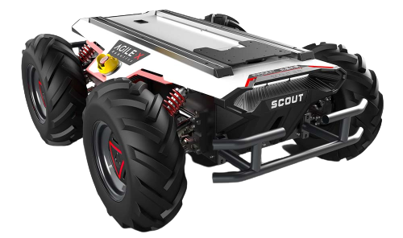
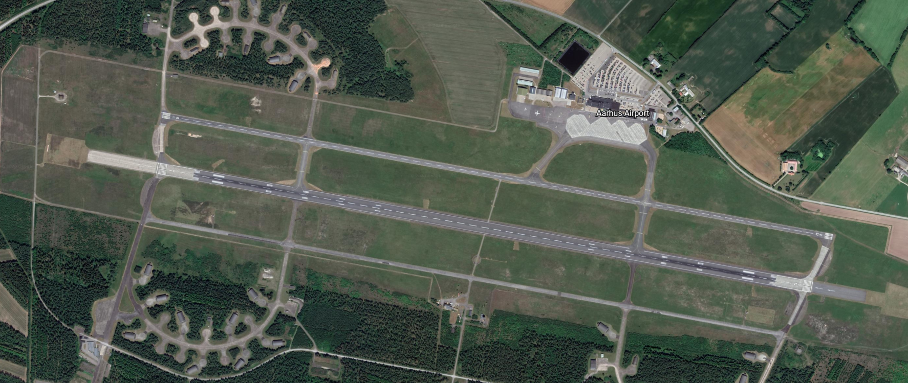
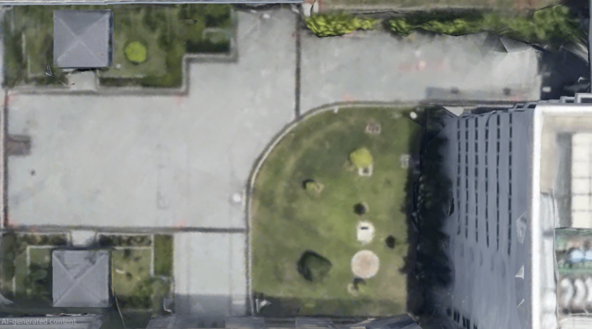

# Autonomous Navigation Simulation & Validation

> **Hilbert Soh · Semester 1 software-in-the-loop (SIL)**  
> **Scope:** AgileX Scout 2.0 is the simulation proxy, not the final FOD Hunter physical chassis. Results are from simulation runs, configuration files and recorded ROS 2 logs. Physical vehicle performance has not been verified.

<!-- #region report -->

## 3.4.1 Objectives & Requirements {#sim-objectives}

Gazebo Harmonic was employed to develop and verify autonomous navigation during concurrent physical vehicle fabrication. Evaluations characterized global path planning, local path tracking, obstacle avoidance, and recovery behaviors under repeatable physics. Results establish algorithmic functionality on a kinematic proxy rather than physical chassis performance.

Testing focused on a development baseline cruise speed of **8.0 km/h ($2.22\text{ m/s}$)**, with supplementary runs at **10.0 km/h ($2.78\text{ m/s}$)**. The target operational sprint speed of **15.0 km/h ($4.17\text{ m/s}$)** remains a Semester 2 physical objective. Evaluations analyzed real-time factor, tracking error, turning feasibility, and obstacle clearance.

::: details Simulation requirements, operating constraints and safety calculations

#### Navigation Testing Objectives

The simulation requirements covered planning, path tracking and recovery:

- **Hybrid A\* Global Path Feasibility:** The planner must compute kinematically feasible Reeds-Shepp trajectory paths respecting a minimum turning radius constraint ($R_{\min} \ge 1.0\text{ m}$). Paths must strongly suppress unnecessary in-place zero-radius turns during normal transit on high-friction tarmac to mitigate tire scrub and peak actuator stress, while preserving in-place rotation for initial heading alignment and emergency Behavior Tree recovery.
- **Regulated Pure Pursuit Path Tracking:** The local controller must maintain Cross-Track Error ($\text{CTE} \le 0.15\text{ m}$) along high-speed straightaways at 8 km/h ($2.22\text{ m/s}$), bound centripetal acceleration ($a_c = \frac{v^2}{R} \le 1.8\text{ m/s}^2 < 0.2g$) through curvature regulation, and limit steering chatter ($\dot{\omega}^2 \le 0.50\text{ rad}^2/\text{s}^4$).
- **Behavior Tree Autonomous Recovery:** The navigation supervisor must detect obstacle deadlock or path planning failure within $10\text{ seconds}$, executing an escalating recovery sequence (costmap clearing → bounded spin → linear backup → pause) up to a 6-retry threshold before reporting mission status back to C2.

#### Software and Computing Constraints

Simulation was executed on an Ubuntu 24.04 WSL2 workstation under two developmental constraints:

First, unreliable DDS multicast across the virtualized adapter required configuring static unicast peering in `cyclonedds.xml` for node discovery; transport latency was not characterized.

Second, pending deployment of the NVIDIA Jetson Orin companion computer, physics simulation, sensor rendering, Dual-EKF estimation, and Nav2 were co-hosted on a single host. Despite WSLg hardware-accelerated OpenGL rendering, compute contention constrained simulation execution, yielding a real-time factor of approximately $0.31\text{–}0.33$ in a recorded WSL2 session.

#### Environment and Safety Constraints

Development utilized two testing environments: Aarhus Airport (EKAH) runway and NUS Faculty of Engineering EA Field courtyard.

Initial specifications targeted an operational airfield runway ($2,702\text{ m} \times 45\text{ m}$). Due to airside access restrictions, testing transitioned to the NUS EA Field courtyard ($52.2\text{ m} \times 29.1\text{ m}$), comprising paved walkways, keep-out grass verges, and structural columns.

For this confined proving ground, autonomous cruise velocity was clamped to **8.0 km/h ($2.22\text{ m/s}$)**. Total theoretical stopping distance is governed by kinematic deceleration accounting for sensor-to-actuator latency and maximum braking deceleration:

$$
d_{\text{stop}} = v \cdot \Delta t_{\text{lat}} + \frac{v^2}{2|a_{\text{decel}}|}
$$

Where $\Delta t_{\text{lat}} \approx 0.07\text{ s}$ represents total pipeline latency (assumed $0.05\text{ s}$ controller cycle at $20\text{ Hz}$ plus $0.02\text{ s}$ additional delay), and $a_{\text{decel}} = -2.5\text{ m/s}^2$ is an assumed deceleration, lower than the configured velocity-smoother limit of $3.0\text{ m/s}^2$. At the development cruise baseline ($v = 2.22\text{ m/s}$):

$$
d_{\text{stop}} = (2.22\text{ m/s})(0.07\text{ s}) + \frac{(2.22\text{ m/s})^2}{2(2.5\text{ m/s}^2)} = 0.155\text{ m} + 0.986\text{ m} \approx \mathbf{1.14\text{ m}} \le 1.15\text{ m}
$$

This provides an analytical estimate rather than an empirical braking measurement. At the target sprint rating of $15.0\text{ km/h}$ ($4.17\text{ m/s}$), braking distance expands substantially:

$$
d_{\text{stop, 15km/h}} = (4.17)(0.07) + \frac{4.17^2}{2(2.5)} = 0.292\text{ m} + 3.478\text{ m} \approx 3.77\text{ m}
$$

Factoring an estimated physical actuator lag of $0.15\text{–}0.25\text{ s}$ (pending hardware characterization), stopping distance increases to $\approx \mathbf{4.1\text{–}4.5\text{ m}}$. High-speed autonomous tracking at $15.0\text{ km/h}$ was not simulated and forms a staged Semester 2 objective.

#### Simulation Requirements

The simulation environment required a four-wheel skid-steer kinematic model, defined contact friction, simulated sensor streams, costmap layers, and compliant ROS 2 interfaces. The proxy model configuration reflects AgileX Scout 2.0 specifications rather than final FOD Hunter parameters.

:::

## 3.4.2 Simulation Architecture {#sim-architecture}

The simulation integrates **Gazebo Harmonic** with **ROS 2 Jazzy** [\[7\]](./references.md#ref-7) via `ros_gz_bridge`. Gazebo publishes simulated odometry, 2D LiDAR scans, IMU streams, and GNSS fixes to Nav2 [\[8\]](./references.md#ref-8), receiving smoothed `/cmd_vel` commands. Simulation time synchronization (`/clock`) and consistent TF trees ensure deterministic multi-node execution.

**Runtime localization verification:** In WSL2 execution, `ekf_filter_node_odom`, `ekf_filter_node_map`, and `navsat_transform_node` actively published `/odometry/local`, `/odometry/global`, and `/odometry/gps`, maintaining a complete `map → odom → base_footprint` transform chain. This confirms functional execution of the Dual-EKF pipeline, though absolute position accuracy requires evaluation against moving ground truth. Simulated IMU and odometry published at 50 Hz, GNSS and LiDAR at 10 Hz, and EKF state estimates at 30 Hz in simulation time ($RTF \approx 0.31\text{–}0.33$).

<Figure src="./assets/diagrams/ros2-gazebo-architecture.svg" alt="ROS 2, Gazebo Harmonic and Nav2 simulation architecture" />

::: details ROS–Gazebo bridge topic schemas and development workflow

#### Purpose of the Simulation Environment

The simulation environment served three primary engineering objectives prior to hardware integration:

1. **Kinematic verification:** Evaluating ground contact, skid-steer yaw dynamics, and trajectory execution using defined friction coefficients (wheel $\mu_1 = 1.2$, $\mu_2 = 0.2$; ground $\mu = 1.0$; nominal dry asphalt design assumption $\mu = 0.8$) [\[13\]](./references.md#ref-13), verifying that path planners enforce minimum turning radius constraints ($R \ge 1.0\text{ m}$).
2. **Deterministic parameter benchmarking:** Evaluating global planners and local controllers across repeatable trajectories with a fixed physics time step ($\Delta t = 1.0\text{ ms}$), unconstrained by battery endurance or thermal throttling.
3. **Software-in-the-loop (SIL) interface validation:** Verifying ROS 2 interface compatibility (`geometry_msgs/msg/Twist`, `sensor_msgs/msg/LaserScan`, `sensor_msgs/msg/Imu`, `nav_msgs/msg/Odometry`, `tf2_msgs/msg/TFMessage`), Nav2 action servers, and CycloneDDS middleware bridges prior to physical hardware commissioning.

#### ROS 2–Gazebo–Nav2 Architecture

Gazebo simulates robot physics, `ros_gz_bridge` exchanges sensor and command messages with ROS 2, and Nav2 handles planning and control:

Table 3.4.1 lists the bridge topics used by `sim_and_nav.launch.py`:

<Card tag="Middleware Specification">

**Table 3.4.1: `ros_gz_bridge` Topic Schemas, Directions & Quality of Service (QoS)**

| ROS 2 Topic         | Gazebo Message Type | ROS 2 Message Type          | Direction | QoS Reliability           | Rate / Role                                                         |
| ------------------- | ------------------- | --------------------------- | --------- | ------------------------- | ------------------------------------------------------------------- |
| `/cmd_vel`          | `gz.msgs.Twist`     | `geometry_msgs/msg/Twist`   | ROS → GZ  | Reliable, Volatile        | $20\text{ Hz}$ velocity commands from the Nav2 velocity smoother    |
| `/odom`             | `gz.msgs.Odometry`  | `nav_msgs/msg/Odometry`     | GZ → ROS  | Reliable, Volatile        | $50\text{ Hz}$ wheel odometry                                       |
| `/scan`             | `gz.msgs.LaserScan` | `sensor_msgs/msg/LaserScan` | GZ → ROS  | Reliable, Volatile        | $10\text{ Hz}$ GPU LiDAR planar scans ($0.15\text{–}30\text{ m}$)   |
| `/camera/image_raw` | `gz.msgs.Image`     | `sensor_msgs/msg/Image`     | GZ → ROS  | Reliable, Volatile        | $30\text{ Hz}$ ($640\times 480$) forward RGB stream                 |
| `/imu/data`         | `gz.msgs.IMU`       | `sensor_msgs/msg/Imu`       | GZ → ROS  | Reliable, Volatile        | $50\text{ Hz}$ simulated IMU orientation, yaw rate and acceleration |
| `/gps/fix`          | `gz.msgs.NavSat`    | `sensor_msgs/msg/NavSatFix` | GZ → ROS  | Reliable, Volatile        | $10\text{ Hz}$ simulated WGS84 position fix                         |
| `/clock`            | `gz.msgs.Clock`     | `rosgraph_msgs/msg/Clock`   | GZ → ROS  | Reliable, Volatile        | $1000\text{ Hz}$ simulation time (one message per physics step)     |

QoS values are the publisher profiles recorded in the ROS 2 bag metadata (`/cmd_vel`, `/odom`, `/scan`, `/imu/data`, `/clock`). `/camera/image_raw` and `/gps/fix` are published by the same bridge process with the same settings.

**Simulation time:** Nav2, EKF and robot-state nodes use `use_sim_time: True` so their timestamps follow Gazebo `/clock`. Consistent timestamps are needed for TF lookups when the simulation runs below real time.

</Card>

#### Development and Testing Workflow

Simulation development followed a structured six-stage progression: **Environment → Robot Model → Sensor Instrumentation → Navigation Integration → Benchmarking → Parameter Refinement**, iteratively updated based on runtime log diagnostics:

<Figure src="./assets/diagrams/sim-development-workflow.svg" alt="Closed-Loop Robotics Simulation Development Lifecycle" caption="Figure 3.4.1: Simulation development workflow. Robot model (URDF/Xacro), DART physics (1 ms step), simulated sensors, Nav2 execution and evaluation, repeated before hardware integration." />

:::

## 3.4.3 Design Methodology & Selection {#sim-methodology}

The **AgileX Scout 2.0** commercial UGV model was adopted as a software-in-the-loop simulation proxy during concurrent FOD Hunter chassis fabrication. As both platforms utilize four-wheel differential skid steering, the proxy enabled end-to-end validation of ROS 2 communication, global planners, and local controllers. However, structural dimensions, mass, and drivetrain configurations differ from the physical prototype. In parallel, a simulation model of the NUS EA Field courtyard was constructed to evaluate narrow corridor traversal and obstacle negotiation.

The viewer below shows the AgileX Scout 2.0 simulation proxy (`scout_v2.glb`) built from the project meshes:

<SimulationWidget1 />

The navigation algorithm selection rationale belongs in [Navigation](./navigation.md), while this document focuses on the simulation assumptions and measured effects of tuning. The software distribution comparison belongs in [Software & Development Environment](/report#software-environment).

::: details Proxy selection, environment iterations, mapping and simulation assumptions

> Software/OS selection is documented in [Programming — Software & Development Environment](/report#software-environment). The original ROS distribution comparison belongs there.

#### AgileX Scout 2.0 Model Selection as Kinematic Proxy

Prior to chassis fabrication, the **AgileX Scout 2.0** served as a kinematic simulation proxy [\[13\]](./references.md#ref-13), enabling development of the Nav2 stack, sensor interfaces, and Command and Control (C2) links.

The Scout 2.0 serves as an architectural proxy rather than an exact digital twin. Table 3.4.2 details discrepancies and engineering mitigations between the proxy and preliminary physical UGV design:

<Card>

AgileX Scout 2.0 Kinematic Simulation Proxy

4WD industrial mobile chassis ($52.37\text{ kg}$ modeled, $0.498\text{ m}$ wheelbase, $0.583\text{ m}$ track width). Used in Gazebo Harmonic to test SmacPlannerHybrid paths, Regulated Pure Pursuit tracking and behaviour-tree recovery before the FOD Hunter chassis was assembled.

</Card>

<Card tag="Kinematic Discrepancy Analysis">

**Table 3.4.2: Simulation Proxy Versus Preliminary Physical Design Assumptions**

| Parameter            | AgileX Scout 2.0 Proxy (`scout_v2.xacro`)                                                                                                                                                                 | Physical Custom Hunter UGV                                                                                               | Discrepancy ($\Delta$) & Engineering Mitigation                                                                                                                         |
| -------------------- | --------------------------------------------------------------------------------------------------------------------------------------------------------------------------------------------------------- | ------------------------------------------------------------------------------------------------------------------------ | ----------------------------------------------------------------------------------------------------------------------------------------------------------------------- |
| Chassis Mass ($m$)   | $52.37\text{ kg}$ ($40\text{ kg}$ base + $12\text{ kg}$ wheels + sensors)                                                                                                                                 | $65.0\text{ kg}$ (chassis + dual batteries + impeller + payload)                                                         | $+24.1\%$ mass increase. Acceleration limits may need to be lowered; to be set from physical traction tests.                                                             |
| Drivetrain           | Paired left/right skid plugin (`gz-sim-diff-drive-system`)                                                                                                                                                | 4× Independent Direct-Drive BLDC Hub Motors (ZLLG80ASM250)                                                               | Simulation commands track velocities; physical hardware uses CANopen dual ZLAC8015D drivers with individual current monitoring.                                         |
| Wheel Radius ($R$)   | $0.1646\text{ m}$ ($329.2\text{ mm}$ tire diameter)                                                                                                                                                       | $0.1315\text{ m}$ ($263.0\text{ mm}$ tire diameter)                                                                      | $-20.1\%$ radius reduction. Physical motors require $1.25\times$ higher RPM for equivalent linear speed ($v = \omega R$).                                               |
| Wheelbase ($L$)      | $0.498\text{ m}$ ($498\text{ mm}$) axle span                                                                                                                                                              | **Not finalized**                                                                                                        | The final chassis geometry must be measured before transferring simulation kinematics.                                                                                  |
| Track Width ($W$)    | **Geometric:** $0.583\text{ m}$ ($583.1\text{ mm}$) wheel centreline **Effective separation:** $0.680\text{ m}$ (`wheel_separation` in Gazebo DiffDrive plugin)                                     | **Not finalized**                                                                                                        | The geometric value ($0.583\text{ m}$) defines the model's physical wheel centres, while the effective separation ($0.680\text{ m}$) is the kinematic plugin parameter tuned for skid-steer turning. Neither value has been validated against the physical FOD Hunter. |
| Aspect Ratio ($L/W$) | $0.854$ (geometric wheel positions)                                                                                                                                                                       | **Not finalized**                                                                                                        | The final chassis geometry must be measured before transferring simulation kinematics.                                                                                  |
| Bus Voltage          | $48.0\text{ V}$ nominal bus model                                                                                                                                                                         | **Proposed power architecture; not validated at full voltage**                                                           | Simulation electrical settings do not verify battery or BMS performance.                                                                                                |
| Speed Rating         | $5.0\text{ m/s}$ ($18.0\text{ km/h}$) Gazebo DiffDrive plugin limit (`scout_v2.xacro`); Nav2 cruise clamped to $2.22\text{ m/s}$ ($8.0\text{ km/h}$); smoother cap $2.78\text{ m/s}$ ($10.0\text{ km/h}$) | $15.0\text{ km/h}$ ($4.17\text{ m/s}$) hardware sprint rating / $2.22\text{ m/s}$ ($8.0\text{ km/h}$) autonomous ceiling | Autonomous cruise baseline clamped to $2.22\text{ m/s}$ ($8.0\text{ km/h}$) across simulation configs for safety margins. $15.0\text{ km/h}$ unvalidated in Semester 1. |

</Card>

**Wheelbase-to-track aspect ratio:** Skid-steer platforms turn through deliberate lateral tire slip [\[13\]](./references.md#ref-13). The ratio of wheelbase $L$ to effective track width $W$ governs maneuverability and tire scrubbing:

$$
\text{Ratio} = \frac{L}{W} = \frac{0.498\text{ m}}{0.583\text{ m}} \approx \mathbf{0.854} < 1.0
$$

An aspect ratio below unity ($L/W < 1.0$) ensures drive wheel moment arms exceed the longitudinal wheelbase, reducing tire scrubbing torque and motor current during turns. Empirical turning resistance and tire slip parameters must be characterized on hardware. Scrubbing torque and powertrain models are detailed in [Steering Kinematics](./steering-kinematics.md).

#### Initial Proving Ground — Aarhus Airport (EKAH)

The initial simulation world replicated Aarhus Airport Runway 10R/28L ($2,702\text{ m} \times 45\text{ m}$) with standard FAA centerline markings and threshold boundaries. This vast, planar environment highlighted a fundamental perceptual constraint:

**Degradation of 2D LiDAR scan matching:** Open airfield corridors lack vertical planar features within standard 2D LiDAR range ($30\text{ m}$), degrading scan matching [\[17\]](./references.md#ref-17). Consequently, state estimation transitioned to a sensor-fused Dual-EKF architecture combining wheel odometry, IMU angular rates, and simulated GNSS fixes [\[9\]](./references.md#ref-9), [\[22\]](./references.md#ref-22).

#### Revised Proving Ground — NUS EA Field Courtyard

Following airfield access constraints, testing transitioned to the NUS EA Field courtyard ($52.2\text{ m} \times 29.1\text{ m}$). Derived from aerial orthophotography, the Gazebo world incorporates textured concrete pavers, grass keep-out zones, and structural columns matching the physical site:

<CardGrid :cols="2">

<Card tag="Initial Proving Ground">

**Aarhus Airport Runway (EKAH)**

Aerodrome corridor ($5000\text{ m} \times 60\text{ m}$ world). Used for long-distance route tests; open runway sections gave few features for 2D LiDAR scan matching.

</Card>

<Card tag="Approved Campus Benchmark Target">

**NUS EA Field Courtyard Proving Ground**

Micro-scale campus courtyard ($52.2\text{ m} \times 29.1\text{ m}$) at $0.02826\text{ m/px}$ resolution. Replicates paved concrete walkways, grass keep-out verges, and building pillars matching the physical testbed.

</Card>

</CardGrid>

#### Mapping Approach Selection

Occupancy grid resolution represents a major computational bottleneck in wide-area robotics. Discretizing a commercial runway envelope ($5000\text{ m} \times 60\text{ m}$) at standard $0.05\text{ m/px}$ resolution yields:

$$
\text{Cells}_{\text{full}} = \left(\frac{5000\text{ m}}{0.05\text{ m}}\right) \times \left(\frac{60\text{ m}}{0.05\text{ m}}\right) = 100,000 \times 1,200 = 1.2 \times 10^8\text{ cells}
$$

Factoring multiple costmap layers, memory allocation is estimated to exceed 500 MB, consuming substantial RAM on embedded platforms (such as the 4–8 GB Raspberry Pi 5).

To mitigate this, a custom script (`generate_map.py`) defines an **analytically bounded operational corridor** ($300\text{ m} \times 200\text{ m}$ at $0.10\text{ m/px}$), reducing grid cells to $6.0\times 10^6 \approx \mathbf{6.0\text{ MB}}$ (a **$95.0\%$ memory reduction**). Linear boundaries $Y(X) = \pm 34.0 - 0.23135 X$ assign lethal obstacle cost (254) to outer grass, while local obstacle avoidance relies on a rolling $12\text{ m} \times 12\text{ m}$ costmap ($0.05\text{ m/px}$, $5\text{ Hz}$ update).

:::

## 3.4.4 Implementation & Prototype {#sim-implementation}

The integrated simulation couples the AgileX Scout 2.0 kinematic model, Gazebo Harmonic physics environments, sensor plugins, `ros_gz_bridge`, and the ROS 2 Nav2 stack. This framework enabled closed-loop evaluation of global path planning, local path tracking, and autonomous recovery under realistic corridor constraints.

**NUS EA Field Gazebo Demonstration**

Video 3.4.1 demonstrates autonomous multi-waypoint transit across the simulated **NUS EA Field courtyard**, navigating narrow paved passages ($2.2\text{ m}\text{–}4.5\text{ m}$), executing obstacle costmap inflation around building perimeters, and validating collision-free path tracking:

<VideoClip
  src="./assets/videos/nus-ea-simulation-demo.mp4"
  poster="./assets/images/nus-ea-simulation-poster.png"
  caption="Video 3.4.1: Autonomous navigation demonstration in the NUS EA Field Gazebo Harmonic simulation environment, showing corridor path planning, building perimeter costmap inflation, and multi-waypoint tracking."
/>

**NUS EA Field environment:**

<Figure 
  src="./assets/images/nus_ea_field_dimensions.png" 
  alt="NUS EA Field Gazebo Environment Layout and Dimensions" 
  caption="Figure 3.4.2: NUS EA Field Gazebo simulation world layout showing dimensioned corridors (2.2 m – 4.5 m), paved traversable zones, building perimeters, and UGV origin." 
/>

**AgileX Scout 2.0 proxy:**

<Figure 
  src="./assets/images/gazebo_runway_world.png" 
  alt="AgileX Scout 2.0 Simulation Proxy in Gazebo Harmonic" 
  caption="Figure 3.4.3: AgileX Scout 2.0 simulation proxy in Gazebo Harmonic with simulated 2D LiDAR, GNSS, and IMU mounts (physical prototype uses Hesai JT16 3D LiDAR)." 
/>

::: details Simulation setup, planner/controller parameters and behaviour-tree configuration

#### Simulation Environment Setup and AgileX Integration

The simulation loads `nus_ea_field.sdf` and spawns the Scout model from `scout_v2.xacro`. DART runs at $1000\text{ Hz}$. Visual meshes (18.1 MB) are separate from simpler collision shapes to reduce physics computation.

#### Navigation Testing Architecture

The navigation simulation pipeline was orchestrated via `bringup_nav2.launch.py` and `sim_and_nav.launch.py`. Gazebo supplies the following sensory inputs to ROS 2:

- **State Estimation:** Dual Extended Kalman Filters (`robot_localization`) fuse $50\text{ Hz}$ wheel odometry and $50\text{ Hz}$ IMU yaw rates to broadcast the continuous `odom → base_footprint` transform, while $10\text{ Hz}$ simulated GNSS fixes anchor the `map → odom` global reference.
- **Costmap Ingestion:** Static orthophoto layers provide free corridor geometry and lethal grass keepouts, while dynamic LiDAR returns ($10\text{ Hz}$) inflate obstacles via the costmap inflation layer.
- **Planning & Control:** `SmacPlannerHybrid` evaluates the 2D costmap at 1 Hz, generating kinematically feasible Reeds-Shepp waypoints. `RegulatedPurePursuitController` executes at $20\text{ Hz}$, tracking the path while regulating speed based on path curvature and obstacle proximity.
- **Obstacle handling:** Obstacles are handled at two levels in the running configuration:
  - **Costmaps:** LiDAR obstacles are marked and inflated in the costmaps, so the planner routes around them and RPP slows near them (cost-regulated speed).
  - **RPP collision checking:** RPP checks its projected footprint against the local costmap and stops if a collision is predicted (`use_collision_detection`).

  The separate Nav2 **Collision Monitor** node is configured in `nav2_params.yaml` (approach polygon, `time_before_collision: 0.5`, no stop polygon) but is **not launched**. The navigation launch file omits it from the lifecycle nodes, and the velocity smoother publishes `/cmd_vel` directly to Gazebo. It therefore provides no protection in the current simulation.

#### Hybrid A\* Configuration & Tuning (\`SmacPlannerHybrid\`)

`SmacPlannerHybrid` parameters were tuned during Gazebo evaluations across both the NUS EA Field and runway maps. Table 3.4.3 distinguishes nominal configurations from runtime observations; recorded timings reflect the heuristic table optimization.

<Card tag="Global Planner">

**Table 3.4.3: `nav2_smac_planner::SmacPlannerHybrid` Parameter Configuration & Tuning Matrix**

| Parameter                                                     | Configured Value          | Purpose                                                                            | Selection Rationale                                                                                             | Expected Effect                                                         | Observed in Simulation                                                                                                        | Trade-off & Future Tuning                                                                              |
| ------------------------------------------------------------- | ------------------------- | ---------------------------------------------------------------------------------- | --------------------------------------------------------------------------------------------------------------- | ----------------------------------------------------------------------- | ----------------------------------------------------------------------------------------------------------------------------- | ------------------------------------------------------------------------------------------------------ |
| `motion_model_for_search`                                     | `"REEDS_SHEPP"`           | Defines the kinodynamic steering expansion primitive model.                        | Enforces continuous-curvature arcs and forward/reverse rolling segments rather than omnidirectional grid steps. | Avoids sharp point-turn corners in global path plans.                   | Generates smooth driving arcs that respect non-holonomic limits.                                                              | Generates reverse segments if goals are behind vehicle; requires forward penalty to prevent reversing. |
| `minimum_turning_radius`                                      | `1.0 m`                   | Constrains the minimum radius of planned circular arcs.                            | Set to $\approx 1.7\times$ track width ($w = 0.582\text{ m}$) to shift ICR outside vehicle wheelbase.           | Prevents zero-radius pivot turns, mitigating tire scrubbing torque.     | Planned paths used rolling arcs instead of pivot turns (RViz). Controlled comparison of 0.8/1.0/1.5 m: see [Navigation §3.2.4.2](./navigation.md#nav-tuning-smac). | Larger values may fail to find paths in narrow campus passages (not tested).                           |
| `reverse_penalty`                                             | `2.5`                     | Multiplies travel cost during backward search expansions.                          | Heavily disincentivizes reverse maneuvers along active runway corridors without prohibiting them.               | Prefers forward loop turns over multi-point backing maneuvers.          | Forward turns were preferred in the observed runs; reverse segments remain possible.                                          | Note: Does not prohibit reversing; forward-only RPP requires careful path validation.                  |
| `change_penalty`                                              | `0.1`                     | Penalizes switching between forward and reverse gears.                             | Suppresses oscillating three-point direction reversals.                                                         | Reduces frequent gear-direction changes in tight spaces.                | Not measured.                                                                                                                 | Higher values may lengthen searches in cluttered dead-ends.                                            |
| `non_straight_penalty`                                        | `1.2`                     | Multiplies search cost for curved trajectory expansions.                           | Encourages planner to track straight runway centerlines when obstacle-free.                                     | Reduces unnecessary serpentine weaving across open runways.             | Paths followed straight corridor sections where free (RViz).                                                                  | Too high a value may delay turns.                                                                      |
| `cost_penalty`                                                | `2.0`                     | Scales the traversal cost of inflated obstacle cells.                              | Ensures path stays centered between runway edge markings and obstacles.                                         | Pushes trajectory away from high-cost inflation halos.                  | Paths stayed away from inflated obstacle cells; clearance not measured.                                                       | High cost penalty slightly lengthens detours around wide obstacles.                                    |
| `angle_quantization_bins`                                     | `64`                      | Discretizes orientation heading into search bins ($5.625^\circ$).                  | Provides fine angular resolution for smooth Reeds-Shepp heading alignment.                                      | Prevents heading discretization errors and jerky orientation jumps.     | Smooth heading transitions in RViz; not measured.                                                                             | Increases memory allocation slightly compared to 16 or 32 bins; negligible on laptop.                  |
| `downsample_costmap` / `downsampling_factor`                  | `true / 2`                | Downsamples costmap grid cells before search expansion ($0.05 \to 0.10\text{ m}$). | Reduces graph node explosion across large outdoor corridors.                                                    | Accelerates A\* heuristic expansion and reduces search time.            | Controlled comparison: median request time 0.13–0.15 s on Route A, including ROS 2 action communication.                      | Slightly coarse cell resolution near narrow pedestrian gateways.                                       |
| `max_planning_time`                                           | `5.0 s`                   | Hard timeout budget for initial and replanning requests.                           | Prevents thread starvation if goal is placed in unmapped lethal space.                                          | Gracefully triggers Behavior Tree recovery if search times out.         | No timeout observed in the controlled comparison (0.13–0.15 s requests). Logged planner failures were mainly "no valid path found" (37). | Can be tightened to $2.0\text{ s}$ for faster failure detection in Semester 2.                         |
| `lookup_table_size`                                           | `10.0 m`                  | Radius of precomputed Dubins/Reeds-Shepp heuristic wavefield.                      | Tuned down from default $20.0\text{ m}$ to optimize initialization speed and RAM.                               | Shortens planner start-up.                                              | **Recorded:** plugin configuration median $38.1\text{ s} \to 2.4\text{ s}$ (NUS map; 5 and 16 sessions). Memory not recorded. | Heuristic table covers all local maneuvers; A\* handles distances beyond 10 m.                         |
| Smoothing Weights (`w_smooth`, `w_data`, `w_curve`, `w_cost`) | `0.3 / 0.2 / 0.15 / 0.05` | Weights for the Smac planner's path smoother.                                      | Balances smoothing path curvature against maintaining distance to obstacles.                                    | Reduces sharp bends in the raw lattice path.                            | Smoother planned paths in RViz; curvature not measured.                                                                       | Over-smoothing can pull path toward obstacles if `w_cost` is too low.                                  |

</Card>

#### RPP Configuration & Tuning (\`RegulatedPurePursuitController\`)

The local controller runs at **$20\text{ Hz}$** and computes linear velocity ($v$) and angular velocity ($\omega$) commands from the global path:

$$
\kappa = \frac{2 y'}{L^2}, \quad \omega_{\text{cmd}} = v_{\text{cmd}} \cdot \kappa
$$

where $y'$ is the lateral offset of the lookahead point in the robot frame and $L$ is the lookahead distance. The table separates configured values, expected effects and measured results. The measured results come from the controlled comparison runs in [Navigation §3.2.4.2](./navigation.md#sec-4-5-tuning) (Route A, AgileX Scout 2.0 proxy).

<Card tag="Local Controller">

**Table 3.4.4: `RegulatedPurePursuitController` Parameter Configuration & Tuning Matrix**

| Parameter                                                       | Configured Value                                                      | Purpose                                                                                              | Selection Rationale                                                                                                                  | Expected Effect                                                                                                | Observed in Simulation                                                                                              | Trade-off & Future Tuning                                                                                                                                                                |
| --------------------------------------------------------------- | --------------------------------------------------------------------- | ---------------------------------------------------------------------------------------------------- | ------------------------------------------------------------------------------------------------------------------------------------ | -------------------------------------------------------------------------------------------------------------- | ------------------------------------------------------------------------------------------------------------------- | ---------------------------------------------------------------------------------------------------------------------------------------------------------------------------------------- |
| `desired_linear_vel`                                            | `2.22 m/s (8.0 km/h)`                                                 | Baseline autonomous cruise velocity along clear straightaways.                                       | Provides rapid corridor sweeps while preserving safe stopping distance ($d_{\text{stop}} \le 1.15\text{ m}$).                        | 100 m takes $45\text{ s}$ at $2.22\text{ m/s}$ (calculated), compared with $200\text{ s}$ at $0.5\text{ m/s}$. | **Recorded:** goals reached on both maps; median average straight-line speed 1.1–1.5 m/s (log wall-clock time).     | Hardware rated for $15\text{ km/h}$; will evaluate progressive increases in Semester 2.                                                                                                  |
| `lookahead_dist` ($L$)                                          | `1.20 m`                                                              | Base lookahead distance when dynamic scaling is disabled or at nominal speed.                        | Selected during Gazebo controller tuning.                                                                                            | Reduces steering oscillation while limiting path deviation in bends.                                           | **Measured** (scaling disabled): RMS CTE 3.48 cm, RMS angular acceleration 0.53 rad/s².                             | A fixed $L$ cannot suit both low and high speeds; velocity scaling addresses this.                                                                                                       |
| `min_lookahead_dist` / `max_lookahead_dist`                     | `0.40 m / 2.50 m`                                                     | Clamps dynamic lookahead distance $L(v)$ within physical limits.                                     | $L_{\min} = 0.4\text{ m}$ is close to the chassis wheelbase ($0.498\text{ m}$); $L_{\max} = 2.5\text{ m}$ limits path deviation in bends. | Maintains responsiveness at low speeds; limits lookahead at cruise.                                            | **Measured:** the 2.50 m cap was reached during cruising.                                                           | Higher-speed values need testing; at $15\text{ km/h}$ a 1.2 s lookahead time would request 5.0 m (calculated).                                                                           |
| `lookahead_time`                                                | `1.20 s`                                                              | Lookahead time horizon scaling distance with velocity ($L(v) = v \cdot t_{\text{lookahead}}$).       | Selected during Gazebo tuning; gives a 2.66 m request at $2.22\text{ m/s}$ (calculated).                                            | Adapts lookahead distance continuously across acceleration and deceleration.                                   | **Measured:** active lookahead 2.50 m (cap) at cruise; RMS CTE 8.62 cm. A 0.60 s setting (1.33 m) gave 3.65 cm.     | Longer times increased deviation (1.80 s with a 4.0 m cap: 20.00 cm). 0.60 s is a candidate setting, not yet adopted.                                                                    |
| `use_velocity_scaled_lookahead_dist`                            | `True`                                                                | Enables velocity-proportional lookahead adaptation.                                                  | Allows one configuration to cover low and high speeds.                                                                               | Balances path deviation in bends against steering smoothness.                                                  | **Measured:** with the 2.50 m cap active, behaved like a fixed 2.50 m lookahead (8.62 cm against 9.03 cm RMS CTE).  | Needs suitable $L_{\min}$ and $L_{\max}$ bounds for each speed range.                                                                                                                    |
| `regulated_linear_scaling_min_radius`                           | `0.80 m`                                                              | Threshold curvature radius below which linear speed is scaled down.                                  | Limits centripetal acceleration ($a_c = \frac{v^2}{R}$) in tight curves.                                                             | Decelerates the vehicle when entering tight curves.                                                            | **Measured:** not activated on Route A (minimum lookahead radius 0.915 m > 0.80 m); lateral acceleration not measured. | Deceleration increases transit time around tight curves.                                                                                                                                 |
| `regulated_linear_scaling_min_speed`                            | `0.40 m/s`                                                            | Floor velocity during curvature-regulated deceleration.                                              | Prevents vehicle from stalling or stopping completely on sharp turns.                                                                | Maintains positive forward momentum through curve apexes.                                                      | Not exercised in the controlled comparison (curvature regulation not activated).                                    | A higher floor reduces the slowdown in tight turns and the margin against wheel slip.                                                                                                    |
| `use_cost_regulated_linear_velocity_scaling`                    | `True`                                                                | Modulates speed based on proximity to obstacles in the local costmap.                                | Slows vehicle ahead of obstacles, providing longer reaction time for replanning.                                                     | Gradual deceleration near obstacles; reduces abrupt braking.                                                   | Slower motion near obstacles; speed profile not recorded (configured law shown in the analytical figure below).     | Requires properly tuned inflation cost decay to prevent premature slowing.                                                                                                               |
| `cost_scaling_dist` / `cost_scaling_gain`                       | `1.0 m / 1.0`                                                         | Distance horizon and exponential gain for cost-regulated slowdown.                                   | Matched to vehicle stopping distance: $d \ge \frac{v^2}{2\|a_{\text{decel}}\|} \approx \frac{2.22^2}{2(2.5)} \approx 0.99\text{ m}$. | Produces a smooth linear deceleration profile into obstacle fields.                                            | Deceleration not measured.                                                                                          | Overly high gain ($\gamma \ge 2.0$) causes timid crawling near harmless grass verges.                                                                                                    |
| `use_collision_detection`                                       | `True`                                                                | Projects the vehicle footprint along the commanded trajectory arc.                                   | RPP's internal check of the projected footprint against the local costmap (separate from the Collision Monitor node).                | Stops trajectory execution if an obstacle is predicted in the projected path within the time horizon.          | **Recorded:** 402 "collision ahead" warnings logged across sessions; obstacle clearance not measured.               | Software monitor subject to sensor update latency ($10\text{ Hz}$ LiDAR); not a certified hardware E-stop relay.                                                                         |
| `max_allowed_time_to_collision_up_to_fast_stop`                 | `1.0 s`                                                               | Time-to-collision threshold triggering emergency fast stop.                                          | Intended to allow a stop before reaching an obstacle ($t_{\text{stop}} = \frac{v}{\|a\|} \approx 0.89\text{ s} < 1.0\text{ s}$, calculated). | Stops the robot before an obstacle predicted in its path; not a guarantee against impact.                      | Not measured.                                                                                                       | Key name differs from the Jazzy parameter `max_allowed_time_to_collision_up_to_carrot`, so the Nav2 default (1.0 s) applies.                                                             |
| `use_rotate_to_heading`                                         | `True`                                                                | Commands pure in-place rotation when initial heading error exceeds threshold.                        | Aligns chassis with path orientation before forward motion begins.                                                                   | Prevents large initial cross-track error excursions when dispatched at odd angles.                             | Rotates in place at mission start if $\|\Delta\theta\| > 45^\circ$, then tracks path forward.                       | Induces zero-radius scrub at start; minimized by aligning vehicle beforehand.                                                                                                            |
| `rotate_to_heading_min_angle` / `rotate_to_heading_angular_vel` | `0.785 rad (45°) / 1.2 rad/s` (key listed twice in YAML: 1.0 and 1.2) | Angular error threshold and rotational velocity for heading alignment.                               | $45^\circ$ threshold allows gentle curves to be negotiated while driving forward.                                                    | Limits pivot turns to large initial misalignments.                                                             | Not measured.                                                                                                       | Angular acceleration is limited to $2.5\text{ rad/s}^2$.                                                                                                                                 |
| `max_linear_accel` / `max_linear_decel`                         | `2.0 m/s² / -2.5 m/s²`                                                | Listed in the RPP block; the active limits are applied by `velocity_smoother` (±3.0 m/s², 2.78 m/s). | Kept below 4WD skid-steer tire friction limits ($a_{\max} \le \mu g \approx 0.8 \times 9.81 = 7.85\text{ m/s}^2$).                   | Prevents wheel spin on acceleration and wheel lockup on braking.                                               | Not measured.                                                                                                       | Must be harmonized with downstream velocity smoother nodes.                                                                                                                              |
| `allow_reversing`                                               | `False`                                                               | Restricts controller to forward-only trajectory tracking.                                            | Reversing on active runway corridors is not intended.                                                                                | Vehicle drives forward only, keeping the front LiDAR and camera facing the direction of travel.                | Forward driving only.                                                                                               | **Compatibility limitation:** RPP cannot follow a reverse Reeds–Shepp segment if the planner produces one. `reverse_penalty = 2.5` reduces, but does not remove, this risk.              |

</Card>

#### Behavior Tree Configuration & Recovery

When a navigation mission is dispatched, the **Nav2 BT Navigator** executes the default Nav2 Jazzy `NavigateToPose` Behavior Tree [\[8\]](./references.md#ref-8); no custom tree file is used. The tree is ticked every 10 ms (`bt_loop_duration: 10`). A `PipelineSequence` runs global path replanning and local path tracking together:

NavigateRecovery (RecoveryNode, retries = 6)  ├── PipelineSequence (Primary Navigation Pipeline)  │ ├── RateController (1 Hz) → ComputePathToPose (SmacPlannerHybrid, R ≥ 1.0m)  │ └── FollowPath (RegulatedPurePursuitController, 20 Hz)  └── RoundRobin (Recovery Actions)  ├── ClearEntireCostmap (local and global costmaps)  ├── Spin (nav2_behaviors::Spin; rotation limited to 1.0 rad/s by `behavior_server`)  ├── Wait (nav2_behaviors::Wait)  └── BackUp (nav2_behaviors::BackUp)

The recovery order spin → wait → backup matches the sequence recorded in the `behavior_server` logs.

#### Turning and Recovery Mechanisms

1. **RPP Rotate-to-Heading vs Behavior Tree Spin:** Two separate mechanisms can produce in-place rotation:  • _RPP Rotate-to-Heading:_ Executed inside the local controller when the heading error to the path exceeds $45^\circ$ ($|\Delta\theta| > 0.785\text{ rad}$), typically at mission start. Once aligned, RPP returns to forward path tracking.  • _Behavior Tree Recovery Spin:_ Executed by `nav2_behaviors::Spin` on the behavior server only after path following has failed and costmaps have been cleared. It commands an in-place pivot (limited to $1.0\text{ rad/s}$) to clear sensor blind spots and re-observe obstacles.
2. **Goal Checking Behavior:** `SimpleGoalChecker` evaluates position ($xy \le 0.35\text{ m}$) and orientation ($\theta \le 0.35\text{ rad}$) tolerances. _It does not command rotation._ Final goal orientation alignment is handled by RPP's terminal goal-approach logic.
3. **Hardware Bridge Distinction:** The STM32 F446RE firmware under development is for physical UGV motor driver communication (CANopen to ZLAC8015D). It is _not_ part of the Gazebo simulation loop, which commands the virtual chassis directly via `ros_gz_bridge` and `gz-sim-diff-drive-system`.

#### Supporting Localization & Costmap Configuration

Localization uses the Dual-EKF pipeline [\[9\]](./references.md#ref-9), which separates continuous local odometry (`odom → base_footprint` at $30\text{ Hz}$) from simulated GNSS-corrected global position (`map → odom` at $30\text{ Hz}$). Costmap inflation uses `inflation_radius = 1.20 m` and `cost_scaling_factor = 2.0`; the exponential cost decay keeps planned paths away from obstacle edges. Diagrams and details are in [Navigation Section 4](./navigation.md#sec-5-implementation).

:::

## 3.4.5 Testing & Results {#sim-testing}

Navigation performance was evaluated across the NUS EA Field and airport runway simulation environments using goal inputs dispatched via RViz, automated mission scripts, and the C2 communications bridge. The performance data in Table 3.4.5 summarizes runtime diagnostics extracted from 93 logged Nav2 development sessions. These sessions evaluated functional waypoint execution across varying operational scenarios; controlled quantitative tracking evaluations (measuring Cross-Track Error and angular acceleration chatter) were conducted independently under standardized test conditions ([Navigation §3.2.4.2](./navigation.md#sec-4-5-tuning)).

**Table 3.4.5: Recorded Simulation Results (ROS 2 logs)**

| Result                                         | Recorded value                                                                                                          | Source and note                                                                        |
| :--------------------------------------------- | :---------------------------------------------------------------------------------------------------------------------- | :------------------------------------------------------------------------------------- |
| Smac Hybrid plugin configuration time, NUS map | Median 38.1 s (34.4–38.7 s, 5 sessions) → 2.4 s (1.9–3.8 s, 16 sessions) after the heuristic-table change; 93.7% lower  | `planner_server` logs; plugin configuration only, not total simulation start-up        |
| Navigation requests                            | 213 requests: 146 reached the goal, 43 replaced by a new goal, 12 aborted, 6 failed, 2 cancelled, 4 open at shutdown    | `bt_navigator` logs; mixed demos, manual goals and difficult goals                     |
| C2 goals with Hybrid A\*                       | NUS map: 11 reached, median 10.7 s (median 11.6 m straight-line). Runway map: 13 reached, median 19.1 s (median 25.6 m) | Log wall-clock time; distances differ, so these are not planner-efficiency comparisons |
| Recovery behaviour                             | 5 navigation requests triggered recovery: 2 then reached the goal, 2 failed or aborted, 1 was replaced                  | `behavior_server` logs; events during normal testing (summarised below)                |
| Dual-EKF in use                                | 23 sessions with EKF nodes; 57 goals reached in those sessions                                                          | Shows the localization pipeline running; accuracy not measured                         |

For dynamic obstacle avoidance demonstrations, see [Autonomous Navigation — Section 3.2.5 (Video 3.2.5)](./navigation.md#sec-6-testing). The controller tuning decisions are explained in [Navigation — Section 3.2.4.2](./navigation.md#sec-4-5-tuning). The planner configuration and recovery behaviour are summarised below; physical vehicle testing is scheduled for Semester 2.

::: details Test procedures, planner configuration, recovery behaviour and functional verification results

#### Test Setup and Performance Metrics

Four trajectory scenarios guided functional controller tuning. Initial runs were evaluated qualitatively via Gazebo and RViz visualizations. Quantitative tracking accuracy (Cross-Track Error) and control chatter were subsequently characterized in standardized benchmark trials ([Navigation §3.2.4.2](./navigation.md#sec-4-5-tuning)); the supplementary metrics detailed below are designated for Semester 2 physical validation:

- **Route 1 (Runway High-Speed Sprint):** $100.0\text{ m}$ straight corridor sprint evaluating cruise tracking stability, terminal braking distance, and steering chatter $\dot{\omega}^2$ at $2.22 - 2.78\text{ m/s}$ ($8 - 10\text{ km/h}$).
- **Route 2 (Acute 90° Taxiway Bend):** Traversing a sharp $90^\circ$ corner ($R = 4.0\text{ m}$) bordered by runway edge lighting and berms. Evaluates Cross-Track Error (CTE), corner-cutting clearance, and curvature-regulated speed scaling.
- **Route 3 (High-Density FOD S-Curve Avoidance):** S-curve circumnavigation around two stationary debris targets and service vehicles. Evaluates cost-regulated proximity braking, footprint collision checks, and minimum obstacle stop margin.
- **Route 4 (NUS EA Courtyard Narrow Doorway):** Navigating through a $2.2\text{ m}$ narrow pedestrian passage between concrete columns on the campus map. Evaluates costmap inflation traversability and narrow corridor clearance.

Planned quantitative metrics: Cross-Track Error ($\text{CTE} = \min_{p \in \text{path}} \|\mathbf{x}_{\text{ugv}} - p\|_2$), steering oscillation chatter metric ($\dot{\omega}^2 = \frac{1}{N}\sum (\frac{\omega_k - \omega_{k-1}}{\Delta t})^2$), total transit time, minimum obstacle clearance, and normalized cumulative absolute yaw rotation ($\int |\omega(t)| dt$).

#### Planner Configuration

**Hybrid A\*.** Grid search (SmacPlanner2D) was replaced by SmacPlannerHybrid so that planned paths respect a minimum turning radius instead of relying on in-place pivots. The Reeds–Shepp motion model and 1.0 m minimum turning radius are set in `nav2_params.yaml`.

**Heuristic table.** SmacPlannerHybrid builds a heuristic lookup table when it configures. With the initial setting, plugin configuration took 34.4–38.7 s. Reducing the table (`lookup_table_size: 10.0 m`, `downsampling_factor: 2`) lowered this to 1.9–3.8 s, a median of 38.1 s → 2.4 s. This is plugin configuration time, not total navigation start-up time.

**Dual-EKF.** The Dual-EKF nodes were then added: the local filter provides the smooth `odom → base_footprint` transform used for control, and the global filter provides the GNSS-corrected `map → odom` transform used for map-frame goals.

Robot yaw rotation was not measured. The controlled turning-radius comparison ([Navigation §3.2.4.2](./navigation.md#nav-tuning-smac)) reports planned heading change and path-relative CTE.

#### RPP Speed Regulation

The lookahead and curvature settings were chosen during functional Gazebo testing, which recorded goal outcomes but not steering rate or cross-track error. Controlled parameter-comparison runs on a fixed reference path then measured both against Gazebo ground truth (see [Navigation — Section 3.2.4.2](./navigation.md#sec-4-5-tuning)). 

To prevent abrupt emergency braking shocks when nearing obstacles while maintaining forward momentum, Nav2's Regulated Pure Pursuit scales linear velocity dynamically according to costmap proximity:
$$v_{\text{regulated}} = \max\left(v_{\min},\; v_{\text{cruise}} \cdot (1.0 - \gamma \cdot \text{norm\_cost})\right)$$
where $v_{\text{cruise}} = 2.22\text{ m/s}$ ($8.0\text{ km/h}$), minimum regulated speed $v_{\min} = 0.40\text{ m/s}$, cost scaling distance $d_{\text{cost}} = 1.0\text{ m}$, and scaling gain $\gamma = 1.0$. The analytical curves below illustrate this velocity derating across varied cost gains:

<Figure src="./assets/images/tuning-cost-regulated-deceleration.png" alt="Cost Regulated Proximity Braking Curves" caption="Figure 3.4.4: Calculated RPP speed regulation curves near obstacles across scaling gains for cost_scaling_dist = 1.0 m (analytical model, not recorded simulation measurement)." />

#### Behavior Tree Recovery Events

Nav2's default recovery sequence (clear costmaps, spin, wait, back up) ran in five logged navigation requests. Two then reached their goals, two failed or aborted because no valid path to the goal existed, and one was replaced by a new goal. These were observations during development testing, not controlled recovery trials, so no recovery success rate is given. The individual events and their durations remain in the `behavior_server` and `bt_navigator` logs.

**Aarhus Airport Runway Simulation**

The simulation recording below demonstrates autonomous navigation within the full-scale **Airport Runway environment (`airport_runway.sdf`)**, modeled after Aarhus Airport Runway 10R/28L ($2,702\text{ m} \times 45\text{ m}$ asphalt runway), executing open corridor sweeps, centerline tracking, and dynamic costmap clearing at the $2.22\text{ m/s}$ baseline:

<VideoClip
  src="./assets/videos/simulation-demo.mp4"
  poster="./assets/images/demo-poster.jpg"
  caption="Video 3.4.2: Integrated autonomous navigation simulation in the Aarhus Airport Gazebo Harmonic runway world, demonstrating centerline tracking, sensor perception, costmap inflation, and Nav2 waypoint tracking at 2.22 m/s."
/>

<CardGrid :cols="2">

<Card tag="Semester 1 Target">

**Primary Demo: NUS EA Field Autonomous Navigation**

AgileX Scout 2.0 proxy executing multi-waypoint navigation across paved campus walkways, with obstacle avoidance and path tracking on the aerial-photograph map.

</Card>

<Card tag="Airfield Baseline">

**Secondary Demo: Aarhus Airport Runway Sweep**

Runway corridor sweep at $2.22\text{ m/s}$ with centreline tracking and obstacle avoidance, in a world modelled on Aarhus Airport Runway 10R/28L ($2,702\text{ m} \times 45\text{ m}$).

</Card>

</CardGrid>

**Software-in-the-loop functional verification:** Table 3.4.6 lists the navigation functions demonstrated in simulation. "Passed" means the function operated as intended with the AgileX Scout 2.0 simulation proxy. It does not mean that the quantitative targets in Section 1 were met, or that the system is ready for physical deployment.

<Card tag="Functional Verification">

**Table 3.4.6: Software-in-the-Loop Functional Verification Results**

| Test Case                     | Verification Objective                                              | Recorded Evidence                                                                                                                                                  | Status                              |
| ----------------------------- | ------------------------------------------------------------------- | ------------------------------------------------------------------------------------------------------------------------------------------------------------------ | ----------------------------------- |
| Autonomous Path Planning      | Generate feasible navigation paths using Hybrid A\*.                | All 15 controlled planning requests succeeded across three turning-radius configurations (0.80, 1.00 and 1.50 m).                                                  | <Badge type="tip" text="Passed" />  |
| Autonomous Path Tracking      | Follow planned routes using Regulated Pure Pursuit.                 | All 35 controlled RPP trials (seven lookahead configurations, five runs each) reached the goal.                                                                    | <Badge type="tip" text="Passed" />  |
| Waypoint Navigation           | Execute navigation goals autonomously.                              | 146 navigation goals reached across 93 development sessions.                                                                                                       | <Badge type="tip" text="Passed" />  |
| Obstacle Detection & Response | Detect obstacles and respond through costmap-based navigation.      | RPP logged 402 "collision ahead" warnings from its costmap check. In one goal it reported an obstacle 43 times and still reached the goal (11.7 m in 18.4 s).      | <Badge type="tip" text="Passed" />  |
| Dual-EKF Integration          | Establish local and global localisation pipelines.                  | Both EKF nodes and `navsat_transform` ran during navigation with the `map → odom → base_footprint` chain present; 57 goals were reached across 23 sessions.         | <Badge type="tip" text="Passed" />  |
| C2-to-Nav2 Communication      | Receive target coordinates and dispatch navigation goals.           | The C2 bridge forwarded targets to Nav2, and C2-dispatched goals were reached on both maps (24 with Hybrid A\*, Table 3.4.5).                                         | <Badge type="tip" text="Passed" />  |

</Card>

The following still require validation:

- **Goal and localisation accuracy on the physical robot.** In the controlled simulation runs, the robot stopped a median 0.32–0.34 m from the goal: within the 0.35 m goal tolerance, but above the 0.15 m target.
- **Obstacle clearance**, which was not measured.
- **An active collision-stopping layer.** The Nav2 Collision Monitor node is configured but not launched.
- **Physical braking, tire slip and actuator performance.**

The simulation also ran below real time (RTF about 0.31–0.33).

_Additional Verification Archive:_ Downloadable milestone video recordings are preserved in the repository archive: <AssetLink href="./assets/videos/231026-sem1-demo-final-compressed-.mp4">Semester 1 Milestone Demo Final (MP4)</AssetLink> • <AssetLink href="./assets/videos/131026-ugv-dual-ekf-test.mov">Dual-EKF RViz Test (MOV)</AssetLink> • <AssetLink href="./assets/videos/131026-ugv-multiwaypoint.mov">Multi-Waypoint Route Test (MOV)</AssetLink> • <AssetLink href="./assets/videos/131026-ugv-object-avoidance.mov">Reactive Obstacle Avoidance Test (MOV)</AssetLink>.

:::

## 3.4.6 Engineering Discussion {#sim-discussion}

Simulation evaluations demonstrate that coupling `SmacPlannerHybrid` with `RegulatedPurePursuitController` achieves reliable multi-waypoint navigation across both airfield and campus environments, while optimizing the heuristic wavefield table significantly reduces planner initialization latency. Generating curvature-constrained Reeds-Shepp paths successfully eliminates zero-radius pivot turns along nominal transit corridors, mitigating anticipated tire scrubbing and powertrain stresses. However, empirical physical validation remains essential to account for mass discrepancies ($52.37\text{ kg}$ proxy vs $65.0\text{ kg}$ prototype), physical CANopen motor actuation delays, and non-ideal tarmac tire friction.

For mathematical planner formulations and controller derivations, refer to [Navigation](./navigation.md); physical skid-steer dynamics and tire scrubbing models are detailed in [Steering Kinematics](./steering-kinematics.md); and actuator torque sizing is presented in [Motor Drivetrain Calculations](./motor-drivetrain-calculation.md).

::: details Evaluation, lessons learned and further technical analysis

#### Hybrid A\* Performance

`SmacPlannerHybrid` generated kinematically feasible trajectories. Constraining paths to continuous Reeds-Shepp arcs ($R \ge 1.0\text{ m}$) replaced planned in-place zero-radius turns with rolling arcs. The added path length and the reduction in tire scrub were not measured.

However, an operational trade-off exists regarding directionality: while `reverse_penalty = 2.5` strongly prefers forward driving, reversing is _not strictly prohibited_ by the planner. Because the local controller (RPP) is configured with `allow_reversing: False`, any plan containing a reverse gear segment cannot be executed, creating an operational limitation that must be monitored in cluttered dead-ends.

#### RPP Performance & Limitations

The Regulated Pure Pursuit controller reached goals at the configured development baseline of **8.0 km/h ($2.22\text{ m/s}$)** on both maps. Median average straight-line speed was 1.1–1.5 m/s because of speed regulation in turns and near obstacles. Velocity-scaled lookahead ($L \in [0.4, 2.5]\text{ m}$) was selected to reduce the steering corrections seen with short lookahead.

The controlled comparison runs on a fixed reference path ([Navigation §3.2.4.2](./navigation.md#sec-4-5-tuning)) measured the tracking trade-off:
- A fixed 1.20 m lookahead gave 3.48 cm RMS CTE.
- The production velocity-scaled setting reached its 2.50 m cap during cruising and gave 8.62 cm.
- Reducing the lookahead time to 0.60 s gave 3.65 cm.
- Curvature regulation did not activate on that route.

A shorter lookahead time is a candidate setting. The production configuration is unchanged, and a 1.50 m maximum lookahead cap has been suggested but was not tested. Lateral acceleration was not measured.

**Speed limitation:** The **$15.0\text{ km/h}$ ($4.17\text{ m/s}$)** physical-vehicle target was not tested in simulation. At $15\text{ km/h}$, the calculated stopping distance rises to about 3.8–4.5 m (Section 1). The lookahead and curvature settings would need retuning, since a 1.2 s lookahead time would request 5.0 m (calculated). Tire slip, which the simulation does not model in detail, would become more significant. Operating at $15\text{ km/h}$ requires staged testing in Semester 2.

#### Behavior Tree Reliability

The standard Nav2 `NavigateToPose` Behavior Tree ran its clear-costmap → spin → wait → backup sequence in five logged requests; two then reached their goal. The two that failed had goals with no valid path, where recovery cannot help. In narrow corridors (such as the $2.2\text{ m}$ gateway on Route 4), in-place recovery spins may fail if costmap inflation overlaps the footprint, which would cause the robot to abort.

#### Differences Between Simulation and Hardware

Four differences need attention before transferring the navigation setup to FOD Hunter:

1. **Chassis mass:** The simulation model ($52.37\text{ kg}$) is lighter than the assumed FOD Hunter mass ($65.0\text{ kg}$). The higher mass is expected to increase braking distance and lateral tire slip.
2. **Actuators and communication delay:** In Gazebo, the diff-drive plugin applies wheel velocities directly. On FOD Hunter, commands pass through STM32 firmware and a CANopen bus to the ZLAC8015D drivers. This adds communication delay (not yet measured), low-speed cogging and motor deadband.
3. **Contact model:** DART uses rigid Coulomb contact (wheel $\mu_1 = 1.2$, $\mu_2 = 0.2$; ground $\mu = 1.0$ in the model files). It does not model tire deformation, lateral slip angles, weight transfer or surface texture.
4. **Sensor noise and vibration:** In the model, only the IMU has added Gaussian noise; the LiDAR and GNSS are noise-free. The physical robot will be exposed to vacuum-impeller vibration, strong sunlight on tarmac and GNSS multipath near buildings.

#### Hybrid A\* Parameter Changes

Two parameter changes affected global planner performance during Semester 1:

First, reducing the precomputed heuristic lookup table (`lookup_table_size: 10.0 m` with `downsampling_factor: 2`) reduced Smac plugin configuration time on the NUS map from a median of $38.1\text{ s}$ to **$2.4\text{ s}$** (93.7% lower; recorded in 5 and 16 sessions). Memory use was not recorded.

Second, directional penalties (`reverse_penalty = 2.5`, `change_penalty = 0.1`) steer the search toward forward loop turns rather than multi-point reversing. This reduces, but does not remove, the incompatibility with forward-only RPP.

#### RPP Parameter Changes

With short static lookahead (about 0.6 m), the simulated UGV corrected its steering repeatedly. I changed to velocity-scaled lookahead ($L(v) \in [0.4, 2.5]\text{ m}$, $t_{\text{lookahead}} = 1.2\text{ s}$), which reduced the visible steering corrections. The controlled comparison later quantified this trade-off (see RPP Performance above). Cost-regulated speed scaling ($\gamma = 1.0$, $d_{\text{cost}} = 1.0\text{ m}$) slows the robot linearly inside 1.0 m of obstacles; deceleration was not recorded.

#### Behavior Tree Settings

Recovery spin speed is limited to $1.0\text{ rad/s}$ with an acceleration limit of $3.2\text{ rad/s}^2$ (`behavior_server`), to keep re-observation sweeps smooth. Chassis tilt during recovery was not measured.

#### Environment and Computing Challenges

Development resolved two key middleware and computational challenges:

**WSL2 networking:** DDS multicast discovery was unreliable across the virtualized network adapter. CycloneDDS static unicast peering was configured in `cyclonedds.xml` to link the host workstation and companion computer.

**Costmap memory:** Full-scale runway maps were estimated to require over 500 MB of RAM. Refactoring `generate_map.py` to bound active corridors ($300\text{ m} \times 200\text{ m}$ at $0.10\text{ m/px}$) yielded a $6.0 \times 10^6$ cell grid, achieving a 95% reduction in memory footprint.

:::

## 3.4.7 Limitations & Semester 2 Plan {#sim-future-work}

Hardware transfer requires empirical characterization of the physical FOD Hunter platform, including center-of-mass distribution, effective kinematic track width, CANopen actuator response latency, and sensor noise covariances. Physical deployment will follow a staged progression, beginning with low-speed baseline trials ($8.0\text{ km/h}$) to tune Dual-EKF covariances and RPP lookahead horizons before expanding to high-speed runway sweeps ($15.0\text{ km/h}$) evaluated against quantitative tracking and stopping-distance criteria.

[View Hilbert's Semester 2 Implementation Plan →](./semester-2-plan.md#programming-semester-2)

::: details Detailed simulation-to-hardware transition and validation roadmap

#### Progressive RPP Tuning Toward 15 km/h

In Semester 2, autonomous trajectory tracking will progress through staged speed evaluations on the physical testbed:

8.0 km/h (2.22 m/s, Baseline) → 10.0 km/h (2.78 m/s) → 12.0 km/h (3.33 m/s) → 15.0 km/h (4.17 m/s, Target Sprint)

Each speed tier will require:

- lookahead and curvature settings retuned and re-measured for that speed;
- stopping distance checked against the calculated values (Section 1);
- an active collision-stopping layer (the Nav2 Collision Monitor is configured but not launched in the current simulation);
- IMU pitch monitoring during emergency stops (proposed limit $|\theta| \le 4.0^\circ$).

#### Conditional MPPI Evaluation

I will consider MPPI [\[19\]](./references.md#ref-19) on the NVIDIA Jetson Orin if RPP [\[18\]](./references.md#ref-18) does not meet tracking requirements above $10\text{ km/h}$ and sufficient computing resources are available.

_Technical Clarification on MPPI:_ MPPI does not inherently require GPU acceleration; CPU SIMD multithreading implementations exist in Nav2. However, GPU tensor acceleration allows evaluating thousands of trajectory rollouts per control cycle. If RPP's geometric formulation provides sufficient tracking fidelity at lower computational cost, RPP will be retained as the production controller to preserve CPU cycles for real-time edge vision (YOLO).

#### Physical Hunter Integration

Transferring the simulation setup to FOD Hunter requires four integration steps:

<Figure src="./assets/diagrams/sim2real-transition-roadmap.svg" alt="Sim2Real Transition Strategy and Phased Roadmap" caption="Figure 3.4.5: Simulation-to-hardware transition roadmap. Four stages for moving the Gazebo SIL setup to FOD Hunter: parameter calibration, CANopen drivers, sensor integration and EKF noise tuning." />

1. **URDF Calibration:** Update robot description with measured physical parameters (65 kg assumed mass, 263 mm purchased wheel diameter, and measured wheelbase/track width once the chassis is finalized).
2. **CANopen Actuator Bridge:** Replace Gazebo diff-drive plugin with ROS 2 CANopen driver nodes communicating with dual ZLAC8015D motor controllers via STM32 firmware, implementing deadband compensation and feedforward anti-cogging.
3. **Sensor Driver Integration:** Interface physical Hesai JT16 3D LiDAR, ArduSimple SimpleRTK2B GPS, and BNO085 9-DOF IMU with calibrated empirical covariance matrices ($Q$ and $R$).
4. **Impeller Vibration Filtering:** Deploy 4th-order Butterworth low-pass filters on IMU accelerometer topics to isolate $24,000\text{ RPM}$ vacuum impeller vibration from vehicle state estimation.

#### Physical Navigation Validation

Physical deployment on the NUS EA Field proving ground will follow a phased verification protocol:

- **Phase 1:** Manual teleoperation motor current profiling and deadband calibration on dry concrete pavers.
- **Phase 2:** Open-loop velocity step responses and empirical wheel-slip odometry calibration.
- **Phase 3:** Single-waypoint trajectory tracking and Cross-Track Error verification at $8.0\text{ km/h}$.
- **Phase 4:** Full-mission autonomous runway debris inspection sweeping and C2 target interception.

:::

<!-- #endregion report -->

[View Hilbert’s References →](./references.md)
