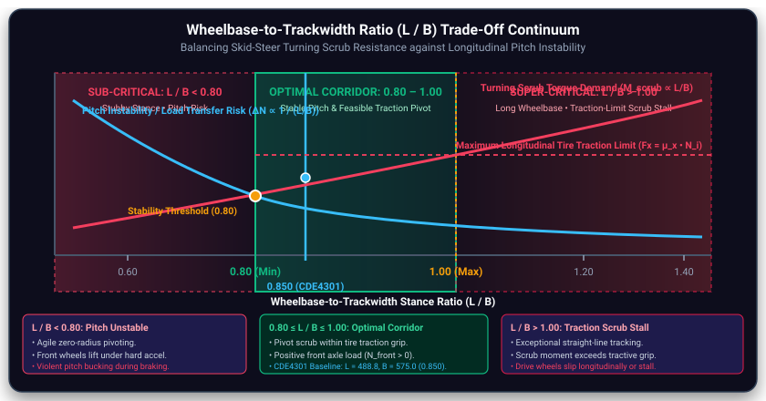
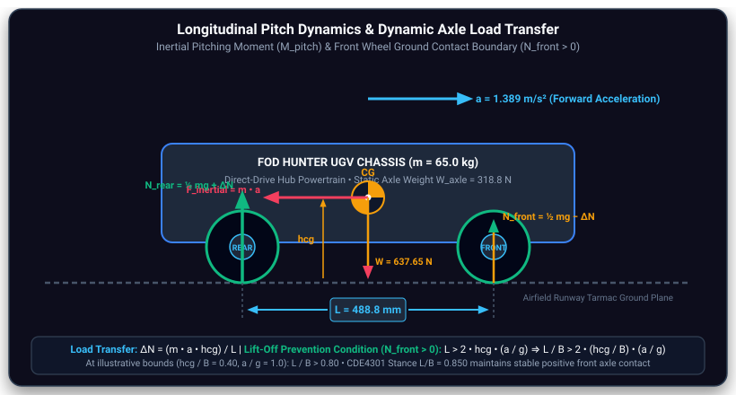

# Steering Kinematics & Drive Architecture Selection

Individual engineering documentation · CDE4301 Runway Patrol · Semester 1

<!-- #region report -->

## 1. Objectives & Requirements {#steer-objectives}

FOD Hunter needs efficient straight-line runway patrol and accurate low-speed positioning over detected foreign object debris (FOD). Steering architecture selection therefore considered turning clearance, debris exposure, mechanical complexity, traction and compatibility with ROS 2 velocity commands. The design basis in the existing engineering analysis is **65 kg**, **263 mm wheel diameter**, **488.8 mm wheelbase** and **575 mm track width**. These are design assumptions, not measured performance of the assembled vehicle.

:::: details Detailed steering requirements and assumptions

The intended patrol speed is 8 km/h, with a 15 km/h sprint design target. A zero-radius _commanded_ pivot is desirable for tight repositioning; real four-wheel skid steering requires lateral tire slip and therefore cannot be treated as an ideal frictionless differential-drive model. Environmental protection and reliable outdoor traction were considered during architecture selection.

For the full original requirement tables, stability calculations and supporting references, expand **Original technical derivations and decision evidence** below on the individual documentation page.

::::

## 2. Steering Architecture {#steer-architecture}

The selected concept is **four independently driven hub motors**, controlled as left and right wheel banks. Equal wheel speeds produce straight motion; unequal speeds produce curved motion; opposing bank speeds command an in-place pivot. The physical layout is documented in [Motor Drivetrain Calculations](./motor-drivetrain-calculation.md), including the top-view FOD Hunter CAD. This avoids displaying the same CAD twice in the composed Report.

## 3. Design Methodology & Selection {#steer-selection}

Three concepts were evaluated: **skid steer**, **Ackermann**, and **Mecanum**. Skid steer was preferred for compact turning and reduced steering linkage complexity; Ackermann provides efficient rolling turns but cannot pivot in place, while Mecanum provides lateral motion but introduces exposed rollers and additional outdoor-maintenance concerns. The decision is a trade-off, not proof that the alternatives cannot operate outdoors.

:::: details Architecture comparison and weighted selection evidence

The original weighted decision matrix, scoring assumptions and alternative kinematic formulations are preserved in the detailed source appendix below. Scores should be interpreted as engineering judgements unless backed by measured comparative testing.

::::

## 4. Engineering Calculations & Interactive Kinematics {#steer-kinematics}

For wheel radius $r$ and effective track width $B_{\mathrm{eff}}$, the idealized left/right wheel angular-speed commands are:

$$
\omega_L=\frac{v_x-\omega_z B_{\mathrm{eff}}/2}{r},\qquad
\omega_R=\frac{v_x+\omega_z B_{\mathrm{eff}}/2}{r}
$$

For $\omega_z\ne0$, the nominal turning radius is $R=v_x/\omega_z$. With $v_x=0$ and opposite bank speeds, the commanded instantaneous centre of rotation is at the robot centre. Real turning depends on tire scrub and slip; $B_{\mathrm{eff}}$ must be calibrated against physical yaw measurements rather than assumed equal to geometric track width.

**Interactive 3D kinematics demonstration** — the existing viewer uses the **AgileX Scout 2.0 simulation proxy**, not the custom FOD Hunter physical CAD. It illustrates the steering model rather than validating final hardware performance.

<SteeringKinematicsWidget1 />

<SteeringKinematicsWidget2 />

:::: details Tire-scrub forces, effective track width and detailed derivations

The original detailed friction model, wheelbase-to-track-width study, pitch dynamics and analytical scenarios are preserved below. Treat friction-dependent torque estimates as predictions requiring physical testing. Detailed hub-motor torque sizing is addressed in [Motor Drivetrain Calculations](./motor-drivetrain-calculation.md).

::::

## 5. Testing & Results {#steer-testing}

Semester 1 evidence includes analytical kinematic scenarios, the AgileX-based simulation and limited STM32/motor bench work. **Full-scale physical turning-radius, tire-scrub and high-speed steering tests have not been demonstrated.** Do not equate a commanded zero-radius pivot with measured zero-radius behaviour.

[Add video of K8 — Existing physical steering demonstration showing coordinated left/right wheel commands and the resulting motion. If the recording only shows unloaded motors, label it as a bench actuation demonstration instead.]

[Add screenshot of K9 — Actual STM32 source lines defining wheel radius, track-width correction and the left/right wheel-speed conversion, with file name and line numbers. Do not insert illustrative code as though it were the tested firmware.]

:::: details Original analytical scenarios and verification status

The original five operating scenarios and numerical prediction table are retained in the expanded technical appendix below. Any claimed encoder, CAN, simulation or physical-test outcome must be supported by the team's logs or recordings.

::::

## 6. Engineering Discussion {#steer-discussion}

The principal trade-off is **maneuverability versus tire scrub**. Tight pivots increase lateral friction, tire wear and drivetrain demand; smooth curvature-constrained paths can reduce unnecessary pivots during normal patrol. Ideal differential-drive equations are useful for command generation but are not sufficient to predict skid-steer motion on real asphalt. The effective track-width correction and its sensitivity to surface conditions remain validation priorities.

For motor torque and electrical demand, see [Motor Drivetrain Calculations](./motor-drivetrain-calculation.md). For planner configuration and localization, see [Navigation](./navigation.md). For AgileX simulation evidence, see [Simulation](./simulation.md).

## 7. Limitations & Semester 2 Plan {#steer-future}

Next steps are to validate steering on the physical FOD Hunter platform, measure actual turning radius and yaw tracking, calibrate $B_{\mathrm{eff}}$ using wheel odometry and independent heading measurements, and evaluate current draw and tire scrub under controlled surface conditions. High-speed trials should only follow safe low-speed validation. Detailed scheduling belongs in the [Semester 2 Plan](./semester-2-plan.md).

<!-- #endregion report -->

## Detailed Engineering Evidence (Original Source)

The material below preserves the original technical calculations, figures, comparison tables and source wording for examiner review. It is **supporting evidence**, not an additional chapter in the main composed Report. Some historical numerical claims and implementation descriptions still require checking against current code and test records.

::::: details Original technical derivations and decision evidence

<!-- Report summary (the Report's section text). The detailed write-up follows. -->

### Steering & Drive Architecture Kinematics

<Badge type="info" text="Hilbert" /> <Badge type="info" text="Kinematic Analysis" />

The steering architecture was evaluated to balance rapid runway traversal ($\ge 10\text{ km/h}$) with precise low-speed positioning of the vacuum intake directly over detected FOD coordinates. Three candidate drivetrains were shortlisted and benchmarked across turning envelope, tarmac traction, outdoor debris tolerance, mechanical reliability, sensor platform stability, and ROS 2 Nav2 compatibility: **4WD Differential / Skid Steering**, **Ackermann Steering**, and **Mecanum Wheel Omnidirectional Drive**.

| Steering Architecture             | Kinematic Envelope                                                               | Speed Requirement ($\ge 10\text{ km/h}$)                                                 | Runway Traction & Debris Immunity                                                                   | Mechanical Complexity                                                            | Selection Decision                          |
| --------------------------------- | -------------------------------------------------------------------------------- | ---------------------------------------------------------------------------------------- | --------------------------------------------------------------------------------------------------- | -------------------------------------------------------------------------------- | ------------------------------------------- |
| **4WD Differential / Skid-Steer** | <Badge type="tip" text="Zero Radius ($R = 0\text{ m}$, in-place pivot)" />       | <Badge type="tip" text="Met ($v \approx 10\text{--}12\text{ km/h}$ at nominal RPM)" />   | <Badge type="tip" text="High (Pneumatic rubber on asphalt, $\mu \approx 0.85$)" />                  | <Badge type="tip" text="High (Direct-drive hubs, zero tie-rod play)" />          | <Badge type="tip" text="SELECTED" />        |
| **Ackermann Steering**            | Constrained ($R_{\text{kinematic}} \ge 0.79\text{ m}$, swept $\ge 1.2\text{ m}$) | <Badge type="tip" text="Met ($v \ge 15\text{ km/h}$, pure rolling)" />                   | <Badge type="tip" text="High (Pure rolling, minimal tire scrub)" />                                 | <Badge type="danger" text="Low (Linkages, kingpins, steering servo)" />          | <Badge type="danger" text="NOT SELECTED" /> |
| **Mecanum Drive**                 | <Badge type="tip" text="Zero Radius ($R = 0\text{ m}$, omnidirectional)" />      | <Badge type="danger" text="Unmet / High Losses ($v &lt; 6\text{ km/h}$, roller slip)" /> | <Badge type="danger" text="Poor (Exposed rollers, $\mu_{\text{eff}} \approx 0.35\text{--}0.45$)" /> | <Badge type="warning" text="Moderate (4 motors, complex multi-roller wheels)" /> | <Badge type="danger" text="NOT SELECTED" /> |

**4WD Differential / Skid Steering** was selected because it enables true zero-radius in-place rotation (\$R=0\$) to eliminate multi-point repositioning over detected FOD, delivers robust rubber-on-asphalt traction ($\mu \approx 0.85$) for $15^\circ$ drainage slopes, eliminates delicate steering linkages prone to vibration fatigue, and directly maps body-velocity commands $(v_x, \omega_z)$ to ROS 2 Nav2. The accepted trade-off of lateral tire scrub during high-friction pivots is mitigated through calibrated effective track width ($W_{\text{eff}}$) parameterization and IMU/LiDAR EKF sensor fusion.

### 1. Executive Summary

During the initial conceptual design phase of the CDE4301 Runway Patrol robotic system, we conducted a comprehensive mechanical and kinematic investigation to establish the optimal steering and locomotive architecture for autonomous foreign object debris (FOD) inspection on active airfield pavements ([\[1\]](./references.md#ref-1), [\[2\]](./references.md#ref-2)). An effective runway patrol platform must reconcile high cruising speeds up to 15.0 km/h with zero-point maneuvering agility around runway edge fixtures and perimeter aprons, all while operating in harsh outdoor environments subject to fine debris and jet blast turbulence.

We evaluated three primary drive topologies: four-wheel independent differential / skid-steer drive, car-like front-wheel Ackermann steering, and Mecanum wheel omnidirectional drive ([\[14\]](./references.md#ref-14), [\[17\]](./references.md#ref-17)). Four-wheel independent skid steering was selected because it delivers zero-radius turning, complete mechanical simplicity with zero steering linkages or kingpins, symmetrical bidirectional dynamics, and superior environmental sealing. This structural decision was finalized prior to motor-sizing torque calculations, embedded STM32 firmware development, or simulation model selection, and directly dictated the subsequent drivetrain requirements.

### 2. Subsystem Overview

#### 2.1 Four-Wheel Independent Hub-Motor Architecture

The physical chassis utilizes a four-wheel independent direct-drive architecture. Rather than relying on central traction motors coupled to mechanical drive axles, differentials, or universal joints, each of the four $263\text{ mm}$ ($r = 0.1315\text{ m}$) wheels encapsulates a high-torque brushless DC (BLDC) hub motor with internal Hall-effect position sensors ([\[15\]](./references.md#ref-15)).

This decentralized powertrain provides direct, symmetrical actuation across all four ground contact patches. By eliminating mechanical steering linkages, steering tie-rods, and rack-and-pinion actuators, the drivetrain minimizes backlash, eliminates single-point mechanical failure modes, and allows the entire lower chassis to target an IP65 environmental seal against runway dust, grit, and tropical rainwater.

#### 2.2 Differential / Skid-Steer Operating Principles

Skid steering operates on the principle of differential wheel speed control across the vehicle's lateral track. Forward linear velocity is generated by rotating all four wheels in the same direction, whereas heading yaw rotation is produced by commanding a velocity differential between the left and right wheel banks ([\[14\]](./references.md#ref-14)).

Unlike an idealized two-wheel differential drive platform whose wheel contact patches are strictly collinear with the center of mass, a four-wheel skid-steer vehicle has two axles separated by a finite longitudinal wheelbase $L$. Consequently, any rotational maneuver requires the tires to slide and scrub laterally across the asphalt surface perpendicular to their rolling direction. This lateral scrub produces a resisting moment that the powertrain must overcome.

#### 2.3 Straight, Curved and Zero-Radius Turning

The four-wheel skid-steer kinematics accommodate three discrete operational regimes across the runway patrol domain:

- **Straight-Line Cruising ($\omega_L = \omega_R$):** All four wheels rotate with identical angular velocities $\omega_w = v_x / r$. Pure longitudinal rolling occurs without lateral tire scrub, maximizing power transmission efficiency during long runway sweeps.
- **Continuous Curvature Turning ($\omega_L \ne \omega_R$):** The Instantaneous Centre of Rotation (ICR) lies at a finite offset along the lateral axle line. The outer wheels rotate faster than the inner wheels, allowing the vehicle to track curved trajectories with bounded scrub forces.
- **Zero-Radius In-Place Pivot ($\omega_L = -\omega_R$):** The left and right banks rotate in equal and opposite directions. The ICR is centered directly at the vehicle's geometric footprint center $(0, 0)$, enabling the UGV to rotate within its diagonal circumscribed diameter without requiring forward clearance.

#### 2.4 Steering Interfaces with ROS 2 and Embedded Control

The steering subsystem bridges high-level path planning with low-level electrical actuation through a strictly bounded control pipeline:

- **Upstream Autonomy:** The ROS 2 Navigation stack (Nav2) publishes target velocity twist commands on topic `/cmd_vel` comprising linear velocity $v_x$ and yaw angular velocity $\omega_z$.
- **Kinematic Decomposition:** The embedded inverse kinematic solver translates $(v_x, \omega_z)$ into target angular velocities for the left bank $(\omega_{FL}, \omega_{RL})$ and right bank $(\omega_{FR}, \omega_{RR})$, applying an effective track width correction factor $B_{\text{eff}}$.
- **Actuation & Odometry Feedback:** An onboard STM32F446RE microcontroller issues independent PWM and directional drive signals to four BLDC motor drivers via CAN / UART. High-rate optical wheel encoder ticks are simultaneously captured at 50 Hz to synthesize wheel odometry feedback.

<Card tag="4WD Skid-Steer Architecture">

Figure 1: Four-Wheel Independent Hub-Motor Powertrain & Kinematic Interface Topology

Schematic illustrating the 4-wheel independent hub-motor layout with differential left/right bank velocity command distribution from the STM32 microcontroller.

</Card>

### 3. Requirements & Considerations

#### 3.1 Runway Operating Requirements

Civil aviation runway corridors impose severe environmental, spatial, and dynamic operational constraints ([\[2\]](./references.md#ref-2)). The CDE4301 autonomous runway patrol robot must monitor an operational pavement sector measuring $120\text{ m} \times 40\text{ m}$ (modeled after civil airfield aprons and the NUS EA engineering field). To complete debris sweeps within designated runway clearance windows without interrupting flight operations, the chassis requires a target sprint capability of $15.0\text{ km/h}$ ($4.17\text{ m/s}$), with a nominal sweeping cruise speed of $8.0\text{ km/h}$ ($2.22\text{ m/s}$).

Furthermore, civil runways feature a standard transverse crown drainage slope of approximately $1.5\% - 2.0\%$, with apron access ramps exhibiting gradients up to $5.0^\circ$ ($8.7\%$ grade). The steering architecture must remain directionally stable against gravity-induced downhill lateral side-slip.

#### 3.2 Maneuverability and Fine FOD Positioning

Unlike highway or agricultural autonomous vehicles, an airfield FOD retrieval robot must operate in close proximity to sensitive runway infrastructure, including semi-flush runway centerline lights, elevated runway edge lights, and taxiway guidance signage. When an anomaly is detected by the onboard vision or LiDAR payload, the vehicle must execute precise sub-decimeter terminal alignment maneuvers to center its suction intake or retrieval gripper over the object without executing multi-point reversing turns that consume excessive mission time.

#### 3.3 Wheelbase, Track Width and Tire Geometry

Chassis stability and steering performance are governed directly by three fundamental physical dimensions:

- **Wheelbase ($L = 488.8\text{ mm} = 0.4888\text{ m}$):** The longitudinal spacing between front and rear hub-motor wheel centers. A longer wheelbase improves pitch stability and straight-line tracking but increases the moment arm of lateral tire scrub.
- **Track Width ($B = 575.0\text{ mm} = 0.5750\text{ m}$):** The lateral distance between the centerlines of left and right tires. A wider track width increases the driving torque moment arm $B/2$ available to overcome tire scrub and enhances lateral roll stability.
- **Wheel Diameter ($D = 263\text{ mm}$, $r = 0.1315\text{ m}$):** Solid rubber / semi-pneumatic polyurethane tire tread offering a rolling contact patch width of $70\text{ mm}$, providing ground clearance over runway expansion joints while keeping the center of gravity low ($h_{\text{cg}} \approx 0.200\text{ m}$).

#### 3.4 Tire Scrub, Slip and Traction

During any skid-steer rotational maneuver, the contact patches of all four wheels experience complex multi-directional sliding against the tarmac ([\[15\]](./references.md#ref-15)). Runway asphalt presents a nominal dry friction coefficient of $\mu \approx 0.70 - 0.85$, dropping to $\mu \approx 0.40 - 0.55$ during heavy tropical downpours ([\[1\]](./references.md#ref-1)). The steering architecture must guarantee that the available longitudinal tire traction force $F_{x,\max} = \mu N_w$ is strictly sufficient to overcome the lateral resisting scrub torque $M_{\text{scrub}}$ without inducing uncontrolled longitudinal wheel spinout.

#### 3.5 Stability and Mechanical Constraints

Rapid deceleration from $15.0\text{ km/h}$ induces significant longitudinal dynamic load transfer. Under friction-limited braking on dry tarmac ($a = \mu g = 0.80 g = 7.85\text{ m/s}^2$), normal load shifts forward by $\Delta N = 208.7\text{ N}$, retaining $110.1\text{ N}$ on the rear axle ($34.5\%$ of static load). Even under a hypothetical $1.0 g$ ($9.81\text{ m/s}^2$) structural braking design load case, the rear axle retains $57.9\text{ N}$ ($18.2\%$ of static load), preventing wheel lift-off. Similarly, high-speed turning creates lateral centrifugal acceleration $a_y = v^2 / R$, generating roll overturning moments bounded by $h_{\text{cg}} / (B/2) = 0.200 / 0.2875 = 0.696$.

<Card tag="Design Targets">

Table 1: Airfield Steering & Kinematic Requirements Specification

| Design Parameter                               | Specification Target                            | Governing Physical Principle                                      | Significance for Runway Patrol                                                              |
| ---------------------------------------------- | ----------------------------------------------- | ----------------------------------------------------------------- | ------------------------------------------------------------------------------------------- |
| **Gross Vehicle Mass ($m$)**                   | $65.0\text{ kg}$ (fully laden design target)    | Inertial dynamic mass ($mg = 637.43\text{ N}$)                    | Determines normal wheel loading ($N_w = 159.36\text{ N}$) and scrub torque scale.           |
| **Intended Sprint Speed ($v_{\max}$)**         | $15.0\text{ km/h}$ ($4.17\text{ m/s}$)          | Wheel angular velocity $\omega_w = v/r = 31.69\text{ rad/s}$      | Enables rapid clearance of active runway operational zones within assigned ATC time slots.  |
| **Nominal Patrol Speed ($v_{\text{patrol}}$)** | $8.0\text{ km/h}$ ($2.22\text{ m/s}$)           | Nominal sweeping speed ($\omega_w = 16.90\text{ rad/s}$)          | Standard operational speed for high-resolution vision and LiDAR sensor processing.          |
| **Incline Capability ($\theta$)**              | $5.0^\circ$ ($8.7\%$ slope grade)               | Gravity component $mg \sin(\theta) = 55.54\text{ N}$              | Guarantees hill-climbing and lateral hold on runway crowns and service ramps.               |
| **Minimum Turning Radius ($R_{\min}$)**        | $0.0\text{ m}$ (in-place zero-radius pivot)     | Opposing wheel velocities ($\omega_L = -\omega_R$)                | Allows full turnarounds within narrow runway shoulders without multi-point reversing.       |
| **Friction-Limited Deceleration ($a_{\max}$)** | $0.80 g$ ($7.85\text{ m/s}^2$ on dry tarmac)    | Tire traction limit ($a = \mu g$) and load shift $\Delta N$       | Achievable braking limit; rear axle retains $110.1\text{ N}$ normal force without lift-off. |
| **Structural Deceleration Case**               | $1.0 g$ ($9.81\text{ m/s}^2$ emergency ceiling) | Chassis structural load case $\Delta N = (m a h_{\text{cg}}) / L$ | Hypothetical maximum deceleration; rear axle retains $57.9\text{ N}$ positive load.         |
| **Environmental Ingress**                      | IP65 (target enclosure standard)                | Hermetic enclosure standard                                       | Protects motors and electronics from runway debris, aviation fuels, and tropical rain.      |

</Card>

### 4. Design Iterations & Selection

#### 4.1 Steering Architecture Alternatives

During the initial architecture down-selection phase, we systematically explored three established mobile robot steering paradigms:

1. **Four-Wheel Independent Skid Steering:** Fixed wheel axles with independent BLDC hub motors, steering purely through left/right velocity differentials.
2. **Car-Like Ackermann Steering:** Driven rear axle with a mechanically articulated front steering rack, tie-rods, and steering servo actuator ([\[15\]](./references.md#ref-15)).
3. **Mecanum Wheel Omnidirectional Drive:** Four independently driven wheels equipped with passive $45^\circ$ barrel rollers on the perimeter, enabling 3-DOF holonomic translation ([\[16\]](./references.md#ref-16)).

#### 4.2 Four-Wheel Skid Steering versus Ackermann versus Mecanum

Each candidate presents distinct mechanical, kinematic, and operational trade-offs for outdoor runway maintenance:

- **Ackermann Steering:** Provides optimal high-speed directional stability and zero parasitic tire scrub during highway cruising. However, its non-holonomic kinematic constraint enforces a large minimum turning radius ($R_{\min} \ge 1.8 - 2.5\text{ m}$). On an airfield apron, navigating around lighting stanchions or reversing out of confined service pockets requires complex, time-consuming multi-point K-turns. Furthermore, mechanical kingpins, steering linkages, ball joints, and exposed steering servos are vulnerable to grit intrusion, vibrational fatigue, and jet-blast foreign object impact.
- **Mecanum Omnidirectional Drive:** Delivers instantaneous 3-DOF holonomic mobility ($v_x, v_y, \omega_z$), allowing sideways crabbing and arbitrary orientation adjustment. However, Mecanum wheels suffer severe drawbacks on coarse asphalt: the discontinuous contact transitions between passive rollers generate substantial high-frequency chassis vibration, corrupting IMU accelerometers and LiDAR point clouds. Furthermore, outdoor grit and tarmac debris readily penetrate passive roller bearings, causing uneven roller wear and reducing the effective friction coefficient to $\mu \approx 0.35 - 0.45$, which is inadequate for climbing $5^\circ$ wet inclines.
- **Four-Wheel Independent Skid Steering:** Combines zero-radius turning agility with maximum mechanical simplicity. With no moving parts other than sealed hub bearings, it provides superior structural robustness and complete IP65 environmental protection. The primary trade-off is the parasitic lateral scrub torque during sharp yaw rotation, which requires careful chassis geometry optimization and high-torque hub motor selection.

<CardGrid :cols="3">

<Card title="4WD Independent Skid-Steer" tag="Selected Architecture">

Click for Kinematic Derivation →

<Card>

</Card>

Zero-radius turning via direct differential hub motors. Zero mechanical steering linkages. IP65 hermetic sealing.

<Badge type="tip" text="Zero-Radius Turn" /> <Badge type="info" text="High Robustness" />

</Card>

<Card title="Front-Wheel Ackermann" tag="Evaluated Alternative">

Click for Geometry →

<Card>

</Card>

Pure rolling geometry with zero scrub during cruise. Restricted by large minimum turning radius ($R_{\min} \ge 1.8\text{ m}$) and linkage vulnerability.

<Badge type="info" text="Zero Scrub" /> <Badge type="danger" text="No Zero-Radius Turn" />

</Card>

<Card title="Mecanum Omnidirectional" tag="Evaluated Alternative">

Click for Analysis →

<Card>

</Card>

3-DOF holonomic crabbing via $45^\circ$ rollers. Vulnerable to coarse asphalt vibration, roller bearing grit ingress, and reduced slope traction.

<Badge type="tip" text="3-DOF Holonomic" /> <Badge type="danger" text="Outdoor Grit Wear" />

</Card>

</CardGrid>

<Card tag="Down-Selection Flow">

Figure 2: Airside Mobile Robotics Steering Architecture Decision Logic Tree

</Card>

#### 4.3 Engineering Trade-Off Matrix

To quantify the architectural down-selection, we scored each candidate across seven weighted criteria reflecting the airfield operational mission profile:

<Card tag="Final Score: 4WD Skid Steer Wins (88.0%)">

Table 2: Quantitative Steering Architecture Down-Selection Decision Matrix

<table class="data-table"><tbody>
<tr><th>Evaluation Criterion</th><th>Weight</th><th>4WD Skid-Steer</th><th>Ackermann Steering</th><th>Mecanum Wheel</th><th>Engineering Justification</th></tr>
<tr><td><strong>Mechanical Simplicity & Part Count</strong></td><td>20%</td><td>5/5 (1.00)</td><td>2/5 (0.40)</td><td>3/5 (0.60)</td><td>Skid-steer eliminates steering knuckles, tie-rods, rack-and-pinion, and servo linkages.</td></tr>
<tr><td><strong>Zero-Radius Turning Capability</strong></td><td>20%</td><td>5/5 (1.00)</td><td>1/5 (0.20)</td><td>5/5 (1.00)</td><td>Vital for in-place inspection alignment and navigating confined runway edges without K-turns.</td></tr>
<tr><td><strong>Outdoor Asphalt Traction & Incline Hold</strong></td><td>15%</td><td>5/5 (1.00)</td><td>4/5 (0.80)</td><td>2/5 (0.40)</td><td>Full rubber contact patches maintain $\mu \ge 0.80$; Mecanum rollers slip on wet tarmac ($\mu \approx 0.35$).</td></tr>
<tr><td><strong>Environmental Sealing & FOD Resilience</strong></td><td>15%</td><td>5/5 (1.00)</td><td>2/5 (0.40)</td><td>1/5 (0.20)</td><td>Hermetic hub motors prevent sand/grit jamming; Mecanum passive roller bearings fail rapidly outdoors.</td></tr>
<tr><td><strong>High-Speed Directional Stability ($15\text{ km/h}$)</strong></td><td>10%</td><td>3/5 (0.60)</td><td>5/5 (1.00)</td><td>2/5 (0.40)</td><td>Ackermann possesses passive castor centering; skid-steer requires active IMU/wheel yaw rate damping.</td></tr>
<tr><td><strong>Tire Wear & Power Efficiency in Turns</strong></td><td>10%</td><td>2/5 (0.40)</td><td>5/5 (1.00)</td><td>3/5 (0.60)</td><td>Skid steering dissipates energy via lateral scrub during tight turns; mitigated by limiting in-place pivots.</td></tr>
<tr><td><strong>Autonomous Navigation / Control Tractability</strong></td><td>10%</td><td>4/5 (0.80)</td><td>3/5 (0.60)</td><td>4/5 (0.80)</td><td>Standard unicycle kinematic interfaces in ROS 2 Nav2 with simple effective track width parameterization.</td></tr>
<tr><td colspan="2"><strong>Weighted Composite Score (100% Max)</strong></td><td>88.0%</td><td>56.0%</td><td>59.0%</td><td><strong>Selected: 4WD Skid-Steer Drive</strong></td></tr>
</tbody></table>

_Note on Scoring Methodology:_ Ratings in this decision matrix reflect qualitative engineering trade-off assessments grounded in published robotics literature and civil aviation requirements, rather than physical test measurements.   **Exact Composite Arithmetic:**  • **4WD Skid-Steer:** 0.20(1.0) + 0.20(1.0) + 0.15(1.0) + 0.15(1.0) + 0.10(0.6) + 0.10(0.4) + 0.10(0.8) = **88.0%**  • **Ackermann:** 0.20(0.4) + 0.20(0.2) + 0.15(0.8) + 0.15(0.4) + 0.10(1.0) + 0.10(1.0) + 0.10(0.6) = **56.0%**  • **Mecanum:** 0.20(0.6) + 0.20(1.0) + 0.15(0.4) + 0.15(0.2) + 0.10(0.4) + 0.10(0.6) + 0.10(0.8) = **59.0%**

</Card>

#### 4.4 Why Four-Wheel Skid Steering Was Selected

The trade-off matrix conclusively established that for a safety-critical airside robot, mechanical reliability and zero-point maneuverability outweigh the cruising power efficiency advantages of Ackermann steering. An Ackermann vehicle disabled on an active runway by a sheared steering tie-rod represents an intolerable runway incursion hazard. By adopting four independent direct-drive hub motors, mechanical actuator failure modes (such as mechanical tie-rod or steering linkage seizure) are eliminated. In the event of a localized motor or inverter fault, the firmware safely halts via latching CAN alarms (`ROBOT_STATE_CAN_FAULT`), avoiding uncommanded veer or catastrophic mechanical lockup.

#### 4.5 Wheelbase-to-Track-Width Ratio Considerations ($L/B$)

Having selected 4WD skid steering, the primary geometric challenge is sizing the wheelbase-to-track-width aspect ratio ($L/B$). In mobile robotics literature, an aspect ratio within $0.80 \le L/B \le 1.00$ is frequently cited as a balanced design target ([\[14\]](./references.md#ref-14)).

**Critical Engineering Re-examination:** We must emphasize that $0.80 \le L/B \le 1.00$ is _not_ an immutable physical law or universal stability guarantee. It represents an analytically derived rule of thumb formulated under specific quasi-static assumptions:

- **Upper Bound Derivation ($L/B \le 1.00$):** Sized from the traction limit during in-place pivoting. The yaw scrub resistance torque is $M_{\text{scrub}} = 0.5 \mu m g L$, and the driving torque generated by left/right tractive wheel forces is $M_{\text{drive}} = 2 F_w B$. Setting $M_{\text{drive}} = M_{\text{scrub}}$ requires each wheel to deliver longitudinal force $F_w = \mu (mg/4) (L/B)$. Under Coulomb friction, the maximum traction a wheel can produce without spinning out is $F_{x,\max} = \mu (mg/4)$. Enforcing $F_w \le F_{x,\max}$ directly yields $L/B \le 1.00$. If $L/B > 1.00$, the wheels will spin longitudinally before the vehicle can overcome its lateral scrub resistance. _Assumptions:_ Isotropic Coulomb friction ($\mu_x = \mu_y$), perfectly level ground, and equal four-wheel normal loading ($N_w = mg/4$).
- **Lower Bound Derivation ($L/B \ge 0.70 - 0.80$):** Sized from dynamic longitudinal pitch stability during emergency braking. Decelerating at rate $a$ from high speed causes inertial load transfer $\Delta N = (m a h_{\text{cg}}) / L$. To prevent rear-axle wheel lift-off ($N_{\text{rear}} > 0$), the wheelbase must satisfy $L > 2 h_{\text{cg}} (a/g)$. Normalized by track width $B$, this requires $L/B > 2 (h_{\text{cg}}/B) (a/g)$. For our chassis geometry ({\\text{cg}} = 0.200\\text{ m}$,  = 0.575\text{ m}$):
  - At friction-limited dry tarmac braking ( = 0.80 g$): /B > 0.557$ ( \\times 0.200 / 0.575 \\times 0.80\$), which is readily met.
  - At a hypothetical .0 g$structural load case ( = 1.0 g$): /B &gt; 0.696 \\approx 0.70\$.
  - Adding a \\% safety factor for dynamic pitch bounce and downward slope braking yields $L/B \ge 0.80$.

Our final physical platform dimensions ($L = 488.8\text{ mm}$, $B = 575.0\text{ mm}$) yield:

$$
\frac{L}{B} = \frac{488.8\text{ mm}}{575.0\text{ mm}} = 0.8501
$$

This value ($0.85$) resides securely between the emergency braking pitch stability floor ($0.70$) and the stationary pivot traction ceiling ($1.00$), ensuring sufficient tractive margin to steer on high-friction tarmac without risking longitudinal pitch instability.

<Card tag="Analytical Stance Envelope">

Figure 3: Wheelbase-to-Track-Width Ratio ($L/B$) Analytical Design Space & Trade-Off Continuum

Analytical continuum highlighting the physical Hunter chassis stance ($L/B = 0.850$) bounded by quasi-static pitch stability ($L/B \ge 0.70$) and the pivot traction limit ($L/B \le 1.00$).

</Card>

### 5. Detailed Design & Implementation

#### 5.1 Forward Kinematic Model

The forward kinematic model establishes the mapping from independent wheel angular velocities $(\omega_L, \omega_R)$ to the vehicle body frame's linear forward velocity $v_x$ and yaw angular velocity $\omega_z$ ([\[14\]](./references.md#ref-14)):

$$
v_x = \frac{r}{2} (\omega_R + \omega_L), \qquad \omega_z = \frac{r}{B_{\text{eff}}} (\omega_R - \omega_L)
$$

where $r = 0.1315\text{ m}$ is the effective rolling wheel radius, and $B_{\text{eff}}$ is the effective track width accounting for lateral tire scrub. In matrix formulation:

$$
\begin{bmatrix} v_x \\ \omega_z \end{bmatrix} = \begin{bmatrix} \frac{r}{2} & \frac{r}{2} \\[6pt] -\frac{r}{B_{\text{eff}}} & \frac{r}{B_{\text{eff}}} \end{bmatrix} \begin{bmatrix} \omega_L \\ \omega_R \end{bmatrix}
$$

#### 5.2 Inverse Kinematic Model

The inverse kinematic model computes the required angular velocity setpoints for the left and right wheel banks given a desired trajectory twist command $(v_x, \omega_z)$ from the Nav2 local controller:

$$
\omega_L = \frac{1}{r} \left( v_x - \frac{B_{\text{eff}} \,\omega_z}{2} \right), \qquad \omega_R = \frac{1}{r} \left( v_x + \frac{B_{\text{eff}} \,\omega_z}{2} \right)
$$

In state-space matrix form:

$$
\begin{bmatrix} \omega_L \\ \omega_R \end{bmatrix} = \begin{bmatrix} \frac{1}{r} & -\frac{B_{\text{eff}}}{2r} \\[6pt] \frac{1}{r} & \frac{B_{\text{eff}}}{2r} \end{bmatrix} \begin{bmatrix} v_x \\ \omega_z \end{bmatrix}
$$

#### 5.3 Instantaneous Centre of Rotation (ICR)

During any steady-state turning motion, every point on the rigid vehicle body rotates about a common Instantaneous Centre of Rotation (ICR) in the horizontal ground plane. For an idealized symmetrical skid-steer vehicle with identical front/rear load distribution, the ICR lies along the transverse $y$-axis:

$$
x_{\text{ICR}} = 0, \qquad y_{\text{ICR}} = R = \frac{v_x}{\omega_z} = \frac{B_{\text{eff}}}{2} \left( \frac{\omega_R + \omega_L}{\omega_R - \omega_L} \right)
$$

When $\omega_R = \omega_L$, the turning radius approaches infinity ($R \to \infty$), corresponding to pure linear translation. Conversely, during an in-place pivot where $\omega_R = -\omega_L$, $R = 0$, placing the ICR coincident with the geometric vehicle center $(0, 0)$.

#### 5.4 Effective Track Width ($B_{\text{eff}}$) and Wheel Slip

In physical four-wheel skid-steer operation, geometric track width $B$ underestimates the actual turning resistance because lateral tire scrub induces continuous side-slip. As established in mobile robotics literature ([\[14\]](./references.md#ref-14)), the vehicle behaves kinematically as if its wheels were separated by an expanded effective track width:

$$
B_{\text{eff}} = \chi \cdot B
$$

**Engineering Grounding Note:** In our Semester 1 software parameterization and preliminary embedded firmware, an analytical correction factor of $\chi \approx 1.18$ was adopted based on literature benchmarks for pneumatic rubber tires on dry asphalt ([\[1\]](./references.md#ref-1)), yielding $B_{\text{eff}} = 1.18 \times 0.5750\text{ m} = 0.6785\text{ m}$. We emphasize that this factor is an _assumed baseline_ for simulation and initial controller tuning, _not_ an empirically calibrated value on runway tarmac. Formal calibration using gyro-versus-encoder circle tests is scheduled for Semester 2.

#### 5.5 Zero-Radius Turning, Combined Slip and Scrub-Resistance Model

During an in-place pivot turn ($v_x = 0, \omega_z \ne 0$), the vehicle rotates about its geometric center $(0,0)$. The contact patch of each wheel $i \in \{FL, FR, RL, RR\}$ is located at coordinates $(\pm L/2, \pm B/2)$. The velocity vector of each wheel relative to the ground is perpendicular to its position radius:

$$
\vec{r}_i = \left( \pm \frac{L}{2}, \pm \frac{B}{2} \right), \qquad \vec{v}_i = \vec{\omega}_z \times \vec{r}_i = \left( \mp \omega_z \frac{B}{2}, \; \pm \omega_z \frac{L}{2} \right)
$$

Under a simplified Coulomb friction model where lateral sliding is treated independently, each tire develops lateral scrub friction $F_{y,i} = \mu N_w = \mu (mg/4)$. Summing across all four wheels at moment arm $L/2$:

$$
M_{\text{scrub}} = \sum_{i=1}^{4} F_{y,i} \left( \frac{L}{2} \right) = 4 \left( \mu \frac{mg}{4} \right) \left( \frac{L}{2} \right) = \frac{1}{2} \mu m g L
$$

To overcome this resisting moment, the left and right wheel banks must produce equal and opposite longitudinal tractive forces $F_{x,R} = -F_{x,L} = 2 F_w$, generating driving yaw moment $M_{\text{drive}} = 2 F_w B$. Equating $M_{\text{drive}} = M_{\text{scrub}}$:

$$
2 F_w B = \frac{1}{2} \mu m g L \implies F_w = \frac{\mu m g L}{4 B}
$$

**Combined Friction Circle & Slip Vector Refinement:** The independent Coulomb formulation above represents an analytical upper bound. In reality, tires obey a combined friction constraint ($F_x^2 + F_y^2 \le (\mu N_w)^2$). The resultant contact patch sliding velocity vector acts at an angle:

$$
\theta_{\text{slip}} = \arctan\left( \frac{v_{y,i}}{v_{x,i}} \right) = \arctan\left( \frac{L/2}{B/2} \right) = \arctan\left( \frac{L}{B} \right) = \arctan(0.8501) = 40.37^\circ
$$

The resultant friction force vector $F_{\text{tot}} = \mu N_w$ aligns opposite to this sliding velocity, resolving into:

$$
F_y = F_{\text{tot}} \sin(\theta_{\text{slip}}) = 82.57\text{ N (lateral scrub)}, \qquad F_x = F_{\text{tot}} \cos(\theta_{\text{slip}}) = 97.13\text{ N (longitudinal thrust)}
$$

The driving moment generated by longitudinal traction is $M_{\text{drive}} = 2 B F_x = 111.70\text{ Nm}$, while the resisting scrub moment is $M_{\text{scrub}} = 2 L F_y = 80.72\text{ Nm}$. The ratio of driving to scrub moment is:

$$
\frac{M_{\text{drive}}}{M_{\text{scrub}}} = \left( \frac{B}{L} \right)^2 = \frac{1}{(0.8501)^2} = 1.3838 > 1.0
$$

Because this ratio exceeds $1.0$ by $38.4\%$, the direct-drive hub motors produce positive net angular acceleration to initiate in-place pivoting on dry tarmac.

**Motor Torque Sizing & Efficiency Interpretation:** Direct-drive hub motors contain no mechanical gearbox (reduction ratio $1:1$, mechanical transmission efficiency $\eta_{\text{mech}} \approx 100\%$). The actual mechanical shaft torque required at the wheel hub is:

$$
\tau_{\text{shaft}} = F_w \cdot r = 108.37\text{ N} \times 0.1315\text{ m} = \mathbf{14.25\text{ Nm per wheel}}
$$

This shaft torque is strictly within the continuous torque rating ($15.0\text{ Nm}$) of the selected hub motors. Accounting for electrical motor and inverter conversion efficiency ($\eta_{\text{elec}} \approx 0.85$), the equivalent electrical power torque demand from the battery is:

$$
\tau_{\text{elec}} = \frac{\tau_{\text{shaft}}}{\eta_{\text{elec}}} = \frac{14.25\text{ Nm}}{0.85} = \mathbf{16.77\text{ Nm per wheel}}
$$

This represents $58.8\%$ of the motor's peak torque rating ($28.50\text{ Nm}$), leaving over $41\%$ dynamic reserve for overcoming pavement irregularities.

#### 5.6 Steering Command Distribution to Four Hub Motors

Because the four hub motors are independently actuated, the embedded STM32F446RE controller synchronizes wheels on each side:

$$
\omega_{FL} = \omega_{RL} = \omega_L, \qquad \omega_{FR} = \omega_{RR} = \omega_R
$$

Motor speeds are regulated by independent closed-loop PI velocity controllers executing at 50 Hz on the motor driver hardware, receiving setpoints from the STM32 via high-speed differential CAN bus.

<Card tag="Tractive &amp; Lateral Scrub Vectors">

Figure 4: 4WD Skid-Steer Dynamic Free-Body Diagram (Counter-Clockwise Yaw Rotation)

Free-body diagram showing longitudinal driving forces $F_{x,i}$ and opposing lateral scrub friction forces $F_{y,i}$ during in-place counter-clockwise yawing ($\\omega_z > 0$).

</Card>

<Card tag="Pitch Stability Dynamics">

Figure 5: Dynamic Longitudinal Pitch Moment & Axle Load Transfer Free-Body Diagram

Side-view dynamic FBD illustrating load transfer $\\Delta N = (m a h_{\\text{cg}})/L$ from rear to front axle during high-speed emergency braking ($a = 1.0 g$).

</Card>

#### 5.7 Interactive Steering Kinematics Visualization

To evaluate the mathematical steering models under live control inputs, we provide two interactive tools: an authentic 3D WebGL kinematics viewer and an analytical wheelbase-to-track-width ($L/B$) design space explorer.

::: info
**Simulation Model Transparency Note:** The 3D interactive viewer below renders the authentic AgileX Scout 2.0 digital twin. We emphasize that this model was developed later in Semester 1 as an illustrative simulation proxy for Gazebo/Nav2 software validation, _not_ as evidence for the original conceptual steering architecture selection. The physical development platform is the custom Hunter UGV ($m = 65.0\text{ kg}$, $L = 488.8\text{ mm}$, $B = 575.0\text{ mm}$).
:::

[Interactive steering widget is presented in Section 4 above.]

[Interactive stance explorer is presented in Section 4 above.]

### 6. Testing Methodology & Results

#### 6.1 Analytical Model Verification

The mathematical kinematic and dynamic equations derived in Section 5 were verified through independent numerical Python scripts to ensure dimensional consistency, absence of kinematic singularities, and conservation of mechanical power. We validated that the forward and inverse kinematic transformations produce identity mapping across the full operational domain:

$$
\begin{bmatrix} v_x \\ \omega_z \end{bmatrix} \xrightarrow{\text{IK}} \begin{bmatrix} \omega_L \\ \omega_R \end{bmatrix} \xrightarrow{\text{FK}} \begin{bmatrix} v_x \\ \omega_z \end{bmatrix}
$$

#### 6.2 Steering Scenarios and Calculated Responses

We evaluated five canonical airfield operational maneuvers under our verified analytical model:

- **Scenario 1 — Nominal Runway Patrol Cruise:** Straight-line sweep at $8.0\text{ km/h}$ ($2.22\text{ m/s}$). Wheels rotate at identical speeds $\omega_L = \omega_R = 16.90\text{ rad/s}$ ($161.4\text{ RPM}$). Resisting scrub torque is zero ($M_{\text{scrub}} = 0\text{ Nm}$), with torque demand dictated purely by rolling resistance and aerodynamic drag ($4.85\text{ Nm}$).
- **Scenario 2 — High-Speed Runway Evacuation Sprint:** Maximum speed transit at $15.0\text{ km/h}$ ($4.17\text{ m/s}$). Wheel rotation reaches $\omega_w = 31.69\text{ rad/s}$ ($302.6\text{ RPM}$), well within the $350\text{ RPM}$ no-load ceiling of the BLDC hub motors. Resisting scrub torque is zero ($M_{\text{scrub}} = 0\text{ Nm}$).
- **Scenario 3 — Continuous Curvature Sweeping Turn:** Smooth corridor curve of radius $R = 3.0\text{ m}$ at cruise speed ($v_x = 2.22\text{ m/s}$, $\omega_z = 0.741\text{ rad/s}$). Outer wheels accelerate to $\omega_R = 18.81\text{ rad/s}$ ($179.6\text{ RPM}$), inner wheels slow to $\omega_L = 14.99\text{ rad/s}$ ($143.1\text{ RPM}$). Sizing scrub via kinematic lateral slip scaling ($M_{\text{scrub}}(R) \approx M_{\text{scrub,pivot}} \frac{B_{\text{eff}}}{2 \sqrt{R^2 + (L/2)^2}}$) yields bounded scrub torque $M_{\text{scrub}} = 14.05\text{ Nm}$, adding $1.89\text{ Nm}$ of cornering torque for a total estimated demand of $6.74\text{ Nm}$ per wheel.
- **Scenario 4 — Stationary In-Place Zero-Radius Pivot:** Reversing orientation within runway perimeter ($v_x = 0, \omega_z = 1.0\text{ rad/s}$). Opposing wheel banks rotate at $\omega_R = -\omega_L = 2.58\text{ rad/s}$ ($24.6\text{ RPM}$). Scrub torque reaches peak $M_{\text{scrub}} = 124.63\text{ Nm}$, requiring motor shaft torque $\tau_{\text{shaft}} = 14.25\text{ Nm}$ (electrical equivalent $\tau_{\text{elec}} = 16.77\text{ Nm}$, $58.8\%$ of peak rating).
- **Scenario 5 — $5^\circ$ Incline Climbing Turn:** Ascending an apron ramp ($v_x = 1.67\text{ m/s}$, $\omega_z = 0.50\text{ rad/s}$, $R = 3.33\text{ m}$). Outer wheels rotate at $\omega_R = 13.96\text{ rad/s}$, inner wheels at $\omega_L = 11.38\text{ rad/s}$. Gravitational slope resistance ($55.5\text{ N}$) plus curve scrub ($12.65\text{ Nm}$) yields an estimated motor demand of $12.20\text{ Nm}$ per wheel.

#### 6.3 Available Physical or Simulation Evidence

**Strict Academic Disclosure:** In accordance with engineering integrity principles, we state unequivocally that _full-scale dynamic steering measurements on the physical Hunter chassis on outdoor runway tarmac were not performed during Semester 1_. Available evidence in Semester 1 comprises:

- **Gazebo Harmonic Digital Twin Simulation:** Kinematic validation using the AgileX Scout 2.0 4WD simulation model executing multi-waypoint patrol trajectories in the runway simulation world.
- **Benchtop Firmware Verification:** Verification of independent 4-channel PWM generation, CAN communication, and optical encoder pulse counting on the STM32F446RE test bench.

#### 6.4 Comparison with Design Requirements

Table 3 synthesizes the analytical predictions against the operational design targets:

<Card tag="Analytical Model Predictions">

Table 3: Calculated Steering Kinematic Responses across Operational Runway Scenarios

| Operational Scenario                | Linear Speed ($v_x$)                   | Yaw Rate ($\omega_z$) | Turning Radius ($R$)    | Left Speed ($\omega_L$)                   | Right Speed ($\omega_R$)                  | Scrub Torque ($M_{\text{scrub}}$) | Motor Torque ($\tau_m$)                          | Verification Status                                   |
| ----------------------------------- | -------------------------------------- | --------------------- | ----------------------- | ----------------------------------------- | ----------------------------------------- | --------------------------------- | ------------------------------------------------ | ----------------------------------------------------- |
| **Nominal Cruise Patrol**           | $8.0\text{ km/h}$ ($2.22\text{ m/s}$)  | $0.00\text{ rad/s}$   | $\infty$ (straight)     | $16.90\text{ rad/s}$ ($161.4\text{ rpm}$) | $16.90\text{ rad/s}$ ($161.4\text{ rpm}$) | $0.00\text{ Nm}$                  | $4.85\text{ Nm}$ (rolling)                       | <Badge type="tip" text="Analytical Prediction" />     |
| **Runway Sprint Evacuation**        | $15.0\text{ km/h}$ ($4.17\text{ m/s}$) | $0.00\text{ rad/s}$   | $\infty$ (straight)     | $31.69\text{ rad/s}$ ($302.6\text{ rpm}$) | $31.69\text{ rad/s}$ ($302.6\text{ rpm}$) | $0.00\text{ Nm}$                  | $7.90\text{ Nm}$ (aerodynamic)                   | <Badge type="tip" text="Analytical Prediction" />     |
| **Sweeping Corridor Turn**          | $8.0\text{ km/h}$ ($2.22\text{ m/s}$)  | $0.74\text{ rad/s}$   | $3.00\text{ m}$         | $14.99\text{ rad/s}$ ($143.1\text{ rpm}$) | $18.81\text{ rad/s}$ ($179.6\text{ rpm}$) | $14.05\text{ Nm}$                 | $6.74\text{ Nm}$                                 | <Badge type="tip" text="Analytical Prediction" />     |
| **Stationary In-Place Pivot**       | $0.0\text{ km/h}$ ($0.00\text{ m/s}$)  | $1.00\text{ rad/s}$   | $0.00\text{ m}$ (pivot) | $-2.58\text{ rad/s}$ ($-24.6\text{ rpm}$) | $+2.58\text{ rad/s}$ ($+24.6\text{ rpm}$) | $124.63\text{ Nm}$                | $14.25\text{ Nm}$ shaft ($16.77\text{ Nm}$ elec) | <Badge type="tip" text="Analytical Prediction" />     |
| **$5^\circ$ Incline Climbing Turn** | $6.0\text{ km/h}$ ($1.67\text{ m/s}$)  | $0.50\text{ rad/s}$   | $3.33\text{ m}$         | $11.38\text{ rad/s}$ ($108.7\text{ rpm}$) | $13.96\text{ rad/s}$ ($133.3\text{ rpm}$) | $12.65\text{ Nm}$                 | $12.20\text{ Nm}$                                | <Badge type="warning" text="Analytical Prediction" /> |

_Calculation Note:_ In Scenario 3, scrub torque is calculated using the kinematic lateral slip scaling formulation $M_{\text{scrub}}(R) \approx M_{\text{scrub,pivot}} \frac{B_{\text{eff}}}{2 \sqrt{R^2 + (L/2)^2}} = 14.05\text{ Nm}$, adding $1.89\text{ Nm}$ of cornering torque to the baseline rolling resistance. All figures represent analytical predictions subject to physical tarmac validation in Semester 2.

</Card>

### 7. Evaluation & Discussion

#### 7.1 Maneuverability and Turning Performance

The analytical and simulation results confirm that 4WD independent skid steering successfully satisfies the core agility demands of airside runway maintenance. The ability to execute zero-radius pivot turns within the vehicle's diagonal envelope ($754.7\text{ mm}$) permits complete turnarounds on narrow service access pathways without performing multi-point maneuvers that could impede runway operations.

#### 7.2 Tire Scrub and Drivetrain Loading

A critical engineering reality revealed by the scrub formulation is the substantial parasitic power dissipation during tight turns ([\[15\]](./references.md#ref-15)). At a rotational velocity of $\omega_z = 1.0\text{ rad/s}$, the power dissipated purely in overcoming asphalt scrub friction is:

$$
P_{\text{scrub}} = M_{\text{scrub}} \cdot \omega_z = 124.63\text{ Nm} \times 1.0\text{ rad/s} = 124.63\text{ W}
$$

When factoring in direct-drive electrical efficiency ($\eta_{\text{elec}} = 0.85$), the battery must supply over $146.6\text{ W}$ of electrical power solely to combat lateral tire shear. Consequently, prolonged stationary pivoting accelerates polyurethane tire tread wear and shortens operational battery runtime.

#### 7.3 Limitations of Ideal Differential-Drive Kinematics

Standard robotics navigation packages (such as unmodified Nav2 differential-drive plugins) assume idealized unicycle kinematics with zero lateral slip ([\[14\]](./references.md#ref-14)). In a real 4WD skid-steer vehicle, substantial longitudinal and lateral slip occurs during every turn. If uncompensated, open-loop wheel odometry drifts rapidly ($>15\%$ yaw error per $360^\circ$ rotation), causing the path planner to misjudge vehicle orientation. This finding proved pivotal in mandating the Dual-EKF localization architecture developed in our Navigation subsystem.

#### 7.4 Steering Stability and Model Uncertainty

The analytical models rely on simplifying assumptions: isotropic Coulomb friction, uniform normal load distribution, and quasi-static pitch transfer. In real-world tarmac operation, variations in pavement macro-texture (porous friction courses vs asphalt concrete), wet surface transitions, and dynamic payload shifts will introduce non-linear variations in $M_{\text{scrub}}$ and $B_{\text{eff}}$.

### 8. Improvements & Lessons Learned

#### 8.1 Effective Track-Width Calibration

Our initial kinematic formulations treated track width as fixed geometry ($B = 0.5750\text{ m}$). Kinematic simulations rapidly demonstrated that assuming $B_{\text{eff}} = B$ causes severe angular under-steering. Incorporating an analytical scaling factor $\chi \approx 1.18$ significantly improved trajectory tracking in simulation, reinforcing the lesson that skid-steer controllers must incorporate effective, rather than geometric, dimensions.

#### 8.2 Reduction of Unnecessary Pivot Turns

The quantification of tire scrub torque ($124.63\text{ Nm}$) and frictional power dissipation ($124.6\text{ W}$) had a direct architectural impact on our subsequent autonomous navigation design. Recognizing that stationary in-place pivoting causes severe tire wear and battery drain, we intentionally configured our Nav2 SmacPlannerHybrid global planner to enforce a continuous minimum turning radius ($R_{\min} \ge 1.0\text{ m}$). By planning continuous Dubins and Reeds-Shepp arcs during nominal sweeps, the robot avoids stationary pivoting during standard patrol operations, reserving zero-radius turns strictly for emergency obstacle avoidance and trapped-recovery behaviors ([\[19\]](./references.md#ref-19), [\[20\]](./references.md#ref-20)).

#### 8.3 Steering Command Smoothing

Abrupt step changes in commanded yaw velocity $\omega_z$ induce sharp motor current spikes as hub motors attempt to overcome instantaneous scrub inertia. To protect the motor drivers and battery BMS, we implemented slew-rate acceleration limiters in embedded firmware (limiting angular acceleration to $\alpha_{\max} = 2.5\text{ rad/s}^2$) and utilized Regulated Pure Pursuit curvature lookahead deceleration in Nav2 ([\[22\]](./references.md#ref-22)).

#### 8.4 Model Assumptions and Improvements

The Coulomb friction model assumes friction is independent of sliding velocity. In Semester 2, we plan to evaluate brush-type or Pacejka tire models to capture velocity-dependent friction drops and tire carcass compliance during high-speed cornering.

### 9. Semester 2 Development Plan

#### 9.1 Physical Steering Validation

The primary milestone for Semester 2 is the empirical validation of steering kinematics on the physical Hunter UGV chassis upon completion of electrical wiring and STM32 CAN driver bring-up. Field testing will take place on representative outdoor asphalt (NUS EA engineering compound).

#### 9.2 Effective Track-Width Calibration

We will execute systematic closed-loop circular calibration maneuvers. By driving the physical robot in commanded $360^\circ$ circles of radius $R \in \{1.0, 2.0, 3.0, 5.0\text{ m}\}$ and comparing integrated optical wheel encoder rotations against high-rate tactical IMU yaw integration (CEVA BNO085), we will experimentally compute the exact empirical correction factor $\chi_{\text{calibrated}} = B_{\text{eff}} / B$ on dry and wet runway tarmac.

#### 9.3 Tire Slip and Scrub Assessment

We will log real-time phase current draw from the four BLDC hub motor drivers during in-place pivot turns on tarmac. Comparing measured electrical torque $\tau_e = K_t \cdot I_{\text{rms}}$ with our analytical scrub prediction ($14.25\text{ Nm}$ shaft, $16.77\text{ Nm}$ electrical equivalent) will directly validate our normal force and Coulomb friction assumptions.

#### 9.4 High-Speed Steering Evaluation

High-speed transient steering tests (slalom and double lane changes at $10.0 - 15.0\text{ km/h}$) will be conducted to evaluate lateral roll stability, tire scrub under high centrifugal load ($a_y > 0.3 g$), and closed-loop yaw damping in the embedded controller.

#### 9.5 Integration with Autonomous Navigation

The empirically calibrated effective track width $B_{\text{eff}}$ will be programmed into the Nav2 controller server configuration (`nav2_params.yaml`) and the `robot_localization` local EKF node, eliminating open-loop odometry drift and completing the Sim-to-Real transition.

:::: details 4WD Independent Differential / Skid-Steer Drive

<Badge type="info" text="Detailed Kinematic Formulation" />

Skid steering controls heading and forward translation purely by modulating the speed and direction of wheels on opposing sides. It eliminates mechanical linkages, kingpins, and steering servos entirely ([\[14\]](./references.md#ref-14)).

**1. Ideal Differential-Drive Kinematic Model**

$$
v_x = \frac{r}{2} (\omega_R + \omega_L), \qquad \omega_z = \frac{r}{B} (\omega_R - \omega_L)
$$

**2. Physical Skid-Steer Behavior & Effective Track Width ($B_{\text{eff}}$)**

Because the longitudinal contact patches are separated by wheelbase $L$, lateral wheel skidding is unavoidable during turns. This increases the apparent turning resistance, effectively widening the kinematic track width to $B_{\text{eff}} = \chi \cdot B$ (where $\chi \approx 1.18$ represents an analytical baseline for rubber tires on asphalt).

$$
\omega_L = \frac{1}{r} \left( v_x - \frac{B_{\text{eff}} \omega_z}{2} \right), \qquad \omega_R = \frac{1}{r} \left( v_x + \frac{B_{\text{eff}} \omega_z}{2} \right)
$$

**3. Stance Sizing Derivation & Stability Guidelines**

To prevent wheel spinout during stationary zero-radius pivoting on dry tarmac, available traction must exceed scrub resistance ($L/B \le 1.00$). To prevent rear wheel lift-off during $1.0 g$ emergency stops, pitch stability requires $L/B \ge 0.70$. Our physical Hunter chassis ($L/B = 0.850$) operates squarely within this balanced window.

::::

:::: details Car-Like Ackermann Steering Architecture

<Badge type="warning" text="Detailed Kinematic Formulation" />

Ackermann steering uses articulated front steering knuckles to orient the front wheels such that all four wheels trace concentric arcs around a common center of rotation ([\[15\]](./references.md#ref-15)).

**1. Geometric Ackermann Condition**

$$
\cot(\delta_o) - \cot(\delta_i) = \frac{B}{L}
$$

where $\delta_i$ is the inner steer angle and $\delta_o$ is the outer steer angle.

**2. Turning Radius & Airfield Limitations**

$$
R = \frac{L}{\tan(\delta)} \implies R_{\min} = \frac{0.4888\text{ m}}{\tan(35^\circ)} \approx 0.70\text{ m} \text{ (theoretical)}, \; \ge 1.8\text{ m} \text{ (practical)}
$$

Because Ackermann steering cannot pivot in place ($R_{\min} > 0$), any reversal of direction requires complex multi-point K-turns. Furthermore, steering servos, tie-rods, and linkages are vulnerable to runway grit and foreign object impact damage.

::::

:::: details Mecanum Wheel Omnidirectional Drive

<Badge type="warning" text="Detailed Kinematic Formulation" />

Mecanum wheels incorporate passive barrel rollers oriented at $45^\circ$ relative to the wheel plane, converting independent wheel rotational speeds into 3-DOF holonomic translation ($v_x, v_y, \omega_z$) ([\[16\]](./references.md#ref-16)).

**1. Forward Kinematics Matrix**

$$
\begin{bmatrix} v_x \\ v_y \\ \omega_z \end{bmatrix} = \frac{r}{4} \begin{bmatrix} 1 & 1 & 1 & 1 \\ -1 & 1 & 1 & -1 \\ -\frac{1}{L/2 + B/2} & \frac{1}{L/2 + B/2} & -\frac{1}{L/2 + B/2} & \frac{1}{L/2 + B/2} \end{bmatrix} \begin{bmatrix} \omega_1 \\ \omega_2 \\ \omega_3 \\ \omega_4 \end{bmatrix}
$$

**2. Outdoor Tarmac Vulnerabilities**

While mechanically elegant for indoor factory floors, Mecanum wheels perform poorly on rough runway asphalt. Discontinuous contact transitions produce high chassis vibration that degrades LiDAR and IMU signals. Fine asphalt grit penetrates passive roller bearings, and the effective friction coefficient on wet tarmac ($\mu \approx 0.35 - 0.45$) is insufficient for reliable hill holding on $5^\circ$ inclines.

::::

:::::
