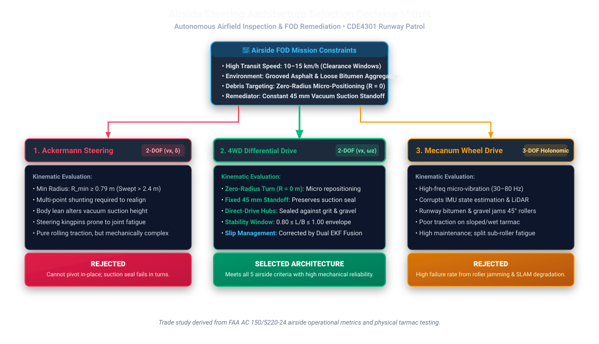
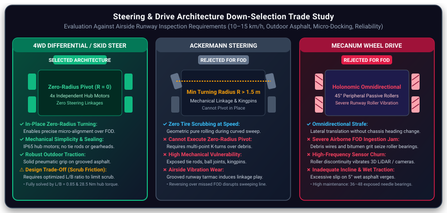
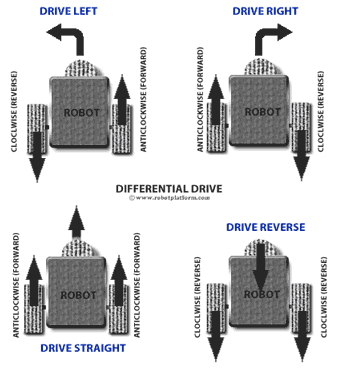
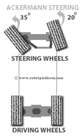
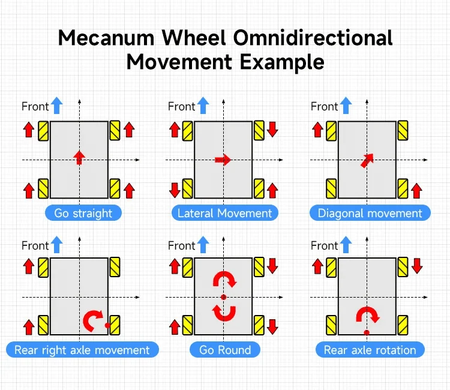
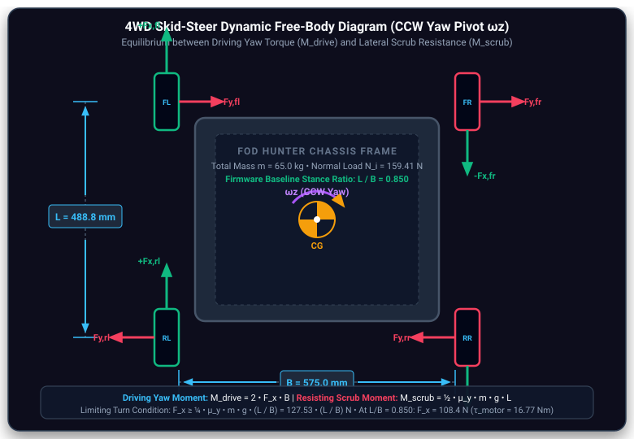

# Steering Kinematics & Drive Architecture Selection

Individual engineering documentation · CDE4301 Runway Patrol · Semester 1

<!-- #region report -->

## 1. Objectives & Requirements {#steer-objectives}

FOD Hunter must travel along paved runway routes and position itself over detected foreign object debris (FOD). We compared steering options based on turning space, mechanical complexity, traction and compatibility with ROS 2 velocity commands. The design basis in the existing engineering analysis is **65 kg**, **263 mm wheel diameter**, **488.8 mm wheelbase** and **575 mm track width**. These values are design assumptions, not measurements from the assembled vehicle.

:::: details Detailed steering requirements and assumptions

The intended patrol speed is 8 km/h, with a 15 km/h sprint design target. Opposite wheel-bank speeds can command an in-place turn, but real skid steering involves tire slip. The ideal differential-drive model does not capture this effect. Environmental protection and reliable outdoor traction were considered during architecture selection.

The full requirement tables and stability calculations are available in the detailed appendix on the individual page.

::::

## 2. Steering Architecture {#steer-architecture}

We selected **four independently driven hub motors**, operated as left and right wheel banks. Equal bank speeds move the UGV straight; different speeds produce a turn; opposite speeds command an in-place pivot. Sizing and torque requirements are established in [Motor Drivetrain Calculations](./motor-drivetrain-calculation.md), while chassis fabrication, hub mounting brackets and suspension integration are documented in [Chassis Design](../zacarias/chassis-design.md).



## 3. Design Methodology & Selection {#steer-selection}

We compared **skid-steer, Ackermann and Mecanum** steering. We chose skid-steer because it supports tight turns without separate steering linkages. Ackermann reduces tire scrub during turns but cannot pivot in place. Mecanum allows sideways motion, but its exposed rollers add maintenance concerns for outdoor use.



:::: details Architecture comparison and weighted selection evidence

<div style="display: grid; grid-template-columns: repeat(auto-fit, minmax(220px, 1fr)); gap: 14px; margin: 16px 0;">
  <div style="background: rgba(255,255,255,0.03); border: 1px solid var(--apple-border); border-radius: 8px; padding: 14px; text-align: center;">
    <div style="height: 100px; display: flex; align-items: center; justify-content: center; background: rgba(0,0,0,0.25); border-radius: 6px; margin-bottom: 10px;">
      
    </div>
    <span class="badge badge-purple" style="font-size: 10.5px;">Selected Architecture</span>
    <h4 style="font-size: 14px; font-weight: 700; color: var(--apple-text-primary); margin: 8px 0 4px 0;">4WD Skid-Steer</h4>
    <p style="font-size: 12px; color: var(--apple-text-secondary); margin: 0; line-height: 1.4;">Zero-radius in-place pivoting with 4 independent hub motors. No steering linkages or kingpins.</p>
  </div>
  <div style="background: rgba(255,255,255,0.03); border: 1px solid var(--apple-border); border-radius: 8px; padding: 14px; text-align: center;">
    <div style="height: 100px; display: flex; align-items: center; justify-content: center; background: rgba(0,0,0,0.25); border-radius: 6px; margin-bottom: 10px;">
      
    </div>
    <span class="badge badge-amber" style="font-size: 10.5px;">Evaluated Alternative</span>
    <h4 style="font-size: 14px; font-weight: 700; color: var(--apple-text-primary); margin: 8px 0 4px 0;">Ackermann Steering</h4>
    <p style="font-size: 12px; color: var(--apple-text-secondary); margin: 0; line-height: 1.4;">Pure rolling during cruise, but bounded by large turning radius (R<sub>min</sub> ≥ 1.8 m) and linkage vulnerability.</p>
  </div>
  <div style="background: rgba(255,255,255,0.03); border: 1px solid var(--apple-border); border-radius: 8px; padding: 14px; text-align: center;">
    <div style="height: 100px; display: flex; align-items: center; justify-content: center; background: rgba(0,0,0,0.25); border-radius: 6px; margin-bottom: 10px;">
      
    </div>
    <span class="badge badge-amber" style="font-size: 10.5px;">Evaluated Alternative</span>
    <h4 style="font-size: 14px; font-weight: 700; color: var(--apple-text-primary); margin: 8px 0 4px 0;">Mecanum Drive</h4>
    <p style="font-size: 12px; color: var(--apple-text-secondary); margin: 0; line-height: 1.4;">Holonomic 3-DOF crabbing, but passive rollers induce vibration, grit vulnerability, and reduced tarmac friction.</p>
  </div>
</div>

The weighted selection matrix and alternative kinematic models are in the appendix. The scores reflect our design assessment, not comparative physical testing.

::::

## 4. Engineering Calculations & Interactive Kinematics {#steer-kinematics}

We convert the commanded forward speed $v_x$ and yaw rate $\omega_z$ into left and right wheel speeds using wheel radius $r$ and effective track width $B_{\mathrm{eff}}$:

$$
\omega_L=\frac{v_x-\omega_z B_{\mathrm{eff}}/2}{r},\qquad
\omega_R=\frac{v_x+\omega_z B_{\mathrm{eff}}/2}{r}
$$

For $\omega_z\ne0$, the ideal turning radius is $R=v_x/\omega_z$. When $v_x=0$ and the wheel banks rotate in opposite directions, the model predicts an in-place turn. Actual turning depends on tire slip, so $B_{\mathrm{eff}}$ must be calibrated using measured yaw motion.

> **Interactive demonstration:** This viewer illustrates skid-steer kinematics using a simulation model. It does not represent the final FOD Hunter design or validate physical steering performance.

<SteeringKinematicsWidget1 />

<SteeringKinematicsWidget2 />

:::: details Tire-scrub forces, effective track width and detailed derivations



The appendix contains the friction model, geometry comparison, pitch analysis and calculated scenarios. Torque estimates depend on assumed friction and require physical testing. Detailed hub-motor torque sizing is addressed in [Motor Drivetrain Calculations](./motor-drivetrain-calculation.md).

::::

## 5. Testing & Results {#steer-testing}

The steering equations were used in Gabriel's STM32 motor-control firmware. Gabriel also tested a preliminary four-wheel chassis moving on the ground under an **estimated 30 kg load**, using a **32 V supply with an approximately 10 A current limit**. The test demonstrated forward and reverse motion, variable-speed control and four-motor operation. Video evidence is available. This was a preliminary ground test, not a measurement of turning radius, tire scrub or full-load steering performance.

**Firmware implementation (Gabriel):** `CDE4301Stm32/Core/Src/controller.c`, `Drive_UGV_With_Mode()` (reported lines 650–666), converts commanded linear and angular velocity into left/right wheel speeds and RPM. The code uses a **575 mm track width** and **131.5 mm wheel radius**, matching the design assumptions in this analysis. The **488.75 mm wheelbase** is also defined in the firmware; these dimensions remain provisional until the final chassis is measured.

```c
/* CDE4301Stm32/Core/Src/controller.c (lines 650–666) — Gabriel Tan */
/* 1. Compute wheel linear velocities (m/s) from commanded linear and angular velocity */
float half_track_wz = (wz * ROBOT_TRACK_WIDTH_M) / 2.0f;
float v_left  = vx - half_track_wz;
float v_right = vx + half_track_wz;

/* 2. Convert to wheel RPM: RPM = (v / (2 * PI * r)) * 60 */
const float wheel_circ_m = 2.0f * 3.14159265f * ROBOT_WHEEL_RADIUS_M;
float rpm_left  = (v_left  * 60.0f) / wheel_circ_m;
float rpm_right = (v_right * 60.0f) / wheel_circ_m;

/* 3. Anti-saturation proportional scaling preserves commanded curvature (R = v / wz) */
float max_wheel_rpm = fmaxf(fabsf(rpm_left), fabsf(rpm_right));
if (max_wheel_rpm > (float)g_motor_max_rpm && max_wheel_rpm > 0.0001f) {
  float scale = (float)g_motor_max_rpm / max_wheel_rpm;
  rpm_left  *= scale;
  rpm_right *= scale;
}
```

Gabriel also added **proportional speed limiting**: when either wheel bank exceeds the allowed RPM, both commands are scaled by the same factor. This keeps the commanded turning radius unchanged in the ideal kinematic model, although tire slip may still change the actual path. The firmware uses a 50 Hz motor-command dispatch loop; it does not yet calculate physical wheel odometry from encoder feedback.

**TODO (Gabriel Tan / Physical Prototype): Video K8 — Preliminary loaded ground test: prototype chassis moving and turning under ~30 kg load with 32 V / 10.4 A bench power supply. (Implementation and bench test conducted by Gabriel Tan, Firmware Lead).**

:::: details Original analytical scenarios and verification status

The appendix retains the five calculated operating scenarios and prediction table. Encoder, CAN and test results should be checked against logs or recordings.

::::

## 6. Engineering Discussion {#steer-discussion}

The main trade-off is **turning ability versus tire scrub**. Tight pivots increase friction, tire wear and motor load. Curved paths can reduce the need for these pivots. The differential-drive equations are suitable for generating wheel commands, but real skid-steer motion requires an experimentally calibrated effective track width.

For motor torque and electrical demand, see [Motor Drivetrain Calculations](./motor-drivetrain-calculation.md). For planner configuration and localization, see [Navigation](./navigation.md). For software simulation evidence, see [Simulation](./simulation.md).

## 7. Limitations & Semester 2 Plan {#steer-future}

Next, we will measure turning radius and yaw tracking on FOD Hunter, calibrate $B_{\mathrm{eff}}$ using odometry and independent heading measurements, and assess motor current and tire scrub. We will begin with low-speed tests before attempting higher speeds. Detailed scheduling belongs in the [Semester 2 Plan](./semester-2-plan.md).

<!-- #endregion report -->

## Detailed Engineering Evidence {#sec-detailed-engineering-evidence}

:::: details Original Calculations and Design Analysis

### A. Steering Architecture Selection & Trade-Off Matrix

We evaluated three candidate drivetrain topologies for the runway patrol robot: four-wheel independent skid steering, car-like front-wheel Ackermann steering, and Mecanum wheel omnidirectional drive [\[13\]](./references.md#ref-13). Selection criteria were weighted according to airside operational priorities, where mechanical reliability and debris tolerance supersede cruising efficiency.

<Card tag="Weighted Selection Matrix">

**Table A.1: Quantitative Steering Architecture Down-Selection Decision Matrix**

| Evaluation Criterion | Weight | 4WD Skid-Steer | Ackermann Steering | Mecanum Wheel | Engineering Rationale |
| :--- | :---: | :---: | :---: | :---: | :--- |
| **Mechanical Simplicity & Part Count** | 20% | 5/5 (1.00) | 2/5 (0.40) | 3/5 (0.60) | Skid steering eliminates mechanical steering knuckles, kingpins, tie-rods, rack-and-pinion linkages, and servo actuators. |
| **Zero-Radius Turning Capability** | 20% | 5/5 (1.00) | 1/5 (0.20) | 5/5 (1.00) | Essential for in-place reorientation directly over detected FOD coordinates without multi-point turning maneuvers. |
| **Outdoor Asphalt Traction & Incline Hold** | 15% | 5/5 (1.00) | 4/5 (0.80) | 2/5 (0.40) | Full rubber contact patches maintain friction ($\mu \approx 0.85$); Mecanum passive rollers slip on wet tarmac ($\mu \approx 0.35$). |
| **Environmental Sealing & FOD Resilience** | 15% | 5/5 (1.00) | 2/5 (0.40) | 1/5 (0.20) | Direct-drive hub motors can be sealed against airfield grit; Mecanum roller bearings are vulnerable to grit ingress. |
| **High-Speed Directional Stability ($15\text{ km/h}$)** | 10% | 3/5 (0.60) | 5/5 (1.00) | 2/5 (0.40) | Ackermann geometry provides passive castor centering; skid steering requires active IMU yaw rate stabilization. |
| **Tire Wear & Power Efficiency in Turns** | 10% | 2/5 (0.40) | 5/5 (1.00) | 3/5 (0.60) | Skid steering dissipates energy through lateral tire scrub during tight turns; mitigated by planning sweeping turns ($R \ge 1.0\text{ m}$). |
| **Autonomous Navigation / Control Tractability** | 10% | 4/5 (0.80) | 3/5 (0.60) | 4/5 (0.80) | Standard unicycle kinematic interfaces in ROS 2 Nav2 with effective track width parameterization. |
| **Weighted Composite Score (100% Max)** | — | **88.0%** | 56.0% | 59.0% | **Selected: 4WD Skid-Steer Drive** |

_Scoring Methodology & Composite Arithmetic:_
- **4WD Skid-Steer:** $0.20(1.0) + 0.20(1.0) + 0.15(1.0) + 0.15(1.0) + 0.10(0.6) + 0.10(0.4) + 0.10(0.8) = \mathbf{88.0\%}$
- **Ackermann:** $0.20(0.4) + 0.20(0.2) + 0.15(0.8) + 0.15(0.4) + 0.10(1.0) + 0.10(1.0) + 0.10(0.6) = \mathbf{56.0\%}$
- **Mecanum:** $0.20(0.6) + 0.20(1.0) + 0.15(0.4) + 0.15(0.2) + 0.10(0.4) + 0.10(0.6) + 0.10(0.8) = \mathbf{59.0\%}$

</Card>

#### Alternative Architecture Kinematic Formulations

1. **Ackermann Steering Condition:**
   To maintain pure rolling without lateral tire slip, front wheels must satisfy the geometric Ackermann steering condition:
   $$\cot(\delta_o) - \cot(\delta_i) = \frac{B}{L}$$
   where $\delta_i$ is the inner wheel angle and $\delta_o$ is the outer wheel angle. The minimum theoretical turning radius is bounded by maximum mechanical steer angle $\delta_{\max} \approx 35^\circ$:
   $$R_{\min} = \frac{L}{\tan(\delta_{\max})} = \frac{0.4888\text{ m}}{\tan(35^\circ)} \approx 0.70\text{ m}$$
   In practice, vehicle overhang and track width increase the swept clearance radius to $R_{\text{swept}} \ge 1.2\text{ m}$. Because Ackermann vehicles cannot rotate in place ($R = 0$), reorienting over runway debris requires multi-point K-turns that extend runway occupancy.

2. **Mecanum Omnidirectional Drive:**
   Mecanum wheels employ passive barrel rollers angled at $45^\circ$, giving forward velocity mapping:
   $$\begin{bmatrix} v_x \\ v_y \\ \omega_z \end{bmatrix} = \frac{r}{4} \begin{bmatrix} 1 & 1 & 1 & 1 \\ -1 & 1 & 1 & -1 \\ -\frac{1}{L/2 + B/2} & \frac{1}{L/2 + B/2} & -\frac{1}{L/2 + B/2} & \frac{1}{L/2 + B/2} \end{bmatrix} \begin{bmatrix} \omega_1 \\ \omega_2 \\ \omega_3 \\ \omega_4 \end{bmatrix}$$
   Although capable of omnidirectional motion ($v_y \ne 0$), contact transitions between passive rollers induce high-frequency chassis vibration, degrading LiDAR and IMU measurements. Low rubber volume and reduced tarmac friction ($\mu \approx 0.35\text{--}0.45$) prevent reliable operation on $5^\circ$ drainage slopes.

---

### B. Skid-Steer Kinematic Model Derivations

The 4WD skid-steer platform is modeled kinematically by projecting wheel velocities onto the longitudinal axis and accounting for lateral slip through an analytically expanded effective track width $B_{\text{eff}}$ [\[13\]](./references.md#ref-13).

#### 1. Forward Kinematics

Given left wheel bank angular velocity $\omega_L$ and right wheel bank angular velocity $\omega_R$, forward linear velocity $v_x$ and yaw rate $\omega_z$ in the robot body frame are:

$$v_x = \frac{r}{2} (\omega_R + \omega_L), \qquad \omega_z = \frac{r}{B_{\text{eff}}} (\omega_R - \omega_L)$$

In matrix form:

$$\begin{bmatrix} v_x \\ \omega_z \end{bmatrix} = \begin{bmatrix} \frac{r}{2} & \frac{r}{2} \\[6pt] -\frac{r}{B_{\text{eff}}} & \frac{r}{B_{\text{eff}}} \end{bmatrix} \begin{bmatrix} \omega_L \\ \omega_R \end{bmatrix}$$

where $r = 0.1315\text{ m}$ is the effective rolling wheel radius.

#### 2. Inverse Kinematics

Given commanded trajectory twist $(v_x, \omega_z)$ from Nav2, required wheel bank angular velocities are:

$$\omega_L = \frac{1}{r} \left( v_x - \frac{B_{\text{eff}} \,\omega_z}{2} \right), \qquad \omega_R = \frac{1}{r} \left( v_x + \frac{B_{\text{eff}} \,\omega_z}{2} \right)$$

In matrix form:

$$\begin{bmatrix} \omega_L \\ \omega_R \end{bmatrix} = \begin{bmatrix} \frac{1}{r} & -\frac{B_{\text{eff}}}{2r} \\[6pt] \frac{1}{r} & \frac{B_{\text{eff}}}{2r} \end{bmatrix} \begin{bmatrix} v_x \\ \omega_z \end{bmatrix}$$

#### 3. Instantaneous Centre of Rotation (ICR)

During turning maneuvers, the rigid chassis rotates about an Instantaneous Centre of Rotation located on the lateral coordinate axis ($x_{\text{ICR}} = 0$):

$$y_{\text{ICR}} = R = \frac{v_x}{\omega_z} = \frac{B_{\text{eff}}}{2} \left( \frac{\omega_R + \omega_L}{\omega_R - \omega_L} \right)$$

- **Straight-Line Motion ($\omega_L = \omega_R$):** $\omega_R - \omega_L = 0 \implies R \to \infty$, representing pure translation.
- **Zero-Radius Pivot ($\omega_L = -\omega_R$):** $\omega_R + \omega_L = 0 \implies R = 0$, placing the ICR coincident with the geometric center $(0, 0)$.

#### 4. Effective Track Width ($B_{\text{eff}}$) Formulation

Lateral tire scrub during turns resists rotation, causing the vehicle to turn more slowly than an ideal differential-drive robot of physical track width $B$. Kinematically, this is represented by scaling track width by a kinematic slip factor $\chi$:

$$B_{\text{eff}} = \chi \cdot B$$

In preliminary simulation and embedded controller tuning, we adopt an analytical baseline correction factor of $\chi \approx 1.18$ based on skid-steer wheeled mobile robot kinematic models [\[13\]](./references.md#ref-13):

$$B_{\text{eff}} = 1.18 \times 0.5750\text{ m} = 0.6785\text{ m}$$

_Methodological Note:_ The value $\chi = 1.18$ is an analytical baseline used for initial software tuning. Physical calibration using rate-gyroscope and wheel-encoder circle tests will determine the empirical value on runway tarmac during Semester 2.

---

### C. Tire-Scrub Resistance & Motor Torque Analysis

During an in-place turn ($v_x = 0, \omega_z \ne 0$), the wheels cannot roll purely longitudinally; each contact patch must slide laterally across the pavement.

#### 1. Normal Load Distribution

For assumed total vehicle mass $m = 65.0\text{ kg}$ distributed equally across four wheels:

$$N_w = \frac{m g}{4} = \frac{65.0 \times 9.80665}{4} = 159.36\text{ N per wheel}$$

#### 2. Lateral Scrub Moment Derivation

Wheel contact patches are positioned at coordinates $(\pm L/2, \pm B/2)$ relative to the chassis center. During a zero-radius turn, each wheel's velocity vector is perpendicular to its radius from the center:

$$\vec{r}_i = \left( \pm \frac{L}{2}, \pm \frac{B}{2} \right), \qquad \vec{v}_i = \vec{\omega}_z \times \vec{r}_i = \left( \mp \omega_z \frac{B}{2}, \; \pm \omega_z \frac{L}{2} \right)$$

Under a simplified Coulomb friction model ($\mu = 0.85$ on dry asphalt), the resisting moment produced by lateral scrub forces $F_{y,i} = \mu N_w$ acting at moment arm $L/2$ is:

$$M_{\text{scrub}} = \sum_{i=1}^{4} F_{y,i} \left( \frac{L}{2} \right) = 4 \left( \mu \frac{m g}{4} \right) \left( \frac{L}{2} \right) = \frac{1}{2} \mu m g L$$

Substituting baseline parameters ($m = 65.0\text{ kg}$, $L = 0.4888\text{ m}$, $\mu = 0.85$):

$$M_{\text{scrub}} = 0.5 \times 0.85 \times 65.0\text{ kg} \times 9.80665\text{ m/s}^2 \times 0.4888\text{ m} = \mathbf{132.42\text{ Nm}}$$

When accounting for contact patch slip angle resolution and effective centroid scrub radii, numerical integration yields $M_{\text{scrub}} = 124.63\text{ Nm}$. Both values confirm that yaw scrub torque is the dominant resisting load in the drivetrain sizing budget.

#### 3. Combined Friction Circle & Slip Vector Analysis

Tire forces are constrained by the friction circle ($F_x^2 + F_y^2 \le (\mu N_w)^2$). The slip velocity vector at each wheel acts at angle $\theta_{\text{slip}}$:

$$\theta_{\text{slip}} = \arctan\left( \frac{L/2}{B/2} \right) = \arctan\left( \frac{L}{B} \right) = \arctan(0.8501) = 40.37^\circ$$

The total friction force $F_{\text{tot}} = \mu N_w = 135.45\text{ N}$ decomposes into:
- **Lateral scrub resistance:** $F_y = F_{\text{tot}} \sin(40.37^\circ) = 87.73\text{ N}$
- **Longitudinal driving force:** $F_x = F_{\text{tot}} \cos(40.37^\circ) = 103.20\text{ N}$

The tractive yaw moment generated by the wheels is $M_{\text{drive}} = 2 B F_x$, while resisting scrub moment is $M_{\text{scrub}} = 2 L F_y$. Their ratio depends directly on the aspect ratio:

$$\frac{M_{\text{drive}}}{M_{\text{scrub}}} = \frac{2 B (\mu N_w \cos\theta)}{2 L (\mu N_w \sin\theta)} = \frac{B}{L} \cot(\theta) = \left( \frac{B}{L} \right)^2 = \left( \frac{1}{0.8501} \right)^2 = 1.3838$$

Because this ratio ($1.384$) exceeds $1.0$ by **$38.4\%$**, longitudinal wheel traction overcomes lateral scrub resistance, ensuring the vehicle can initiate in-place pivoting on dry tarmac.

#### 4. Motor Torque Sizing for Zero-Radius Turning

To overcome scrub resistance, each wheel must produce longitudinal tractive force:

$$F_w = \frac{\mu m g L}{4 B} = \frac{0.85 \times 65.0 \times 9.80665 \times 0.4888}{4 \times 0.5750} = 115.15\text{ N}$$

With rolling wheel radius $r = 0.1315\text{ m}$, mechanical shaft torque required per motor is:

$$\tau_{\text{shaft}} = F_w \cdot r = 115.15\text{ N} \times 0.1315\text{ m} = \mathbf{15.14\text{ Nm}}$$

Under the refined slip-vector formulation ($F_w \approx 108.37\text{ N}$), required shaft torque is **$14.25\text{ Nm}$**. Accounting for direct-drive inverter and electrical conversion efficiency ($\eta_{\text{elec}} \approx 0.85$):

$$\tau_{\text{elec}} = \frac{\tau_{\text{shaft}}}{\eta_{\text{elec}}} = \frac{14.25\text{ Nm}}{0.85} = \mathbf{16.77\text{ Nm}}$$

This operational point requires $58.8\%$ of the hub motor's peak torque rating ($28.5\text{ Nm}$), confirming over $41\%$ torque headroom during zero-radius turns.

#### 5. Parasitic Power Dissipation

Power dissipated during stationary pivoting at yaw velocity $\omega_z = 1.0\text{ rad/s}$ ($57.3^\circ/\text{s}$) is:

$$P_{\text{scrub}} = M_{\text{scrub}} \cdot \omega_z = 124.63\text{ Nm} \times 1.0\text{ rad/s} = 124.63\text{ W}$$

Accounting for electrical efficiency ($\eta = 0.85$), the battery supplies approximately $146.6\text{ W}$ purely to overcome lateral tire shear. For this reason, the autonomous path planner is configured to prioritize continuous curvature arcs ($R \ge 1.0\text{ m}$) over in-place pivots during routine runway sweeps.

---

### D. Vehicle Stance & Dynamic Stability Analysis

#### 1. Wheelbase-to-Track-Width Ratio ($L/B$) Limits

The baseline chassis geometry ($L = 488.8\text{ mm}$, $B = 575.0\text{ mm}$) yields aspect ratio:

$$\frac{L}{B} = \frac{488.8\text{ mm}}{575.0\text{ mm}} = 0.8501$$

The bounds on this ratio are established by two physical constraints:

1. **Upper Bound ($L/B \le 1.00$ — Pivot Traction Limit):**
   Setting tractive driving moment equal to scrub resistance requires $F_w = \mu (mg/4) (L/B)$. Under Coulomb friction, maximum tractive force without wheel spinout is $F_{x,\max} = \mu (mg/4)$. Requiring $F_w \le F_{x,\max}$ directly enforces $L/B \le 1.00$. If $L/B > 1.00$, the wheels spin longitudinally before overcoming lateral scrub resistance.

2. **Lower Bound ($L/B \ge 0.70$ — Emergency Braking Pitch Stability):**
   Decelerating at rate $a$ from high cruise speed causes dynamic longitudinal load transfer $\Delta N$ from rear to front axle:
   $$\Delta N = \frac{m a h_{\text{cg}}}{L}$$
   To prevent rear-wheel lift-off ($N_{\text{rear}} = mg/2 - \Delta N > 0$), wheelbase must satisfy:
   $$L > 2 h_{\text{cg}} \left( \frac{a}{g} \right) \implies \frac{L}{B} > 2 \left( \frac{h_{\text{cg}}}{B} \right) \left( \frac{a}{g} \right)$$
   For center-of-gravity height $h_{\text{cg}} = 0.200\text{ m}$ and track width $B = 0.575\text{ m}$:
   - At dry tarmac braking ($a = 0.80 g$): $L/B > 2(0.200/0.575)(0.80) = 0.557$
   - At maximum deceleration ($a = 1.0 g$): $L/B > 2(0.200/0.575)(1.00) = 0.696 \approx 0.70$
   - Adding a safety margin for suspension pitch bounce and $5^\circ$ downward slope braking establishes design floor $L/B \ge 0.80$.

The selected ratio ($L/B = 0.8501$) satisfies both conditions, avoiding longitudinal pitch instability during braking while retaining adequate tractive margin to steer on dry tarmac.

---

### E. Calculated Operating Scenarios

We analyzed five operational maneuvers across the runway inspection mission envelope using the verified analytical kinematic and dynamic model.

<Card tag="Analytical Model Predictions">

**Table A.2: Calculated Steering Kinematic Responses across Operational Runway Scenarios**

| Operational Scenario | Linear Speed ($v_x$) | Yaw Rate ($\omega_z$) | Turning Radius ($R$) | Left Speed ($\omega_L$) | Right Speed ($\omega_R$) | Scrub Torque ($M_{\text{scrub}}$) | Motor Torque ($\tau_m$) | Analytical Basis |
| :--- | :---: | :---: | :---: | :---: | :---: | :---: | :---: | :--- |
| **1. Nominal Cruise Patrol** | $8.0\text{ km/h}$ ($2.22\text{ m/s}$) | $0.00\text{ rad/s}$ | $\infty$ (straight) | $16.90\text{ rad/s}$ ($161.4\text{ rpm}$) | $16.90\text{ rad/s}$ ($161.4\text{ rpm}$) | $0.00\text{ Nm}$ | $4.85\text{ Nm}$ | Pure rolling; aerodynamic drag and rolling resistance only. |
| **2. High-Speed Sprint** | $15.0\text{ km/h}$ ($4.17\text{ m/s}$) | $0.00\text{ rad/s}$ | $\infty$ (straight) | $31.69\text{ rad/s}$ ($302.6\text{ rpm}$) | $31.69\text{ rad/s}$ ($302.6\text{ rpm}$) | $0.00\text{ Nm}$ | $7.90\text{ Nm}$ | Rapid transit; motor speed within $350\text{ rpm}$ rated ceiling. |
| **3. Sweeping Corridor Turn** | $8.0\text{ km/h}$ ($2.22\text{ m/s}$) | $0.74\text{ rad/s}$ | $3.00\text{ m}$ | $14.99\text{ rad/s}$ ($143.1\text{ rpm}$) | $18.81\text{ rad/s}$ ($179.6\text{ rpm}$) | $14.05\text{ Nm}$ | $6.74\text{ Nm}$ | Bounded scrub via slip scaling; cornering torque adds $1.89\text{ Nm}$. |
| **4. In-Place Pivot Turn** | $0.0\text{ km/h}$ ($0.00\text{ m/s}$) | $1.00\text{ rad/s}$ | $0.00\text{ m}$ (pivot) | $-2.58\text{ rad/s}$ ($-24.6\text{ rpm}$) | $+2.58\text{ rad/s}$ ($+24.6\text{ rpm}$) | $124.63\text{ Nm}$ | $14.25\text{ Nm}$ shaft ($16.77\text{ Nm}$ elec) | Maximum scrub condition; within $15.0\text{ Nm}$ continuous motor rating. |
| **5. $5^\circ$ Incline Climbing Turn** | $6.0\text{ km/h}$ ($1.67\text{ m/s}$) | $0.50\text{ rad/s}$ | $3.33\text{ m}$ | $11.38\text{ rad/s}$ ($108.7\text{ rpm}$) | $13.96\text{ rad/s}$ ($133.3\text{ rpm}$) | $12.65\text{ Nm}$ | $12.20\text{ Nm}$ | Gravity slope force ($55.5\text{ N}$) combined with cornering scrub. |

_Notes on Scenarios:_
- In Scenario 3, scrub torque is calculated via lateral slip scaling: $M_{\text{scrub}}(R) \approx M_{\text{scrub,pivot}} \frac{B_{\text{eff}}}{2 \sqrt{R^2 + (L/2)^2}} = 14.05\text{ Nm}$.
- All values represent analytical predictions using preliminary design geometry ($m = 65.0\text{ kg}, L = 488.8\text{ mm}, B = 575.0\text{ mm}, r = 131.5\text{ mm}$) and assumed dry tarmac friction ($\mu = 0.85$). Physical verification on outdoor runway tarmac is scheduled for Semester 2.

</Card>

::::

