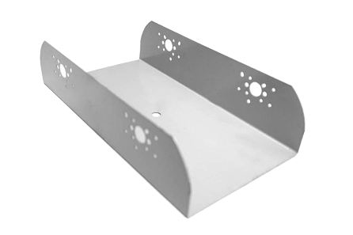
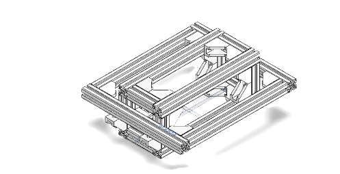
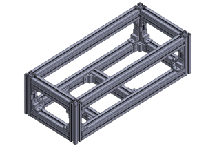
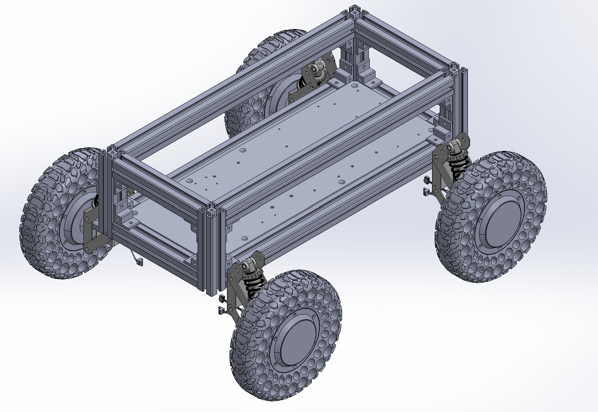
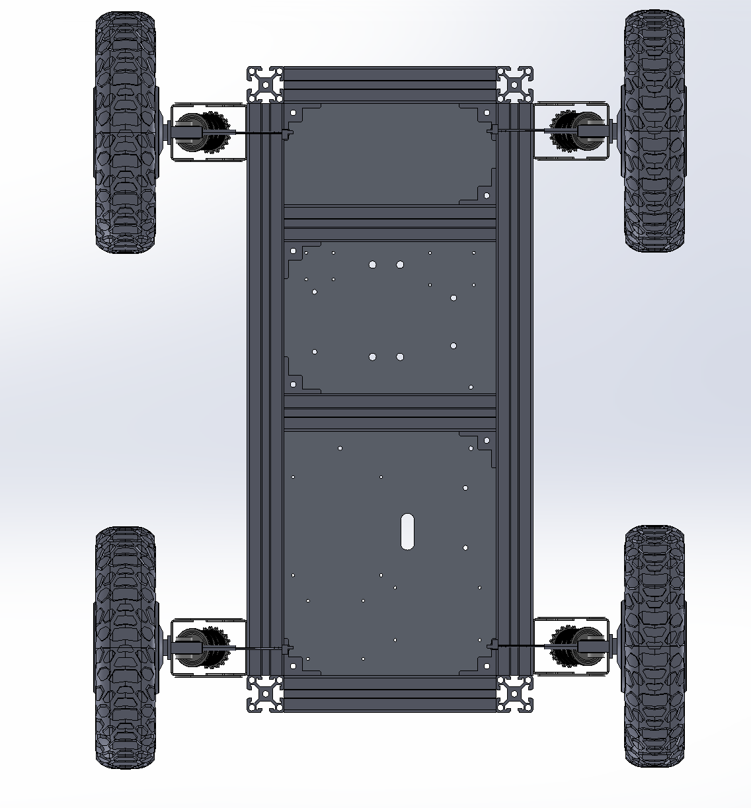
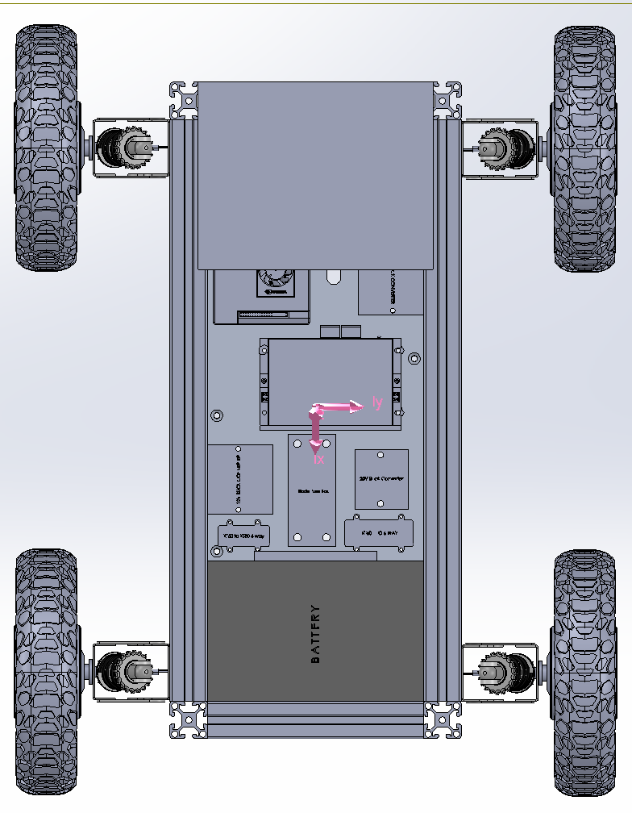
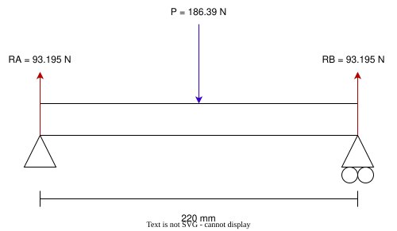
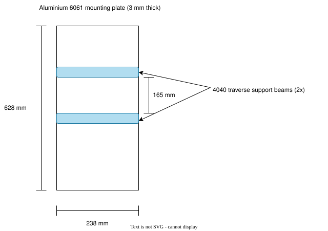
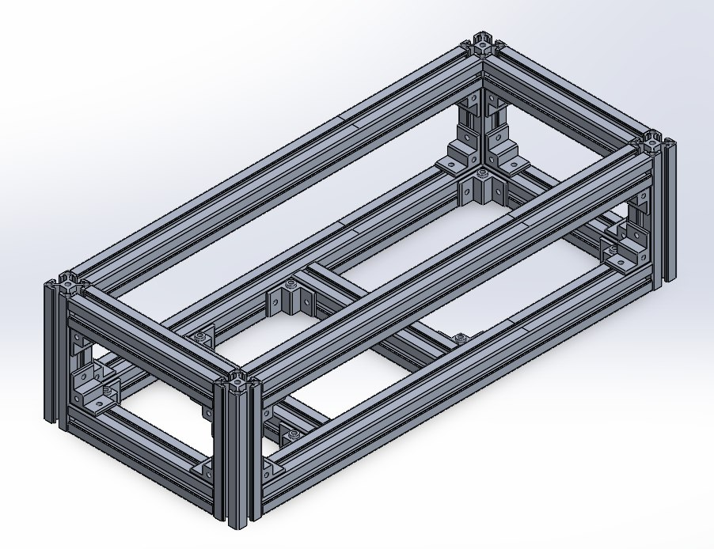
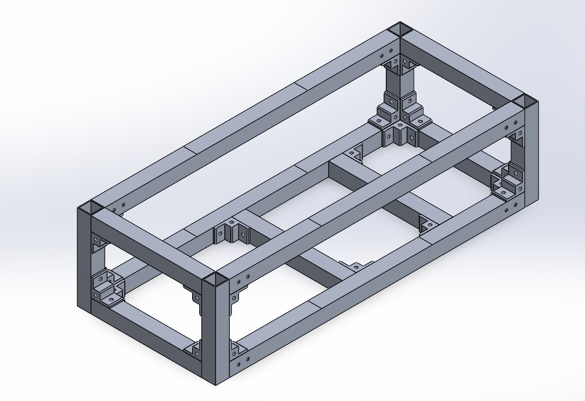

# Chassis Design

Structural chassis architecture, physical CAD layout, mounting points, and mechanical assembly specifications.

<!-- #region report -->

## 1. Objective & Requirements {#sec-4-1-1}

The chassis provides structural support for the UGV's battery, electronics, drivetrain, suspension and FOD collection system. During Semester 1, the main objective was to fabricate a functional chassis early to allow other subteams to proceed with component integration. The design therefore prioritized structural adequacy, modularity and ease of fabrication.

**Table 1. Chassis design requirements**

| Parameter | Requirement |
| :--- | :--- |
| Maximum vehicle mass | 65 kg |
| Minimum factor of safety (FOS) | 2.0 |
| Drive configuration | Four-wheel skid-steer |
| Target ground clearance | 180 mm |
| Wheelbase-to-track-width ratio ($L/B$) | 0.8–1.0 |
| Initial chassis footprint | 700 × 300 mm |
| Additional considerations | Component mounting, fabrication, accessibility and weight |

Following the convention in [Steering Kinematics](../hilbert/steering-kinematics.md), $L$ denotes wheelbase and $B$ denotes track width. The assumed wheelbase of 488.8 mm and track width of 575 mm give $L/B = 488.8/575 \approx 0.85$. These dimensions are design assumptions, not measurements of the physical chassis.

A conservative initial design was adopted, with detailed structural optimization carried out after the prototype was fabricated.

## 2. System Architecture {#chassis-architecture}

### 2.1 Chassis Concept Evaluation {#chassis-concepts}

Three chassis concepts were considered before prototype fabrication (Figure 1).

**Table 2. Comparison of initial chassis concepts**

| Concept | Advantages | Limitations |
| :--- | :--- | :--- |
| Sheet-metal monocoque | Compact, lightweight potential, fewer separate members | Requires custom bending and reinforcement; difficult to modify |
| Expanded extrusion frame | Additional mounting space for sensors and equipment | Unnecessary material, increased weight and cost |
| Compact rectangular extrusion frame | Modular, simple assembly, adjustable mounting | Additional brackets and fasteners; joint stiffness requires consideration |

The **compact rectangular extrusion frame** was selected because it provided sufficient component space while allowing mounting positions to be adjusted. This was important as several electrical and mechanical components had not yet been finalized.

  
  
  

*Figure 1. Preliminary chassis concepts: (a) sheet-metal monocoque, (b) expanded aluminium extrusion frame and (c) compact rectangular extrusion frame (left to right; top to bottom when wrapped).*

### 2.2 Selected Prototype Architecture {#chassis-prototype-architecture}

The initial chassis used **40 × 40 mm T-slot aluminium extrusions (PTP-4040-8)**, assembled into a rectangular frame using brackets and fasteners. The main members consisted of four 620 mm longitudinal beams, six 220 mm transverse beams and four 185 mm vertical supports.

A 3 mm aluminium 6061 mounting plate was installed to accommodate the battery and electronics. Two additional 220 mm transverse beams supported the plate from below, with a measured clear spacing of 165 mm between their nearest faces. The plate was also secured to the frame through mounting brackets.

This arrangement provided multiple load paths from the plate to the surrounding structure and allowed components to be repositioned during integration (Figure 2).

  
  

*Figure 2. Isometric and underside CAD views showing the 4040 chassis, mounting plate and additional support beams.*

### 2.3 Component Placement and Centre of Mass {#chassis-centre-of-mass}

The battery was positioned toward the front of the chassis, while the vacuum module was positioned toward the rear. This arrangement was intended to distribute the major component masses more evenly along the vehicle.

A preliminary centre-of-mass check was performed in SolidWorks using the assembled chassis and major components. The battery was assigned its actual mass of 6.8 kg, while a simplified vacuum placeholder with an estimated mass of 7 kg was included.

**Table 3. SolidWorks centre-of-mass results**

| Parameter | Result |
| :--- | ---: |
| Estimated assembly mass | 29.648 kg |
| CG X-coordinate | 0.15 mm |
| CG Y-coordinate | 270.50 mm |
| CG Z-coordinate | −4.58 mm |

The coordinates are referenced to the default assembly coordinate system. The top-view model showed the CG located approximately within the central region of the vehicle, supporting the selected front-to-rear component arrangement (Figure 3).

*Figure 3. SolidWorks top-view assembly showing the calculated centre of mass.*

## 3. Design Methodology & Selection {#chassis-methodology}

### 3.1 Preliminary Structural Calculations {#chassis-calculations}

Before fabricating the prototype, simplified calculations were performed to assess the feasibility of the selected 4040 members supporting the electronics mounting plate. The preliminary loading assumptions included a 12 kg battery allowance and 7 kg for electrical components, giving a total load of:

$$
W = mg = (12 + 7)(9.81) = 186.39\text{ N}
$$

These values were conservative design allowances rather than the actual component masses used in the centre-of-mass calculation.

**4040 support-beam bending.** For a simplified conservative member check, one of the two additional 220 mm transverse beams was assumed to carry the entire 186.39 N load at its midpoint. The simply supported model gives a nominal bending stress of **2.19 MPa** and a provisional **FOS of 25.2**. This indicates low nominal bending stress under the idealized loading condition. The reference yield strength of 55.15 MPa is not a verified material certificate value for the supplied extrusion.

:::: details Preliminary 4040 support-beam bending calculation

The beam was modelled as simply supported over $L = 220\text{ mm}$, with a midpoint load $P = 186.39\text{ N}$, as shown in Figure 4(a). The manufacturer's section modulus for the PTP-4040-8 profile is $Z = 4690\text{ mm}^3$ ([1](#chassis-ref-1)).

$$
M_{\max} = \frac{PL}{4}
= \frac{186.39(220)}{4}
= 10{,}251.45\text{ N}\cdot\text{mm}
$$

$$
\sigma_{\max} = \frac{M_{\max}}{Z}
= \frac{10{,}251.45}{4690}
= \boxed{2.19\text{ MPa}}
$$

Using the provisional reference yield strength of 55.15 MPa adopted in the initial simulation:

$$
\mathrm{FOS} = \frac{55.15}{2.19} = \boxed{25.2}
$$

::::

**Electronics mounting-plate support arrangement.** The 3 mm aluminium 6061 mounting plate was supported by two additional 220 mm transverse 4040 beams and mounting brackets connected to the surrounding chassis. The clear spacing between the two transverse beams was measured as **165 mm**, as shown in Figure 4(b).

These additional supports were included to reduce the unsupported regions of the plate and distribute component loads into the chassis. Due to the multiple support locations and non-uniform component loading, a simplified single-span bending calculation was not considered representative of the complete plate. The final plate and mounting connections require assessment under their actual loading and support conditions.

  <figure style="flex: 1 1 400px; min-width: 0; margin: 0;">
    
    <figcaption>(a) 220 mm transverse 4040 support-beam free-body diagram.</figcaption>
  </figure>
  <figure style="flex: 1 1 400px; min-width: 0; margin: 0;">
    
    <figcaption>(b) Mounting-plate support arrangement with 165 mm clear spacing.</figcaption>
  </figure>

*Figure 4. (a) Simplified free-body diagram of the 220 mm transverse 4040 support beam; (b) electronics mounting-plate support arrangement showing the two transverse beams and their 165 mm clear spacing.*

### 3.2 Decision to Fabricate the 4040 Prototype {#chassis-fabrication-decision}

The 4040 extrusion frame was retained for the initial prototype because it offered adequate preliminary strength and adjustable mounting interfaces. Completing fabrication early allowed the electrical and mechanical teams to install their components while detailed structural evaluation continued.

The 4040 configuration was initially considered a potential final chassis. Its suitability and opportunities for weight reduction were subsequently investigated using SolidWorks FEA.

## 4. Implementation & Prototype {#chassis-implementation}

The 4040 aluminium extrusion chassis was fabricated using profiles. The frame was assembled using mechanical brackets, T-slot nuts and fasteners. The electronics mounting plate was installed using brackets with central mounting holes and the two additional transverse support beams.

The assembled prototype has since been fitted with the wheel and suspension assemblies and major electrical components, allowing subsystem integration to proceed. The modular construction proved useful during this stage, as mounting arrangements could be adjusted without modifying the main frame.

<!-- TODO Figure 5: Add the physical prototype photograph to ./assets/images/ when available. Do not substitute a CAD image. Caption: Fabricated 4040 prototype showing the assembled structure and installed components. -->

*Figure 5. Fabricated 4040 prototype showing the assembled structure and installed components (photograph pending).*

## 5. Testing & Results {#chassis-results}

### 5.1 Evaluation of the 4040 Prototype {#chassis-4040-evaluation}

Following fabrication, a static FEA study was conducted to assess whether the 4040 extrusion chassis was suitable as the final design. The analysis indicated a substantial structural reserve in the assessed chassis members, suggesting that the initial configuration could be optimized to reduce weight. This motivated the investigation of a lighter alternative using **30 × 30 mm hollow aluminium square tubes with a nominal wall thickness of 2 mm**.

### 5.2 Selection of the 3030 Square-Tube Chassis {#chassis-3030-selection}

The proposed 3030 configuration was evaluated under static, skid-steering and uneven-ground loading. The preliminary member-level results indicated acceptable factors of safety under the investigated conditions, although localized stress concentrations require further verification.

The estimated structural mass decreased from **11.00 kg** for the 4040 chassis to **5.15 kg** for the 3030 chassis:

$$
\text{Mass reduction} = \frac{11.0043 - 5.15}{11.0043}\times 100\%
= \boxed{53.2\%}
$$

Based on the estimated mass reduction and preliminary structural evaluation, the **30 × 30 × 2 mm square-tube configuration** was selected as the proposed final chassis (Figure 6). Detailed FEA methodology, loading assumptions, stress distributions and numerical results belong in the separate [FEA Simulation report (Section 4.1.2)](./fea-simulation.md), which is still being completed.

  
  

*Figure 6. Side-by-side CAD comparison of the 4040 extrusion chassis (left) and proposed 3030 square-tube chassis (right; below when wrapped).*

## 6. Engineering Discussion {#chassis-discussion}

The initial 4040 extrusion chassis prioritized rapid fabrication and mounting flexibility, allowing subsystem integration to proceed before the final component arrangement was established.

Subsequent structural evaluation showed that the initial configuration had considerable potential for weight reduction. The proposed 3030 square-tube design reduces the estimated structural mass by 53.2%, while the more permanent construction becomes practical as component positions are finalized.

The main trade-off is reduced mounting flexibility in exchange for lower structural mass. The selected 3030 design therefore provides a suitable baseline for the final chassis, subject to verification of critical structural connections and local stresses.

## 7. Limitations & Semester 2 Plan {#chassis-limitations}

The main remaining tasks are final material selection, verification of mounting stresses and fabrication of the optimized chassis.

The initial FEA used an aluminium 6061 material model with an assigned yield strength of 55.15 MPa. The final square-tube alloy and temper must be confirmed so that the simulations use the actual material properties. This work will be documented in the separate [Material Selection report (Section 4.1.3)](./material-selection.md), which is still being completed.

Localized stress concentrations will be investigated through targeted mesh refinement, convergence checks and improved modelling of mounting holes, contacts and fasteners. Local reinforcement or changes to the 2 mm wall thickness will be considered if the verified stresses exceed the allowable limits. The completed chassis will also be reassessed against the full **65 kg design-load requirement** before fabrication.

Following verification, the final chassis CAD will be updated with the required mounting holes, protective-shell interfaces and component arrangements. The optimized structure will then be fabricated and tested under representative static and operational loads. Physical testing will include deformation measurements and inspection of structural connections, with results compared against the numerical predictions.

Additional Semester 2 mechanical work includes waterproofing and protective-shell development, as well as coordination of chassis interfaces for the proposed charging dock and hot-swappable battery system.

**Reference**

[1] Prestech Industrial Automation, *PTP-4040-8 Aluminium Profile Specifications*. Available: [Prestech PTP-4040-8](https://www.prestech.com.sg/house-products/aluminium-profiles/40series/product/product/33-PTP-4040-8).

<!-- #endregion report -->
